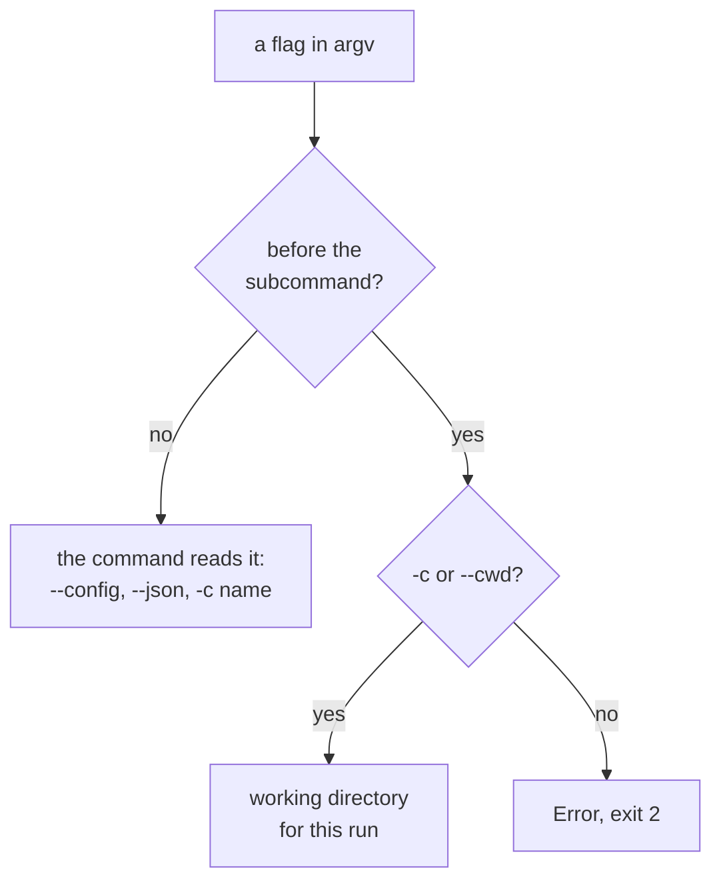

# CLI flag conventions


Put every flag after the subcommand. The one exception is `-c <path>`, which goes before it.

```bash
noorm -c packages/db run build --dry-run
```

Here `-c packages/db` sets the working directory, and `--dry-run` belongs to `run build`. A flag in the wrong position is an error, not a silent no-op:

```
$ noorm --dry-run run build
Error: Unrecognized flag '--dry-run' before the subcommand — noorm can't forward it there. The only root-level flag is -c/--cwd <path>; every other flag goes on the command that uses it. Move '--dry-run' after the subcommand instead, e.g. noorm <command> ... --dry-run.
```

The first non-flag token is the subcommand. It decides who reads each flag:



`--help`, `-h`, `--version`, and `-v` skip this check. `--version` and `-v` work only as the sole argument.


## Which flags go where?


| Flag | Before the subcommand | After the subcommand |
|------|-----------------------|----------------------|
| `-c <path>`, `--cwd <path>`, `--cwd=<path>` | Working directory, like `git -C` | `-c` means `--config` |
| `-c <name>`, `--config <name>` | `-c` is read as `--cwd`; `--config` is an error | Config to use instead of the active one |
| `--json` | Error | Print JSON on stdout |
| `--dry-run` | Error | Preview without executing |
| `--force`, `-f` | Error | Force the operation; the effect varies per command |
| `--yes`, `-y` | Error | Skip confirmations, same as `NOORM_YES=1` |

Each command declares the subset it accepts, and `noorm <command> --help` lists them. It prints `--dryRun` for `--dry-run`; the two spellings are one flag. After the subcommand, a misspelled flag is dropped without an error, so check the spelling there. The full table is in the [CLI reference](/headless#where-do-flags-go).


## What does `-c` / `--cwd` do?


noorm normally walks up from the current directory to the nearest `.noorm/` and runs there. `--cwd` skips the walk and runs in the path you name.

```bash
noorm -c packages/db run build
noorm --cwd /repos/shop change ff
```

| Situation | Result |
|-----------|--------|
| Path is not a directory | `Error: --cwd path is not a directory: <absolute path>`, exit 2 |
| `-c` followed by the subcommand, `noorm -c run build` | `run` is taken as the path, so this fails as above |
| `-c` with no value | Ignored; noorm walks up as usual |
| `-c prod` meant as a config, `noorm -c prod run build` | `prod` is a path, not a config. Use `noorm run build --config prod` |


## Next


- [Discovering command help](/cli/help)
- [CLI reference](/headless): every command and the exit-code table
- [Troubleshooting](/guide/troubleshooting)
