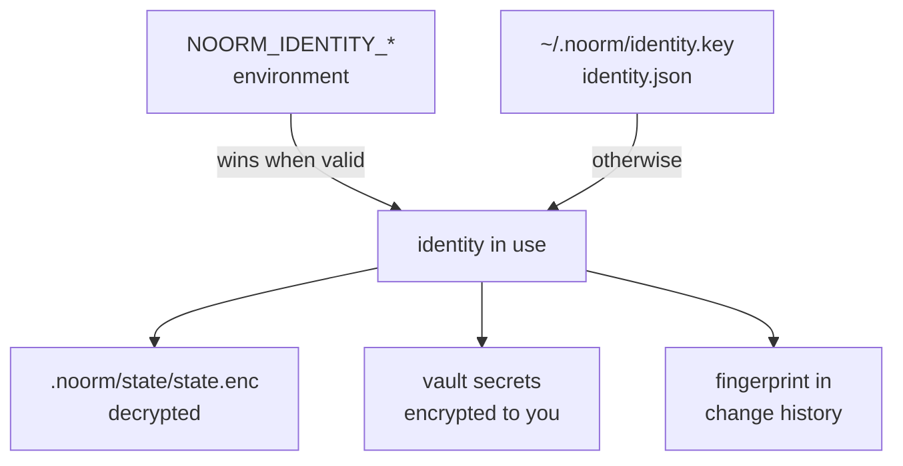

# Identity Management


Create the keypair that unlocks your local state, tags your changes in the audit trail, and lets teammates share vault secrets with you.

```bash
noorm identity init --name "Alice Cooper" --email alice@example.com
```

```
Identity created.
  Name:        Alice Cooper
  Email:       alice@example.com
  Fingerprint: 5e217a60eb7c27d5390cf2f3c8639fb7158dc3006df5057be03d83e3be51d721
```

`init` writes three files in `~/.noorm/`. The private key never leaves your machine.

| File | Mode | Holds |
|------|------|-------|
| `identity.key` | `0600` | Private key |
| `identity.pub` | `0644` | Public key, derived from the private key |
| `identity.json` | umask default | Name, email, public key, machine, OS, fingerprint |


## What is an identity used for?


One identity serves every project on the machine. On CI, environment variables replace the files.



The fingerprint identifies you in the database. A disk identity hashes the machine too, so the same person on two laptops appears twice, and each laptop needs vault access.

| | Disk identity | Environment identity |
|---|---|---|
| Fingerprint input | `SHA-256(email, name, hostname, OS)` | `SHA-256(email, name, public key, "env")` |
| Same person on two machines | Two identities | One identity |
| Files written | `~/.noorm/*` | None |


## identity init


```
noorm identity init --name <name> --email <email> [--force --yes] [--json]
```

| Flag | Effect |
|------|--------|
| `--name <name>` | Display name. Required |
| `--email <email>` | Email address. Required |
| `--force` | Replace an existing identity. Needs `--yes` |
| `--yes`, `-y` | Confirm the replacement. `NOORM_YES` does not count |
| `--json` | JSON result with `name`, `email`, `fingerprint`, `publicKey` |

| Condition | Behavior |
|-----------|----------|
| `--name` or `--email` missing | Usage text and `Missing required argument`, exit 1. No prompt |
| Identity exists, no `--force` | `Identity already exists. Use --force to overwrite.`, exit 1 |
| `--force` without `--yes` | Prints the warning below and `Pass --yes to confirm.`, exit 1 |
| `--force --yes` | Copies the key files to `<file>.bak-<timestamp>`, then replaces them. Prints the backup paths |
| Backup fails | Refuses to overwrite, exit 1 |

::: danger
Replacing an identity makes every `.noorm/state/state.enc` on the machine unreadable. State encryption is keyed off the private key, and nothing re-encrypts it under the new one. Restore `identity.key` from the `.bak-` copy to get the configs, secrets, and database passwords back.
:::


## identity edit


```
noorm identity edit [--name <name>] [--email <email>] [--json]
```

```bash
noorm identity edit --name "Alice C. Cooper"
```

```
Identity updated.
  Name:        Alice C. Cooper
  Email:       alice@example.com
  Fingerprint: bf151889b92fdc4f65e0b717dc3e93465488beba27f4df00be06095a70547936

NOTE: the fingerprint changed, because it is derived from your name and email.
Vault access is granted against the old fingerprint, so you will need a team
member with vault access to propagate it to the new one.
  Previous: 5e217a60eb7c27d5390cf2f3c8639fb7158dc3006df5057be03d83e3be51d721
```

| Condition | Behavior |
|-----------|----------|
| Neither `--name` nor `--email` | `At least one of --name or --email must be provided.`, exit 2 |
| No identity yet | ``No identity found. Run `noorm identity init` first.``, exit 2 |
| Name or email changes | The fingerprint changes. `--json` reports `previousFingerprint` and `fingerprintChanged` |
| Machine | Carried over unchanged |


## identity export


```
noorm identity export [--json]
```

Prints your name, email, fingerprint, and public key. Send the public key to a teammate who is adding you to the vault.

```bash
noorm identity export --json
```

```json
{"success":true,"name":"Alice Cooper","email":"alice@example.com","fingerprint":"5e217a60…","publicKey":"302a3005…"}
```

| Condition | Behavior |
|-----------|----------|
| No identity | ``No identity found. Run `noorm identity init` to create one.``, exit 2 |
| Public key unreadable | `Failed to load public key. Identity files may be corrupted.`, exit 1 |


## identity list


```
noorm identity list [--json]
```

Lists the people this project has seen, collected when a config syncs with its database.

```
Known users (1):
  Alice Cooper <alice@example.com>
    Fingerprint: 5e217a60eb7c27d5390cf2f3c8639fb7158dc3006df5057be03d83e3be51d721
    Machine:     alice-mbp
    Source:      prod
    Last seen:   2026-10-21 05:41:59
```

| Condition | Behavior |
|-----------|----------|
| Nobody synced yet | `No known users found.`, exit 0. `--json` gives `{"users":[]}` |
| State cannot be decrypted | `Failed to load state: …`, exit 1 |


## How does CI get an identity?


Set three variables before the first `noorm` command. Every command in that process then uses the environment identity and writes nothing to `~/.noorm/`.

| Variable | Value |
|----------|-------|
| `NOORM_IDENTITY_PRIVATE_KEY` | Hex-encoded X25519 private key, 96 hex characters |
| `NOORM_IDENTITY_NAME` | Display name |
| `NOORM_IDENTITY_EMAIL` | Email address |

| Condition | Behavior |
|-----------|----------|
| All three valid | Environment identity is used, even if `~/.noorm/` also holds one |
| One missing, blank, or the key is not valid hex | Ignored without an error, and the disk identity is used |
| Leading or trailing whitespace | Trimmed |

`noorm ci identity new` generates a CI keypair, and `noorm ci identity enroll` grants it vault access on a database. The [CI guide](/guide/automation/ci) walks through both.


## Next


- [CI automation](/guide/automation/ci): provision and enroll a CI identity
- [Vault](/guide/environments/vault): share secrets between identities
- [Secrets](/cli/secret): config-scoped secrets, which the identity key protects
