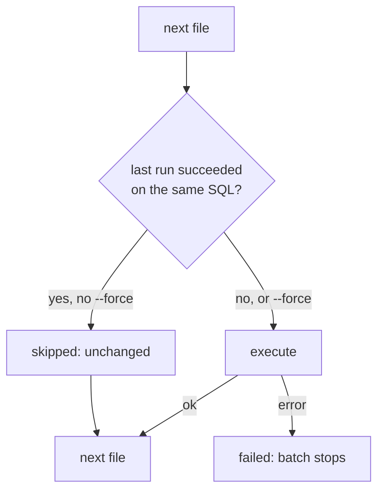

# noorm run


Execute SQL files against the active database, or render a template without touching it.

```bash
noorm run build
noorm run build
```

```
• log  Build completed  status=success filesRun=3 filesSkipped=0 filesFailed=0 durationMs=13.153750000000002

• log  /work/shop/db/sql/01_tables/01_party.sql (skipped: unchanged)
• log  /work/shop/db/sql/01_tables/02_sales_order.sql (skipped: unchanged)
• log  /work/shop/db/sql/02_views/01_open_orders.sql (skipped: unchanged)
• log  Build completed  status=success filesRun=0 filesSkipped=3 filesFailed=0 durationMs=3.4714580000000126
```

The first run executes all three files. The second skips them, because their checksums match a prior success. Log lines go to stderr. With `--json`, the result is one JSON object on stdout.


## Which command runs what?


| Command | Runs | Needs the database |
|---------|------|--------------------|
| `noorm run build` | Every file under `paths.sql`, narrowed by `build.include` and `build.exclude` | Yes |
| `noorm run file <path>` | One file | Yes |
| `noorm run dir <path>` | Every `.sql` and `.sql.tmpl` file under a directory, recursively, sorted | Yes |
| `noorm run files --paths a.sql,b.sql` | The listed files, in the order given | Yes |
| `noorm run exec <dir-or-glob>` | A directory (as `dir`) or the `.sql` and `.sql.tmpl` files a glob matches, sorted | Yes |
| `noorm run inspect <path>` | Nothing. Lists what a `.sql.tmpl` can read | Only to read vault secrets |
| `noorm run preview <path>` | Nothing. Prints the rendered SQL | Only to read vault secrets |

Each file takes one of these paths, and the first failure stops the batch:



Files after the failed one do not run and do not appear in the result.


## Flags


| Flag | Commands | Effect |
|------|----------|--------|
| `--config <name>`, `-c <name>` | all seven | Use a stored config instead of the active one |
| `--force`, `-f` | the five executing commands | Run even when the checksum matches a prior success |
| `--dry-run` | the five executing commands | Render templates into `tmp/` and write nothing to the database |
| `--json` | all seven | Print the result as JSON on stdout |

`inspect` and `preview` never execute, so they have no `--force` or `--dry-run`.

::: warning
A dry run writes every rendered file with its secrets resolved, in plaintext, to `tmp/`. noorm creates the files owner-only (`0600`) but does not add `tmp/` to `.gitignore`. A template at `db/sql/09_seeds/01_products.sql.tmpl` renders to `tmp/db/sql/09_seeds/01_products.sql`.
:::


## What does each command do at the edges?


| Command | Condition | Behavior |
|---------|-----------|----------|
| `build` | A `build.include` entry matches no file | Warns `Ignored N build.include entries that matched no files`. Paths are relative to `paths.sql`: `01_tables`, not `sql/01_tables` |
| `build` | A `build.exclude` entry matches no file | Warns that nothing was excluded, so those files ran |
| `build` | `--dry-run` | Header reads `Build (dry-run) completed`; each file line ends `-> <path in tmp/>`; `--json` adds `"dryRun": true` |
| `file` | File does not exist | `error: Failed to read file: <path>`, exit 1 |
| `dir` | Directory does not exist | `Error: Directory not found: <path>`, exit 2 |
| `dir` | No SQL files inside | `Error: No SQL files found in: <path>`, exit 2 |
| `files` | `--paths` omitted | Usage text and `Missing required argument: --paths`, exit 1 |
| `files` | `--paths ""` or only commas | `Error: --paths must contain at least one file path`, exit 1 |
| `exec` | Glob or directory matches nothing | `Error: No SQL files found matching: <input>`, exit 2 |
| `inspect`, `preview` | Template does not exist | `Error: Template not found: <path>`, exit 2 |
| `inspect`, `preview` | The database is unreachable | Vault secrets are skipped, local secrets still render, and the output says `Vault-backed secrets were not resolved (no reachable database) — showing local-only secrets.`; `--json` adds `vaultProbeFailed: true` and `notice` |
| `inspect`, `preview` | The role lacks `run:file` on the config | Policy message, exit 1 |
| any executing command | Role lacks the permission, such as the default `viewer` agent role | `Cannot run.build on config "dev": "run:build" is not allowed on config "dev" (role: viewer).`, exit 1 |
| MSSQL files | `GO` alone on a line | Split into batches. A failure is prefixed `[batch N of M]`. See [execution](/guide/sql-files/execution) |


## What do inspect and preview show?


`inspect` lists the variables a template can read. `preview` prints the SQL the template renders to, on stdout, so it pipes to a file.

```bash
noorm run inspect db/sql/09_seeds/01_products.sql.tmpl
```

```
Template: db/sql/09_seeds/01_products.sql.tmpl
Config:   dev

Data Files:
  $.products  Array [1]

Built-ins: include, escape, quote, json, now, uuid
Secrets: 0 resolved, 0 global
```

```bash
noorm run preview db/sql/09_seeds/01_products.sql.tmpl > rendered.sql
```

```sql
INSERT INTO product (sku, name, list_price)
VALUES ('HW-DONGLE', 'USB security key', 49);
```

`inspect` adds `Helpers ($helpers):` and `Helper Errors:` sections when the folder has a `$helpers` file. `preview` prints resolved secrets, and both commands execute the template's helper scripts, so both check the `run:file` permission first. `--json` gives `{ filepath, context, … }` for `inspect` and `{ filepath, sql, durationMs }` for `preview`.


## What does the output look like?


A failed file prints its SQL error under its status line:

```
✗ log  /work/shop/db/sql/03_mixed/02_bad.sql (failed)
✗ log    error: [Err 1] no such table: invoice_line_missing
✗ log  Run directory partial  filesRun=1 filesSkipped=0 filesFailed=1
```

The summary line reads `Build completed` for `build`, `Run directory <status>` for `dir`, `Run files <status>` for `files`, and `Run exec <status>` for `exec`. `--json` prints the batch result, with `success` added:

```json
{
  "success": false,
  "status": "partial",
  "files": [
    { "filepath": "/work/shop/db/sql/03_mixed/01_ok.sql", "checksum": "8ece28fd…", "status": "success", "durationMs": 1.36 },
    { "filepath": "/work/shop/db/sql/03_mixed/02_bad.sql", "checksum": "3dd15369…", "status": "failed", "error": "[Err 1] no such table: invoice_line_missing", "durationMs": 0.24 }
  ],
  "filesRun": 1,
  "filesSkipped": 0,
  "filesFailed": 1,
  "durationMs": 7.4,
  "changeId": 1
}
```

| Field | Appears when |
|-------|--------------|
| `files[].skipReason` | A file was skipped: `unchanged` |
| `files[].outputPath` | A dry run wrote the file |
| `unmatchedInclude`, `unmatchedExclude` | `build` had patterns that matched nothing |
| `error` | The batch failed before any file ran, or `dir` found no files |
| `dryRun: true` | `build --dry-run` |

`run file --json` returns one file result, with `success` added.


## Exit codes


| Code | Meaning | Remedy |
|------|---------|--------|
| 0 | Every file succeeded or was skipped | None |
| 1 | Nothing succeeded: no connection, project not initialized, role denied, a missing required flag, `file` or `files` target missing, or every file that ran failed | Read the `error:` line, fix the SQL or the connection, run again |
| 2 | Nothing was attempted: `dir` or `exec` found no SQL files, or `inspect` or `preview` found no template | Fix the path or glob |
| 3 | Some files succeeded and some failed | Part of the database changed. Check the failed file's effect, fix it, run again; files that succeeded skip |

A re-run that fails again at the same file reports `failed` and exits 1, not 3: the earlier files skip, so nothing executed successfully in that run.


## What bites


| Symptom | Cause | Fix |
|---------|-------|-----|
| `--force` fails with `table party already exists; 1 prior successful execution` | `--force` re-executes files that already ran, and `CREATE TABLE` is not guarded | Use `--force` only on files that are safe to run twice; new schema reaches an existing database through a [change](/guide/changes/add-a-column) |
| `run build` fails after you edit a table file | The new checksum makes the file run again against a table that exists | Build only fresh databases. Existing ones catch up with `noorm change ff` |
| Seed files report `skipped: unchanged` after `db truncate` | Truncate keeps noorm's tracking tables, so each file still has a successful record | Re-run the seed files with `--force` |


## Next


- [Execution](/guide/sql-files/execution): skipping, tracking, and slow files
- [Templates](/guide/sql-files/templates): what `inspect` lists
- [Forward and revert](/guide/changes/forward-revert): the other way SQL reaches a database
- [CLI reference](/headless#exit-codes): the shared exit-code contract
