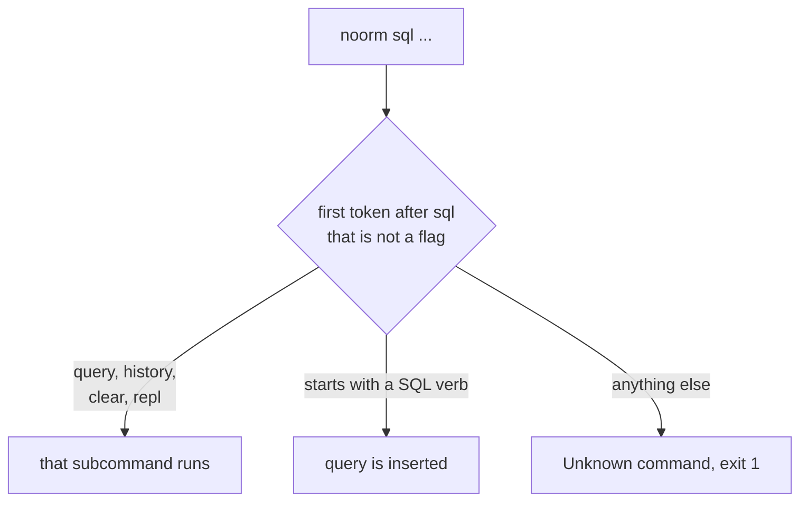

# noorm sql


Run a SQL statement against a config from the command line, and manage the saved query history.

```bash
noorm sql query "SELECT party_id, order_no FROM sales_order LIMIT 2"
```

```
Columns: party_id, order_no
{"party_id":1,"order_no":1}
{"party_id":1,"order_no":2}
2 rows returned (3ms)
```

| Subcommand | Does |
|------------|------|
| `query` | Runs one SQL statement, or a file of them, against the active config |
| `history` | Lists recent queries from the SQL terminal |
| `clear` | Deletes saved history |
| `repl` | Opens the TUI on the SQL terminal: [`noorm sql repl`](/cli/sql-repl) |

The role your channel holds on the config decides which statements run. The statement is classified as read, write, or DDL; see [access roles](/guide/environments/configs#access-roles).


## Can I skip the word `query`?


Yes, when the first word after `sql` that is not a flag starts with a SQL verb. noorm inserts `query` for you:

```bash
noorm sql "SELECT 1"                 # runs: noorm sql query "SELECT 1"
noorm sql --json "SELECT 1 AS one"   # runs: noorm sql query --json "SELECT 1 AS one"
```

That word picks one of three outcomes:



The rewrite is positional and never touches the SQL or the flags. A SQL verb is one of `SELECT`, `INSERT`, `UPDATE`, `DELETE`, `MERGE`, `WITH`, `CREATE`, `DROP`, `ALTER`, `TRUNCATE`, `EXEC`, `EXECUTE`, `CALL`, `SHOW`, `EXPLAIN`, `GRANT`, `REVOKE`, `COMMENT`, `PRAGMA`, `VACUUM`, `ANALYZE`, `BEGIN`, `COMMIT`, `ROLLBACK`, `SAVEPOINT`, or `USE`, in any case.

A flag that takes a value puts the value first, so the rewrite misses:

| Typed | Result | Write instead |
|-------|--------|---------------|
| `noorm sql -c prod "SELECT 1"` | `Unknown command prod`, exit 1 | `noorm sql query -c prod "SELECT 1"` |
| `noorm sql -f reports/monthly.sql` | `Unknown command reports/monthly.sql`, exit 1 | `noorm sql query -f reports/monthly.sql` |
| `noorm sql --json "SELECT 1"` | Works. `--json` takes no value | |


## sql query


```
noorm sql query [<sql>] [--file <path>] [--config <name>] [--json]
```

| Flag | Effect |
|------|--------|
| `<sql>` | The statement. Optional when `--file` is given |
| `--file <path>`, `-f <path>` | Read the SQL from a file. It wins over `<sql>` |
| `--config <name>`, `-c <name>` | Run against this config instead of the active one |
| `--json` | Print `{"success":true,"columns":[…],"rows":[…],"durationMs":…}` on stdout |

Human output is `Columns:`, one JSON line per row, then `N row(s) returned (Xms)`. A statement that changes rows prints `Rows affected: N` instead. `--json` is a per-subcommand flag: write it after `query`, not before `sql`. The [flag rules](/cli/flags) explain why.

```bash
noorm sql query -f reports/monthly.sql --json
```

| Condition | Behavior |
|-----------|----------|
| No `<sql>` and no `--file` | `No query provided. Usage: noorm sql "SELECT ..."`, exit 2 |
| `--file` cannot be read | `Failed to read SQL file: <path>: <reason>`, exit 2 |
| The database rejects the statement | `Query failed: <message>`, exit 1 |
| Your role does not allow that class of statement | The policy message, exit 1 |
| Cannot connect | `Failed to connect: <message>`, exit 1 |

`sql query` writes nothing to history. It is the headless path, and persisting query text and returned rows on a build agent is an exposure nobody asked for.


## sql history


```
noorm sql history [--limit <n>] [--config <name>] [--json]
```

| Flag | Effect |
|------|--------|
| `--limit <n>`, `-n <n>` | Entries to show. Default 50 |
| `--config <name>`, `-c <name>` | History of this config |
| `--json` | `{"configName":…,"entries":[{id, query, executedAt, durationMs, success, errorMessage, rowCount}]}` |

```bash
noorm sql history -n 2
```

```
SQL history for 'prod' (2 entries):

  ✓  Oct 21, 01:41:59  12ms · 2 row(s)
     SELECT party_id, order_no FROM sales_order LIMIT 2

  ✗  Oct 21, 01:40:12  4ms · relation "invoice_line" does not exist
     SELECT * FROM invoice_line
```

Only the interactive SQL terminal (`noorm sql repl`, or `Shift+Q` in the TUI) records history. Query text longer than 80 characters is cut with `…`. History needs a config name but no connection. The name comes from `--config`, then `NOORM_CONFIG`, then the active config.

| Condition | Behavior |
|-----------|----------|
| `--limit` is not a positive integer | `Invalid limit: <value>. Must be a positive integer.`, exit 2 |
| No config named and none active | `No config specified and no active config set. Use --config or run "noorm config use <name>".`, exit 2 |
| Nothing recorded | `No SQL history found for config 'prod'.`, exit 0 |


## sql clear


```
noorm sql clear [--older-than <months>] [--yes] [--config <name>] [--json]
```

| Flag | Effect |
|------|--------|
| `--older-than <months>` | Delete only entries older than this many months |
| `--yes`, `-y` | Delete without the preview step |
| `--config <name>`, `-c <name>` | History of this config |
| `--json` | Print `{configName, entriesRemoved, filesRemoved}`. Also skips the preview step |

```bash
noorm sql clear --older-than 3 --yes
```

```
Cleared 12 entries older than 3 month(s) (4 result files removed).
```

| Condition | Behavior |
|-----------|----------|
| Neither `--yes` nor `--json` | Prints `This will clear all entries from SQL history for config 'prod'.` and `Pass --yes to skip this confirmation.`, deletes nothing, exit 0 |
| `--json` without `--yes` | Deletes at once |
| `--older-than` is not a positive integer | `Invalid --older-than value: <value>. Must be a positive integer (months).`, exit 2 |
| No config named and none active | Same message and exit 2 as `history` |


## Exit codes


| Code | Meaning | Remedy |
|------|---------|--------|
| 0 | Statement ran, or history was listed or cleared | None |
| 1 | Connection failed, the database rejected the statement, role denied, or `Unknown command` | Read the message. Spell out `query` when a flag precedes the SQL |
| 2 | No SQL given, unreadable `--file`, a bad `--limit` or `--older-than`, or no config to read history from | Fix the argument, or pass `--config` |


## Next


- [`noorm sql repl`](/cli/sql-repl): the interactive SQL terminal
- [The SQL terminal](/guide/database/terminal): history, result browsing, and cancel
- [CLI reference](/headless#sql): every flag in one place
