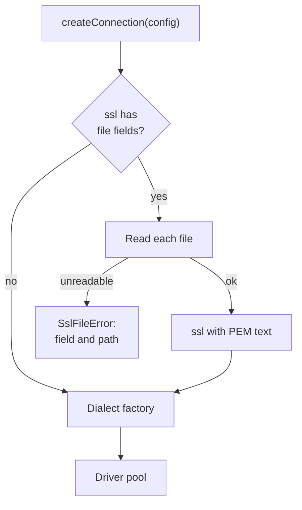
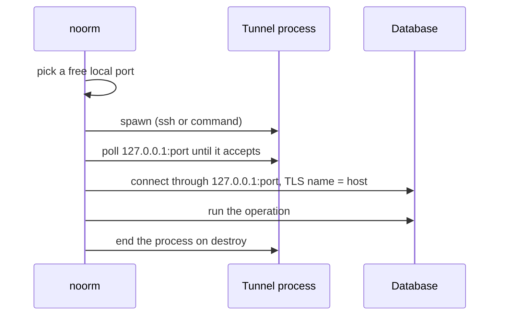

# Enterprise connectivity: certificate files and tunnels


## Problem


An enterprise database sits on a private subnet and accepts only TLS connections signed by the company's own certificate authority, often with a client certificate. noorm cannot reach such a database today without help from outside the tool.

| Need | Today |
|---|---|
| CA or client certificate kept in a file | `connection.ssl` takes PEM text only (`src/core/config/schema.ts:103`). A user pastes the private key into an environment variable or a JSON import file. |
| Private CA on MySQL | The factory passes `ssl: {}` and drops `ca`, `cert` and `key` (`src/core/connection/dialects/mysql.ts:44`). |
| Private CA on MSSQL | `ssl` only switches validation on (`src/core/connection/dialects/mssql.ts:151`). There is no field for a CA. |
| Hostname check on MySQL | mysql2 leaves `verifyIdentity` off, so the chain is validated and the name is not. `tlsServerName` is not read. |
| SSL in the TUI | The add and edit forms have no SSL field. Saving from the edit screen rebuilds `connection` from five form fields, which deletes a stored `ssl` object, `tlsServerName` and `pool` (`src/tui/screens/config/ConfigEditScreen.tsx:226`). |
| Shared CA path for a team | Stage defaults accept `ssl` as a boolean only (`src/core/settings/types.ts:62`). |
| Database on a private subnet | The user opens a tunnel by hand before every command and points the config at the local port. |

The work ships as two pull requests. The first covers certificates. The second covers the tunnel.


## Goals / Non-goals


- Goals:
    - A config names certificate files by path, and noorm reads them when it opens a connection.
    - A private CA and a client certificate work on PostgreSQL, MySQL and MSSQL.
    - `tlsServerName` works on all three dialects.
    - The TUI can set and keep SSL settings.
    - noorm starts and stops a tunnel process for a config that declares one.
- Non-goals:
    - An embedded SSH client.
    - PFX or PKCS#12 bundles, passphrase-protected keys, certificate revocation lists.
    - Reading certificates from a secret manager or the vault.
    - Turning on MySQL hostname verification for configs that do not set `tlsServerName`.
    - `tlsServerName` in stage defaults.
    - The worker-thread connection path (`src/workers/connection.ts`), which receives a dialect and a connection string only.


## Config contract


The first block is the certificate form. The second adds the tunnel.

```yaml
connection:
    dialect: postgres
    host: db.internal.corp
    port: 5432
    ssl:
        caFile: ./certs/corp-ca.pem
        certFile: /etc/noorm/client.crt
        keyFile: /etc/noorm/client.key
    tlsServerName: db.internal.corp
```

```yaml
connection:
    host: db.internal.corp
    port: 5432
    tunnel:
        ssh:
            host: bastion.corp
            user: deploy
            keyFile: ~/.ssh/id_ed25519
        # or any command that forwards {localPort} to the database:
        command: aws ssm start-session --target i-0abc --document-name AWS-StartPortForwardingSessionToRemoteHost --parameters host=db.internal.corp,portNumber=5432,localPortNumber={localPort}
```

| Field | Rule |
|---|---|
| `ssl.caFile`, `ssl.certFile`, `ssl.keyFile` | Path to a PEM file. The stored value is the path as written. |
| Inline `ssl.ca`, `ssl.cert`, `ssl.key` | Unchanged. Setting the inline form and the file form of the same field is a validation error. |
| Relative path | Resolved from the working directory, which the CLI and TUI set to the project root at startup. The SDK anchors to its `projectRoot` option. A leading `~/` expands to the home directory. |
| Environment | `NOORM_CONNECTION_SSL_caFile`, `NOORM_CONNECTION_SSL_certFile`, `NOORM_CONNECTION_SSL_keyFile`. Underscores nest in noorm's env parser, so the camelCase segment follows `NOORM_CONNECTION_SSL_rejectUnauthorized`. |
| Stage defaults | `ssl` accepts a boolean or `{ caFile, certFile, keyFile, rejectUnauthorized }`. Inline PEM is refused there, because `settings.yml` is committed. |
| SDK | The inline `connection.ssl` accepts the same file fields. |

Layers combine `ssl` field by field.

| Higher layer | Lower layer | Result |
|---|---|---|
| `ssl: false` | anything | SSL is off. |
| `ssl: true` | an object | The lower object's fields stay. `true` means on and adds nothing. |
| an object | an object | For each of `ca`, `cert`, `key`, the higher layer's form (inline or file) replaces the lower layer's form of that field. `rejectUnauthorized` follows the higher layer when it sets it. |
| an object | `true` or nothing | That object. |
| any | any | The same-field exclusion applies within one layer. After combining, no pair conflicts. |


## Certificates


### Business rules


1. noorm reads a certificate file each time it opens a connection pool. A rotated file takes effect on the next connection without a config change.
2. File content never enters `state.enc`, a config export, an observer event or an error message. An error names the field and the path.
3. A missing or unreadable file fails the connection once. The connection retry loop does not repeat it.
4. Dialect factories receive PEM text only. One step in the connection factory turns paths into text, so no dialect reads the file system.
5. A config import accepts a path without checking that the file exists, because the file may live on another machine.
6. `config validate` and the TUI connection test read the files, so both report an unreadable path.

The connection factory resolves file paths into PEM text before it calls a dialect factory.




### Dialect behavior


| Dialect | Certificate passthrough | `tlsServerName` | Driver evidence |
|---|---|---|---|
| PostgreSQL | Unchanged: the `ssl` object reaches `pg`. | Unchanged. | `src/core/connection/dialects/postgres.ts:18` |
| MySQL | `ca`, `cert`, `key`, `rejectUnauthorized` reach mysql2's `ssl`. | When set: mysql2 receives the name as `host`, a `stream` function dials the real host and port, and `verifyIdentity` is on. | mysql2 3.19.1 builds its secure context from those keys and takes the TLS name from `host` only (`lib/base/connection.js:337-366`); `stream` may be a function (`lib/base/connection.js:63`). |
| MSSQL | `ca`, `cert`, `key` reach tedious as `cryptoCredentialsDetails`. `rejectUnauthorized: false` sets `trustServerCertificate`. | Unchanged. The IP-host name check follows `rejectUnauthorized` too. | tedious 19.2.1 passes `cryptoCredentialsDetails` to `tls.createSecureContext` (`lib/connection.js:821,1196`). |

MySQL identity options follow the PostgreSQL rule: `tlsServerName` requires `ssl` to be enabled and refuses `rejectUnauthorized: false`.

On MySQL, the socket that noorm supplies must carry the keepalive and no-delay settings that mysql2 applies to its own socket (`lib/base/connection.js:49-60`).


### TUI


| Form field | Maps to |
|---|---|
| Use SSL (checkbox) | `ssl` on or off |
| Verify Certificate (checkbox) | `ssl.rejectUnauthorized`; unchecked stores `false` |
| CA file, client certificate file, client key file | `ssl.caFile`, `ssl.certFile`, `ssl.keyFile` |
| TLS server name | `tlsServerName` |

The TUI connects with the stored config merged over the defaults of its stage, and applies no environment override. The edit form shows the state in effect: Use SSL and Verify Certificate reflect the merged `ssl`, and a certificate field that only the stage supplies shows `(stage: <path>)`. A save stores only what the user changed, so untouched SSL fields leave the stored `ssl` as it was and the stage default keeps applying.

The config list tags each server config `tls` or `tls unverified`. The TUI export carries every connection field that is not a credential, and withholds `user`, `password` and the inline `ssl.key` and `ssl.cert`.


## Tunnel


### Business rules


1. `connection.host` and `connection.port` name the real database. The tunnel changes the address that noorm dials and nothing else.
2. noorm picks a free local port, starts the process, and waits until the port accepts a connection or a timeout passes.
3. noorm dials `127.0.0.1:<local port>` and verifies the certificate against `tlsServerName`, or against `host` when `tlsServerName` is not set.
4. noorm ends the process when the connection is destroyed, when the connect attempt fails, and when the noorm process exits.
5. The `ssh` form builds an `ssh -N -L` invocation for the system binary. The `command` form runs the given text with `{localPort}` replaced.
6. A tunnel that exits early fails the connection with the process's exit code and its last lines of output.

The tunnel process lives exactly as long as the connection that needed it.




### Security rules


`tunnel.command` is code execution stored in a config. A config received from someone else can run any command on the machine that activates it.

| Surface | Rule |
|---|---|
| `config import` | Shows the tunnel command and requires confirmation, for a new config as well as an overwrite. |
| Agent channel | Cannot set or change `tunnel` through any command, RPC method or MCP tool. |
| MCP review text | Displays the tunnel command for a config that has one. |
| `ssh` form | Arguments are passed as an array, never through a shell. |


## Approaches


Certificates:

| # | Approach | Pros | Cons |
|---|----------|------|------|
| A | Store the path, read the file at connect time | Rotation works; the private key stays out of state and exports | The file must exist on every machine that connects |
| B | Read the file when the config is saved and store the PEM | The config is self-contained | The key enters `state.enc` and every export; rotation needs a config edit |
| C | Document `NODE_EXTRA_CA_CERTS` | No code | No client certificates; process-wide |

Tunnel:

| # | Approach | Pros | Cons |
|---|----------|------|------|
| A | Spawn a process (`ssh` binary or a command) | One mechanism covers SSH, SSM, IAP, Teleport and `kubectl`; reuses the user's agent, `known_hosts`, ProxyJump and MFA; no new dependency | The binary must be installed; a stored command is code execution |
| B | Embed an SSH client library | Self-contained | SSH only; noorm would own host-key checking and key handling; a new dependency in the compiled binary |
| C | Document manual tunnels | No code | Every command needs a manual step; CI needs wrapper scripts |


## Recommendation


Certificates: approach A. The private key never enters noorm's state, and rotation needs no config change. Reading the files in the connection factory keeps the three dialect factories free of file access and gives the missing-file error one home.

Tunnel: approach A. Enterprise networks reach private subnets through several products, and a spawned process covers all of them with the credentials and host-key trust the user already has. The cost is the security rules above, which the tunnel pull request must enforce before the field is accepted anywhere.

The certificate pull request comes first. It fixes a silent MySQL defect and the TUI data loss on its own, and the tunnel depends on `tlsServerName` working on all three dialects.


## Open questions


- Tunnel: whether `tunnel` is accepted from environment variables. Decided in the tunnel spec.
- Tunnel: the default readiness timeout. Decided in the tunnel spec.
