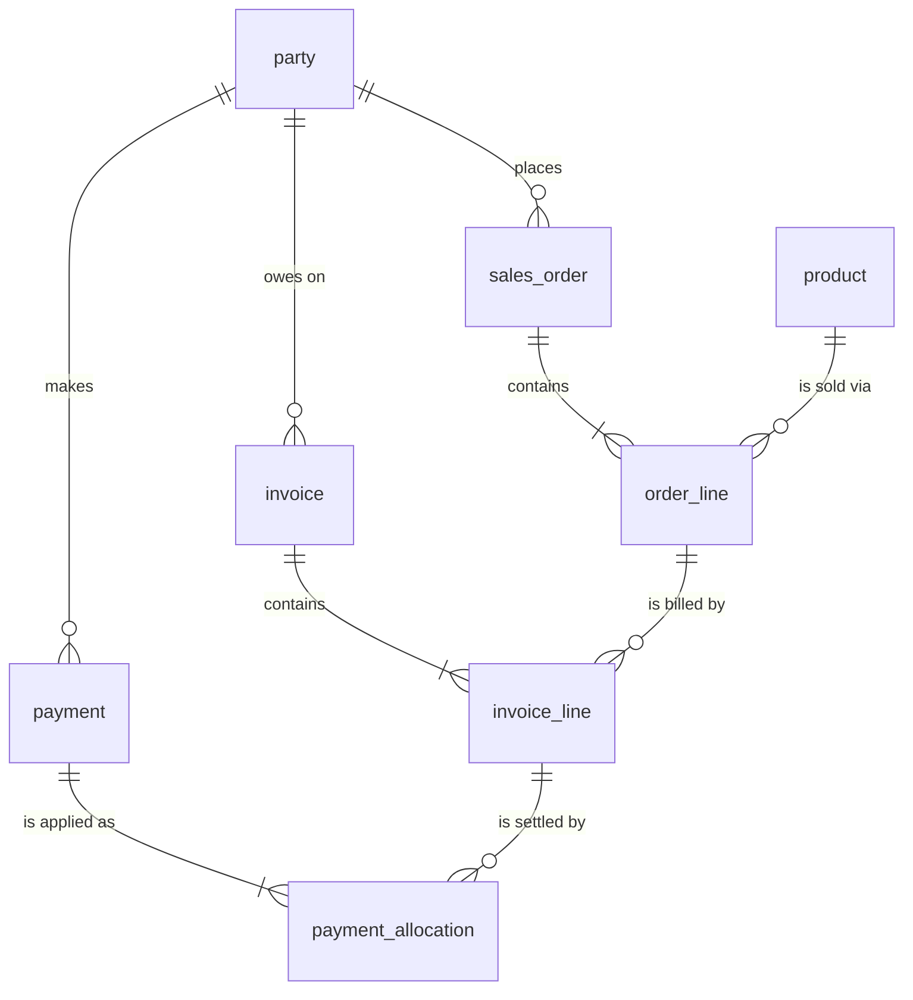
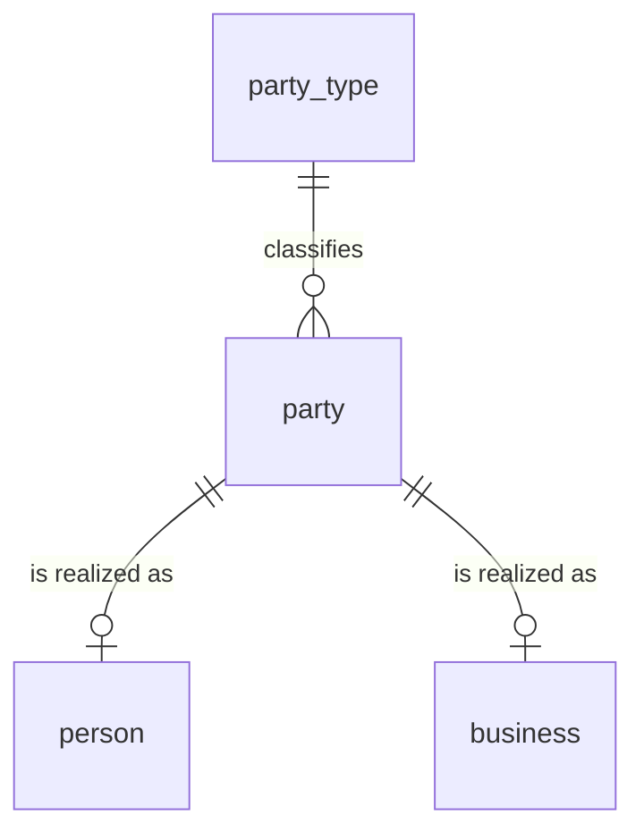
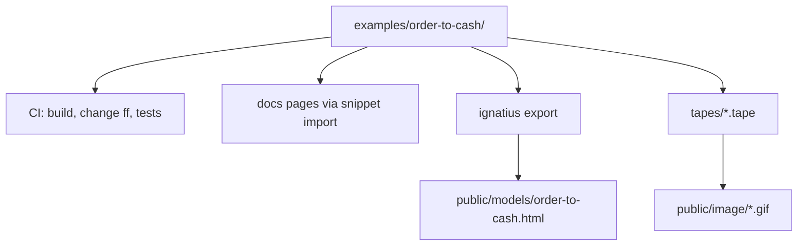

# noorm.dev: one running example, less prose


This is an audit of the published docs site (`docs/`, deployed to noorm.dev) and a proposal to rebuild it around one example project. The audit covered all 48 user-facing pages (14,339 lines). The contributor pages under `docs/dev/` were read only where the user sidebar links into them.

The proposal has three parts:

- one example schema that follows the modeling rules the site teaches
- one source for every snippet, so examples cannot drift
- one page shape that puts the command and its output on the first screen


## Problem


A developer arriving at noorm.dev hits these problems in roughly this order.


### ignatius has no obvious download


| Where a reader looks | What they find |
|---|---|
| Hero buttons | "Get started" (noorm install) and "View on GitHub". Nothing for ignatius. |
| Top nav | "Modeling", which opens a narrative overview. None of its 8 "On this page" sections is an install step. |
| Sidebar | "Installation" under "Information Modeling", a group that starts collapsed. |
| Landing page | One install line, mid-page, in "Plan it before you build it". |
| Install URL | `https://raw.githubusercontent.com/noormdev/ignatius/main/install.sh`. noorm gets `noorm.dev/install.sh`; `noorm.dev/ignatius.sh` returns 404. |
| npm | ignatius is not published (`ignatius/package.json` is `"private": true`). |


### The modeling pages contradict each other and the rules they teach


The site argues for inherited keys, and its own examples break the rules that make inherited keys work.

| Page | Example | Problem |
|---|---|---|
| `guide/relational-design.md:32,42` | `todos PRIMARY KEY (user_id, created_at)`, `todo_items (user_id, created_at, item_index)` | A timestamp is a key component. The per-parent sequence (`todo_no`) is the rule. |
| `models/todo-list/` (embedded in that page) | Same keys | The diagram readers see repeats the defect. |
| `modeling/entities.md` | `Party → SalesInvoice → SI_Line` with `line_seq` | Correct, but a different domain from the page that makes the argument. |
| `getting-started/first-build.md` | `CREATE TABLE IF NOT EXISTS users (id SERIAL ...)`, `posts (id SERIAL, user_id REFERENCES users(id))` | `IF NOT EXISTS` in `sql/`, surrogate key on a child table, unnamed FK. |
| `guide/changes/overview.md:147` | `verification_tokens (id SERIAL ...)` | Surrogate key on a child of `users`. |
| `guide/database/explore.md:248-254` | `posts_user_id_fkey`, `comments_post_id_fkey` | Default FK names instead of predicate names. |
| `examples/todo-db/sql/00_tables/03_task.sql:26`, `04_association.sql:20` | `todo PRIMARY KEY (user_id, category_id, created_at)`, FK `todo_has_tag` | Timestamp and a reclassifiable column in the key, ORM-verb FK name. |
| `tapes/demo-project/sql/01_tables/003_task.sql:9` | `task (user_id, created_at, task_index)` | Source of every TUI screenshot. |

`modeling/entities.md` adds a second kind of confusion. It opens on IDEF1X theory and an optional skill, and reaches the file format in its second section. It ends in viewer internals (the lineage spotlight's subset test, classification precedence) that belong in the ignatius repo's reference docs. Nothing on the site shows how an entity file becomes a `CREATE TABLE`, which is the handoff the whole modeling section exists to support.


### At least six example domains, none shared


| Domain | Where |
|---|---|
| Blog: `users`, `posts`, `comments` | First Build, Building Your SDK, 9 guide pages, `headless.md`, `cli/sql.md`. `users` alone has 4+ incompatible definitions. |
| Todo: `users/todos/todo_items` | `relational-design.md`, `models/todo-list` |
| Todo variant: `app_user/project/task` | TUI screenshots (`tapes/demo-project`) |
| Order-to-cash: `Party/SalesInvoice/SI_Line` | `modeling/entities.md` |
| LLM memory: `Memory`, `Sentinels`, `sp_Memory_Create` | ignatius demo video, `cli/run.md`, `reference/sdk.md` |
| Social graph: `posts/photos/tags/groups` | `relational-design.md`, `models/social`, `models/polymorphic` |

`reference/sdk.md` alone draws from about seven: blog, accounts and invoices, departments, orders, task batches, memory, and abstract helpers (`add_numbers`, `simple_proc`). Eleven guide pages show no schema at all, only connection strings or secret names.


### Prose before the command


| Page | First command | Notes |
|---|---|---|
| `getting-started/first-build.md` | line 27 | Four TUI detours (config, create, new change, test config). Each has a headless equivalent: `noorm config import`, `noorm db create`, `noorm change add`. |
| `getting-started/building-your-sdk.md` | line 399 (`createContext`) | Steps 1-4 are monorepo scaffolding. Several samples do not compile (`app`, `emailService` undefined). |
| `guide/changes/history.md` | line 113 | |
| `guide/environments/vault.md` | line 91 | Lines 60-84 are X25519/HKDF internals. |
| `guide/database/explore.md` | line 69 | 13 ASCII TUI mockups before the CLI form. |
| `guide/sql-files/templates.md`, `guide/environments/stages.md`, `guide/sql-files/organization.md`, `guide/relational-design.md` | none | No `noorm` command block on the page. |


### Navigation


- Nine of the ten `cli/*` pages are in no nav or sidebar. `cli/run.md` and `cli/settings-edit.md` have no inbound links at all.
- `headless.md` (1,870 lines) puts its 70 commands at `####`, and `outline.level` is `[2, 3]`, so the right-hand TOC lists group names only. There is no command index.
- `dev/sdk.md` (1,159 lines) is an older copy of the user SDK reference, reachable from the user sidebar as "Contributor Documentation".
- The same content lives in several places: the access-role matrix (configs, teardown, mcp, terminal), the CI bootstrap script (create, non-interactive, troubleshooting), the env-var table (configs, ci, deployment), and dry-run (changes overview, forward-revert).


### Correctness bugs found along the way


These ship regardless of the redesign.

| Bug | Evidence |
|---|---|
| `noorm -c prod run build` runs in a directory named `prod` | `src/cli/index.ts:179` reads `-c` before the subcommand as `--cwd`. `guide/environments/configs.md:86,169,189,375` use it as `--config`. |
| `https://noorm.dev/install.sh` verifies nothing | The served copy, `docs/public/install.sh` (116 lines), has no checksum code and ignores `NOORM_INSECURE`. The repo-root `install.sh` (200 lines, the GitHub-mirror URL) verifies against `checksums.txt`. The two copies drifted, so `getting-started/installation.md`'s "every install path verifies the downloaded binary" is false for the primary URL. Fix: deploy the root script at build time and delete the copy. |
| `NOORM_INSTALL_DIR=~/my-tools curl … \| sh` never reaches the installer | A prefix assignment applies to `curl` only. `getting-started/installation.md:38,64` (`NOORM_INSECURE` too). Fix: `curl … \| NOORM_INSTALL_DIR=~/my-tools sh`. |
| SDK install line omits the `kysely` peer | `reference/sdk.md:16-18` vs `packages/sdk/package.json` peers. |
| "Four permissions require confirmation even for admin" | `changes.delete` is a fifth (`src/core/policy/matrix.ts:17`). |
| `secret set` shown without `--stdin`/`--yes`; `init` shown without `--here` | `headless.md` vs `src/cli/secret/set.ts`, `src/cli/init.ts`. |
| Settings link loops | `guide/sql-files/organization.md:351` → `stages.md`, which has no `build.include` content and links back. |


## Goals / Non-goals


Goals:

- A reader can install either tool from the first screen of noorm.dev.
- Every code sample on the site comes from one example project, and that project's CI proves the samples run.
- The example follows every modeling rule the site teaches.
- Every page shows its command and real output within the first screen.
- Fewer pages: one home per topic, everything else links to it.

Non-goals:

- Visual redesign beyond the landing and Download pages. The landing replaces the stock VitePress hero, so its hero components and their CSS go; the rest of the theme and brand CSS stay.
- New CLI features. A `noorm init --example` scaffold would help, but it is a public contract and a separate decision.
- Rewriting `docs/dev/`, apart from removing `dev/sdk.md`'s duplicate of the user reference.
- Re-running the 1M-row benchmark in `relational-design.md`.


## Approaches: which running example


| # | Example | Wins | Loses |
|---|---|---|---|
| A | **Order-to-cash**, trimmed from ignatius's `models/key-inherited` | Already follows the rules (`line_seq`, `places / is placed by`). Has a real subtype cluster (Party → Person, Business). Payments that can only settle the same party's invoice show what inherited keys buy, in one FK. Every noorm feature has a natural use. ignatius already ships the `order-to-cash` flow. | New example project to build. Business vocabulary (invoice, allocation) is one notch past a toy. |
| B | Todo, remodeled correctly (`todo_no`, `item_no`) | Smallest. Every reader knows the domain. `examples/todo-db` exists. | Subtypes, stored procedures, transfer, and vault all feel staged in a todo app. `todo-db` needs a full remodel anyway. |
| C | LLM memory (`examples/llm-memory-db-*`) | Exists with 230 tests, matches the MCP pitch. | 38 tables, 140 SQL files. The domain needs explaining before any example lands. |
| D | Blog (`users/posts`), cleaned up | Already the most-used domain. | No subtype story, no procedure story. Every ORM tutorial uses it, so it does nothing to show why noorm is different. |


## Recommendation


**A, order-to-cash.** It is the only candidate that is already correct, already modeled in ignatius, and large enough to carry every feature without staging. Its central FK is the site's argument in one line. `payment_allocation` carries `party_id` from both parents, so a payment from one customer cannot settle another customer's invoice. The database enforces that without a trigger.


### The schema


Eleven tables. The quick start uses two, and later pages add tables as the topic needs them.

The transactional spine. Every child inherits `party_id`, which is what lets one constraint stop cross-customer payments:



The party cluster. `party_type` is the discriminator, so a party is exactly one of person or business:



| Table | Primary key | Rule it demonstrates |
|---|---|---|
| `party` | `party_id` | Surrogate allowed at a root: nothing above it supplies identity. |
| `person`, `business` | `party_id` | Exclusive subtypes, one-to-one with the basetype. |
| `product` | `product_id`, AK `sku` | Root entity with an alternate key named for its rule. |
| `sales_order` | `party_id, order_no` | Per-parent sequence, assigned by `place_order()`. No timestamp in the key. |
| `order_line` | `party_id, order_no, line_no` | Full lineage in the key; the owner is readable without a join. |
| `invoice`, `invoice_line` | `party_id, invoice_no[, line_no]` | Same shape, second spine. |
| `payment` | `party_id, payment_no` | |
| `payment_allocation` | `party_id, payment_no, invoice_no, line_no` | Two identifying parents share `party_id`, which makes cross-party allocation unrepresentable. |

FKs follow `<table>_<reverse predicate>_<target>`: `sales_order_isplacedby_party`, `order_line_ispartof_sales_order`, `payment_allocation_settles_invoice_line`. `sql/` declares every column and constraint once, inline in `CREATE TABLE`. Every `ALTER`, backfill, and drop lives in `changes/`.


### How the example grows across the site


| Page | Tables and objects it uses | Feature it shows |
|---|---|---|
| Landing, Quick start | `party`, `sales_order` | `run build`, then a change that adds `order_line` |
| Concepts | same | SQL files are current state, changes are how existing databases catch up |
| SQL files & build order | all tables, `01_tables/` … `04_views/` | Ordering, `build.include` |
| Templates & seeds | `products.yml` → `product` rows, `roles.yml` → `GRANT`s | `.sql.tmpl`, data loaders |
| Changes | `order-status` change: `ALTER TABLE sales_order ADD COLUMN status` + backfill + `SET NOT NULL` | Why history lives in `changes/` and never in `sql/` |
| Configs & stages | `dev`, `staging`, `prod` | Stages, access roles |
| Secrets & vault | `PAYMENT_GATEWAY_KEY`, read in a `.sql.tmpl` as `$.secrets.PAYMENT_GATEWAY_KEY` | Sensitive values stay out of committed SQL; the template fills them in when the SQL runs |
| Explore, SQL terminal | the built schema | Real `noorm db explore --json` output |
| Transfer | staging → qa: `party` → `product` → `sales_order` → `order_line` | FK-ordered copy |
| SDK | `ctx.proc('place_order', …)` with a TVP of lines, `ctx.func('party_balance', …)` | Typed procs, functions, TVPs |
| Testing | `requireTest`, truncate between tests | Test guards |
| CI | the example's own workflow job | Headless build + change + tests |
| MCP | an agent with `viewer` reads `sales_order` | Per-channel roles |
| Modeling | the same 11 entities plus the `order-to-cash` flow | IDEF1X, DFDs, model → SQL |
| Relational design | `payment_allocation` | The case for inherited keys, with this schema |


### One source for every snippet


The example lives in `examples/order-to-cash/` and holds both halves: the ignatius model and the noorm project. Docs import files from it with VitePress's `<<<` syntax, which resolves paths relative to the page with no restriction to `srcDir` (checked in VitePress 2.0.0-alpha.15's snippet plugin). A sample on the site is therefore a file CI has run.

Each artifact the site shows is built from the example project, so a schema change reaches every page on the next deploy:



```
examples/order-to-cash/
    model/                 ignatius root (ignatius.yml, data/, flows/)
    sql/
        01_tables/
        02_views/
        03_functions/
        09_seeds/          products.yml, roles.yml, *.sql.tmpl
    changes/
    scripts/quickstart.sh  the landing quick start, run in CI
    tests/                 SDK integration tests
```

Until checkpoint 3 creates the example project, the model lives at `docs/models/order-to-cash/` beside the site's other models, and moves into `examples/order-to-cash/model/` with it.

`examples/todo-db` stays as an SDK test target and drops out of the docs. `docs/models/todo-list` is replaced by the order-to-cash export. `tapes/demo-project` is replaced by the example project, and the tapes re-record from it.


### Before and after: the landing quick start


Before (`docs/index.md`):

```bash
mkdir -p sql/01_tables
echo "CREATE TABLE users (id SERIAL PRIMARY KEY, name TEXT);" > sql/01_tables/001_users.sql

noorm run build
```

After, imported from `examples/order-to-cash`. The exact config commands get settled when `scripts/quickstart.sh` runs green in CI:

```sql
-- sql/01_tables/01_party.sql
CREATE TABLE party (
    party_id  integer GENERATED ALWAYS AS IDENTITY PRIMARY KEY,
    name      text NOT NULL
);

-- sql/01_tables/02_sales_order.sql
CREATE TABLE sales_order (
    party_id  integer NOT NULL,
    order_no  integer NOT NULL,
    CONSTRAINT sales_order_pk PRIMARY KEY (party_id, order_no),
    CONSTRAINT sales_order_isplacedby_party
        FOREIGN KEY (party_id) REFERENCES party (party_id)
);
```

```bash
noorm run build                  # fresh database: runs sql/ in order
noorm change add order-lines     # add sql/01_tables/03_order_line.sql, list it in the change
noorm change ff                  # existing database: runs pending changes
```

The reader sees a correct key, a named FK, and both halves of the model (build and change) before the first heading.


### Before and after: model to SQL


The site never shows this handoff today. A new "From model to SQL" page puts the entity file and the DDL side by side, using a VitePress `code-group`:

```markdown
---
entity: sales_order
group: sales
pk: [party_id, order_no]
columns:
    party_id: { type: integer }
    order_no: { type: integer, desc: "Per-party sequence, assigned by place_order()." }
relationships:
    - target: party
      on: { party_id: party_id }
      predicate: { fwd: places, rev: is placed by }
---
```

| Entity file | SQL |
|---|---|
| `pk:` | `PRIMARY KEY (…)` |
| `relationships[].on` | `FOREIGN KEY (…) REFERENCES …` |
| `predicate.rev` + target | constraint name: `sales_order_isplacedby_party` |
| `type: integer` | the physical type, chosen per dialect in `sql/` |
| `ak:` rule | `CONSTRAINT product_isidentifiedby_sku UNIQUE (sku)` |
| `subtypes:` | one table per member, PK = FK to the basetype |


### Site structure


48 user pages become 34. Each topic gets one page, and everything that repeated it links there instead.

```
Docs
    Start
        Quick start                 installation + first-build
        Concepts
        The example project         new: tour of examples/order-to-cash
    Schema
        SQL files & build order     organization + execution
        Templates & seeds
        Changes                     overview + forward-revert + history
    Environments
        Configs & stages            configs + stages
        Secrets & vault             secrets + vault
        Identity                    cli/identity
    Data
        Explore                     CLI output first, TUI second
        Transfer
        Create, reset & teardown    create + teardown
        SQL terminal                terminal + cli/sql + cli/sql-repl
    App code
        SDK in 5 minutes            top of building-your-sdk
        Procedures, functions, TVPs
        Testing against a real DB
        Deploying                   deployment
    Automation
        CI                          ci + non-interactive
        Agents (MCP)
    Troubleshooting                 symptom | cause | fix table
    Background
        Why noorm
        Relational design           rewritten on order-to-cash
Modeling (ignatius)
    Install                         first page of the section
    Model the example               serve the order-to-cash model, edit one entity
    Entity files                    format only; internals move to the ignatius repo
    Data flows
    From model to SQL               new
    Reverse-engineering
    Modeling skill                  absorbs branding + best practices
Reference
    CLI                             headless + cli/flags, help, init, run, secret, settings-*
    SDK API
    settings.yml
    TUI keys                        tui.md
Download                            new: both tools, every platform, both skills
```

Top nav becomes `Docs · Modeling · Reference · Download`. "Contributor Documentation" moves from the user sidebar to the footer, and `dev/sdk.md` shrinks to internals that `reference/sdk.md` does not cover.


### Page shape


Every guide page follows the same order, so a reader learns the layout once:

```
# <Task, verb first>               "Add a column to a live database"
<one sentence: when you need this>

<<< the example file or command
<its real output>

## How it works                    diagram or table; prose only for reasoning
## Options                         flag table, linking to Reference
## What bites                      symptom | cause | fix
Next: <one link>
```

Budgets: first code block before line 15, no paragraph over four sentences, internals (crypto, classifiers, driver quirks) go to `docs/dev/`.

The reference pages get one entry shape. CLI: synopsis, flag table, example, JSON output, exit codes, with a command index at the top and `outline.level` raised to `[2, 4]`. SDK: signature, params table, returns, example, with an API index at the top.


### Download page


One page, linked from the hero and the nav.

| | noorm | ignatius |
|---|---|---|
| macOS / Linux | `curl -fsSL https://noorm.dev/install.sh \| sh` | `curl -fsSL https://noorm.dev/ignatius.sh \| sh` |
| npm | `npm i -g @noormdev/cli` | none |
| Windows | `noorm-windows-x64.exe` from releases | `ignatius-windows-x64.exe` from releases |
| Agent skill | `npx skills add noormdev/noorm/skills` | `npx skills add https://github.com/noormdev/ignatius --skill ignatius-modeling` |
| Verify | `noorm --version` | `ignatius --help` |

`noorm.dev/ignatius.sh` is a two-line file in `docs/public/` that pipes the ignatius repo's `install.sh` into `sh`. It needs no copy of the installer, so it cannot go stale. `IGNATIUS_*` variables set on the outer `sh` (`curl … | IGNATIUS_VERSION=v0.23.0 sh`) reach the inner one. The hero's secondary button changes from "View on GitHub" (already in the nav icons) to "Download".


## What will bite


| Risk | Cause | Mitigation |
|---|---|---|
| A moved example file blanks a code block on the site | VitePress renders `Code snippet path not found: …` in place of the block and does not fail the build | Grep `.vitepress/dist` for that string in `docs.yml` and fail the job |
| The docs deploy misses an example change | `docs.yml` triggers on `docs/**` only | Add `examples/order-to-cash/**` to its path filter |
| The model drifts from the SQL | ignatius and noorm read different files | CI runs `ignatius validate model/` and a check that every entity has a table |
| ignatius format changes break the example | ignatius releases on its own cadence | Pin `IGNATIUS_VERSION` in CI; bump deliberately |
| `docs/models/key-inherited` style models multiply | ignatius repo keeps its own 24-entity reference model | Out of scope here; the site uses only the order-to-cash model |
| The page shape conflicts with the docs rule | `.claude/rules/documentation.md` says "code follows the explanation that motivates it" | Change the rule to "one-line problem, then the example, then the explanation" in the same PR as the first rewritten page |


## Decisions needed


1. **Running example.** Order-to-cash (recommended), remodeled todo, LLM memory, or blog.
2. **Tutorial database.** Postgres in Docker for every page (recommended: one dialect keeps procs, TVPs, and transfer real) or SQLite for the quick start only (zero install, but the reader switches dialects at the SDK page).
3. **Relational-design essay.** Rewrite it on order-to-cash and drop `models/social` and `models/polymorphic` (recommended), or keep the social-graph section and its 1M-row benchmark as is.
4. **`examples/todo-db`.** Keep as an SDK test target outside the docs (recommended), or retire it once order-to-cash covers its tests.


## Rollout


| # | Checkpoint | Depends on |
|---|---|---|
| 1 | Correctness fixes from the bug table above | nothing; ships first |
| 2 | Download page, `noorm.dev/ignatius.sh`, hero button, nav rename | nothing |
| 3 | `examples/order-to-cash`: model, `sql/`, `changes/`, seeds, `quickstart.sh`, tests, CI job, `ignatius export` | decisions 1, 2 |
| 4 | Landing, Quick start, Concepts, Example project page, doc-rule change | 3 |
| 5 | Modeling section: Install first, Model the example, From model to SQL, internals moved out | 3 |
| 6 | Guides rewritten to the page shape, merges and redirects | 4 |
| 7 | CLI and SDK reference restructure, orphan `cli/*` folded in, `dev/sdk.md` trimmed | 6 |
| 8 | Tapes re-recorded from the example, `tapes/demo-project` and `models/todo-list` removed | 3 |
