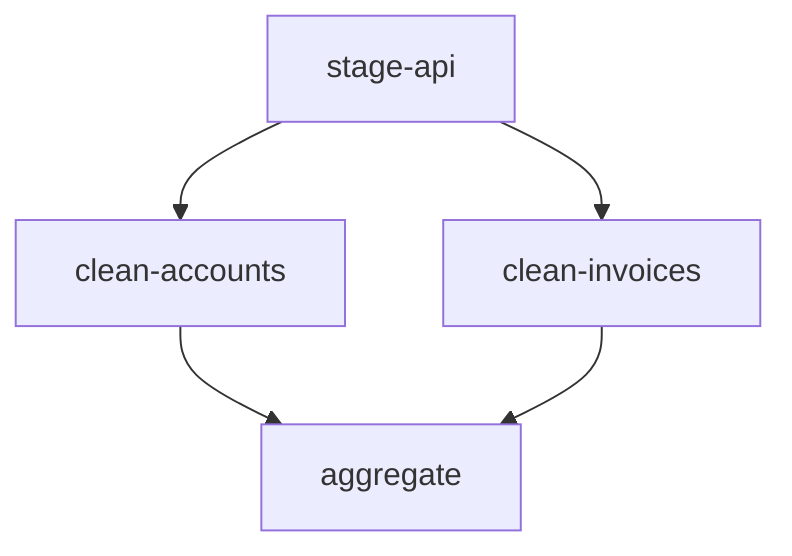
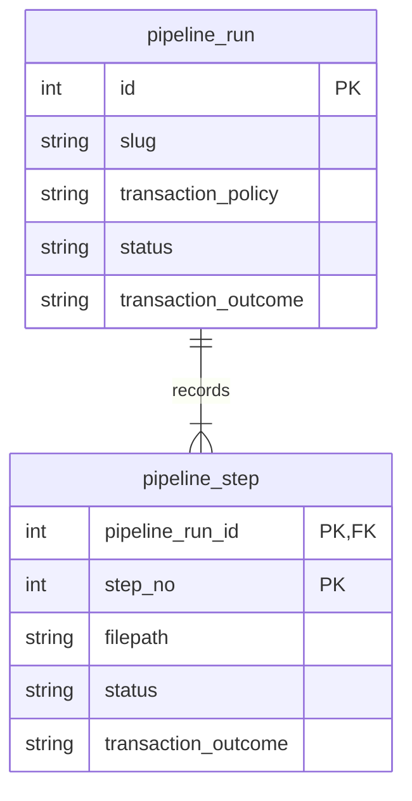
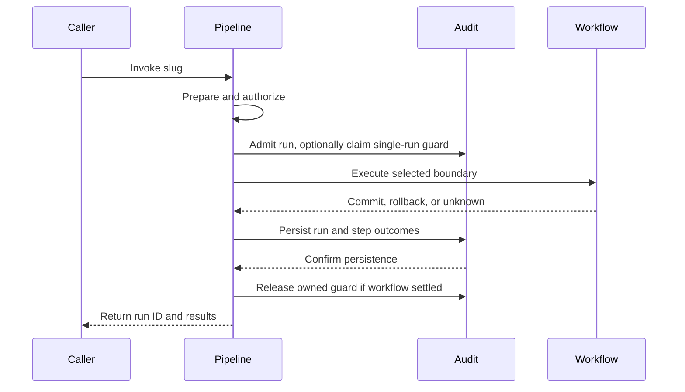

# SQL pipelines

## Problem

A pipeline is a named, repeatable SQL workflow that an operator or application invokes against one database. It packages operational SQL that belongs with the application code: closing invoices at month end, balancing accounts, refreshing cache and aggregate tables, or moving staged API data through temporary tables into the data model. These are sequential data operations, not schema migrations and not warehouse transformation graphs.

The application is a first-class caller. A button click or scheduled job can run a pipeline through the SDK, so invocation latency, parameters, duplicate requests, and progress matter as much as CLI ergonomics.

**Working design, not an implementation contract.** The behavior and data model below capture the current discussion. API shapes and unresolved choices remain proposals. This revision separates pipeline history from change history, makes single-run protection opt-in, and serializes pipeline-wide transactions. The [Ignatius model](../datamodel/ignatius.yml) and its flows illustrate these decisions. The earlier [implementation spec](../spec/sql-pipelines.md) retains superseded decisions and must be reconciled before implementation; this document does not approve that spec or start implementation.

Proposed CLI usage:

```bash
noorm pipeline refresh-reporting --config production
```

```yaml
# db/pipelines/refresh-reporting/pipeline.yml
description: Rebuild reporting tables
transaction: step
steps:
  - id: collect
    sql: collect.sql.tmpl
  - id: summarize
    sql: summarize.sql
  - id: publish
    sql: publish.sql
```

Pipeline folders have no execution order. Within the selected pipeline, a manifest declares either a linear sequence or explicit step dependencies. The example is linear, so it runs collect, summarize, and publish sequentially, stopping at the first failure. Another invocation starts again at collect.

## Goals / Non-goals

| In scope | Outside the current design |
|---|---|
| Named SQL workflows on one resolved database | Cross-database connections and external data movement |
| Linear or dependency-ordered steps, with bounded parallelism and fresh invocations | Scheduling, automatic retries, and resume |
| Pipeline-wide, per-step, or unmanaged transactions | Generic undo after commit or migration-style revert scripts |
| Independent pipeline-run and step history | Pipeline records in schema-change history or a database registry of definitions |
| CLI invocation, and SDK invocation from application code | Committed SDK signatures, runtime-input syntax, TUI or MCP surfaces |
| Local CSV, JSON, and YAML inputs through existing file/template capabilities | Automatic imports of neighboring files or a new input-loading language |
| Opt-in single-run protection per config and pipeline | Built-in business idempotency or serialization by default |

Single database means one resolved database target, not necessarily one physical connection for execution, audit, locks, and monitoring. Execution requires session affinity; auxiliary connections must still target that database.

## Approaches

### Execution

| Option | Approach | Benefit | Cost or risk |
|---|---|---|---|
| A | Use existing `run files` and shell scripts | No new workflow surface | No shared manifest, pipeline identity, or transaction policy |
| B | Treat pipelines as unordered changes | Reuses migration infrastructure | Applied-state semantics and path deduplication conflict with fresh runs |
| C | Add pipeline orchestration over shared SQL primitives | Reuses templates and dialect execution without inheriting migration semantics | Requires explicit transaction, audit, and session handling |
| D | Add a general workflow engine | Could support external tasks and dependency graphs | Introduces capabilities outside SQL orchestration |

### History

| Option | Approach | Benefit | Cost or risk |
|---|---|---|---|
| A | Store everything in existing history tables | One history structure | Workflow-specific state expands generic records |
| B | Store pipelines only in new tables | Business-process history has its own identity, state, and retention | Pipeline tables must carry their own execution evidence |
| C | Link dedicated pipeline tables to existing history | Preserves a combined operation history | Couples business-process tracking to change history and duplicates status ownership |

## Recommendation

Use execution option C and history option B: a shared core SQL executor behind caller-facing APIs, with independent pipeline-run and step history. Pipelines represent business processes; schema-change tracking is not their parent model.

The existing runner imports template processing, SQL-body execution, and tracking separately in `src/core/runner/runner.ts`. Reuse preparation and execution without routing pipelines through its checksum skip gate or change-history tracking. Pipelines do not create `change` or `executions` rows, and do not add a `change_type: pipeline` discriminator.

### Definitions and invocation

```text
db/
├── sql/
├── changes/
└── pipelines/
    └── refresh-reporting/
        ├── pipeline.yml
        ├── collect.sql.tmpl
        ├── summarize.sql
        ├── publish.sql
        ├── accounts.csv
        ├── mappings.json
        └── rules.yaml
```

| Rule | Current design |
|---|---|
| Location | `paths.pipelines`, proposed default `./db/pipelines`, follows existing settings and environment resolution |
| Selection | One slug identifies one folder containing `pipeline.yml`; no dates, numeric prefixes, next, or fast-forward |
| Step identity | The array position supplies the one-based `step_no`; filenames never order steps |
| Ordering mode | No `needs` key anywhere means linear. Any `needs` key means graph. A manifest that mixes the two is rejected |
| Dependencies | Graph steps name prerequisites with `needs`; `needs: []` declares a root |
| Parallelism | Independent ready steps may run together under `step` or `none`, bounded by a configurable cap; `pipeline` always serializes |
| Graph validation | Duplicate ids, unknown targets, self-dependencies, and cycles all fail preflight |
| Declared files | Only referenced `.sql` and `.sql.tmpl` files execute; other files are available inputs, not automatically executed or imported |
| Step label | Manifest `id` supplies the readable `pipeline_step.name`; it is unique within the run, not the relational identity |
| Repeated files | Different declarations may reference the same path; each executes at its own step number |
| Preparation | Validate all declarations and prepare SQL before workflow execution; execute those prepared bytes |
| Path boundary | Resolve referenced files inside the selected pipeline folder, including symlinks; reject escapes and missing files |
| Templates | Reuse existing data, helpers, config, environment, and secrets. There is no agreed new input-binding language |
| Local data | CSV, JSON, and YAML may live beside the manifest and SQL; steps use existing file/template capabilities to consume them |

Preparing every template first means rendering a later step cannot depend on mutations from an earlier step. Local data files are consumed when explicitly referenced through the existing preparation facilities; their presence alone does not load database rows. This introduces no pipeline-specific loader or new template syntax. Template helpers are trusted project code; preparing a dry run does not sandbox them.

### Step ordering

Two modes, never mixed. A manifest with no `needs` key is linear: the array is the execution order, exactly as declared. A manifest where any step declares `needs` is a graph: every step must declare its prerequisites, and the array position becomes declaration identity only.

```yaml
description: Load staged ERP data
transaction: step
steps:
  - id: stage-api
    sql: stage-api.sql
    needs: []

  - id: clean-accounts
    sql: clean-accounts.sql
    needs: [stage-api]

  - id: clean-invoices
    sql: clean-invoices.sql
    needs: [stage-api]

  - id: aggregate
    sql: aggregate.sql
    needs: [clean-accounts, clean-invoices]
```

The two cleaning steps become eligible after staging, and aggregate waits for both. Under `step`, they may run concurrently within the cap; under `pipeline`, the same graph executes serially.



Mixed manifests are rejected because an implicit "depends on the step above" edge silently under-approximates fan-in: a step after a parallel branch would run while its sibling still writes. Requiring `needs` on every graph step removes the ambiguity. Linear manifests keep zero ceremony and unchanged behavior.

In graph mode, `step_no` remains declaration identity within a run, not execution order or a stable identifier across manifest edits. Readers take dependencies from `needs`. Reordering the array changes `step_no` without changing dependency constraints; history belongs to that run's manifest snapshot.

Failure in a graph follows the run boundary, not a branch: stop scheduling new steps, let in-flight steps finish, then mark all unstarted steps `skipped`. Independent work that already committed stays committed, so the run reports `partial` under `step` or `none` when committed effects remain.

### Transaction boundaries

| Policy | Boundary | If the second step fails |
|---|---|---|
| `pipeline` | One transaction spans all steps | Roll back the transactional work of the first and second steps; do not start the third |
| `step` | One transaction per declaration | Keep the first step committed; roll back the second; do not start the third |
| `none` | Noorm adds no workflow transaction | Previously committed effects remain; the failing step may leave partial effects |

Concurrency intersects the policy, because a transaction is a session and a session runs one statement at a time.

| Policy | Concurrent steps in graph mode |
|---|---|
| `pipeline` | Serialized. Accept the graph and execute one eligible step at a time on one connection in one transaction |
| `step` | Allowed. Each ready step gets its own transaction and its own connection |
| `none` | Allowed. Each concurrently ready step gets its own pinned session, so session-local state does not cross branches |

For `step` and `none`, the proposed cap defaults low, around four, and must not exceed the resolved pool size. SQLite serializes writers, so parallelism there buys almost nothing and risks busy timeouts; treat that cap as effectively one for write-heavy pipelines. `pipeline` always has an effective cap of one. Dependencies express prerequisites, not a promise of parallel execution.

`step` is the current default. Under managed policies, every fragment of a step must use the relevant transaction executor. `pipeline` uses one pinned session for all steps, including graph steps executed serially. A linear `none` pipeline also keeps workflow SQL on one pinned session. These modes preserve session affinity, subject to the database's temporary-object and transaction rules.

A `none` graph gives each ready step its own session; dependencies do not transfer temporary tables, session variables, or `SET` values between steps. `step` commits independently and does not promise session reuse, even for a linear manifest. Workflows that share session-local state across steps must use `pipeline` or linear `none`.

| Constraint | Consequence |
|---|---|
| SQL returns an error value rather than throwing | Orchestration must fail the transaction rather than return normally and commit |
| Long transactions hold locks and resources | Pipeline-wide atomicity is a deliberate author choice |
| Implicit commits, nontransactional storage, or routines that commit | A wrapping transaction cannot promise universal rollback |
| SQL authors manage their own transactions | Allowed only under `none`; do not compete with noorm-managed boundaries |
| Cancellation is unavailable mid-statement | Stop subsequent steps, but do not claim the active statement was cancelled |
| Commit acknowledgement is lost | Record uncertainty; a disconnect is not proof of rollback |

Known direct transaction-control and implicit-commit statements should be rejected in managed modes through bounded, dialect-aware recognition. Procedural blocks such as MSSQL `BEGIN ... END` must remain valid. Lexical checks cannot prove that routines or dynamic SQL are safe. The precise supported-statement contract remains a review question.

Existing change transactions are PostgreSQL-only in `src/core/change/executor.ts`. That implementation does not establish pipeline guarantees for MySQL, SQLite, or MSSQL. Transactional DML, MSSQL `GO` composition, and SQLite statement execution need real-database proof before these policies are offered. MySQL currently rejects multi-statement file bodies; pipelines do not silently change that driver contract.

### Data model and identity

Each invocation owns an independent pipeline-run ID. Its steps use declaration position as their identity; no relationship to change history is required.



The ERD shows identity and ownership, not every column. PostgreSQL/MSSQL use the `noorm` schema; MySQL/SQLite use prefixed internal names.

The [Ignatius model](../datamodel/ignatius.yml), [portable viewer](../datamodel/schema.html), and data flows for [execution](../datamodel/flows/pipeline-execution/index.md) and [history queries](../datamodel/flows/pipeline-history/index.md) show independent pipeline history and optional single-run admission. Existing change-history tables remain separate. The admission guard in the flows represents a required coordination contract when protection is enabled, not a settled storage mechanism or new database table.

| Invariant | Meaning |
|---|---|
| Independent `pipeline_run.id` | Generate a new pipeline identity for every admitted invocation; it is not an FK to `change` |
| Step PK `(pipeline_run_id, step_no)` | Declaration position is identity. There is no surrogate step ID. Execution order comes from `needs` in graph mode |
| Step FK `pipeline_run_id` | Every step belongs to one pipeline run, including intended steps never reached |
| Unique `(pipeline_run_id, name)` | Labels remain unambiguous without replacing sequence identity |
| Direct execution evidence | Each step stores its own SQL path, rendered checksum, timing, error, status, and transaction outcome; there is no `execution_id` link |
| No pipeline writes to change history | Existing `change` and `executions` records and discriminators remain unchanged |
| Admission-policy snapshot | Proposed `pipeline_run.single_run` records whether protection was requested for that invocation; the audit flag does not enforce exclusion or settle manifest/SDK syntax |
| No definition table | The folder and manifest define the workflow; tables track invocations |

### Status authority and outcomes

| Fact | Authoritative record |
|---|---|
| Run identity, config, executing identity, invoking version, and run timing | `pipeline_run` |
| Slug, manifest checksum, transaction policy, workflow status, and transaction outcome | `pipeline_run` |
| Declaration position and label, SQL path, rendered checksum, step timing, and execution error | `pipeline_step` |
| Step execution status and transaction outcome | `pipeline_step` |

Pipeline tables are the only history authority for pipeline invocations. Their statuses are not projected into `change` or `executions`. Exact column names and domains beyond the keys remain subject to schema review.

A successful statement is not necessarily committed work. A step can execute successfully while its transaction outcome is pending, rolled back, or unknown. Under `none`, confirmed `no_effects` is not described as a rollback. `skipped` means a declared step was never attempted after failure or interruption, not that its checksum matched.

The model's examples illustrate whole-pipeline rollback, per-step partial completion, commit and rollback uncertainty, fresh reruns, and repeated file declarations. Additional cases cover overlapping unprotected runs, protected pending intent, serialized and concurrent dependency graphs, and neighboring local input files. Example checksums remain abbreviated to eight characters for readability; storage and runtime hash semantics are unchanged.

### Audit persistence and failure

Audit records must survive workflow rollback, but a workflow commit and a later audit update are not one atomic event.



Persist the pipeline run and intended pipeline steps before workflow transactions. With single-run protection enabled, admission must claim the guard atomically with establishing the pending run, or provide an equivalent race-free protocol. Buffer outcomes while a workflow transaction is open, then persist run and step state in a separate bookkeeping transaction. Repeat at each resolved boundary for `step` mode. In SQLite, a second audit writer must not compete with the workflow writer.

A crash can leave intent or incomplete finalization in history. Do not infer commit or rollback from pending rows. Preserve the original execution error when rollback, audit persistence, or cleanup also fails. Release an owned guard only after workflow SQL and transaction activity have settled, even when final bookkeeping fails. Ownership alone is insufficient; uncertain activity requires reconciliation before admission can reopen. Do not report complete success if required bookkeeping failed. Guard recovery must account for unresolved history rather than silently treating an old pending row as completed work.

Preflight failure, policy denial, single-run admission contention, and dry-run do not create pipeline-run records in the current proposal. They remain caller-visible errors or previews. This is a policy choice, not an inability to audit rejected invocations.

### Optional single-run protection

Overlapping invocations are allowed by default. Authors may opt into at most one pending or running invocation per resolved config and pipeline slug. This is separate from concurrency between steps inside a run.

| Concern | Contract |
|---|---|
| Scope | The same config and pipeline slug; unrelated pipelines are not blocked |
| Admission | Atomically reserve the run or return busy; checking status and then inserting without coordination races |
| Pending intent | Counts as active so another caller cannot enter between admission and SQL execution |
| Completed invocation | Does not prevent a fresh run, even with identical inputs and files |
| Crashed or disconnected caller | Requires an ownership and recovery rule; stale status must not block forever or permit overlap with a still-running database operation |
| Business idempotency | The application's SQL enforces domain rules, such as closing an accounting period only once |

This option does not promise exactly-once execution, deduplicate completed requests, or serialize other pipelines that touch the same business rows. Manifest/SDK syntax, the admission mechanism, and stale-run reconciliation remain open.

### Application-triggered requirements

An application caller raises requirements that a CLI-only feature avoids. These are requirements, not settled syntax.

| Requirement | Why it matters | Current direction |
|---|---|---|
| Runtime inputs | Month close needs a period; tenant work needs an id | Typed manifest inputs bound into the existing template context. Syntax open |
| Business repeatability | A second completed request must not close the same period twice | Business SQL owns guards and uniqueness rules; no built-in request-idempotency key is proposed |
| Result detail | The UI shows outcomes, not an exit code | Per-step affected row counts and optional domain results. Capture mechanism open |
| Caller concurrency | Two users can trigger the same operation together | Optional single-run protection, disabled by default. When enabled, a competing caller gets busy rather than a silently queued run |
| Progress | An ETL pipeline outlives an HTTP request | SDK progress events or run polling. Decide before promising live UI feedback |
| Caller identity | The application user is not the database operator | Existing config access policy applies. Per-caller attribution is an open question |

The SDK is the primary invocation surface for this use case; the CLI remains the operator and CI path. Both call the same executor, so input validation, optional single-run admission, and audit behavior cannot diverge by entry point.

### Caller-facing APIs

These APIs are proposed, not available commands or SDK methods.

| CLI example | Behavior |
|---|---|
| `noorm pipeline refresh-reporting --config production` | Execute against the resolved config |
| `noorm pipeline refresh-reporting --dry-run` | Prepare and report ordered steps without workflow SQL, run history, or an execution lock |
| `noorm pipeline refresh-reporting --json` | Return structured identity, ordered results, outcomes, and errors |

Use the existing `run:dir` authorization semantics in the core entry point, so direct callers do not bypass policy. When single-run protection is enabled, scope admission to the config and pipeline rather than the config alone. The current lock table enforces `UNIQUE(config_name)`; it cannot provide that scope unchanged. Extending it or choosing a separate admission mechanism remains open. Existing run commands are not all lock-aware, so a pipeline guard would not serialize arbitrary SQL activity.

Proposed SDK shape, following the existing `ctx.noorm` namespaces:

```typescript
const ctx = await createContext({ config: 'production' });
await ctx.connect();
try {
    const result = await ctx.noorm.pipelines.run('refresh-reporting');
    // Inspect the returned run ID, status, steps, and transaction outcomes.
} finally {
    await ctx.disconnect();
}
```

Possible read APIs are `ctx.noorm.pipelines.history(slug, { limit: 20 })` and `ctx.noorm.pipelines.getRun(runId)`. Preview could use `run(slug, { dryRun: true })`. SDK return/error conventions, method names, and whether these methods belong in the first implementation remain open. There is no agreed CLI history syntax.

The CLI and SDK should invoke the same core executor. The resolved context supplies the database; the manifest supplies transaction policy. A caller-owned transaction is not part of this API because it would conflict with manifest boundaries and independent audit persistence.

### Evidence and verification boundaries

| Surface | Evidence or role |
|---|---|
| `src/core/shared/tables.ts` | Existing operation/execution fields, statuses, and dialect table naming |
| `src/core/runner/runner.ts` | Existing preparation, checksum decisions, and execution tracking |
| `src/core/runner/mssql-batches.ts` | Shared SQL-body execution and dialect fragments |
| `src/core/runner/statement-watcher.ts` | Pinned execution, monitoring, and cancellation limits |
| `src/core/change/executor.ts` | Existing transaction and shared-lock integration |
| `src/core/settings/` and `src/cli/index.ts` | Configuration and command integration conventions |
| `docs/datamodel/data/pipelines/` | Proposed independent run/step records, direct execution evidence, and synthetic lifecycle examples |

The model has illustrative coverage, not runtime proof: all three policies crossed with success, first failure, and later failure; pending/running states; interruption; audit gaps; uncertain outcomes; fresh reruns; and repeated file declarations. Examples also cover local inputs, default overlapping runs, protected pending admission, and branching graphs. Before implementation is accepted, verify these against real databases, including admission races and stale-owner recovery, SQLite audit contention, history consistency, access controls, and unchanged build/migration behavior. Documentation-only validation does not establish those guarantees.

## Open questions

| Question | Current direction and decision still needed |
|---|---|
| Runtime parameters | App-triggered pipelines need typed inputs such as a closing period or tenant. Decide the manifest and SDK syntax, validation, and whether values are recorded in history |
| SDK and history APIs | The SDK is now a primary caller. Decide public names, errors, result shape, progress delivery, and initial scope |
| Dependency snapshot | A manifest checksum identifies the graph, but history cannot reconstruct `needs` after the fact. Decide whether to snapshot dependencies per run or rely on checksum plus version control |
| Single-run option | Decide manifest/SDK syntax for opt-in protection, admission ownership, and stale pending/running recovery. The default permits overlap |
| Admission mechanism | Per-pipeline protection needs a scope beyond `UNIQUE(config_name)`. Decide an internal lock-table change or a separate race-free mechanism |
| Local input provenance | Reuse existing loaders and template context. Decide whether history records local data-file identities in addition to rendered SQL checksums, without retaining secrets |
| Parallelism defaults | Decide the default cap, its relation to pool size, and per-dialect behavior, especially SQLite |
| Result payload | Define how steps report affected row counts or domain results without exposing raw SQL or secrets |
| State vocabulary | Examples distinguish execution status and persistence outcome. Finalize domains and meanings, especially terminal versus unresolved unknown states |
| Live progress versus durable audit | Buffering avoids SQLite contention, but pending durable rows may lag live progress. Decide what history promises during an active transaction |
| Managed SQL support | Specify the direct rejection set and dialect limits without promising a general SQL safety analyzer |
| Pipeline schema | Finalize independent run/step columns, FK and uniqueness constraints, indexes, and error representation across supported dialects |
| Retention and deletion | Define cleanup of pipeline runs and their steps independently of change history |
| Long-running invocations | When protection is enabled, define lease renewal, ownership-safe release, and recovery without admitting overlap with active SQL. Define cancellation behavior under each transaction policy |
| Failure output | Define structured primary/secondary errors, audit failure handling, and unknown-outcome exit mapping. Existing CLI exits are success 0, failure 1, usage 2, partial 3 |
| Implementation readiness | Reconcile the prior spec after the design settles, and keep the Ignatius entities, examples, flows, and exported viewer aligned with subsequent decisions. This draft is not approval to implement |
