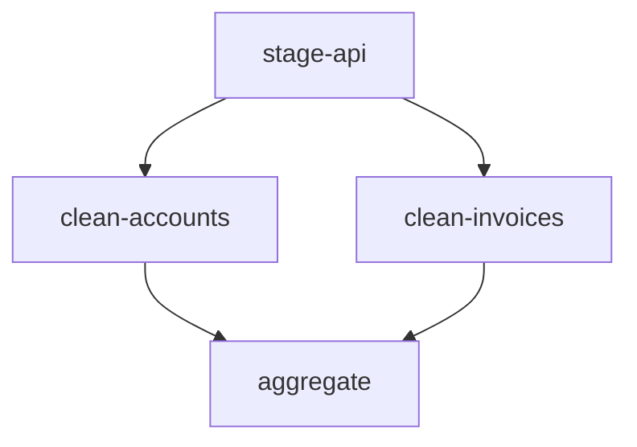
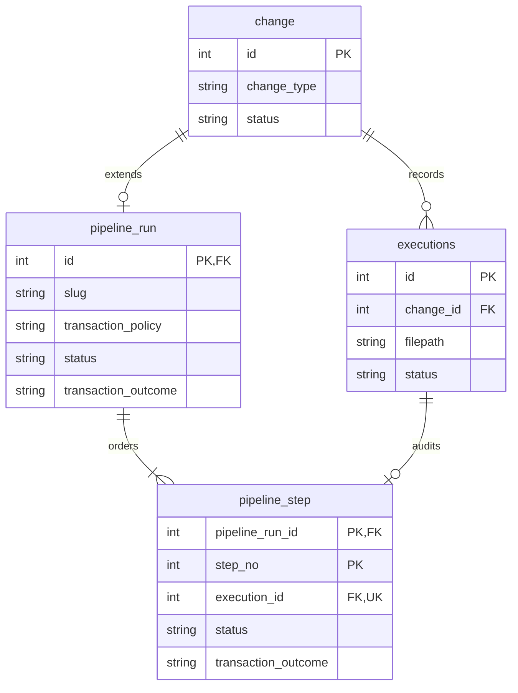
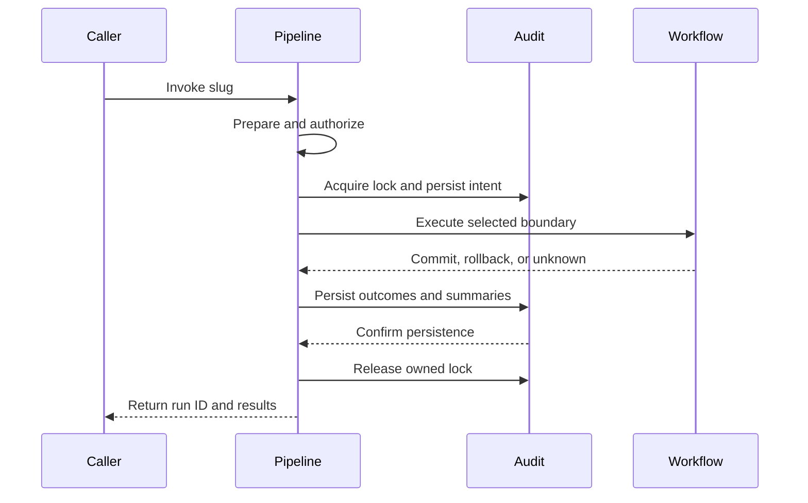

# SQL pipelines

## Problem

A pipeline is a named, repeatable SQL workflow that an operator or application invokes against one database. It packages operational SQL that belongs with the application code: closing invoices at month end, balancing accounts, refreshing cache and aggregate tables, or moving staged API data through temporary tables into the data model. These are sequential data operations, not schema migrations and not warehouse transformation graphs.

The application is a first-class caller. A button click or scheduled job can run a pipeline through the SDK, so invocation latency, parameters, duplicate requests, and progress matter as much as CLI ergonomics.

**Working design, not an implementation contract.** The behavior and data model below capture the current discussion. API shapes and unresolved choices remain proposals. The earlier [implementation spec](../spec/sql-pipelines.md) predates the linked-history model and sequence-based step key; it must be reconciled before implementation. This document does not approve that spec or start implementation.

Proposed CLI usage:

```bash
noorm pipeline refresh-reporting --config production
```

```yaml
# db/pipelines/refresh-reporting/pipeline.yml
description: Rebuild reporting tables
transaction: step
steps:
  - id: collect
    sql: collect.sql.tmpl
  - id: summarize
    sql: summarize.sql
  - id: publish
    sql: publish.sql
```

Pipeline folders have no execution order. Within the selected pipeline, a manifest declares either a linear sequence or explicit step dependencies. The example is linear, so it runs collect, summarize, and publish sequentially, stopping at the first failure. Another invocation starts again at collect.

## Goals / Non-goals

| In scope | Outside the current design |
|---|---|
| Named SQL workflows on one resolved database | Cross-database connections and external data movement |
| Linear or dependency-ordered steps, with bounded parallelism and fresh invocations | Scheduling, automatic retries, and resume |
| Pipeline-wide, per-step, or unmanaged transactions | Generic undo after commit or migration-style revert scripts |
| Pipeline tracking linked to general operation history | A database registry of pipeline definitions |
| CLI invocation, and SDK invocation from application code | Committed SDK signatures, runtime-input syntax, TUI or MCP surfaces |

Single database means one resolved database target, not necessarily one physical connection for execution, audit, locks, and monitoring. Execution requires session affinity; auxiliary connections must still target that database.

## Approaches

### Execution

| Option | Approach | Benefit | Cost or risk |
|---|---|---|---|
| A | Use existing `run files` and shell scripts | No new workflow surface | No shared manifest, pipeline identity, or transaction policy |
| B | Treat pipelines as unordered changes | Reuses migration infrastructure | Applied-state semantics and path deduplication conflict with fresh runs |
| C | Add pipeline orchestration over shared SQL primitives | Reuses templates and dialect execution without inheriting migration semantics | Requires explicit transaction, audit, and session handling |
| D | Add a general workflow engine | Could support external tasks and dependency graphs | Introduces capabilities outside SQL orchestration |

### History

| Option | Approach | Benefit | Cost or risk |
|---|---|---|---|
| A | Store everything in existing history tables | One history structure | Workflow-specific state expands generic records |
| B | Store pipelines only in new tables | Dedicated workflow model | General operation history would omit pipeline activity |
| C | Link dedicated pipeline tables to existing history | Keeps workflow state separate while preserving general history | Requires coherent links and derived summary updates |

## Recommendation

Use execution option C and history option C: a shared core executor behind caller-facing APIs, with dedicated pipeline state linked to existing operation and execution records. This is the current design direction, open to further review.

The existing runner imports template processing, SQL-body execution, and tracking separately in `src/core/runner/runner.ts`. Reuse the first two without routing pipelines through the runner's checksum skip gate. Existing operation and file records are defined in `src/core/shared/tables.ts`; they already provide the general parent/child audit structure.

### Definitions and invocation

```text
db/
├── sql/
├── changes/
└── pipelines/
    └── refresh-reporting/
        ├── pipeline.yml
        ├── collect.sql.tmpl
        ├── summarize.sql
        └── publish.sql
```

| Rule | Current design |
|---|---|
| Location | `paths.pipelines`, proposed default `./db/pipelines`, follows existing settings and environment resolution |
| Selection | One slug identifies one folder containing `pipeline.yml`; no dates, numeric prefixes, next, or fast-forward |
| Step identity | The array position supplies the one-based `step_no`; filenames never order steps |
| Ordering mode | No `needs` key anywhere means linear. Any `needs` key means graph. A manifest that mixes the two is rejected |
| Dependencies | Graph steps name prerequisites with `needs`; `needs: []` declares a root |
| Parallelism | Independent ready steps may run together, bounded by a configurable concurrency cap |
| Graph validation | Duplicate ids, unknown targets, self-dependencies, and cycles all fail preflight |
| Declared files | Only referenced `.sql` and `.sql.tmpl` files execute; unlisted files are ignored |
| Step label | Manifest `id` supplies the readable `pipeline_step.name`; it is unique within the run, not the relational identity |
| Repeated files | Different declarations may reference the same path; each executes at its own step number |
| Preparation | Validate all declarations and prepare SQL before workflow execution; execute those prepared bytes |
| Path boundary | Resolve referenced files inside the selected pipeline folder, including symlinks; reject escapes and missing files |
| Templates | Reuse existing data, helpers, config, environment, and secrets. There is no agreed new input-binding language |

Preparing every template first means rendering a later step cannot depend on mutations from an earlier step. Template helpers are trusted project code; preparing a dry run does not sandbox them.

### Step ordering

Two modes, never mixed. A manifest with no `needs` key is linear: the array is the execution order, exactly as declared. A manifest where any step declares `needs` is a graph: every step must declare its prerequisites, and the array position becomes declaration identity only.

```yaml
description: Load staged ERP data
transaction: step
steps:
  - id: stage-api
    sql: stage-api.sql
    needs: []

  - id: clean-accounts
    sql: clean-accounts.sql
    needs: [stage-api]

  - id: clean-invoices
    sql: clean-invoices.sql
    needs: [stage-api]

  - id: aggregate
    sql: aggregate.sql
    needs: [clean-accounts, clean-invoices]
```

In graph mode, the two cleaning steps run concurrently after staging, and aggregate waits for both.



Mixed manifests are rejected because an implicit "depends on the step above" edge silently under-approximates fan-in: a step after a parallel branch would run while its sibling still writes. Requiring `needs` on every graph step removes the ambiguity. Linear manifests keep zero ceremony and unchanged behavior.

In graph mode, `step_no` remains the declaration identity, so history stays stable when the graph is edited, but it no longer promises execution order. Readers take order from `needs`. Reordering the array changes `step_no` without changing execution, which is acceptable for an audit record tied to one manifest snapshot, and confusing enough to discourage gratuitous reordering.

Failure in a graph follows the run boundary, not a branch: stop scheduling new steps, let in-flight steps finish, then mark every transitive dependent `skipped`. Independent work that already committed stays committed, so the run reports `partial` under `step` or `none`.

### Transaction boundaries

| Policy | Boundary | If the second step fails |
|---|---|---|
| `pipeline` | One transaction spans all steps | Roll back the transactional work of the first and second steps; do not start the third |
| `step` | One transaction per declaration | Keep the first step committed; roll back the second; do not start the third |
| `none` | Noorm adds no workflow transaction | Previously committed effects remain; the failing step may leave partial effects |

Concurrency intersects the policy, because a transaction is a session and a session runs one statement at a time.

| Policy | Concurrent steps in graph mode |
|---|---|
| `pipeline` | Not allowed. One transaction spans the whole run, so preflight rejects a graph whose ready steps can overlap |
| `step` | Allowed. Each ready step gets its own transaction and its own connection |
| `none` | Allowed. Parallelism is bounded by the concurrency cap and whatever the database tolerates |

The cap defaults low, around four, and must not exceed the resolved pool size. SQLite serializes writers, so parallelism there buys almost nothing and risks busy timeouts; treat that cap as effectively one for write-heavy pipelines. `pipeline` plus a concurrent graph is a definition error, not a silent downgrade to sequential.

`step` is the current default. Under managed policies, every fragment of a step must use the relevant transaction executor. Under `none`, keep workflow SQL on one pinned session so session-local objects remain accessible. Session affinity does not extend a step-local transaction or preserve objects that the database drops on commit.

| Constraint | Consequence |
|---|---|
| SQL returns an error value rather than throwing | Orchestration must fail the transaction rather than return normally and commit |
| Long transactions hold locks and resources | Pipeline-wide atomicity is a deliberate author choice |
| Implicit commits, nontransactional storage, or routines that commit | A wrapping transaction cannot promise universal rollback |
| SQL authors manage their own transactions | Allowed only under `none`; do not compete with noorm-managed boundaries |
| Cancellation is unavailable mid-statement | Stop subsequent steps, but do not claim the active statement was cancelled |
| Commit acknowledgement is lost | Record uncertainty; a disconnect is not proof of rollback |

Known direct transaction-control and implicit-commit statements should be rejected in managed modes through bounded, dialect-aware recognition. Procedural blocks such as MSSQL `BEGIN ... END` must remain valid. Lexical checks cannot prove that routines or dynamic SQL are safe. The precise supported-statement contract remains a review question.

Existing change transactions are PostgreSQL-only in `src/core/change/executor.ts`. That implementation does not establish pipeline guarantees for MySQL, SQLite, or MSSQL. Transactional DML, MSSQL `GO` composition, and SQLite statement execution need real-database proof before these policies are offered. MySQL currently rejects multi-statement file bodies; pipelines do not silently change that driver contract.

### Data model and identity

The pipeline run extends a general operation; the step's sequence number supplies its identity within that run. In graph mode that number is declaration identity, not execution order.



The ERD is a relationship overview. The [Ignatius model](../datamodel/ignatius.yml) and [portable viewer](../datamodel/schema.html) contain the complete proposed columns and synthetic examples. PostgreSQL/MSSQL use the `noorm` schema; MySQL/SQLite use prefixed internal names.

The model also includes proposed data-flow diagrams for [pipeline execution](../datamodel/flows/pipeline-execution/index.md) and [history queries](../datamodel/flows/pipeline-history/index.md). These show the data exchanged by preparation, reservation, SQL execution, and audit finalization, with readable flow labels and example payloads. In-memory stores are transient handoffs, not new tables or resume checkpoints. Process numbers label DFD processes; they do not replace the pipeline's manifest-derived step numbers.

| Invariant | Meaning |
|---|---|
| `pipeline_run.id = change.id` | The operation ID is the pipeline run ID; there is no second generated identity |
| Parent `change_type = 'pipeline'` | Pipeline invocations appear in general history, without becoming migrations or ordinary checksum-gated runs |
| Step PK `(pipeline_run_id, step_no)` | Declaration position is identity. There is no surrogate step ID. Execution order comes from `needs` in graph mode |
| Unique `execution_id` | Each intended pipeline step links to one distinct file-execution record, including steps never reached |
| Unique `(pipeline_run_id, name)` | Labels remain unambiguous without replacing sequence identity |
| `executions.change_id = pipeline_run_id` | The linked file execution must belong to the operation that the pipeline extends |
| No definition table | The folder and manifest define the workflow; tables track invocations |

A shared-key FK alone does not enforce the pipeline discriminator, and independent step FKs do not enforce same-operation coherence. Both require an explicit enforcement design before DDL is finalized.

### Status authority and outcomes

| Fact | Authoritative record |
|---|---|
| Executing identity, config, invoking version | Existing `change` |
| SQL path, rendered checksum, execution error | Existing `executions` |
| Slug, manifest identity, transaction policy, workflow status | `pipeline_run` |
| Declaration identity, step state, and transaction outcome | `pipeline_step` |

Pipeline tables own workflow state. Existing history statuses are coarse projections, updated from that state rather than maintained as competing authorities. In particular, pipeline pending/running projects to generic pending; success projects to success; partial, failed, interrupted, or unknown projects to failed. No new generic status values are assumed.

A successful statement is not necessarily committed work. The model examples show successful steps with pending, rolled-back, and unknown transaction outcomes. Under `none`, confirmed `no_effects` is not described as a rollback. `skipped` means a declared step was never attempted after failure or interruption, not that its checksum matched.

Run 1042 in the model demonstrates whole-pipeline rollback. Run 1043 demonstrates per-step partial completion. Runs 1054 and 1057 demonstrate commit and rollback uncertainty. Runs 1056 and 1058 distinguish an unchanged-manifest rerun from a new manifest that references one file twice. Example checksums are abbreviated to eight characters for readability; storage and runtime hash semantics remain unchanged.

### Audit persistence and failure

Audit records must survive workflow rollback, but a workflow commit and a later audit update are not one atomic event.



Persist the general operation, pipeline run, intended file executions, and pipeline steps before workflow transactions. Buffer outcomes while a workflow transaction is open, then update pipeline state and generic summaries together in a separate bookkeeping transaction. Repeat at each resolved boundary for `step` mode. In SQLite, a second audit writer must not compete with the workflow writer.

A crash can leave intent or incomplete finalization in history. Do not infer commit or rollback from pending rows. Preserve the original execution error when rollback, audit persistence, or cleanup also fails. Release an owned lock in cleanup even when final bookkeeping fails; do not report complete success if required bookkeeping failed.

Preflight failure, policy denial, lock contention, and dry-run do not create pipeline-run records in the current proposal. They remain caller-visible errors or previews. This is a policy choice, not an inability to audit rejected invocations.

### Application-triggered requirements

An application caller raises requirements that a CLI-only feature avoids. These are requirements, not settled syntax.

| Requirement | Why it matters | Current direction |
|---|---|---|
| Runtime inputs | Month close needs a period; tenant work needs an id | Typed manifest inputs bound into the existing template context. Syntax open |
| Idempotent requests | A double-click or retried request must not close the same period twice | Either an idempotency key recorded per config and slug, or SQL guards plus reported row counts. Choose one |
| Result detail | The UI shows outcomes, not an exit code | Per-step affected row counts and optional domain results. Capture mechanism open |
| Caller concurrency | Two users can trigger the same operation together | Per-pipeline lock. The second caller gets a busy result, never a silently queued second run |
| Progress | An ETL pipeline outlives an HTTP request | SDK progress events or run polling. Decide before promising live UI feedback |
| Caller identity | The application user is not the database operator | Existing config access policy applies. Per-caller attribution is an open question |

The SDK is the primary invocation surface for this use case; the CLI remains the operator and CI path. Both call the same executor, so input validation, locking, and audit behavior cannot diverge by entry point.

### Caller-facing APIs

These APIs are proposed, not available commands or SDK methods.

| CLI example | Behavior |
|---|---|
| `noorm pipeline refresh-reporting --config production` | Execute against the resolved config |
| `noorm pipeline refresh-reporting --dry-run` | Prepare and report ordered steps without workflow SQL, run history, or an execution lock |
| `noorm pipeline refresh-reporting --json` | Return structured identity, ordered results, outcomes, and errors |

Use the existing `run:dir` authorization semantics in the core entry point, so direct callers do not bypass policy. Coordinate real invocations with a lock scoped to the config and pipeline, not the config alone: an app-triggered month close must not block a cache refresh in the same database. The current lock table enforces `UNIQUE(config_name)`, so per-pipeline scope requires extending the internal lock model; that change belongs in the same schema migration as pipeline tracking. Existing run commands are not all lock-aware, so this does not serialize arbitrary SQL activity. Long-running lease renewal and ownership behavior need review.

Proposed SDK shape, following the existing `ctx.noorm` namespaces:

```typescript
const ctx = await createContext({ config: 'production' });
await ctx.connect();
try {
    const result = await ctx.noorm.pipelines.run('refresh-reporting');
    // Inspect the returned run ID, status, steps, and transaction outcomes.
} finally {
    await ctx.disconnect();
}
```

Possible read APIs are `ctx.noorm.pipelines.history(slug, { limit: 20 })` and `ctx.noorm.pipelines.getRun(runId)`. Preview could use `run(slug, { dryRun: true })`. SDK return/error conventions, method names, and whether these methods belong in the first implementation remain open. There is no agreed CLI history syntax.

The CLI and SDK should invoke the same core executor. The resolved context supplies the database; the manifest supplies transaction policy. A caller-owned transaction is not part of this API because it would conflict with manifest boundaries and independent audit persistence.

### Evidence and verification boundaries

| Surface | Evidence or role |
|---|---|
| `src/core/shared/tables.ts` | Existing operation/execution fields, statuses, and dialect table naming |
| `src/core/runner/runner.ts` | Existing preparation, checksum decisions, and execution tracking |
| `src/core/runner/mssql-batches.ts` | Shared SQL-body execution and dialect fragments |
| `src/core/runner/statement-watcher.ts` | Pinned execution, monitoring, and cancellation limits |
| `src/core/change/executor.ts` | Existing transaction and shared-lock integration |
| `src/core/settings/` and `src/cli/index.ts` | Configuration and command integration conventions |
| `docs/datamodel/data/pipelines/` | Proposed identities, constraints, and linked example scenarios |

The model has illustrative coverage, not runtime proof: all three policies crossed with success, first failure, and later failure; pending/running states; interruption; audit gaps; uncertain outcomes; fresh reruns; and repeated file declarations. Before implementation is accepted, verify these against real databases, including SQLite audit contention, history consistency, access controls, and unchanged build/migration behavior. Documentation-only validation does not establish those guarantees.

## Open questions

| Question | Current direction and decision still needed |
|---|---|
| Runtime parameters | App-triggered pipelines need typed inputs such as a closing period or tenant. Decide the manifest and SDK syntax, validation, and whether values are recorded in history |
| SDK and history APIs | The SDK is now a primary caller. Decide public names, errors, result shape, progress delivery, and initial scope |
| Dependency snapshot | A manifest checksum identifies the graph, but history cannot reconstruct `needs` after the fact. Decide whether to snapshot dependencies per run or rely on checksum plus version control |
| Lock scope | Per-pipeline locking needs a scope beyond `UNIQUE(config_name)`. Decide the internal lock-table change or a separate mechanism |
| Idempotency | Choose between a recorded idempotency key and SQL guards with reported row counts. Both must be safe under retries |
| Parallelism defaults | Decide the default cap, its relation to pool size, and per-dialect behavior, especially SQLite |
| Result payload | Define how steps report affected row counts or domain results without exposing raw SQL or secrets |
| State vocabulary | Examples distinguish execution status and persistence outcome. Finalize domains and meanings, especially terminal versus unresolved unknown states |
| Live progress versus durable audit | Buffering avoids SQLite contention, but pending durable rows may lag live progress. Decide what history promises during an active transaction |
| Managed SQL support | Specify the direct rejection set and dialect limits without promising a general SQL safety analyzer |
| Relational enforcement | Select constraints that enforce pipeline discriminator and same-operation step links across supported dialects |
| Retention and deletion | Define coordinated cleanup of generic history and pipeline extensions without orphaning or contradicting records |
| Long-running invocations | Confirm lock lease renewal, ownership-safe release, and cancellation behavior under each policy |
| Failure output | Define structured primary/secondary errors, audit failure handling, and unknown-outcome exit mapping. Existing CLI exits are success 0, failure 1, usage 2, partial 3 |
| Implementation readiness | Reconcile the prior spec only after this design discussion settles. This draft is not approval to implement |
