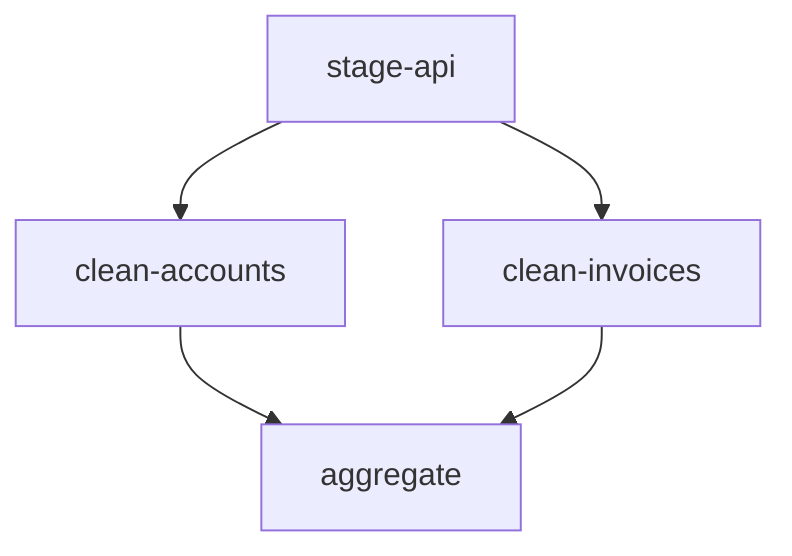
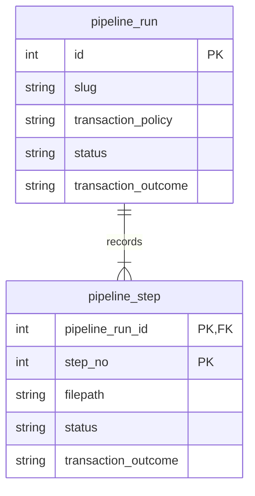
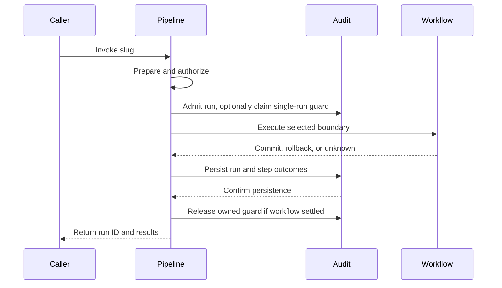
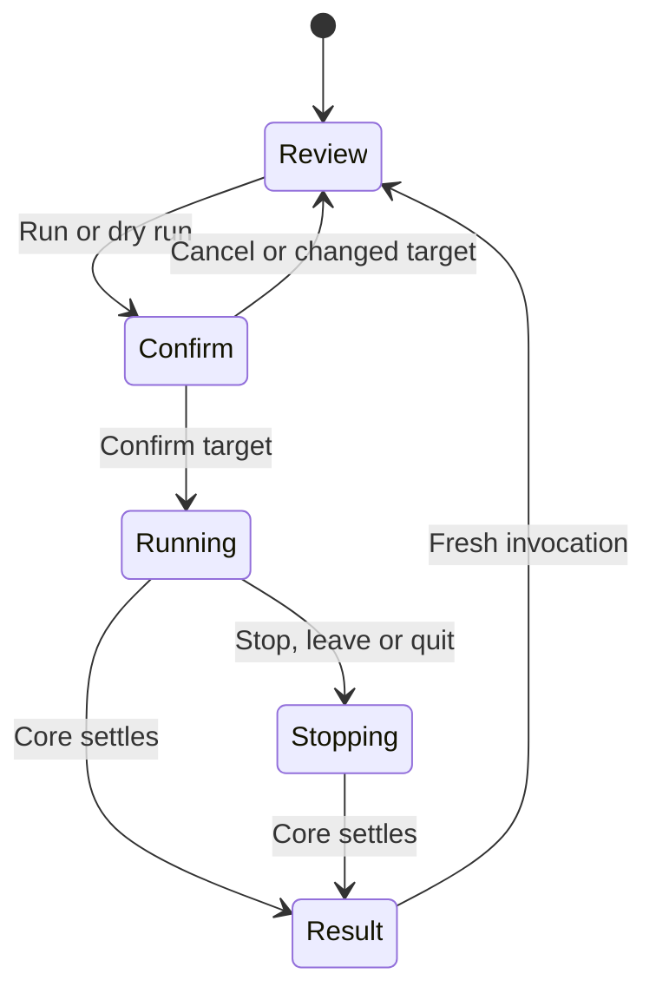

# SQL pipelines

## Problem

A pipeline is a named, repeatable SQL workflow that an operator or application invokes against one database. It packages operational SQL that belongs with the application code: closing invoices at month end, balancing accounts, refreshing cache and aggregate tables, or moving staged data through temporary tables into the data model. Steps can form a dependency graph, but pipelines are not schema migrations or cross-database warehouse engines.

The application is a first-class caller. A button click or scheduled job can run a pipeline through the SDK, so invocation inputs, duplicate requests, and truthful outcomes matter as much as CLI ergonomics.

This design defines the intended behavior; the [implementation spec](../spec/sql-pipelines.md) carries implementation and acceptance details. The [Ignatius model](../datamodel/ignatius.yml) and its flows illustrate the history model, not proof of runtime behavior.

Proposed CLI usage:

```bash
noorm pipeline run refresh-reporting --config production
```

```yaml
# db/pipelines/refresh-reporting/pipeline.yml
description: Rebuild reporting tables
transaction: step
steps:
  - id: collect
    sql: collect.sql.tmpl
  - id: summarize
    sql: summarize.sql
  - id: publish
    sql: publish.sql
```

Pipeline folders have no execution order. Within the selected pipeline, a manifest declares either a linear sequence or explicit step dependencies. The example is linear, so it runs collect, summarize, and publish sequentially, stopping at the first failure. Another invocation starts again at collect.

## Goals / Non-goals

| In scope | Outside the current design |
|---|---|
| Named SQL workflows on one resolved database | Cross-database connections and external data movement |
| Linear or dependency-ordered steps, with bounded parallelism and fresh invocations | Scheduling, automatic retries, and resume |
| Pipeline-wide, per-step, or unmanaged transactions | Generic undo after commit or migration-style revert scripts |
| Independent pipeline-run and step history | Pipeline records in schema-change history or a database registry of definitions |
| CLI and TUI operation, structured runtime inputs, and SDK invocation from application code | New MCP surfaces or a visual pipeline editor |
| Local CSV, JSON, and YAML inputs through existing file/template capabilities | Automatic imports of neighboring files or a new input-loading language |
| Opt-in single-run protection per config and pipeline | Built-in business idempotency or serialization by default |

Single database means one resolved database target, not necessarily one physical connection for execution, audit, locks, and monitoring. Execution requires session affinity; auxiliary connections must still target that database.

## Approaches

### Execution

| Option | Approach | Benefit | Cost or risk |
|---|---|---|---|
| A | Use existing `run files` and shell scripts | No new workflow surface | No shared manifest, pipeline identity, or transaction policy |
| B | Treat pipelines as unordered changes | Reuses migration infrastructure | Applied-state semantics and path deduplication conflict with fresh runs |
| C | Add pipeline orchestration over shared SQL primitives | Reuses templates and dialect execution without inheriting migration semantics | Requires explicit transaction, audit, and session handling |
| D | Add a general workflow engine | Could support external tasks and dependency graphs | Introduces capabilities outside SQL orchestration |

### History

| Option | Approach | Benefit | Cost or risk |
|---|---|---|---|
| A | Store everything in existing history tables | One history structure | Workflow-specific state expands generic records |
| B | Store pipelines only in new tables | Business-process history has its own identity, state, and retention | Pipeline tables must carry their own execution evidence |
| C | Link dedicated pipeline tables to existing history | Preserves a combined operation history | Couples business-process tracking to change history and duplicates status ownership |

### Terminal operation

| Option | Approach | Benefit | Cost or risk |
|---|---|---|---|
| A | Launch CLI commands from a TUI shell wrapper | Reuses commands | Loses structured interaction and duplicates process cancellation and output parsing |
| B | Create an SDK context for each screen | Reuses the public facade | Adds another connection owner and cannot preserve the existing in-memory SQLite database |
| C | Call shared core operations from native TUI screens | Preserves existing forms, policy and structured results | Requires retained connection ownership through settlement, even after a screen unmounts |
| D | Add a YAML or visual graph editor | Can author definitions interactively | Expands beyond operating code-owned SQL workflows |

## Recommendation

Use execution option C and history option B: a shared core SQL executor behind caller-facing APIs, with independent pipeline-run and step history. Pipelines represent business processes; schema-change tracking is not their parent model.

The existing runner imports template processing, SQL-body execution, and tracking separately in `src/core/runner/runner.ts`. Reuse preparation and execution without routing pipelines through its checksum skip gate or change-history tracking. Pipelines do not create `change` or `executions` rows, and do not add a `change_type: pipeline` discriminator.

### Definitions and invocation

```text
db/
├── sql/
├── changes/
└── pipelines/
    └── refresh-reporting/
        ├── pipeline.yml
        ├── collect.sql.tmpl
        ├── summarize.sql
        ├── publish.sql
        ├── accounts.csv
        ├── mappings.json
        └── rules.yaml
```

| Rule | Contract |
|---|---|
| Location | `paths.pipelines` defaults to `./db/pipelines` and follows existing settings and environment overlays |
| Selection | One safe slug segment selects a folder containing exactly `pipeline.yml`; pipeline names are independent of CLI command names |
| Manifest | `description`, `transaction` (default `step`), `concurrency` (default `4`), `singleRun` (default `false`), `inputs` (default `{}`), and nonempty `steps`; reject unknown keys |
| Step identity | The array position supplies the one-based `step_no`; filenames never order steps |
| Ordering mode | No `needs` key anywhere means linear. Any `needs` key means every step declares `needs`, including roots with `[]` |
| Dependencies | Graph steps name prerequisites by step ID; among eligible steps, the lowest declaration `step_no` wins |
| Parallelism | Graph steps under `step` or `none` may run together within the effective cap; linear and `pipeline` execution are serial |
| Graph validation | Duplicate IDs, unknown or self dependencies, and cycles fail preflight |
| Declared files | Only referenced `.sql` and `.sql.tmpl` files execute; other files are available inputs, not automatically executed or imported |
| Step label | Manifest `id` supplies the readable `pipeline_step.name`; it is unique within the run, not the relational identity |
| Repeated files | Different declarations may reference the same path; each executes at its own step number |
| Preparation | Validate all declarations and prepare each SQL body once before workflow SQL; execute those prepared bytes |
| Path boundary | Resolve referenced files inside the selected pipeline folder, including symlinks; reject escapes and missing files |
| Templates | Reuse existing ETA data, helpers, config, environment, and secrets. Reserve `$.input` for validated invocation input in steps and includes, even if a local file or helper uses that name |
| Local data | CSV, JSON, and YAML may live beside the manifest and SQL; steps use existing file/template capabilities to consume them |

Preparing every template first means rendering a later step cannot depend on mutations from an earlier step. Local data files are consumed when explicitly referenced through the existing preparation facilities; their presence alone does not load database rows. This introduces no pipeline-specific loader or new template syntax. Template helpers are trusted project code; preparing a dry run does not sandbox them.

Preflight validates the definition, inputs, paths, rendering, and bounded checks for managed transaction-control statements. It is not a general SQL parser: arbitrary SQL syntax and runtime errors are execution failures and can occur after earlier workflow SQL has run. The transaction-control scan fails closed but cannot be complete, so the executor also proves at runtime that each managed step left noorm's transaction open (see [Transaction boundaries](#transaction-boundaries)).

### Invocation inputs

The manifest declares each input's type, description, and required status, with optional `default` and `choices`:

```yaml
inputs:
  period:
    type: string
    description: Accounting period to close, such as 2026-10
    required: true
  tenantId:
    type: string
    description: Tenant whose accounts should be closed
    required: true
```

The CLI accepts a JSON object through `--input` and derives named flags and pipeline-specific help from the declarations. For example, `--period` and `--tenant-id` address the inputs above. Explicit named flags override matching `--input` fields; defaults fill remaining gaps. `false`, zero, and the empty string are values, not missing inputs. Optional missing properties remain absent.

| Condition | Behavior |
|---|---|
| Declaration | Names are lowerCamelCase, starting with a letter and followed by letters or digits. Descriptions are nonempty; `required` defaults to false. Defaults and scalar choices must match the declared type and are validated when the definition loads. A required input may have a default |
| Types | `string`, finite `number`, safe `integer`, `boolean`, `object`, or `array`. Objects and arrays contain plain JSON-compatible values, not nested schema declarations. Reject cycles, functions, class instances, nonfinite numbers, and prototype-polluting keys |
| Unknown inputs | Reject top-level input keys not declared by the manifest |
| Missing required values | Prompt only for an interactive human with stdin and stdout TTY, outside CI, JSON mode, `--yes`, and `NOORM_YES`. Otherwise fail with the missing names |
| Prompt type | Choices use select, booleans use confirm, and other types use text with shared validation. Optional and defaulted values do not prompt |
| CLI values | Strings stay literal; numbers, integers, and booleans parse strictly. Object and array flags accept JSON. Boolean flags accept an explicit value, including `--enabled=false`. Invalid explicit values fail rather than prompting |
| SDK input | Validate actual JSON types against the same manifest contract, without prompting or CLI coercion |
| Generated flag collision | Reject collisions among generated kebab-case flags and with root or leaf built-ins, aliases, or help, including `slug`, `input`, `config`, `cwd`, `json`, `yes`, `force`, and `dry-run` |
| Prompt cancellation | Stop before admission, workflow SQL, or history writes |
| Missing property access | Fail preparation; templates can guard optional input with membership checks |

The resolved object is available to every ETA step and include as `$.input`, including during dry-run preparation. Input values and rendered SQL are not persisted or output by default, and template errors must not echo secret input. Interpolation is not parameter binding. Use the existing `$.quote` helper for SQL literals, for example ``.

For pipelines, `$.quote` emits a literal whose meaning no session mode can change, because a step can change the mode after rendering. Apostrophes, backslashes, Unicode and empty strings survive unchanged, and quoting never queries or alters session SQL modes.

| Dialect | Pipeline `$.quote` output |
|---|---|
| PostgreSQL | `U&'...'` with every code point as `\XXXX` or `\+XXXXXX`; fails closed when `standard_conforming_strings` is off, and cannot end a `$$` body |
| MySQL | `_utf8mb4 X'<hex>'`, independent of `NO_BACKSLASH_ESCAPES` and `ANSI_QUOTES` |
| MSSQL | `N'...'`, with a `\` before a line break doubled so T-SQL line continuation keeps it |
| SQLite | A standard `'...'` literal |

Pipeline `$.escape` throws `PipelineEscapeError`, and preparation reports it as an invalid definition with rule `escape-unavailable`. Inside an author-written `'...'`, no encoding of the value `\` is correct under both MySQL backslash modes. Nonpipeline template rendering retains its existing behavior.

### Step ordering

Two modes, never mixed. A manifest with no `needs` key is linear: the array is the execution order, exactly as declared. A manifest where any step declares `needs` is a graph: every step must declare its prerequisites, and the array position becomes declaration identity only.

```yaml
description: Load staged ERP data
transaction: step
steps:
  - id: stage-api
    sql: stage-api.sql
    needs: []

  - id: clean-accounts
    sql: clean-accounts.sql
    needs: [stage-api]

  - id: clean-invoices
    sql: clean-invoices.sql
    needs: [stage-api]

  - id: aggregate
    sql: aggregate.sql
    needs: [clean-accounts, clean-invoices]
```

The two cleaning steps become eligible after staging, and aggregate waits for both. Under `step`, they may run concurrently within the cap; under `pipeline`, the same graph executes serially.



Mixed manifests are rejected because an implicit "depends on the step above" edge silently under-approximates fan-in: a step after a parallel branch would run while its sibling still writes. Requiring `needs` on every graph step removes the ambiguity. Linear manifests keep zero ceremony and unchanged behavior.

In graph mode, `step_no` remains declaration identity within a run, not execution order or a stable identifier across manifest edits. Readers take dependencies from `needs`. Reordering the array changes `step_no` without changing dependency constraints; history belongs to that run's manifest snapshot.

Failure in a graph follows the run boundary, not a branch: stop scheduling new steps, let in-flight steps settle, then mark all unstarted steps `skipped`. Confirmed committed work can make the run `partial`; unprovable effects remain `unknown`, including for a failing unmanaged step.

### Transaction boundaries

| Policy | Boundary | If the second step fails |
|---|---|---|
| `pipeline` | One transaction spans all steps | Roll back the transactional work of the first and second steps; do not start the third |
| `step` | One transaction per declaration | Keep the first step committed; roll back the second; do not start the third |
| `none` | Noorm adds no workflow transaction | Previously confirmed committed effects remain; effects of a failing step can be unknown |

Concurrency intersects the policy, because a transaction is a session and a session runs one statement at a time.

| Policy | Concurrent steps in graph mode |
|---|---|
| `pipeline` | Serialized. Accept the graph and execute one eligible step at a time on one connection in one transaction |
| `step` | Allowed. Each ready step gets its own transaction and its own connection |
| `none` | Allowed. Each concurrently ready step gets its own pinned session, so session-local state does not cross branches |

For graph `step` and `none`, `concurrency` is a positive integer defaulting to four. The effective cap is `min(concurrency, config.pool.max ?? 10)`, with a minimum of one. The fallback matches the existing PostgreSQL, MySQL, and MSSQL driver defaults in `src/core/connection/dialects/postgres.ts:40`, `mysql.ts:37`, and `mssql.ts:216`, respectively. SQLite always uses one. Linear execution and `pipeline` also use one. Dependencies express prerequisites, not a promise of parallel execution.

`step` is the current default. Under managed policies, every fragment of a step must use the relevant transaction executor. `pipeline` uses one pinned session for all steps, including graph steps executed serially. A linear `none` pipeline also keeps workflow SQL on one pinned session. These modes preserve session affinity, subject to the database's temporary-object and transaction rules.

A `none` graph gives each ready step its own session; dependencies do not transfer temporary tables, session variables, or `SET` values between steps. `step` commits independently and does not promise session reuse, even for a linear manifest. Workflows that share session-local state across steps must use `pipeline` or linear `none`.

#### Session ownership after failed cleanup

Workflow connections belong to the invocation, not the caller's shared application/history pool. Use one separate, bounded pool per invocation, capped to effective execution concurrency and closed after started work settles. Do not create a pool per step. This deliberately pays connection setup cost to avoid unsupported private Kysely driver hooks and prevents a later bookkeeping `BEGIN` from committing an earlier, unrolled-back MySQL transaction. An unknown outcome and uncertain server activity remain different facts; closing a client pool does not by itself authorize releasing an uncertain run guard.

SQLite `:memory:` must keep its original single handle. A harmless empty-transaction probe can establish reusability after a lost acknowledgement; it does not establish the earlier transaction outcome. If that probe cannot prove settlement, close/invalidate the handle while its workflow lease is still held, and disconnect the SDK context. Losing the in-memory database on unrecoverable cleanup is the fail-closed boundary; ordinary confirmed rollback keeps it usable. File-backed SQLite gets a separate invocation-owned handle.


| Constraint | Consequence |
|---|---|
| SQL returns an error value rather than throwing | Orchestration must fail the transaction rather than return normally and commit |
| Long transactions hold locks and resources | Pipeline-wide atomicity is a deliberate author choice |
| Implicit commits, nontransactional storage, or routines that commit | A wrapping transaction cannot promise universal rollback |
| SQL authors manage their own transactions | Allowed only under `none`; do not compete with noorm-managed boundaries |
| Cancellation is unavailable mid-statement | Stop subsequent steps, but do not claim the active statement was cancelled |
| Commit acknowledgement is lost | Record uncertainty; a disconnect is not proof of rollback |

Managed modes reject directly recognized transaction control and implicit commits with bounded dialect-aware checks, not a general SQL parser. These include PostgreSQL `END`, `ABORT`, and `PREPARE TRANSACTION`, with `BEGIN ATOMIC` bodies rejected; SQLite `END` and `RELEASE`; MySQL autocommit, XA, and implicit-commit DDL, scanned under the default, `ANSI_QUOTES`, and `NO_BACKSLASH_ESCAPES` readings; and MSSQL transaction forms at any token boundary while permitting procedural `BEGIN` and `TRY` blocks. The spec defines the recognition boundary. The scan fails closed, but one masker cannot match four server lexers, and dynamic SQL can still defeat it.

Runtime ownership is the correctness boundary. After opening a managed transaction, noorm marks it: a per-run savepoint on PostgreSQL, MySQL, and SQLite, plus `pg_current_xact_id()` on PostgreSQL, and `CURRENT_TRANSACTION_ID()` on MSSQL. After each managed step and before rollback it proves the open transaction is still that one.

| Check result | Recorded |
|---|---|
| Proven noorm's | The step succeeds with a pending outcome until the boundary commits or rolls back |
| Proven ended or replaced | `TRANSACTION_ESCAPED` (phase `execute`), the step fails, and the outcome is `unknown` |
| The check itself failed | `OWNERSHIP_UNVERIFIED` (phase `cleanup`), the outcome is `unknown`, and activity counts as unsettled, so the guard is retained unless a SQLite settlement probe proves the session idle |

A `COMMIT` or `ROLLBACK` that returns OK is not proof: PostgreSQL warns, and MySQL and MSSQL may act on a transaction the author opened. The checks need PostgreSQL 13 or later and SQL Server 2016 or later. Below those versions the marker query fails when the transaction opens, so the run fails before workflow SQL.

Reuse `executeSqlBody` in `src/core/runner/mssql-batches.ts`, not the generic runner's tracker or applied-state gate. Existing change transactions are PostgreSQL-only and do not prove these guarantees for other dialects. MySQL currently rejects multi-statement file bodies; pipelines do not silently change that driver contract.

### Data model and identity

Each invocation owns an independent pipeline-run ID. Its steps use declaration position as their identity; no relationship to change history is required.



The ERD shows identity and ownership, not every column. PostgreSQL and MSSQL use the `noorm` schema; MySQL and SQLite use `__noorm_*__` names. Schema version 3 adds only these two tables and includes migration, bootstrap, reset, internal transfer exclusions, and teardown handling. The migration checks each table, index, and the MySQL/MSSQL `name_key` column before creating it, so a retry after a partial run finishes. The move is one way. An older CLI or TUI that connects to a v3 database fails with `VersionMismatchError`. An older SDK ignores the new tables, except that `vault.copy` to a v3 destination throws `VersionMismatchError`. Transfer exclusions apply to existing supported transfer dialects; SQLite transfer remains unsupported. Existing metadata tables and generic history semantics remain unchanged.

The [Ignatius model](../datamodel/ignatius.yml), [portable viewer](../datamodel/schema.html), and data flows for [execution](../datamodel/flows/pipeline-execution/index.md) and [history queries](../datamodel/flows/pipeline-history/index.md) illustrate independent pipeline history and optional single-run admission. Existing change-history tables remain separate.

| Invariant | Meaning |
|---|---|
| Independent `pipeline_run.id` | Generate a new pipeline identity for every admitted invocation; it is not an FK to `change` |
| Step PK `(pipeline_run_id, step_no)` | Declaration position is identity. There is no surrogate step ID. Execution order comes from `needs` in graph mode |
| Step FK `pipeline_run_id` | Every step belongs to one pipeline run, including intended steps never reached; deleting a run cascades to its steps |
| Unique `(pipeline_run_id, name)` | Labels remain unambiguous without replacing sequence identity |
| Dependency snapshot | Step `needs` is JSON text containing prerequisite declaration numbers. Linear steps snapshot their predecessor; graph labels map to step numbers |
| Direct execution evidence | Each step stores its own SQL path, rendered checksum, timing, bounded safe error, status, and transaction outcome; there is no `execution_id` link |
| No pipeline writes to change history | Existing `change` and `executions` records and discriminators remain unchanged |
| Admission-policy snapshot | `pipeline_run.single_run` records the manifest choice; nullable `active_key` enforces admission independently |
| No definition table | The folder and manifest define the workflow; tables track invocations |

Step labels are exact, well-formed Unicode strings without U+0000, bounded to 255 UTF-16 code units for portable metadata storage; relative SQL paths use the same text domain and are bounded to 500. Metadata preserves Unicode rather than relying on a server's default character set. Where text indexes fold case or pad trailing spaces, a generated binary `name_key` enforces the same logical label uniqueness. It is not a surrogate identity and is excluded from public step records.

### Status authority and outcomes

| Fact | Authoritative record |
|---|---|
| Run identity, config, executing identity, invoking version, and run timing | `pipeline_run` |
| Slug, manifest checksum, transaction policy, workflow status, and transaction outcome | `pipeline_run` |
| Declaration position and label, SQL path, rendered checksum, step timing, and execution error | `pipeline_step` |
| Step execution status and transaction outcome | `pipeline_step` |

Pipeline tables are the only history authority for pipeline invocations. Their statuses are not projected into `change` or `executions`. Rendered checksums are provenance, not applied state or a reason to skip a fresh run.

Configuration names and pipeline slugs retain their exact spelling: `alpha` and `ALPHA` are different configurations. History filtering and ownership checks preserve that distinction even under case-insensitive database collations, before applying history limits.

| Record | Execution status | Transaction outcome |
|---|---|---|
| Run | `pending`, `running`, `success`, `failed`, `partial`, `interrupted`, `unknown` | `pending`, `committed`, `rolled_back`, `partial`, `no_effects`, `unknown` |
| Step | `pending`, `running`, `success`, `failed`, `skipped`, `interrupted`, `unknown` | Run outcomes plus `not_started` for skipped steps |

A successful statement is not necessarily committed work. A step can execute successfully while its transaction outcome is pending, rolled back, or unknown. Under `none`, unprovable effects are `unknown`, not `no_effects` or `partial` without evidence. Confirmed earlier commits can make the run partial while the failing step remains unknown. A skipped step was never attempted, not checksum-skipped; its timestamps are null and duration is zero.

The model's examples illustrate whole-pipeline rollback, per-step partial completion, commit and rollback uncertainty, fresh reruns, and repeated file declarations. Additional cases cover overlapping unprotected runs, protected pending intent, serialized and concurrent dependency graphs, and neighboring local input files. Example checksums remain abbreviated to eight characters for readability; storage and runtime hash semantics are unchanged.

### Audit persistence and failure

Audit records must survive workflow rollback, but a workflow commit and a later audit update are not one atomic event.



Admission inserts the run and every intended step in one bookkeeping transaction before workflow SQL. Outcomes are buffered while any workflow boundary is active and persisted atomically after activity quiesces, before reusing the same pool or session. SQLite must not have an auxiliary audit writer competing with an active workflow boundary. History reads can lag execution and do not promise live statement progress.

A crash can leave intent or incomplete finalization in history. Do not infer commit or rollback from pending rows. Preserve the original execution error and return secondary rollback, audit, and cleanup errors separately. Release an owned guard only after all workflow SQL and transaction activity have settled, including cleanup after audit failure. Uncertain activity retains the guard; lost commit acknowledgement alone is not evidence that SQL is still active. Do not report clean success if required bookkeeping failed.

Preflight failure, policy denial, single-run contention, cancellation before admission, and dry-run create no pipeline-run records.

### Optional single-run protection

Overlapping invocations are allowed by default. Authors may opt into at most one pending or running invocation per resolved config and pipeline slug. This is separate from concurrency between steps inside a run.

| Concern | Contract |
|---|---|
| Scope | Opt-in runs for the same resolved config and pipeline slug; unrelated pipelines are not blocked |
| Admission | Insert run and intended steps while claiming a unique non-null `active_key` in the same transaction. A collision rolls back the whole admission and returns busy, not a queued run |
| Key | Full SHA-256 of the unambiguous JSON array `[config_name, slug]`, stored as `VARCHAR(64)` only while the protected run is active. Unprotected runs use null and may overlap |
| Index | A unique index permits multiple nulls on PostgreSQL, MySQL, and SQLite; MSSQL uses a unique filtered index with `WHERE active_key IS NOT NULL` |
| Pending intent | Counts as active so another caller cannot enter between admission and SQL execution |
| Release | Compare both run ID and key, and release only after all SQL and transaction activity has settled. A matching owner alone is insufficient |
| Recovery | No TTL, lease, automatic expiry, or automatic stealing. Uncertain activity retains the key until an administrator establishes quiescence |
| Business idempotency | Application SQL enforces domain rules, such as closing an accounting period only once |

The manifest's `singleRun: true` cannot be disabled by a caller. This option does not promise exactly-once execution, deduplicate completed requests, or serialize other pipelines, generic run commands, or migrations. The existing lock table's `UNIQUE(config_name)` cannot enforce this scope unchanged and remains unchanged.

#### Recovering a stale guard

An administrator must stop the originating worker from issuing more SQL, inspect the run and its database sessions, and wait for or terminate every remaining workflow session before clearing the guard. If activity cannot be identified or proven settled, leave the key in place. Inspect PostgreSQL `pg_stat_activity`, MySQL `information_schema.processlist`, or MSSQL `sys.dm_exec_sessions` and `sys.dm_exec_requests` using an appropriately privileged account. SQLite has no server session list: stop every process that can hold the database open and establish that its workflow connection has closed. Identify sessions from operator and database evidence, not status age alone. Termination can itself have an uncertain outcome; wait for settlement.

In one transaction, compare the recorded run ID and exact key, mark the unresolved run `unknown`, mark steps proven unstarted `skipped` with `not_started`, and mark other unresolved steps `unknown`. A pending audit row alone does not prove a step never started: buffered outcomes may not have been persisted. Preserve confirmed outcomes. Clear the key only in that same transaction and only if the comparison still matches. Use `BEGIN`/`COMMIT` on PostgreSQL and SQLite, `START TRANSACTION`/`COMMIT` on MySQL, and `BEGIN TRANSACTION`/`COMMIT TRANSACTION` on MSSQL; roll back on any failed comparison or update. The [spec](../spec/sql-pipelines.md) requires executable dialect-aware recovery SQL in the operational documentation. Never delete an active protected run as a substitute for recovery.

### Application-triggered requirements

An application caller raises requirements that a CLI-only feature avoids.

| Requirement | Why it matters | Contract |
|---|---|---|
| Runtime inputs | Month close needs a period; tenant work needs an ID | CLI and SDK callers supply structured `input` validated against manifest declarations; every ETA step reads it from `$.input` |
| Business repeatability | A second completed request must not close the same period twice | Business SQL owns guards and uniqueness rules; there is no request-idempotency key |
| Result detail | The UI shows outcomes, not an exit code | Return per-step timing, execution status, and transaction outcome. Do not promise arbitrary domain results or affected-row counts |
| Caller concurrency | Two users can trigger the same operation together | Optional single-run protection returns busy rather than silently queuing |
| Progress | Long work can outlive an HTTP request | History queries can lag active transactions; no live event transport is promised |
| Caller identity | The application user is not the database operator | Existing config access policy applies; no new caller identity model |

The SDK is the primary invocation surface for this use case; the CLI remains the operator and CI path. Both call the same executor, so input validation, optional single-run admission, and audit behavior cannot diverge by entry point.

### Caller-facing APIs

Execution uses an explicit `run` command so workflows named `history`, `show`, or `run` remain unambiguous. The CLI and SDK share the same safe-name rules. Bare-slug CLI execution is not supported.

| CLI example | Behavior |
|---|---|
| `noorm pipeline run refresh-reporting --config production` | Execute against the resolved config |
| `noorm pipeline run refresh-reporting --input '{"period":"2026-10","tenantId":"acme"}'` | Supply a JSON input object |
| `noorm pipeline run refresh-reporting --period 2026-10 --tenant-id acme` | Supply inputs through manifest-derived flags |
| `noorm pipeline run refresh-reporting --dry-run` | Prepare and report ordered steps without workflow SQL, run history, or an execution lock |
| `noorm pipeline run refresh-reporting --json` | Return structured identity, ordered results, outcomes, and errors |
| `noorm pipeline run refresh-reporting --help` | Show manifest-derived input types, descriptions, required status, defaults, and choices offline, before connecting or rendering |
| `noorm pipeline history refresh-reporting --limit 20` | List runs for the resolved config and slug |
| `noorm pipeline show 42` | Show one run and its ordered steps within the resolved config |

History reads are scoped to the resolved config; list queries are additionally scoped to the requested slug. The limit defaults to 20 and must be an integer from 1 through 100 inclusive; invalid limits are rejected. Runs are ordered by generated run ID descending. Show and SDK `getRun` require a positive safe-integer run ID and return steps in declaration order.

Use the existing `run:dir` policy, configuration, channel, and confirmation guards in the core entry point for both run and dry-run. Pipeline-specific help does not connect, render, write history, or load secrets; root help does not scan manifests or connect. Use the existing citty parser and JSON envelope. CLI exits are 0 for success, dry-run, or help; 2 for invalid definition, input, or invocation, including an unknown slug (`PIPELINE_NOT_FOUND`); 1 for failure, busy, or unknown without confirmed partial work; and 3 for confirmed partial committed work. Core throws errors carrying an internal `code`, and the CLI picks the exit code and message from that code, never from message text. An invalid definition names its failed rule, such as `missing-file` or `dependency-cycle`, without echoing values. A first SIGINT during `pipeline run` aborts scheduling; a second exits 130 without waiting.

The SDK follows the existing `ctx.noorm` namespaces:

```typescript
const ctx = await createContext({ config: 'production' });
await ctx.connect();
try {
    const result = await ctx.noorm.pipelines.run('refresh-reporting', {
        input: { period: '2026-10', tenantId: 'acme' },
    });
    // Inspect the returned run ID, status, steps, and transaction outcomes.
} finally {
    await ctx.disconnect();
}
```

`ctx.noorm.pipelines.history(slug, { limit: 20 })` lists runs, and `ctx.noorm.pipelines.getRun(runId)` returns a run with ordered steps or null for a different resolved config. `run` also accepts `dryRun` and `signal`. Run and history require a connected context. Every method migrates the tracking tables with `ensureSchemaVersion`, as the CLI and TUI do on connect; `history` and `getRun` validate their arguments first. `run` and the TUI share one context builder, which migrates and then checks the abort signal before reading secrets. Only the TUI passes its signal there; an SDK abort is seen by the executor after admission and records an interrupted run. SDK methods throw preflight, authorization, and busy errors; busy is the exported `PipelineBusyError`; an admitted execution returns a structured result with run ID, status, outcomes, ordered step results, and primary and secondary errors, including on workflow failure. Neither history nor default output includes raw input or SQL.

All callers use the same core executor. The resolved context supplies the database; the manifest supplies transaction policy. A caller-owned transaction is not part of this API because it would conflict with manifest boundaries and independent audit persistence. An abort stops future scheduling and waits for in-flight work to settle; it does not promise server-side SQL cancellation.

### Terminal operator interface

Use terminal option C. Home exposes `[p] Pipelines`, separate from the Run SQL Files menu. The operator browses folders, reviews a definition's steps and dependencies, supplies inputs, confirms the target and runs or dry-runs it. History remains in the pipeline section rather than the generic change history or Home recent-change feed.

| Surface | Operator contract |
|---|---|
| Definitions | Browse the configured pipeline root with existing searchable-list behavior. A missing root has an empty state. Invalid definitions remain identifiable by their failed rule but cannot run; parser exceptions and manifest values are not printed as diagnostics. |
| Review and inputs | Show the selected slug, description, transaction policy, dependency mode, configured and effective concurrency, single-run protection and declaration-ordered steps. Editing does not run SQL or render templates. |
| Confirmation | Use existing `run:dir` policy and protected confirmation for run and dry run. Show the captured config and mode. A changed target requires fresh review; force cannot bypass admission. |
| Execution | Show a spinner and elapsed time, not invented per-step live progress. Stop requests prevent future scheduling and wait for active SQL and transaction cleanup. |
| Results | Show the run ID, execution status, transaction outcome and ordered step evidence separately. Unknown or partial outcomes cannot appear as clean green success. Dry run reports a plan with no run ID. |
| History | Read the current config's bounded newest-first history, then declaration-ordered step details. Slug and run-ID lookup work even when local definitions have been removed. No input values, SQL, active keys or arbitrary stored errors appear. |

An input list records explicit presence without changing the shared Form's semantics.

| Input state | Meaning |
|---|---|
| Supplied | The operator saved an override, including an empty string, false or zero. |
| Default | No override exists and the declaration owns a default, including false or empty values. |
| Omitted | An optional input has neither an override nor a default. |
| Unset | A required input without a default has not been saved. |

Enter opens one input in the existing Form. Save validates and supplies that property; Cancel preserves its previous state. Reset removes only the override, allowing the default or actual absence to apply. A required string can be explicitly saved empty: required means present, not nonempty. Text remains literal, choices retain their original scalar types, booleans use a checkbox, numbers use strict text parsing, and object/array inputs use JSON text. CLI and TUI share textual coercion and core validation; SDK inputs remain already typed. Values appear only in the deliberate editor, not list summaries, routes, history or logs.

Stop cannot bypass settlement.



The operation owner outlives its screen. It captures the config and connection, retains that exact caller/history connection, registers stopping and completing lifecycle work, and releases ownership only after core preparation, execution, cleanup and bookkeeping settle. Navigation or unmount requests stop and suppresses stale display updates; it does not discard the promise. Config change and provider unmount retire a retained connection without destroying it early. An old operation cannot release or invalidate a replacement config's connection.

A retained-connection disposal failure does not erase an already-returned core result. Keep its run ID, transaction outcome and primary/secondary errors, show a separate safe cleanup warning and preserve a nonzero shutdown outcome. Execution evidence remains authoritative; a confirmed commit does not become an unknown transaction because later connection disposal failed.

Provider-owned physical destruction remains a managed releasing resource until it settles, even after the final operation lease has been released. Register that work before the factory untracks the connection. Config retirement, stale connection disposal and quit must not lose a cleanup failure or report exit zero before destruction finishes.

Factory-created connections are globally tracked, including workflow pools. Automatic global destruction therefore belongs to the existing lifecycle's releasing phase, after completing waiters, not the early `app:shutdown` notification. That notification preserves the manager's shutdown-state flag without independently calling `closeAll()`. The managed lifecycle is the only production emitter; CLI and SDK contexts also retain their explicit disconnect ownership. Emitting a notification alone is not a replacement for managed shutdown or explicit disconnect. This is a clean ownership cutover, not another connection manager or a factory opt-out.

SQLite `:memory:` uses the existing handle. Fatal uncertainty immediately invalidates that exact handle without waiting for its own operation retention; a replacement handle is a new empty database. The existing lifecycle's shared 30-second completing budget and second-request forced exit remain bounded abandonment paths. After timeout, releasing may close connections before the operation settles; neither closure nor forced departure proves remote SQL stopped. Timeout or forced exit is visibly incomplete and exits nonzero; it must not synthesize history, release protection or claim rollback.

Global dry-run mode applies to subsequent pipeline invocation; the captured mode stays fixed during execution. Dry run renders no files to `tmp/`. Global force has no pipeline effect because every invocation is fresh and admission is not overridable. Definitions, input editors and history use existing keyboard/focus behavior. Counted list rows, headings and summary metadata stay single-row; scrollable details retain full slugs, names and dependencies.

Detail navigation preserves the reader's place. Review steps, execution evidence and history retain the highlighted item's stable key in the owning screen and restore it through the existing `SelectList` convention when an overlay closes. Review inputs, review steps and evidence are distinct logical lists. Selection belongs to the current pipeline, run and configuration; a new dataset or a missing item starts at an appropriate existing row rather than inheriting an unrelated position.


### Evidence and verification boundaries

| Surface | Evidence or role |
|---|---|
| `src/core/shared/tables.ts` | Existing operation/execution fields, statuses, and dialect table naming |
| `src/core/runner/runner.ts` | Existing preparation, checksum decisions, and execution tracking |
| `src/core/runner/mssql-batches.ts` | Shared SQL-body execution and dialect fragments |
| `src/core/runner/statement-watcher.ts` | Pinned execution, monitoring, and cancellation limits |
| `src/core/change/executor.ts` | Existing transaction and shared-lock integration |
| `src/core/settings/` and `src/cli/index.ts` | Configuration and command integration conventions |
| `docs/datamodel/data/pipelines/` | Proposed independent run/step records, direct execution evidence, and synthetic lifecycle examples |

The model has illustrative coverage, not runtime proof: all three policies crossed with success, first failure, and later failure; pending/running states; interruption; audit gaps; uncertain outcomes; fresh reruns; and repeated file declarations. Examples also cover local inputs, default overlapping runs, protected pending admission, and branching graphs. Before implementation is accepted, verify these against real databases, including admission races and stale-owner recovery, SQLite audit contention, history consistency, access controls, and unchanged build/migration behavior. Documentation-only validation does not establish those guarantees.

## Open questions

No implementation decisions remain open for this scope. Cross-database loading, scheduling, retries, resume, undo, request-key idempotency, domain rowset results, live progress transport, new MCP surfaces, and interactive pipeline authoring are non-goals. Administrators control retention by deleting completed run rows; cascading deletes remove their steps, but active protected rows must not be deleted.
