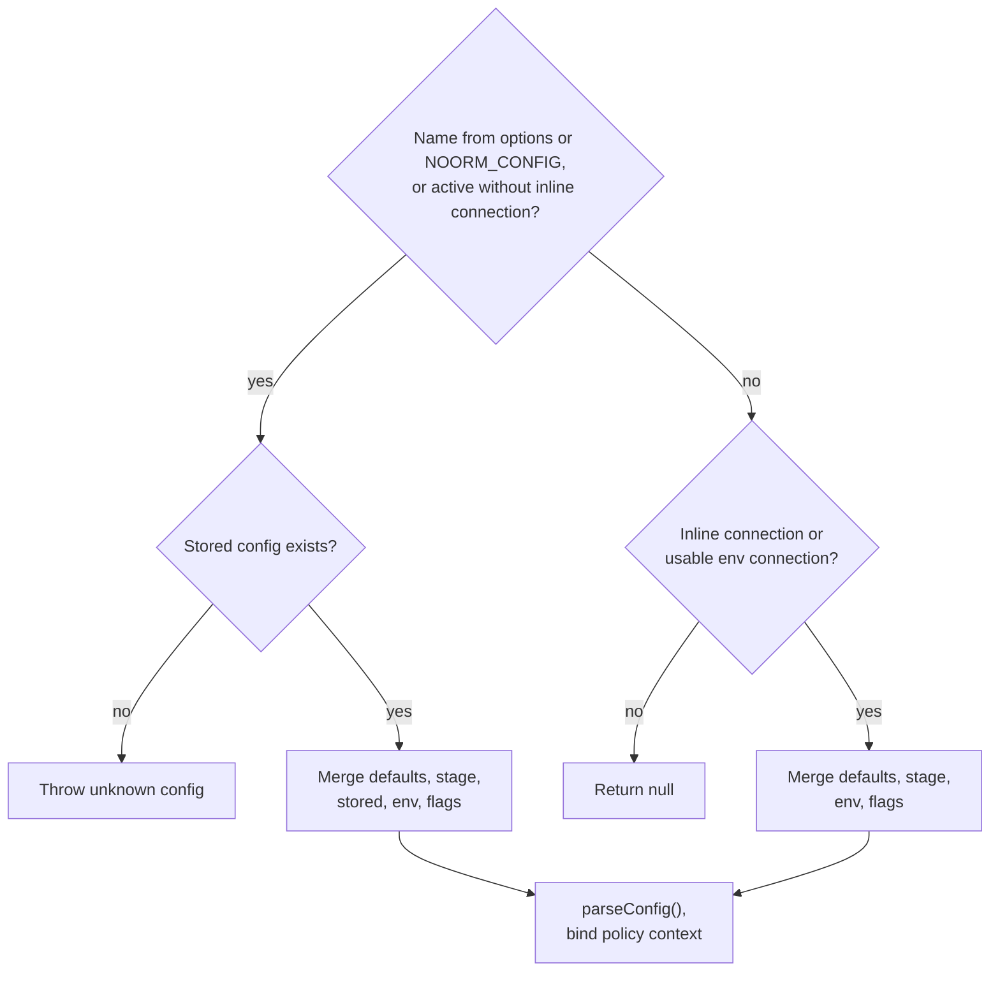

# Configuration


## The Problem

A database tool needs connection details: host, port, credentials, paths. But where should these come from? Hardcoding is inflexible. Environment variables alone don't persist. Config files risk credential leaks.

noorm solves this with layered configuration. Multiple sources merge together with clear precedence. Sensitive data stays encrypted. Environment variables enable CI/CD without changing stored configs.


## Configuration Sources

Configs come from five sources, merged in priority order:

| Priority | Source | Purpose |
|----------|--------|---------|
| 1 (highest) | Resolver flags / SDK `connection` | One-time overrides |
| 2 | Environment variables | CI/CD, per-session tweaks |
| 3 | Stored config | Your saved database configs |
| 4 | Stage defaults | Team-defined templates |
| 5 (lowest) | Defaults | Sensible fallbacks |

Higher priority sources override lower ones. This means you can set a base config, override the host via environment for CI, and override the port via CLI for a specific run.

```typescript
import { resolveConfig } from './core/config'

// Merges all sources into final config
const config = resolveConfig(state, {
    name: 'dev',
    flags: { connection: { port: 5433 } },  // Override just the port
})
```


## Config Structure

A complete config defines everything needed to connect and run:

```typescript
interface Config {
    name: string              // Unique identifier: 'dev', 'staging', 'prod'
    type: 'local' | 'remote'  // Connection type
    isTest: boolean           // Test database flag
    access: ConfigAccess      // Per-channel access roles — see Access Roles below

    connection: {
        dialect: 'postgres' | 'mysql' | 'sqlite' | 'mssql'
        host?: string         // Required for non-SQLite, defaults to 'localhost'
        port?: number         // Default by dialect
        database: string      // Database name or file path
        filename?: string     // SQLite only — alternative to database
        user?: string
        password?: string
        ssl?: boolean | SSLConfig  // see TLS Certificates below
        pool?: PoolOpts         // min/max default to 0/10; PgPoolOpts and TarnPoolOpts add the per-dialect options, see below
        tlsServerName?: string  // Certificate hostname for PostgreSQL, MySQL and MSSQL, including IP dial hosts
        connectTimeoutMs?: number  // Per attempt, defaults to 15000
        statementTimeoutMs?: number // PostgreSQL server-side timeout
        queryTimeoutMs?: number     // PostgreSQL client-side timeout
        applicationName?: string    // PostgreSQL session application_name
        keepAlive?: boolean         // PostgreSQL/MySQL TCP keepalive
        keepAliveInitialDelayMs?: number // PostgreSQL/MySQL: idle ms before the first keepalive probe
    }

    identity?: string         // Override audit identity
}
```

File locations (`paths.sql`, `paths.changes`) are **not** part of `Config` —
they live in `settings.yml` and are read through `SettingsManager.getPaths()`.
See [Settings](./settings.md).

`connectTimeoutMs` bounds one connection attempt, and is passed to whichever
option the dialect's driver exposes for it — `connectionTimeoutMillis` on `pg`,
`connectTimeout` on `mysql2` and `tedious`. It exists because `pg` defaults to
no limit, so an unreachable host waited forever. Raise it when the link is slow
but working; a serverless database resuming from auto-pause is the case that
needs it.

`pool` accepts a different set of options per dialect. PostgreSQL uses `pg`'s pool. MySQL and MSSQL use Tarn, for a string password and a password callback alike.

| `pool` option | PostgreSQL | MySQL, MSSQL | SQLite |
|---|---|---|---|
| `min`, `max` | yes; `min` must not exceed `max` | yes; `min` must not exceed `max` | accepted, unused |
| `idleTimeoutMs` | yes; zero disables the timeout | yes; must be greater than zero | no; the `idleTimeoutMillis` alias is accepted, unused |
| `maxLifetimeMs` | yes | no | no |
| `maxUses`, `allowExitOnIdle` | yes | no | no |
| `acquireTimeoutMs`, `createTimeoutMs` | no | yes; positive; default 30000, or `connectTimeoutMs` plus 5000 when that is larger | no |
| `reapIntervalMs` | no | yes; positive | no |

`ConnectionSchema` rejects an option the dialect cannot honor (`pool.maxUses is not supported on mysql`), and the dialect adapter repeats the check for a config that reached it without passing the schema. Both read the rules from `src/core/connection/options.ts`. A key that is not a pool option at all fails too (`pool.maxuses is not a pool option`); the pool schema is strict, so nothing is stripped. The message names the camelCase spelling when only the case differs, which is what an all-caps environment segment such as `NOORM_CONNECTION_POOL_MAXUSES` turns into. The connection object itself is not strict: an unknown connection key, including an all-caps `NOORM_CONNECTION_KEEPALIVEINITIALDELAYMS`, is still dropped without an error.

`pool.idleTimeoutMillis` is a deprecated alias of `pool.idleTimeoutMs`. One source that sets both to different values is an error. The resolver treats them as one setting across sources, so a stored, environment, or inline value under either name replaces a lower source's value under either name. The [SDK reference](/reference/sdk#pool-options) maps each option to its driver option.

`keepAliveInitialDelayMs` is rejected on MSSQL, where tedious fixes the delay at 30 seconds, and on SQLite, which has no socket. On PostgreSQL and MySQL it also turns `keepAlive` on unless `keepAlive` is `false`. `keepAlive: false` turns keepalive off on both, which on MySQL overrides mysql2's default of on.


## TLS Certificates

A private CA or a client certificate belongs in a file that a rotation replaces, not in the config. `connection.ssl` names the file, and noorm reads it each time a pool opens, on every connect attempt:

```typescript
connection: {
    dialect: 'postgres',
    host: '10.0.0.5',
    database: 'myapp',
    tlsServerName: 'db.internal.corp',
    ssl: {
        caFile: './certs/corp-ca.pem',
        certFile: '~/.certs/client.pem',
        keyFile: '~/.certs/client.key',
    },
}
```

| Field | Inline form | File form |
|-------|-------------|-----------|
| CA certificate | `ca` | `caFile` |
| Client certificate | `cert` | `certFile` |
| Client key | `key` | `keyFile` |
| Validation | `rejectUnauthorized` | |

`ssl` is `true`, `false`, or an object of those fields. Setting the inline and file form of one field in one layer fails validation and names the field (`ssl.ca and ssl.caFile cannot both be set; use one`). An empty path fails too (`ssl.caFile must not be empty`).

| Where the path is | It resolves from |
|-------------------|------------------|
| Absolute | Itself |
| Leading `~/` | The home directory |
| Relative, in the CLI or TUI | The working directory, which both set to the project root |
| Relative, in the SDK | The `projectRoot` option |

A relative path in a `settings.yml` stage default means a different file on each machine with a different project root, so the file must exist at that path wherever the config connects.

A path that is not a readable, non-empty regular file holding a PEM block fails the connection with `SslFileError`. It carries `field` (`ssl.caFile`), `path` and `code`, never file content. `code` is the system error code, `EINVAL` for a path that is not a regular file, `EMPTY` for an empty file, `EFBIG` for a file over 1 MiB, or `ENOTPEM` for a file with no `-----BEGIN ` line. The factory does not retry an `SslFileError`, and the `connection:error` event carries its message. `config validate` and the TUI connection test report the same message. SQLite never reads `ssl` files.

A file-form setting is stored as its path, never the file's content. `config export` copies `ssl` as stored, so a file-form setting exports as its path and an inline `ca`, `cert` or `key` exports as the stored PEM. `config import` accepts a path without checking that the file exists.

### Combining layers

The stage, stored config, environment and inline connection each supply `ssl`. Each layer is checked on its own, then combined field by field with `combineSsl` in `src/core/config/ssl-combine.ts`:

| Higher layer | Lower layer | Result |
|--------------|-------------|--------|
| `false` | anything | `false`: SSL is off |
| `true` | an object | The lower object's `ca`, `cert` and `key` fields, without its `rejectUnauthorized`; `true` when none remain |
| an object | an object | Each of `ca`, `cert` and `key` takes the higher layer's form, inline or file, replacing the lower layer's form of that field. `rejectUnauthorized` comes from the higher object alone |
| an object | `true`, `false` or nothing | The object |
| no `ssl` in the layer | anything | The lower layer's `ssl`, unchanged |

`rejectUnauthorized` is never inherited. It reaches the result only from the highest layer that sets `ssl`, and only when that layer is an object that sets it. A layer that sets `ssl` without it validates the certificate, whatever a lower layer said. A layer that wants validation off states `ssl: { rejectUnauthorized: false }` itself.

| Stage | Stored | Resolves to |
|-------|--------|-------------|
| `{ rejectUnauthorized: false }` | `true` | `true` |
| `{ rejectUnauthorized: false }` | `{ caFile }` | `{ caFile }` |
| `{ rejectUnauthorized: false }` | no `ssl` | `{ rejectUnauthorized: false }` |
| `{ caFile }` | `true` | `{ caFile }` |

A stage `ssl: { rejectUnauthorized: false }` therefore applies only to a config that has no `ssl` of its own. A stored inline `ca` over a stage `caFile` resolves to the inline `ca` alone. `config sync` combines with the same function, and the stage is the higher layer, so a stage `ssl: { caFile }` over a stored `ssl: { certFile, keyFile }` keeps the stored `certFile` and `keyFile`, and a stage `ssl: true` over a stored `{ caFile, rejectUnauthorized: false }` stores `{ caFile }`.

### Per dialect

| | PostgreSQL | MySQL | MSSQL |
|---|---|---|---|
| `ca`, `cert`, `key` | Passed to `pg` | Passed to mysql2 | Passed to tedious as `cryptoCredentialsDetails` |
| `rejectUnauthorized: false` | Encrypts, skips validation | Encrypts, skips validation | Encrypts, skips validation, and lifts the IP-host name requirement |
| `tlsServerName` | Needs `ssl` on and validation; an IP dial host is allowed | Needs `ssl` on and validation; a hostname only, an IP address throws | Hostname only; works without `ssl`; required for a validated connection to an IP host |

MySQL checks the server's host name only when `tlsServerName` is set. MSSQL always encrypts, and validates the certificate when `ssl` is on and `rejectUnauthorized` is not `false`.

A rejected certificate produces an error that names `ssl.caFile` (or `NODE_EXTRA_CA_CERTS` for the whole process) and `ssl.rejectUnauthorized: false`. A hostname mismatch names `tlsServerName` and the hostnames the certificate is issued for.


## Environment Variables

`getEnvConfig()` delegates to `makeNestedConfig` from `@logosdx/utils`. Underscores separate object levels. All-uppercase segments become lowercase; mixed-case segments retain their spelling, so a schema field such as `connectTimeoutMs` stays within one segment.

```bash
export NOORM_CONNECTION_connectTimeoutMs=30000
export NOORM_CONNECTION_SSL_rejectUnauthorized=true
export NOORM_CONNECTION_POOL_idleTimeoutMs=10000
```

These set `connection.connectTimeoutMs`, `connection.ssl.rejectUnauthorized`, and `connection.pool.idleTimeoutMs`. `NOORM_CONNECTION_CONNECT_TIMEOUT_MS` instead builds nested `connection.connect.timeout.ms`; it does not set a timeout.

An `ssl` segment in another letter case, such as `NOORM_CONNECTION_SSL_CAFILE`, becomes the key `cafile`. noorm refuses it and names the spelling to use (`ssl.caFile`), as it does for an inline `ssl` object with a key like `cafile`.

**Connection variables:**

| Variable | Config Path | Notes |
|----------|-------------|-------|
| `NOORM_CONNECTION_DIALECT` | `connection.dialect` | postgres, mysql, sqlite, mssql |
| `NOORM_CONNECTION_HOST` | `connection.host` | |
| `NOORM_CONNECTION_PORT` | `connection.port` | Auto-parsed as integer |
| `NOORM_CONNECTION_DATABASE` | `connection.database` | |
| `NOORM_CONNECTION_USER` | `connection.user` | |
| `NOORM_CONNECTION_PASSWORD` | `connection.password` | Kept as string |
| `NOORM_CONNECTION_SSL` | `connection.ssl` | Use 'true'/'false' |
| `NOORM_CONNECTION_POOL_MIN` | `connection.pool.min` | |
| `NOORM_CONNECTION_POOL_MAX` | `connection.pool.max` | |
| `NOORM_CONNECTION_FILENAME` | `connection.filename` | SQLite file path |
| `NOORM_CONNECTION_connectTimeoutMs` | `connection.connectTimeoutMs` | Positive integer, milliseconds per attempt |
| `NOORM_CONNECTION_tlsServerName` | `connection.tlsServerName` | Certificate identity on PostgreSQL, MySQL and MSSQL |
| `NOORM_CONNECTION_SSL_rejectUnauthorized` | `connection.ssl.rejectUnauthorized` | Boolean |
| `NOORM_CONNECTION_SSL_CA`, `_CERT`, `_KEY` | `connection.ssl.ca`, `.cert`, `.key` | PEM strings |
| `NOORM_CONNECTION_SSL_caFile`, `_certFile`, `_keyFile` | `connection.ssl.caFile`, `.certFile`, `.keyFile` | File paths, camelCase segment. Do not combine with the scalar `NOORM_CONNECTION_SSL` |
| `NOORM_CONNECTION_POOL_idleTimeoutMs` | `connection.pool.idleTimeoutMs` | Nonnegative integer; greater than zero on MySQL and MSSQL. `_POOL_idleTimeoutMillis` is an alias |
| `NOORM_CONNECTION_POOL_maxLifetimeMs`, `_maxUses`, `_allowExitOnIdle` | `connection.pool.<option>` | PostgreSQL only |
| `NOORM_CONNECTION_POOL_acquireTimeoutMs`, `_createTimeoutMs`, `_reapIntervalMs` | `connection.pool.<option>` | MySQL and MSSQL only, positive integer |
| `NOORM_CONNECTION_statementTimeoutMs` | `connection.statementTimeoutMs` | PostgreSQL, nonnegative integer |
| `NOORM_CONNECTION_queryTimeoutMs` | `connection.queryTimeoutMs` | PostgreSQL, nonnegative integer |
| `NOORM_CONNECTION_applicationName` | `connection.applicationName` | PostgreSQL session name |
| `NOORM_CONNECTION_keepAlive` | `connection.keepAlive` | PostgreSQL and MySQL TCP keepalive, boolean |
| `NOORM_CONNECTION_keepAliveInitialDelayMs` | `connection.keepAliveInitialDelayMs` | PostgreSQL and MySQL, nonnegative integer |

The native parser converts numeric and boolean values, except keys containing `password`, which retain strings. The config schemas validate the merged result and strip unknown fields outside `pool`. An unknown `pool` key is refused, and so is an `ssl` key spelled in another letter case in the environment or inline layer; a key that differs only in letter case gets the right spelling. Use either scalar `NOORM_CONNECTION_SSL` or its nested fields; the parser does not provide a conflict-resolution contract for combining them.

**Path variables** (override `settings.yml` paths, not `Config`):

| Variable | Settings Path |
|----------|---------------|
| `NOORM_PATHS_SQL` | `paths.sql` |
| `NOORM_PATHS_CHANGES` | `paths.changes` |

**Top-level variables:**

| Variable | Config Path | Notes |
|----------|-------------|-------|
| `NOORM_NAME` | `name` | |
| `NOORM_TYPE` | `type` | 'local' or 'remote' |
| `NOORM_PROTECTED` | `access` (legacy) | Use 'true'/'false'. Maps through the deprecated `protected` boolean into `access` — see [Access Roles](#access-roles) |
| `NOORM_IDENTITY` | `identity` | |
| `NOORM_isTest` | `isTest` | camelCase preserved |

**Note:** For camelCase properties like `isTest`, preserve the case: `NOORM_isTest` (not `NOORM_IS_TEST`).

**Behavior variables** (excluded from config merging — the `META_ENV_VARS` set in `core/config`):

| Variable | Purpose |
|----------|---------|
| `NOORM_CONFIG` | Which config to use |
| `NOORM_YES` | Skip confirmations |
| `NOORM_JSON` | JSON output mode |
| `NOORM_HEADLESS` | Headless mode detection |
| `NOORM_DEBUG` | Debug logging |
| `NOORM_DEV` | Dev mode detection |
| `NOORM_CI_CONFIG_NAME` | `ci init` config name override |
| `NOORM_LOGGER_DEBUG` | Logger-internal debug |
| `NOORM_CHANNEL` | Policy channel override (`resolveChannel`) |

`NOORM_IDENTITY_*` is also excluded — it belongs to `loadIdentityFromEnv`, and forwarding it would collide with the `identity: string` field.

```bash
# CI/CD example: use stored config with overridden host
export NOORM_CONFIG=staging
export NOORM_CONNECTION_HOST=db.ci-runner.local
noorm run build
```


## Config Resolution

The resolver determines which config to use and merges all sources.

```typescript
const config = resolveConfig(state, options)
```

The resolver selects a stored name before considering inline or environment-only input. Unknown selected names throw instead of falling back:

Name selection follows `options.name`, then `NOORM_CONFIG`, then the active config in state only when `options.flags.connection` is absent. `options.name: false` selects no stored config and skips the other two sources. Inline connection input does not inherit the active config's connection fields, access roles, or `isTest` flag.



Inline mode is available through `options.flags.connection`; the SDK maps its `connection` option there. With no selected stored name, the synthetic name defaults to `__inline__` when that object exists and `__env__` otherwise. `NOORM_NAME` can supply the synthetic name without selecting a stored record; `options.flags.name` wins over it, and `options.unstoredName` (the SDK's `name` option) wins over both. `resolveConfig` throws when a stored config has the synthetic name, and when an env or flag name would rename a selected stored config to another stored config's name, because secrets and tracking records are keyed by name. `resolveConfig` throws when `unstoredName` is set and a stored config is selected. The name `unstoredName` displaced still feeds the protected-stage ceiling and the `isTest` trust check, so a caller-chosen name only adds restriction. Environment-only resolution requires a connection object and a dialect/database supplied by the combined stage and environment layers. Inline input enters schema validation even when incomplete.

`stageFields(defaults, true)` maps flat stage fields into nested `connection` before merging, including the stage password at runtime. Stored values, environment variables, and flags override that layer in order. Stage `type`, `isTest`, and `access` remain top-level; protected stages cap effective permission cells at policy-check time without changing assigned roles. An explicit `options.stage` chooses the stage, otherwise the resolver matches the config name. The protected-stage ceiling is the union of the stage the resolver bound, the config name, and `options.stage`: a caller option can add the ceiling and never remove it.

```typescript
// Explicit name
resolveConfig(state, { name: 'production' })

// From NOORM_CONFIG
process.env.NOORM_CONFIG = 'staging'
resolveConfig(state)  // uses 'staging'

// From active config
state.setActiveConfig('dev')
resolveConfig(state)  // uses 'dev'

// Env-only (CI mode)
process.env.NOORM_CONNECTION_DIALECT = 'postgres'
process.env.NOORM_CONNECTION_DATABASE = 'ci_test'
resolveConfig(state)  // creates __env__ config
```

```typescript
// Inline-only SDK-style resolution, without a stored config
resolveConfig(state, {
    flags: {
        connection: { dialect: 'sqlite', database: './tmp/review.db' },
    },
}) // name: __inline__
```

For a stage-backed inline connection, start with these defaults:

```yaml
stages:
    preview:
        defaults:
            dialect: postgres
            host: stage.example.com
            user: app
            isTest: true
```

With no selected stored name, `NOORM_CONNECTION_HOST=db.example.com` and this resolver input combine stage credentials with an inline database:

```typescript
const config = resolveConfig(state, {
    stage: 'preview',
    settings: new SettingsProvider(settingsManager),
    flags: { connection: { database: 'orders_review' } },
})
```

| Resolved field | Value | Source |
|---|---|---|
| `name` | `__inline__` | Synthetic name, assuming `NOORM_NAME` is unset |
| `connection.dialect`, `connection.user` | `postgres`, `app` | Stage defaults |
| `connection.host` | `db.example.com` | Environment |
| `connection.database` | `orders_review` | Inline flags |
| `isTest` | `true` | Stage default |

Runtime credential callbacks bypass the serializable config schemas. The [SDK reference](/reference/sdk#runtime-credentials) owns their types, lifecycle, errors, and observer contract.


## Validation

Configs are validated using Zod schemas. Key rules:

- `name` - Required, alphanumeric with hyphens/underscores
- `connection.dialect` - Must be one of the four supported
- `connection.host` - Required for non-SQLite
- `connection.port` - Integer 1-65535
- `connection.database` - Required

Default ports by dialect:

| Dialect | Default Port |
|---------|--------------|
| postgres | 5432 |
| mysql | 3306 |
| mssql | 1433 |
| sqlite | N/A |

```typescript
import { validateConfig, parseConfig } from './core/config'

// Throws on invalid config
validateConfig(config)

// Returns config with defaults applied
const full = parseConfig(partial)
```


## Access Roles

`Config.protected: boolean` was replaced by per-channel access roles. Roles live on the config, not the caller — the caller is a **channel**: `user` (a human) or `agent` (an AI agent, over MCP or the CLI). Each config declares a role per channel:

```typescript
const config = {
    name: 'prod',
    access: {
        user: 'operator',   // what a human at the CLI/TUI gets
        agent: 'viewer',       // what a connected AI agent gets — can differ from user
    },
    // ...
}
```

The built-in defaults below can be overridden, and `.noorm/settings.yml` can define custom roles. See [Access roles](/guide/environments/configs#access-roles) for the full matrix and inheritance rules.

| Permission | viewer | operator | admin |
|---|---|---|---|
| explore, `sql:read` | allow | allow | allow |
| `sql:write` | deny | allow | allow |
| `sql:ddl` | deny | deny | allow |
| `change:run`, `change:ff`, `change:revert` | deny | confirm | allow |
| `run:build`, `run:file`, `run:dir` | deny | confirm | allow |
| `pipeline:run` | deny | confirm | allow |

| `db:create`, `db:reset` | deny | confirm | allow |
| `db:destroy` | deny | deny | confirm |
| `config:rm` | deny | confirm | confirm |

The read cells (`explore`, `sql:read`) apply to the `agent` channel only; `getConfigPermission` returns `allow` for them on the `user` channel.

`agent: false` is not a role. It hides the config from agents on MCP and the CLI.

Check policy before executing:
Use a resolved config with its non-enumerable policy context. A detached or spread copy loses that context and enforcement denies it.


```typescript
import { checkPolicy } from './core/policy'

const check = checkPolicy('user', config, 'change:run')

if (!check.allowed) {
    console.error(check.blockedReason)
    process.exit(1)
}

if (check.requiresConfirmation) {
    const input = await prompt(`Type "${check.confirmationPhrase}" to confirm:`)
    if (input !== check.confirmationPhrase) {
        process.exit(1)
    }
}

// Proceed with action
```

`confirm` resolves per channel: on `user` it prompts for `yes-<config>` (skippable with `NOORM_YES=1`); on `agent` it collapses straight to deny — an agent confirming its own destructive action is theater, and on the CLI it would need only `--yes`.

```bash
export NOORM_YES=1
noorm change run  # No prompt, even on an operator-role config
```

**Migration:** a legacy `protected: true` maps to `{ user: 'operator', agent: 'viewer' }`; `protected: false` or absent maps to the default `{ user: 'admin', agent: 'viewer' }`. A config that already stores an explicit `access` is left as-is. The `protected` field is accepted on input for one version, then dropped — see the state migration in `core/version/state/migrations/`.


## Stages

Stages are team-defined config templates from `settings.yml`. They provide defaults and enforce constraints.

```yaml
# .noorm/settings.yml
stages:
    prod:
        description: Production database
        locked: true           # Cannot delete this config
        defaults:
            dialect: postgres
            protected: true    # Immutable per-permission user/agent ceilings
        secrets:
            - key: DB_PASSWORD
              type: password
              required: true
```

When resolving a config linked to a stage, stage defaults merge in:

```typescript
import { resolveConfig, SettingsProvider } from './core/config/resolver'

const config = resolveConfig(state, {
    name: 'prod',
    settings: new SettingsProvider(settingsManager),
    // stage: 'prod',  // optional — omit to auto-link by matching config name
})
// Stage defaults applied, then stored config, then env, then flags
```

> **Note:** `settings` takes a `SettingsProvider`, not a `SettingsManager` — wrap the manager. The class must be imported from `core/config/resolver` directly; the `core/config` barrel re-exports it type-only. When `stage` is omitted, `findStageForConfig` auto-links a stage whose name matches the config name.


## Config Completeness

A config is "complete" when all required secrets (from its stage) are set. Incomplete configs have limited functionality.

```typescript
import { checkConfigCompleteness } from './core/config'

// Fourth argument is an options object: { stageName?, vaultSecretKeys? }
const check = checkConfigCompleteness(config, state, settings, {
    stageName: 'prod',
    vaultSecretKeys: ['DB_PASSWORD'],  // vault keys count as "set"
})

// Without stageName - auto-links a stage whose name matches the config name
const check = checkConfigCompleteness(config, state, settings)

if (!check.complete) {
    console.log('Missing secrets:', check.missingSecrets)
    console.log('Constraint violations:', check.violations)
}
```


**Home Screen Status**

The home screen displays setup status for all stage-linked configs:

```
Stage Configs:
  ✓ dev
  ✓ staging
    prod     ✗ secrets (2)
```

- `✓` indicates all required secrets are set
- `✗ secrets (N)` shows how many secrets are missing

This helps track which environments are ready to use and which need secret values configured.

Stage constraints and how noorm checks them:

| Constraint | Behavior |
|------------|----------|
| `protected: true` in defaults | Caps each effective user cell at the original operator matrix and each agent cell at the original viewer matrix; assigned role names remain unchanged |
| `isTest: true` in defaults | A resolved `isTest: false` is reported as a stage-completeness violation; resolution does not force it back to `true` |
| `locked: true` | Config cannot be deleted |

```typescript
import { canDeleteConfig } from './core/config'

// Basic usage
const { allowed, reason } = canDeleteConfig('prod', settings)

// With explicit stage name (optional 3rd parameter)
const { allowed, reason } = canDeleteConfig('prod', settings, 'production')

if (!allowed) {
    console.error(reason)  // "Config 'prod' is linked to a locked stage..."
}
```


## CI/CD Mode

In CI pipelines, configs can be built entirely from environment variables:

```bash
# GitHub Actions example
env:
    NOORM_CONNECTION_DIALECT: postgres
    NOORM_CONNECTION_HOST: ${{ secrets.DB_HOST }}
    NOORM_CONNECTION_DATABASE: ${{ secrets.DB_NAME }}
    NOORM_CONNECTION_USER: ${{ secrets.DB_USER }}
    NOORM_CONNECTION_PASSWORD: ${{ secrets.DB_PASSWORD }}
    NOORM_YES: 1

steps:
    - run: noorm run build
```

Minimum required env vars:
- `NOORM_CONNECTION_DIALECT`
- `NOORM_CONNECTION_DATABASE`

```typescript
// Check if in CI mode
import { isCi, shouldSkipConfirmations } from './core/environment'

if (isCi()) {
    // Running in CI environment
}

if (shouldSkipConfirmations()) {
    // NOORM_YES is set
}
```


## Observer Events

Config operations emit events:

```typescript
observer.on('config:created', ({ name }) => {
    console.log(`Created config: ${name}`)
})

observer.on('config:updated', ({ name, fields }) => {
    console.log(`Updated ${name}: ${fields.join(', ')}`)
})

observer.on('config:deleted', ({ name }) => {
    console.log(`Deleted config: ${name}`)
})

observer.on('config:activated', ({ name, previous }) => {
    console.log(`Switched from ${previous} to ${name}`)
})
```


## Config Summary

For listings, use `ConfigSummary` which omits sensitive connection details:

```typescript
const summaries = state.listConfigs()
// [
//     { name: 'dev', type: 'local', isTest: false, access: { user: 'admin', agent: 'admin' }, isActive: true, dialect: 'postgres', database: 'dev_db' },
//     { name: 'prod', type: 'remote', isTest: false, access: { user: 'operator', agent: 'viewer' }, isActive: false, dialect: 'postgres', database: 'prod_db' },
// ]
```

The `ConfigSummary` interface:

```typescript
interface ConfigSummary {
    name: string
    type: 'local' | 'remote'
    isTest: boolean
    access: ConfigAccess
    isActive: boolean
    dialect: Dialect
    database: string
}
```
