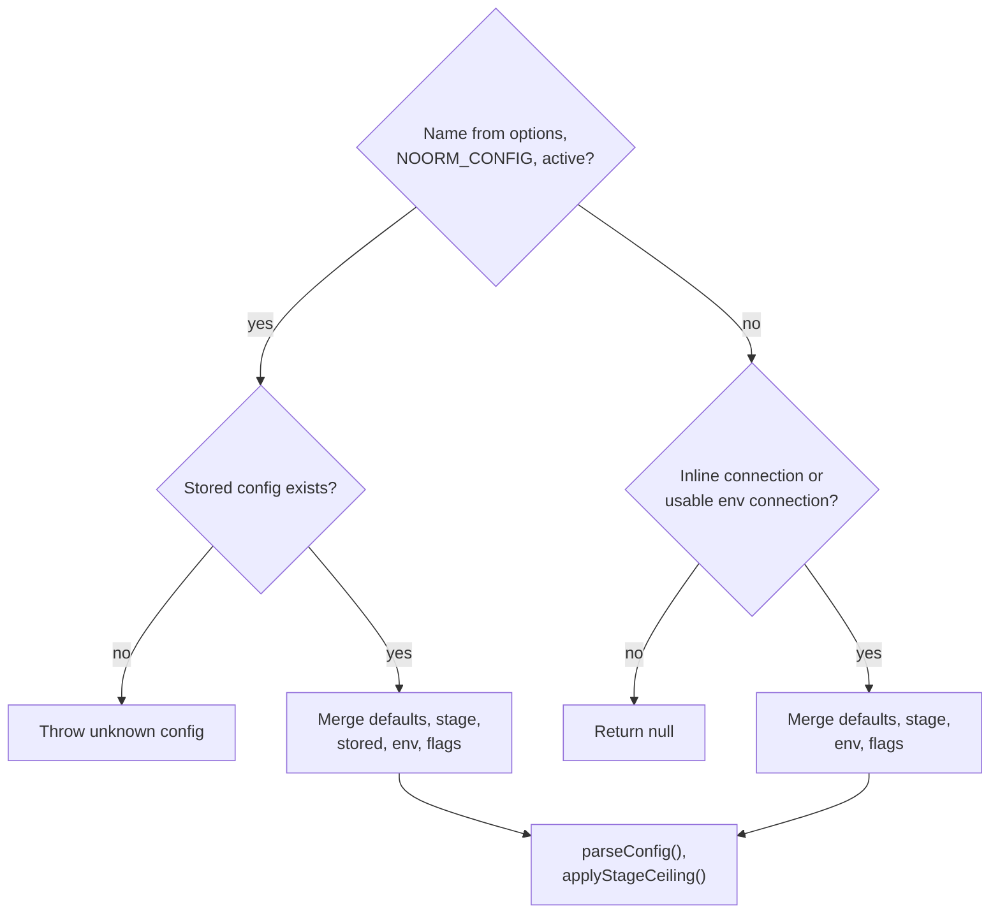

# Configuration


## The Problem

A database tool needs connection details: host, port, credentials, paths. But where should these come from? Hardcoding is inflexible. Environment variables alone don't persist. Config files risk credential leaks.

noorm solves this with layered configuration. Multiple sources merge together with clear precedence. Sensitive data stays encrypted. Environment variables enable CI/CD without changing stored configs.


## Configuration Sources

Configs come from five sources, merged in priority order:

| Priority | Source | Purpose |
|----------|--------|---------|
| 1 (highest) | Resolver flags / SDK `connection` | One-time overrides |
| 2 | Environment variables | CI/CD, per-session tweaks |
| 3 | Stored config | Your saved database configs |
| 4 | Stage defaults | Team-defined templates |
| 5 (lowest) | Defaults | Sensible fallbacks |

Higher priority sources override lower ones. This means you can set a base config, override the host via environment for CI, and override the port via CLI for a specific run.

```typescript
import { resolveConfig } from './core/config'

// Merges all sources into final config
const config = resolveConfig(state, {
    name: 'dev',
    flags: { connection: { port: 5433 } },  // Override just the port
})
```


## Config Structure

A complete config defines everything needed to connect and run:

```typescript
interface Config {
    name: string              // Unique identifier: 'dev', 'staging', 'prod'
    type: 'local' | 'remote'  // Connection type
    isTest: boolean           // Test database flag
    access: ConfigAccess      // Per-channel access roles — see Access Roles below

    connection: {
        dialect: 'postgres' | 'mysql' | 'sqlite' | 'mssql'
        host?: string         // Required for non-SQLite, defaults to 'localhost'
        port?: number         // Default by dialect
        database: string      // Database name or file path
        filename?: string     // SQLite only — alternative to database
        user?: string
        password?: string
        ssl?: boolean | SSLConfig
        pool?: { min?: number, max?: number, idleTimeoutMillis?: number } // min/max default to 0/10
        tlsServerName?: string  // PostgreSQL/MSSQL certificate hostname, including IP dial hosts
        connectTimeoutMs?: number  // Per attempt, defaults to 15000
        statementTimeoutMs?: number // PostgreSQL server-side timeout
        queryTimeoutMs?: number     // PostgreSQL client-side timeout
        applicationName?: string    // PostgreSQL session application_name
        keepAlive?: boolean         // PostgreSQL TCP keepalive
    }

    identity?: string         // Override audit identity
}
```

File locations (`paths.sql`, `paths.changes`) are **not** part of `Config` —
they live in `settings.yml` and are read through `SettingsManager.getPaths()`.
See [Settings](./settings.md).

`connectTimeoutMs` bounds one connection attempt, and is passed to whichever
option the dialect's driver exposes for it — `connectionTimeoutMillis` on `pg`,
`connectTimeout` on `mysql2` and `tedious`. It exists because `pg` defaults to
no limit, so an unreachable host waited forever. Raise it when the link is slow
but working; a serverless database resuming from auto-pause is the case that
needs it.


## Environment Variables

`getEnvConfig()` delegates to `makeNestedConfig` from `@logosdx/utils`. Underscores separate object levels. All-uppercase segments become lowercase; mixed-case segments retain their spelling, so a schema field such as `connectTimeoutMs` stays within one segment.

```bash
export NOORM_CONNECTION_connectTimeoutMs=30000
export NOORM_CONNECTION_SSL_rejectUnauthorized=true
export NOORM_CONNECTION_POOL_idleTimeoutMillis=10000
```

These set `connection.connectTimeoutMs`, `connection.ssl.rejectUnauthorized`, and `connection.pool.idleTimeoutMillis`. `NOORM_CONNECTION_CONNECT_TIMEOUT_MS` instead builds nested `connection.connect.timeout.ms`; it does not set a timeout.

**Connection variables:**

| Variable | Config Path | Notes |
|----------|-------------|-------|
| `NOORM_CONNECTION_DIALECT` | `connection.dialect` | postgres, mysql, sqlite, mssql |
| `NOORM_CONNECTION_HOST` | `connection.host` | |
| `NOORM_CONNECTION_PORT` | `connection.port` | Auto-parsed as integer |
| `NOORM_CONNECTION_DATABASE` | `connection.database` | |
| `NOORM_CONNECTION_USER` | `connection.user` | |
| `NOORM_CONNECTION_PASSWORD` | `connection.password` | Kept as string |
| `NOORM_CONNECTION_SSL` | `connection.ssl` | Use 'true'/'false' |
| `NOORM_CONNECTION_POOL_MIN` | `connection.pool.min` | |
| `NOORM_CONNECTION_POOL_MAX` | `connection.pool.max` | |
| `NOORM_CONNECTION_FILENAME` | `connection.filename` | SQLite file path |
| `NOORM_CONNECTION_connectTimeoutMs` | `connection.connectTimeoutMs` | Positive integer, milliseconds per attempt |
| `NOORM_CONNECTION_tlsServerName` | `connection.tlsServerName` | PostgreSQL/MSSQL certificate identity |
| `NOORM_CONNECTION_SSL_rejectUnauthorized` | `connection.ssl.rejectUnauthorized` | Boolean |
| `NOORM_CONNECTION_SSL_CA`, `_CERT`, `_KEY` | `connection.ssl.ca`, `.cert`, `.key` | PEM strings |
| `NOORM_CONNECTION_POOL_idleTimeoutMillis` | `connection.pool.idleTimeoutMillis` | PostgreSQL, nonnegative integer |
| `NOORM_CONNECTION_statementTimeoutMs` | `connection.statementTimeoutMs` | PostgreSQL, nonnegative integer |
| `NOORM_CONNECTION_queryTimeoutMs` | `connection.queryTimeoutMs` | PostgreSQL, nonnegative integer |
| `NOORM_CONNECTION_applicationName` | `connection.applicationName` | PostgreSQL session name |
| `NOORM_CONNECTION_keepAlive` | `connection.keepAlive` | PostgreSQL TCP keepalive, boolean |

The native parser converts numeric and boolean values, except keys containing `password`, which retain strings. The config schemas validate the merged result and strip unknown fields. There is no custom spelling map or unsupported-name check. Use either scalar `NOORM_CONNECTION_SSL` or its nested fields; the parser does not provide a conflict-resolution contract for combining them.

**Path variables** (override `settings.yml` paths, not `Config`):

| Variable | Settings Path |
|----------|---------------|
| `NOORM_PATHS_SQL` | `paths.sql` |
| `NOORM_PATHS_CHANGES` | `paths.changes` |

**Top-level variables:**

| Variable | Config Path | Notes |
|----------|-------------|-------|
| `NOORM_NAME` | `name` | |
| `NOORM_TYPE` | `type` | 'local' or 'remote' |
| `NOORM_PROTECTED` | `access` (legacy) | Use 'true'/'false'. Maps through the deprecated `protected` boolean into `access` — see [Access Roles](#access-roles) |
| `NOORM_IDENTITY` | `identity` | |
| `NOORM_isTest` | `isTest` | camelCase preserved |

**Note:** For camelCase properties like `isTest`, preserve the case: `NOORM_isTest` (not `NOORM_IS_TEST`).

**Behavior variables** (excluded from config merging — the `META_ENV_VARS` set in `core/config`):

| Variable | Purpose |
|----------|---------|
| `NOORM_CONFIG` | Which config to use |
| `NOORM_YES` | Skip confirmations |
| `NOORM_JSON` | JSON output mode |
| `NOORM_HEADLESS` | Headless mode detection |
| `NOORM_DEBUG` | Debug logging |
| `NOORM_DEV` | Dev mode detection |
| `NOORM_CI_CONFIG_NAME` | `ci init` config name override |
| `NOORM_LOGGER_DEBUG` | Logger-internal debug |
| `NOORM_CHANNEL` | Policy channel override (`resolveChannel`) |

`NOORM_IDENTITY_*` is also excluded — it belongs to `loadIdentityFromEnv`, and forwarding it would collide with the `identity: string` field.

```bash
# CI/CD example: use stored config with overridden host
export NOORM_CONFIG=staging
export NOORM_CONNECTION_HOST=db.ci-runner.local
noorm run build
```


## Config Resolution

The resolver determines which config to use and merges all sources.

```typescript
const config = resolveConfig(state, options)
```

The resolver selects a stored name before considering inline or environment-only input. Unknown selected names throw instead of falling back:

Name selection follows `options.name`, then `NOORM_CONFIG`, then the active config in state.



Inline mode is available through `options.flags.connection`; the SDK maps its `connection` option there. With no selected stored name, the synthetic name defaults to `__inline__` when that object exists and `__env__` otherwise. `NOORM_NAME` can supply the synthetic name without selecting a stored record. Environment-only resolution requires a connection object and a dialect/database supplied by the combined stage and environment layers. Inline input enters schema validation even when incomplete.

`stageFields(defaults, true)` maps flat stage fields into nested `connection` before merging, including the stage password at runtime. Stored values, environment variables, and flags override that layer in order. Stage `type`, `isTest`, and `access` remain top-level; a protected stage caps access after schema validation. An explicit `options.stage` chooses the stage, otherwise the resolver matches the config name.

```typescript
// Explicit name
resolveConfig(state, { name: 'production' })

// From NOORM_CONFIG
process.env.NOORM_CONFIG = 'staging'
resolveConfig(state)  // uses 'staging'

// From active config
state.setActiveConfig('dev')
resolveConfig(state)  // uses 'dev'

// Env-only (CI mode)
process.env.NOORM_CONNECTION_DIALECT = 'postgres'
process.env.NOORM_CONNECTION_DATABASE = 'ci_test'
resolveConfig(state)  // creates __env__ config
```

```typescript
// Inline-only SDK-style resolution, without a stored config
resolveConfig(state, {
    flags: {
        connection: { dialect: 'sqlite', database: './tmp/review.db' },
    },
}) // name: __inline__
```

For a stage-backed inline connection, start with these defaults:

```yaml
stages:
    preview:
        defaults:
            dialect: postgres
            host: stage.example.com
            user: app
            isTest: true
```

With no selected stored name, `NOORM_CONNECTION_HOST=db.example.com` and this resolver input combine stage credentials with an inline database:

```typescript
const config = resolveConfig(state, {
    stage: 'preview',
    settings: new SettingsProvider(settingsManager),
    flags: { connection: { database: 'orders_review' } },
})
```

| Resolved field | Value | Source |
|---|---|---|
| `name` | `__inline__` | Synthetic name, assuming `NOORM_NAME` is unset |
| `connection.dialect`, `connection.user` | `postgres`, `app` | Stage defaults |
| `connection.host` | `db.example.com` | Environment |
| `connection.database` | `orders_review` | Inline flags |
| `isTest` | `true` | Stage default |

Runtime credential callbacks bypass the serializable config schemas. The [SDK reference](/reference/sdk#runtime-credentials) owns their types, lifecycle, errors, and observer contract.


## Validation

Configs are validated using Zod schemas. Key rules:

- `name` - Required, alphanumeric with hyphens/underscores
- `connection.dialect` - Must be one of the four supported
- `connection.host` - Required for non-SQLite
- `connection.port` - Integer 1-65535
- `connection.database` - Required

Default ports by dialect:

| Dialect | Default Port |
|---------|--------------|
| postgres | 5432 |
| mysql | 3306 |
| mssql | 1433 |
| sqlite | N/A |

```typescript
import { validateConfig, parseConfig } from './core/config'

// Throws on invalid config
validateConfig(config)

// Returns config with defaults applied
const full = parseConfig(partial)
```


## Access Roles

`Config.protected: boolean` was replaced by per-channel access roles. Roles live on the config, not the caller — the caller is a **channel**: `user` (a human) or `agent` (an AI agent, over MCP or the CLI). Each config declares a role per channel:

```typescript
const config = {
    name: 'prod',
    access: {
        user: 'operator',   // what a human at the CLI/TUI gets
        agent: 'viewer',       // what a connected AI agent gets — can differ from user
    },
    // ...
}
```

Three roles, hard-coded, not user-extensible:

| Permission | viewer | operator | admin |
|---|---|---|---|
| explore, `sql:read` | allow | allow | allow |
| `sql:write` | deny | allow | allow |
| `sql:ddl` | deny | deny | allow |
| `change:run`, `change:ff`, `change:revert` | deny | confirm | allow |
| `run:build`, `run:file`, `run:dir` | deny | confirm | allow |
| `db:create`, `db:reset` | deny | confirm | allow |
| `db:destroy` | deny | deny | confirm |
| `config:rm` | deny | confirm | confirm |

`agent: false` is not a role — it makes the config invisible to agents on both MCP and the CLI (absent from `list_configs`, `connect` fails with the byte-identical error an unknown config produces).

Check policy before executing:

```typescript
import { checkPolicy } from './core/policy'

const check = checkPolicy('user', config, 'change:run')

if (!check.allowed) {
    console.error(check.blockedReason)
    process.exit(1)
}

if (check.requiresConfirmation) {
    const input = await prompt(`Type "${check.confirmationPhrase}" to confirm:`)
    if (input !== check.confirmationPhrase) {
        process.exit(1)
    }
}

// Proceed with action
```

`confirm` resolves per channel: on `user` it prompts for `yes-<config>` (skippable with `NOORM_YES=1`); on `agent` it collapses straight to deny — an agent confirming its own destructive action is theater, and on the CLI it would need only `--yes`.

```bash
export NOORM_YES=1
noorm change run  # No prompt, even on an operator-role config
```

**Migration:** a legacy `protected: true` maps to `{ user: 'operator', agent: 'viewer' }`; `protected: false` or absent maps to the default `{ user: 'admin', agent: 'viewer' }`. A config that already stores an explicit `access` is left as-is. The `protected` field is accepted on input for one version, then dropped — see the state migration in `core/version/state/migrations/`.


## Stages

Stages are team-defined config templates from `settings.yml`. They provide defaults and enforce constraints.

```yaml
# .noorm/settings.yml
stages:
    prod:
        description: Production database
        locked: true           # Cannot delete this config
        defaults:
            dialect: postgres
            protected: true    # Access ceiling: clamps resolved access to at most operator/viewer
        secrets:
            - key: DB_PASSWORD
              type: password
              required: true
```

When resolving a config linked to a stage, stage defaults merge in:

```typescript
import { resolveConfig, SettingsProvider } from './core/config/resolver'

const config = resolveConfig(state, {
    name: 'prod',
    settings: new SettingsProvider(settingsManager),
    // stage: 'prod',  // optional — omit to auto-link by matching config name
})
// Stage defaults applied, then stored config, then env, then flags
```

> **Note:** `settings` takes a `SettingsProvider`, not a `SettingsManager` — wrap the manager. The class must be imported from `core/config/resolver` directly; the `core/config` barrel re-exports it type-only. When `stage` is omitted, `findStageForConfig` auto-links a stage whose name matches the config name.


## Config Completeness

A config is "complete" when all required secrets (from its stage) are set. Incomplete configs have limited functionality.

```typescript
import { checkConfigCompleteness } from './core/config'

// Fourth argument is an options object: { stageName?, vaultSecretKeys? }
const check = checkConfigCompleteness(config, state, settings, {
    stageName: 'prod',
    vaultSecretKeys: ['DB_PASSWORD'],  // vault keys count as "set"
})

// Without stageName - auto-links a stage whose name matches the config name
const check = checkConfigCompleteness(config, state, settings)

if (!check.complete) {
    console.log('Missing secrets:', check.missingSecrets)
    console.log('Constraint violations:', check.violations)
}
```


**Home Screen Status**

The home screen displays setup status for all stage-linked configs:

```
Stage Configs:
  ✓ dev
  ✓ staging
    prod     ✗ secrets (2)
```

- `✓` indicates all required secrets are set
- `✗ secrets (N)` shows how many secrets are missing

This helps track which environments are ready to use and which need secret values configured.

Stage constraints and how noorm checks them:

| Constraint | Behavior |
|------------|----------|
| `protected: true` in defaults | Clamps resolved `access` to at most `{ user: 'operator', agent: 'viewer' }` — stricter survives, looser is clamped down (see [Access Roles](#access-roles)) |
| `isTest: true` in defaults | A resolved `isTest: false` is reported as a stage-completeness violation; resolution does not force it back to `true` |
| `locked: true` | Config cannot be deleted |

```typescript
import { canDeleteConfig } from './core/config'

// Basic usage
const { allowed, reason } = canDeleteConfig('prod', settings)

// With explicit stage name (optional 3rd parameter)
const { allowed, reason } = canDeleteConfig('prod', settings, 'production')

if (!allowed) {
    console.error(reason)  // "Config 'prod' is linked to a locked stage..."
}
```


## CI/CD Mode

In CI pipelines, configs can be built entirely from environment variables:

```bash
# GitHub Actions example
env:
    NOORM_CONNECTION_DIALECT: postgres
    NOORM_CONNECTION_HOST: ${{ secrets.DB_HOST }}
    NOORM_CONNECTION_DATABASE: ${{ secrets.DB_NAME }}
    NOORM_CONNECTION_USER: ${{ secrets.DB_USER }}
    NOORM_CONNECTION_PASSWORD: ${{ secrets.DB_PASSWORD }}
    NOORM_YES: 1

steps:
    - run: noorm run build
```

Minimum required env vars:
- `NOORM_CONNECTION_DIALECT`
- `NOORM_CONNECTION_DATABASE`

```typescript
// Check if in CI mode
import { isCi, shouldSkipConfirmations } from './core/environment'

if (isCi()) {
    // Running in CI environment
}

if (shouldSkipConfirmations()) {
    // NOORM_YES is set
}
```


## Observer Events

Config operations emit events:

```typescript
observer.on('config:created', ({ name }) => {
    console.log(`Created config: ${name}`)
})

observer.on('config:updated', ({ name, fields }) => {
    console.log(`Updated ${name}: ${fields.join(', ')}`)
})

observer.on('config:deleted', ({ name }) => {
    console.log(`Deleted config: ${name}`)
})

observer.on('config:activated', ({ name, previous }) => {
    console.log(`Switched from ${previous} to ${name}`)
})
```


## Config Summary

For listings, use `ConfigSummary` which omits sensitive connection details:

```typescript
const summaries = state.listConfigs()
// [
//     { name: 'dev', type: 'local', isTest: false, access: { user: 'admin', agent: 'admin' }, isActive: true, dialect: 'postgres', database: 'dev_db' },
//     { name: 'prod', type: 'remote', isTest: false, access: { user: 'operator', agent: 'viewer' }, isActive: false, dialect: 'postgres', database: 'prod_db' },
// ]
```

The `ConfigSummary` interface:

```typescript
interface ConfigSummary {
    name: string
    type: 'local' | 'remote'
    isTest: boolean
    access: ConfigAccess
    isActive: boolean
    dialect: Dialect
    database: string
}
```
