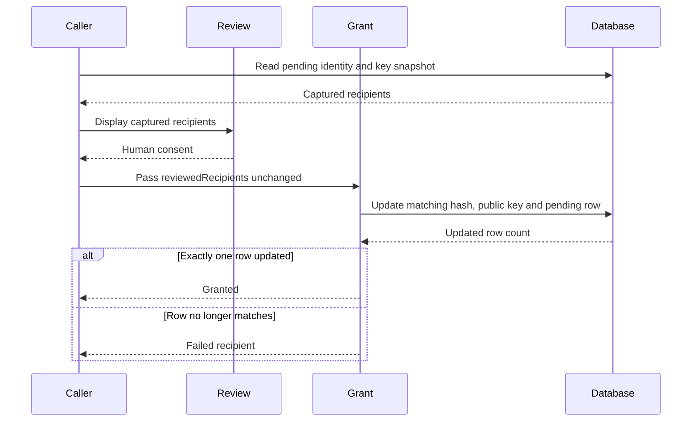
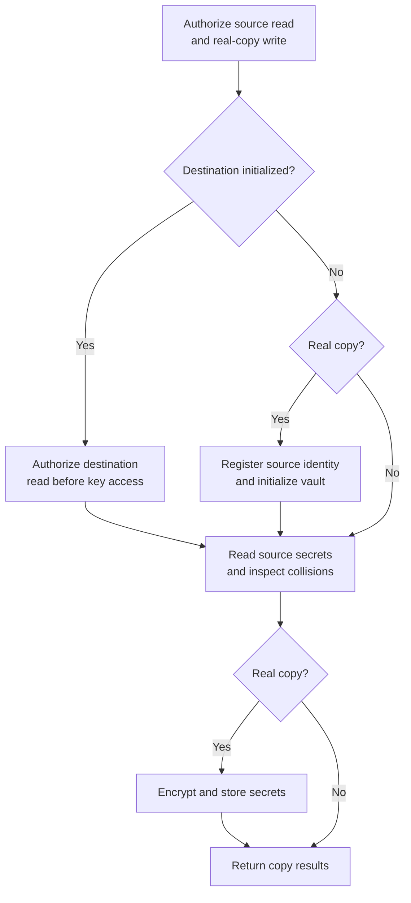

# Vault


## The Problem

Local secrets solve the individual developer's needs—sensitive values encrypted on their machine. But teams need shared secrets: API keys everyone uses, service credentials that shouldn't live in code. Email threads and chat messages aren't secure. Separate secret management tools add friction.

The vault stores encrypted secrets in the database itself. Team members automatically receive access when an authorized user propagates the key. Secrets stay encrypted at rest, decrypted only in memory when needed.


## Architecture

The vault uses dual-layer encryption:

```
┌─────────────────────────────────────────────────────────────┐
│  Layer 1: Vault Key Distribution                            │
│                                                             │
│  vault_key (32 bytes) ──────┬──────────────────────────────│
│                             │                               │
│    ┌─────────────────────┐  │  ┌─────────────────────────┐ │
│    │ Alice's public key  │──┼──│ encrypted_vault_key[A]  │ │
│    └─────────────────────┘  │  └─────────────────────────┘ │
│    ┌─────────────────────┐  │  ┌─────────────────────────┐ │
│    │ Bob's public key    │──┼──│ encrypted_vault_key[B]  │ │
│    └─────────────────────┘  │  └─────────────────────────┘ │
│                             │                               │
└─────────────────────────────┼───────────────────────────────┘
                              │
┌─────────────────────────────┼───────────────────────────────┐
│  Layer 2: Secret Encryption │                               │
│                             ▼                               │
│    ┌─────────────────────────────────────────────────────┐ │
│    │ vault_key (decrypted in memory)                     │ │
│    └─────────────────────┬───────────────────────────────┘ │
│                          │                                  │
│    ┌──────────────────┐  │  ┌────────────────────────────┐ │
│    │ API_KEY value    │──┴──│ encrypted_value (in DB)    │ │
│    └──────────────────┘     └────────────────────────────┘ │
│                                                             │
└─────────────────────────────────────────────────────────────┘
```

**Layer 1** distributes the vault key to authorized users. Each user gets their own encrypted copy using their X25519 public key. No shared secret transmission—ECDH derives the encryption key.

**Layer 2** encrypts individual secrets with the shared vault key. All team members with vault access can decrypt any secret.


## Encryption Details

### Vault Key Encryption (Layer 1)

The ephemeral keypair pattern encrypts the vault key for each recipient:

```typescript
function encryptVaultKey(vaultKey: Buffer, recipientPubKey: string): EncryptedVaultKey {
    // 1. Generate ephemeral X25519 keypair
    const { publicKey, privateKey } = generateKeyPairSync('x25519', {
        publicKeyEncoding: { type: 'spki', format: 'der' },
        privateKeyEncoding: { type: 'pkcs8', format: 'der' },
    });

    // 2. ECDH: ephemeral private + recipient public → shared secret
    const sharedSecret = diffieHellman({ privateKey, publicKey: recipientPubKey });

    // 3. HKDF-SHA256: shared secret → encryption key
    const encKey = hkdfSync('sha256', sharedSecret, Buffer.alloc(0), 'noorm-vault-key', 32);

    // 4. AES-256-GCM encryption
    const iv = randomBytes(16);
    const cipher = createCipheriv('aes-256-gcm', encKey, iv);
    const ciphertext = Buffer.concat([cipher.update(vaultKey), cipher.final()]);
    const authTag = cipher.getAuthTag();

    return { ephemeralPubKey, iv, authTag, ciphertext };
}
```

The stored payload contains:
- `ephemeralPubKey` — Sender's ephemeral public key (for ECDH on decrypt)
- `iv` — 16-byte initialization vector
- `authTag` — 16-byte GCM authentication tag
- `ciphertext` — Encrypted vault key

Decryption reverses the process: ECDH with the ephemeral public key and user's private key, same HKDF derivation, then AES-GCM decrypt.


### Secret Encryption (Layer 2)

Individual secrets use straightforward AES-256-GCM:

```typescript
function encryptSecret(value: string, vaultKey: Buffer) {
    const iv = randomBytes(16);
    const cipher = createCipheriv('aes-256-gcm', vaultKey, iv);
    const ciphertext = Buffer.concat([cipher.update(value, 'utf8'), cipher.final()]);
    const authTag = cipher.getAuthTag();

    return { iv, authTag, ciphertext };
}
```

Stored as JSON in the `encrypted_value` column. Each secret has its own random IV.


## Database Schema

Two tables back the vault, and both are created by schema migration v1 (`src/core/version/schema/migrations/v1.ts`) — there is no separate "add vault" migration.

Table names below are the MySQL/SQLite prefixed form. PostgreSQL and SQL Server store these in a dedicated `noorm` schema instead (`noorm.vault`, `noorm.identities`), with no prefix.

### Vault Table (`__noorm_vault__`)

```sql
CREATE TABLE __noorm_vault__ (
    id              INT PRIMARY KEY,   -- serial (PG) / identity(1,1) (MSSQL) / autoincrement
    secret_key      VARCHAR(255) NOT NULL UNIQUE,
    encrypted_value TEXT NOT NULL,
    set_by          VARCHAR(255) NOT NULL,
    created_at      TIMESTAMP NOT NULL DEFAULT CURRENT_TIMESTAMP,
    updated_at      TIMESTAMP NOT NULL DEFAULT CURRENT_TIMESTAMP
);

CREATE INDEX idx_vault_secret_key ON __noorm_vault__ (secret_key);
```

The `id` column is dialect-dependent: `serial` on PostgreSQL, `int identity(1,1)` on SQL Server, `integer primary key autoincrement` elsewhere. `created_at` / `updated_at` use `datetime2` on SQL Server (its `timestamp` is a binary rowversion counter, not a datetime) and `timestamp` everywhere else. Every one of these datetime columns is *naive* — it stores a wall clock with no offset.

The `encrypted_value` column stores JSON: `{ iv, authTag, ciphertext }`.

Secret keys must match `/^[A-Za-z][A-Za-z0-9_]*$/` — the same regex `StateManager.setSecret` enforces, because vault and local state feed the same `$.secrets` template namespace. A key one writer accepts and the other rejects resolves in one environment and not the other.

### Identities Table (`__noorm_identities__`)

The vault key column is part of the identities table from creation:

```sql
-- excerpt from the v1 CREATE TABLE
encrypted_vault_key TEXT   -- nullable
```

When this column is NULL, the user hasn't received vault access yet. After propagation, it contains their encrypted copy of the vault key.


## Secret Resolution

Templates reference secrets via `secrets.KEY_NAME`. The resolution order:

1. **Config-specific local secret** — User's override for this config
2. **Global local secret** — User's shared secret across configs
3. **Vault secret** — Team-shared from database

```typescript
async function resolveSecret(
    stateManager: StateManager,
    configName: string,
    secretKey: string,
    db?: Kysely<NoormDatabase> | null,
    vaultKey?: Buffer | null,
    dialect?: Dialect,          // defaults to 'postgres' when omitted
): Promise<string | null> {

    // 1. Config-specific local
    const configSecret = stateManager.getSecret(configName, secretKey);
    if (configSecret) return configSecret;

    // 2. Global local
    const globalSecret = stateManager.getGlobalSecret(secretKey);
    if (globalSecret) return globalSecret;

    // 3. Vault
    if (db && vaultKey) {
        return getVaultSecret(db, vaultKey, secretKey, dialect ?? 'postgres');
    }

    return null;
}
```

Every storage-layer function takes `dialect` as its last argument — it selects between the prefixed and schema-qualified table names. Omitting it against MySQL or SQLite looks in a `noorm` schema those dialects don't have.

`resolveVaultKey(db, dialect)` is the helper that loads the on-disk identity, reads the private key, and returns the vault key — degrading to `null` on any failure. A project with no vault at all keeps working.

For template rendering, `buildSecretsContext()` merges all three layers with proper priority:

```typescript
async function buildSecretsContext(
    stateManager: StateManager,
    configName: string,
    db?: Kysely<NoormDatabase> | null,
    vaultKey?: Buffer | null,
    dialect?: Dialect,
): Promise<Record<string, string>> {

    const secrets: Record<string, string> = {};

    // 1. Start with vault (lowest priority)
    if (db && vaultKey) {
        const vaultSecrets = await getAllVaultSecrets(db, vaultKey, dialect ?? 'postgres');
        for (const [key, secret] of Object.entries(vaultSecrets)) {
            secrets[key] = secret.value;
        }
    }

    // 2. Override with global local
    for (const key of stateManager.listGlobalSecrets()) {
        const value = stateManager.getGlobalSecret(key);
        if (value) secrets[key] = value;
    }

    // 3. Override with config-specific (highest priority)
    for (const key of stateManager.listSecrets(configName)) {
        const value = stateManager.getSecret(configName, key);
        if (value) secrets[key] = value;
    }

    return secrets;
}
```


## Core Operations

### Initialization

The first user to initialize creates the vault key. `initializeVault` is **idempotent**: calling it a second time against an already-initialized vault returns `[null, null]` without touching state or emitting an event. Callers can `init()` defensively at startup without special-casing an error.

The three possible return shapes:

| Shape | Meaning |
|-------|---------|
| `[Buffer, null]` | First-time init succeeded; this buffer is the vault key. Use it to seed initial secrets, propagate to teammates, etc. |
| `[null, null]` | Vault already initialized. No work done. Use `vault.get` / `vault.set` with the user's private key for ongoing operations. |
| `[null, Error]` | Actual failure (DB error, encryption error). The error is the underlying cause. |

```typescript
async function initializeVault(
    db: Kysely<NoormDatabase>,
    identityHash: string,
    publicKey: string,
    dialect: Dialect,
): Promise<[Buffer | null, Error | null]> {

    // Check if already initialized
    const existing = await db
        .selectFrom('__noorm_identities__')
        .select('encrypted_vault_key')
        .where('encrypted_vault_key', 'is not', null)
        .limit(1)
        .executeTakeFirst();

    if (existing?.encrypted_vault_key) {
        // Idempotent — no state change, no event emission.
        return [null, null];
    }

    // Generate new vault key
    const vaultKey = randomBytes(32);

    // Encrypt for initializer
    const encrypted = encryptVaultKey(vaultKey, publicKey);

    // Store
    await db
        .updateTable('__noorm_identities__')
        .set({ encrypted_vault_key: JSON.stringify(encrypted) })
        .where('identity_hash', '=', identityHash)
        .execute();

    observer.emit('vault:initialized', { identityHash });

    return [vaultKey, null];
}
```

The `vault:initialized` observer event fires only on first init — repeat calls return early before the emit.

Typical call-site pattern at the SDK boundary:

```typescript
const vaultKey = await ctx.noorm.vault.init();

if (vaultKey) {
    // First-time init — seed initial team secrets.
    await ctx.noorm.vault.set('API_KEY', process.env.SEED_KEY!, privateKey);
}
else {
    // Already initialized — use the vault normally.
    const apiKey = await ctx.noorm.vault.get('API_KEY', privateKey);
}
```


### Propagation

Users with vault access can propagate to pending users. `options.targets` selects identity hashes at execution time. CLI and TUI confirmation flows instead pass the captured hashes and public keys in `reviewedRecipients`, so the grant cannot include late arrivals or changed keys.

The update grants only the captured public key while its identity row remains pending.



Capture the review plan before presenting it:

```typescript
const [reviewedRecipients, readError] = await getUsersWithoutVaultAccess(db, 'postgres');
if (readError) throw readError;
```

After collecting consent for that exact plan, pass it unchanged:

```typescript
const result = await propagateVaultKey(db, vaultKey, 'postgres', { reviewedRecipients });
if (result.failed.length > 0) throw new Error('partial propagation');
```

A non-empty `failed` means some recipients did not receive the key. Callers must report partial grants rather than presenting them as complete success.

`propagateVaultKeyTo(db, vaultKey, targetIdentityHash, dialect)` grants to exactly one user and returns a boolean — `true` also when the user already had access.


### Cross-Config Copy

`copyVaultSecrets` requires source `vault:read`. Real copies also require destination `vault:write`; an initialized destination requires `vault:read` before key access or collision inspection.

```typescript
const [result, error] = await copyVaultSecrets(
    sourceConfig, destConfig, 'all',
    identity.identityHash, privateKey, identity.publicKey,
    { dryRun: true, channel: 'user' },
);
if (error) throw error;
```

Only real copies initialize or write the destination; collision previews still honor its read policy.



Fresh initialization registers the caller's actual identity metadata from the source and stores a key encrypted to that identity. It needs write access, not read access to an existing destination key. Dry runs neither initialize tracking tables nor decrypt the destination key. Source-read and destination-write denials can throw before connecting; failures inside the dual-connection operation, including destination-read denials, use the error tuple.

`VaultCopyOptions` carries three fields:

| Field | Default | Effect |
|-------|---------|--------|
| `force` | `false` | Overwrite secrets that already exist in the destination |
| `channel` | `'user'` | Who is asking; gates source read, real-copy destination write, and initialized-destination read |
| `dryRun` | `false` | Inspect source keys and authorized destination collisions without initializing schema, decrypting the destination key, or writing |

A dry run reports source keys and current destination collisions; it cannot predict later changes or write failures. Keys named in `keys` but missing from the source vault appear in `result.errors`.


## Policy Gating

The functions above take no config, so they cannot consult `access`. They are the ungated primitives the TUI still calls directly. **Every surface that holds a config — CLI, SDK — must use the `*Checked` wrappers instead**, which is what closes the hole where a `viewer`-role config could still write the vault:

| Ungated | Gated wrapper | Permission |
|---------|---------------|------------|
| `initializeVault` | `initializeVaultChecked` | `vault:write` |
| `getVaultKey` | `getVaultKeyChecked` | `vault:read` |
| `setVaultSecret` | `setVaultSecretChecked` | `vault:write` |
| `deleteVaultSecret` | `deleteVaultSecretChecked` | `vault:write` |
| `listVaultSecretKeys` | `listVaultSecretKeysChecked` | `vault:read` |
| `propagateVaultKey` | `propagateVaultKeyChecked` | `vault:propagate` |
| `propagateVaultKeyTo` | `propagateVaultKeyToChecked` | `vault:propagate` |

Each wrapper takes a `VaultPolicyGate` (`{ configName, access, channel }`) as its first argument and throws with the policy's `blockedReason` when denied. `access` is optional only so a caller holding partial config JSON can pass what it has — an absent `access` denies rather than waves through.

`assertVaultPolicy` ignores `requiresConfirmation`, because the core has no way to ask. Surfaces that must distinguish "denied" from "allowed but needs confirmation" — `vault:write` and `vault:propagate` are confirm cells for the `operator` role — call `checkVaultPolicy(gate, permission)` first and resolve the prompt themselves.

Gating `getVaultKey` rather than each individual read is what makes the gate hard to route around: `getVaultSecret` and `getAllVaultSecrets` are useless without the key, so a denied caller cannot decrypt anything. `listVaultSecretKeys` is gated even though it decrypts nothing — key names alone enumerate which systems the team holds credentials for.

`getVaultStatus` has no gated twin on purpose: it returns counts and booleans, never key names or values, and callers need it to tell a user *why* they have no access.


## CLI Commands

### `vault init`

Initialize the vault for the active config's database:

```bash
noorm vault init
```

Creates a new vault key and stores it encrypted for your identity. Re-running it is safe: if the vault is already initialized and you have access, it reports success and does nothing. It fails only when the vault exists and *you* have no access — the fix there is `vault propagate` from a teammate, not another `init`.


### `vault set`

Store a secret in the vault:

```bash
noorm vault set API_KEY "sk-live-..."
noorm vault set DB_PASSWORD "secret123"

# Keep the value out of argv, the process table, and shell history.
# One trailing newline is stripped, so the plain `echo` idiom is safe.
echo "$API_KEY" | noorm vault set API_KEY --stdin
```

Upserts—creates new or updates existing. Records `set_by` for audit trail.


### `vault list`

List all vault secrets:

```bash
noorm vault list
```

Shows keys, who set them, and timestamps. Values stay hidden.


### `vault rm`

Delete a vault secret:

```bash
noorm vault rm OLD_API_KEY
```


### `vault propagate`

Grant vault access to pending team members:

```bash
noorm vault propagate
noorm vault propagate --to <hash>,<hash> --yes   # Approve only these identity hashes
```

The preview lists pending recipients without granting. A human must pass `--yes` even when the role allows propagation; the agent channel cannot self-confirm recipient review. `--to` narrows the then-current pending list; a hash that is not waiting is an error. A preview from an earlier invocation does not bind the later grant. Within the granting invocation, each selected identity hash and public key must still match its pending row, and late arrivals are excluded. A changed or missing recipient is reported as a failure.


### `vault cp`

Copy a secret between configs. All three positionals — key, source, destination — are required; there is no "copy every secret" CLI form (the `keys: 'all'` mode exists only on the `copyVaultSecrets` SDK function):

```bash
noorm vault cp API_KEY staging production               # Copy one secret
noorm vault cp DB_PASSWORD dev staging --force          # Overwrite existing
noorm vault cp API_KEY staging production --dry-run     # Preview only
noorm vault cp API_KEY staging production --json
```

`--dry-run` runs the full preflight and writes nothing; it will not create a vault on the destination. The exit code and the `success` field track `errors` being empty, so a CI script branching on `.success` sees a partial copy as a failure.


## Observer Events

Vault operations emit events for monitoring:

```typescript
// Vault lifecycle
observer.on('vault:initialized', ({ identityHash }) => { ... });
observer.on('vault:propagated', ({ toIdentityHash, toEmail }) => { ... });

// Secret operations
observer.on('vault:secret:created', ({ key, setBy }) => { ... });
observer.on('vault:secret:updated', ({ key, setBy }) => { ... });
observer.on('vault:secret:deleted', ({ key }) => { ... });

// Copy operations
observer.on('vault:copy:starting', ({ source, destination, keys }) => { ... });
observer.on('vault:copy:completed', ({ source, destination, copied, skipped, errors }) => { ... });
```


## Types

```typescript
interface EncryptedVaultKey {
    ephemeralPubKey: string;  // X25519 public key (hex)
    iv: string;               // Initialization vector (hex)
    authTag: string;          // GCM authentication tag (hex)
    ciphertext: string;       // Encrypted vault key (hex)
}

interface EncryptedSecret {
    iv: string;
    authTag: string;
    ciphertext: string;
}

interface VaultSecret {
    key: string;
    value: string;
    setBy: string;
    createdAt: Date;
    updatedAt: Date;
}

interface VaultStatus {
    isInitialized: boolean;
    hasAccess: boolean;
    secretCount: number;
    usersWithAccess: number;
    usersWithoutAccess: number;
}

interface VaultCopyResult {
    copied: string[];
    skipped: string[];
    errors: Array<{ key: string; error: string }>;
}

interface PendingVaultUser {
    identityHash: string;   // stable handle propagation targets
    publicKey: string;      // X25519 key the vault key is sealed to
    name: string;
    email: string;
}

interface FailedVaultPropagation {
    identityHash: string;
    email: string;
    error: string;
}

interface VaultPropagationResult {
    propagatedTo: string[];
    alreadyHadAccess: number;

    // Non-empty means the operation partially succeeded: some teammate
    // believes they have access and does not. Treat as an error.
    failed: FailedVaultPropagation[];
}
```


## Security Properties

1. **End-to-end encryption** — Secrets encrypted before transmission, decrypted only in memory
2. **Zero-knowledge database** — Database sees only ciphertext; no plaintext ever stored
3. **Per-recipient key separation** — Each user's copy of the vault key is sealed under a fresh ephemeral keypair, so no two stored copies share a wrapping key. This is *not* forward secrecy: the recipient's static private key decrypts their copy forever, so a leaked private key exposes every past and future secret in that vault
4. **Authenticated encryption** — AES-GCM detects tampering
5. **No shared secrets in transit** — ECDH derives keys without transmitting them


## Limitations

- **All-or-nothing access** — Users with vault access can read all secrets
- **No key rotation** — Removing a user requires generating a new vault key (not yet implemented)
- **Lost keys** — If a user loses their private key, they must re-register identity
- **Single vault per database** — No per-team or per-project subdivision
