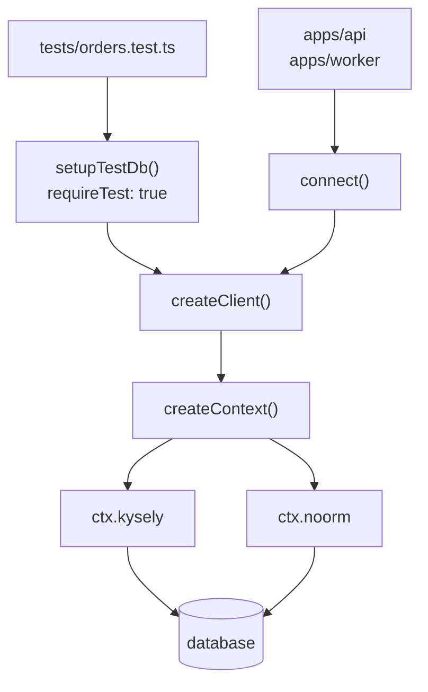

# Building your SDK


Wrap `createContext` in one workspace package, so every app and test queries the database through the same typed client.

```typescript
// apps/api/src/orders.ts
import { connect } from '@acme/db';

const db = await connect({ config: 'dev' });

const orders = await db.orders.listByParty(2);
// [ { party_id: 2, order_no: 1 }, { party_id: 2, order_no: 2 } ]
```


## How is the package laid out?


Apps and tests share one client, and only the test entry point sets `requireTest`.



```
packages/db/
├── src/
│   ├── index.ts           # re-exports connect, createClient, Client, Database
│   ├── client.ts
│   ├── testing.ts
│   ├── types.ts
│   └── domains/orders.ts
└── tests/orders.test.ts
```

In `packages/db`, install the SDK, Kysely, and your driver ([Installation](/getting-started/installation#install-the-sdk-optional) lists the driver per dialect), plus the test tools:

```bash
pnpm add @noormdev/sdk kysely pg
pnpm add -D typescript vitest
```


## Describe the schema


One interface per table, mirroring `db/sql/`. Update an interface in the same commit that changes its table.

```typescript
// packages/db/src/types.ts
import type { Generated } from 'kysely';

export interface PartyTable {
    party_id: Generated<number>;
    name: string;
}

export interface SalesOrderTable {
    party_id: number;
    order_no: number;
    placed_at: Generated<Date>;
}

export interface Database {
    party: PartyTable;
    sales_order: SalesOrderTable;
}
```


## Write a domain class


Each domain holds the context and exposes the queries for its tables:

```typescript
// packages/db/src/domains/orders.ts
import type { Context } from '@noormdev/sdk';
import type { Database } from '../types.js';

export class Orders {

    #ctx: Context<Database>;

    constructor(ctx: Context<Database>) {

        this.#ctx = ctx;

    }

    listByParty(partyId: number) {

        return this.#ctx.kysely
            .selectFrom('sales_order')
            .select(['party_id', 'order_no'])
            .where('party_id', '=', partyId)
            .orderBy('order_no')
            .execute();

    }

}
```


## Assemble the client


`createContext` returns an unconnected context. `connect()` creates and connects it:

```typescript
// packages/db/src/client.ts
import { createContext, type Context, type CreateContextOptions } from '@noormdev/sdk';
import type { Database } from './types.js';
import { Orders } from './domains/orders.js';

export class Client {

    #ctx: Context<Database>;

    readonly orders: Orders;

    constructor(ctx: Context<Database>) {

        this.#ctx = ctx;
        this.orders = new Orders(ctx);

    }

    get kysely() {

        return this.#ctx.kysely;

    }

    connect() {

        return this.#ctx.connect();

    }

    disconnect() {

        return this.#ctx.disconnect();

    }

    reset() {

        return this.#ctx.noorm.db.reset();

    }

    truncate() {

        return this.#ctx.noorm.db.truncate();

    }

}

export async function createClient(options: CreateContextOptions = {}) {

    return new Client(await createContext<Database>(options));

}

export async function connect(options: CreateContextOptions = {}) {

    const client = await createClient(options);

    await client.connect();

    return client;

}
```

`reset()` tears the schema down and rebuilds it from `db/sql/`. `truncate()` empties every table and keeps the schema.


## Test against a real database


The test client refuses any config that is not marked as a test database:

```typescript
// packages/db/src/testing.ts
import { createClient } from './client.js';

export function createTestClient(projectRoot?: string) {

    return createClient({ config: 'test', requireTest: true, yes: true, projectRoot });

}

export async function setupTestDb(projectRoot?: string) {

    const db = await createTestClient(projectRoot);

    await db.connect();
    await db.reset();

    return db;

}
```

Export it as its own entry, so production code never imports it. In `packages/db/package.json`:

```json
{
    "type": "module",
    "exports": {
        ".": { "types": "./dist/index.d.ts", "import": "./dist/index.js" },
        "./testing": { "types": "./dist/testing.d.ts", "import": "./dist/testing.js" }
    },
    "scripts": { "build": "tsc", "test": "vitest run" }
}
```

Then write tests against the real schema:

```typescript
// packages/db/tests/orders.test.ts
import { afterAll, beforeAll, beforeEach, expect, it } from 'vitest';
import { setupTestDb } from '../src/testing.js';
import type { Client } from '../src/client.js';

let db: Client;

beforeAll(async () => {

    db = await setupTestDb();

});

afterAll(async () => {

    await db.disconnect();

});

beforeEach(async () => {

    await db.truncate();

});

it('lists a party\'s orders by order_no', async () => {

    const { party_id } = await db.kysely
        .insertInto('party')
        .values({ name: 'Ada Lovelace' })
        .returning('party_id')
        .executeTakeFirstOrThrow();

    await db.kysely
        .insertInto('sales_order')
        .values([{ party_id, order_no: 1 }, { party_id, order_no: 2 }])
        .execute();

    const orders = await db.orders.listByParty(party_id);

    expect(orders.map((o) => o.order_no)).toEqual([1, 2]);

});
```

Add the `test` config once with `noorm ui`: press `c`, then `a`, name it `test`, and check Test Database.


## Where does the connection come from?


| Where it runs | Connection source | Call |
|---|---|---|
| Your machine | A stored config in `.noorm/state/state.enc` | `connect({ config: 'dev' })` |
| Tests | A stored config marked as a test database | `createTestClient()` |
| CI | `noorm ci init` writes the `test` config from env vars | `createTestClient()` |
| Production | `NOORM_CONNECTION_*` env vars, no stored config | `connect()` |

In CI, create the config before the tests run:

```bash
noorm -c packages/db ci init --name test --test
pnpm --filter @acme/db test
```

Both steps need `NOORM_IDENTITY_PRIVATE_KEY`, `NOORM_IDENTITY_NAME`, and `NOORM_IDENTITY_EMAIL`. `ci init` also needs `NOORM_CONNECTION_*`. [CI](/guide/automation/ci) has the full workflow, and [Deploying](/guide/deployment) covers production.


## What bites


| Symptom | Cause | Fix |
|---|---|---|
| `RequireTestError: Config "test" does not have isTest: true` | The config is not marked as a test database. `ci init` leaves it unmarked | Check Test Database in `noorm ui`, or run `ci init --test` |
| PostgreSQL: `db.truncate()` fails with `permission denied to set parameter "session_replication_role"` | Truncate turns off foreign-key triggers with a setting only superusers, or roles granted `SET` on it, may change | Use a superuser login for the test database, or [grant the setting](/guide/database/teardown#what-bites) |
| `ProtectedConfigError` from `truncate()` | `db:truncate` asks for confirmation even on an `admin` config, and the SDK cannot ask | Pass `yes: true` to `createContext`, or set `NOORM_YES=1` |
| `Config "dev" not found` | Stored configs resolve against `projectRoot`, which defaults to the process's cwd | Run from the directory that holds `.noorm/`, or pass `projectRoot` |
| `NotConnectedError: Not connected` | `createContext` returns an unconnected context | Call `connect()` first |
| A query fails: column does not exist | The interface in `types.ts` drifted from `db/sql/` | Update the interface with the table |


## Next


- [SDK reference](/reference/sdk): every method on `ctx` and `ctx.noorm`
- [Deploying](/guide/deployment): env-only connections and one context per process
- [CI](/guide/automation/ci): `ci init` and the workflow shapes
- [Templates](/guide/sql-files/templates): generate SQL from data
