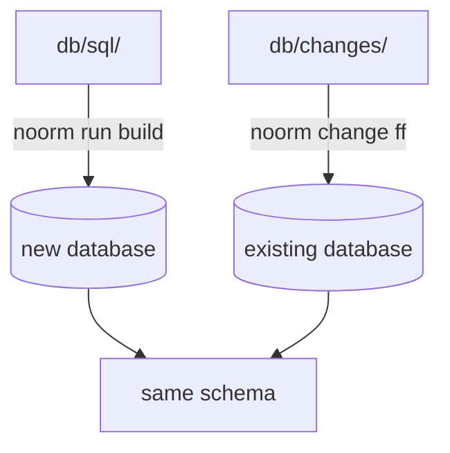
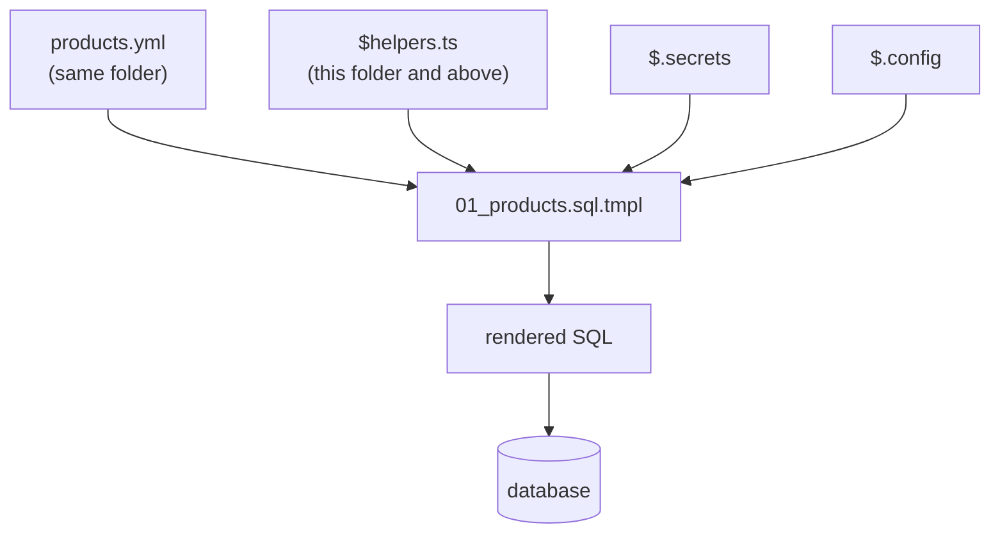

# Concepts


A noorm project keeps its schema in `db/`. `db/sql/` holds the schema as it stands today, and `db/changes/` holds the steps that bring databases that already exist up to it.

```
db/
├── sql/
│   ├── 01_tables/
│   │   ├── 01_party.sql
│   │   └── 02_sales_order.sql
│   └── 02_views/
│       └── 01_open_orders.sql
└── changes/
    └── 2026-10-20-order-status/
        ├── change/001_order-status.sql
        └── revert/001_order-status.sql
```

A new database and an old one reach the same schema by different commands:



Every edit to `db/sql/` comes with the change that brings an already-built database to the same state.


## SQL files are the current state


Each file in `db/sql/` declares one object the way it should exist now. Every column and constraint is declared once, inline in `CREATE TABLE`. A test run or a new developer gets a database with `noorm run build`, and no history is replayed.

History never goes in `db/sql/`. `DROP`, an `ALTER` of an existing table, an `IF NOT EXISTS` guard, and a backfill all belong in a change.

| | `db/sql/` | `db/changes/` |
|---|---|---|
| Holds | the schema today | how existing databases catch up |
| Runs on | new databases | databases that already exist |
| Command | `noorm run build` | `noorm change ff` |
| Undo | none | each change has a `revert/` folder |
| Order | path, alphanumeric | date prefix |

[Add a column](/guide/changes/add-a-column) walks one edit through both folders.


## Order is the sort order of the path


noorm sorts every path alphanumerically: folders, the files inside them, and the scripts inside a change. A view can only reference a table that already exists, so the folders need number prefixes:

```
db/sql/tables/       runs 2nd     db/sql/01_tables/      runs 1st
db/sql/functions/    runs 1st     db/sql/02_views/       runs 2nd
db/sql/views/        runs 3rd     db/sql/03_functions/   runs 3rd
```

Without prefixes, `functions/` sorts first and fails on tables that do not exist yet. `build.include` in settings picks which folders take part in a build. It does not reorder them.


## Templates turn data into SQL


Add `.tmpl` to a SQL file and noorm renders it before running it. A data file in the same folder becomes a variable named after the file, so `products.yml` is `$.products`:

```yaml
# db/sql/09_seeds/products.yml
- { sku: HW-DONGLE, name: USB security key, list_price: 49.00 }
- { sku: SW-SEAT,   name: "Desktop seat, yearly", list_price: 89.00 }
```

```sql
-- db/sql/09_seeds/01_products.sql.tmpl
-- 
INSERT INTO product (sku, name, list_price)
VALUES (, , );
-- 
```

A template reads from four sources, and renders to plain SQL that the database runs:



Data files can be YAML, JSON, JSON5, or CSV. A `$helpers.ts` applies to its folder and every folder below it, and a deeper one overrides a shallower one. [Templates](/guide/sql-files/templates) covers the syntax.


## Configs, stages, and roles


A **config** is a saved connection: `dev`, `staging`, `prod`. Commands use the active one unless `--config` names another:

```bash
noorm config use staging
noorm change ff --config prod
```

A **stage** in `.noorm/settings.yml` applies to the config with the same name. Its `defaults` seed that config when the TUI first creates it, `protected: true` caps its access, and `secrets` lists what it needs:

```yaml
# .noorm/settings.yml
stages:
  prod:
    defaults:
      dialect: postgres
      protected: true
    secrets:
      - key: PAYMENT_GATEWAY_KEY
        type: password
        required: true
```

Each config gives a **role** to two channels: `user` (you, in the CLI or TUI) and `agent` (an AI agent over MCP or the CLI). The role decides what runs, what asks for a typed confirmation, and what is refused:

| Role | Runs | Asks first | Refused |
|---|---|---|---|
| `viewer` | explore, read-only SQL | | writes, builds, changes, teardown |
| `operator` | explore, SQL reads and writes | build, change, `db create`, truncate | raw DDL, `db drop`, `db teardown` |
| `admin` | everything else | `db drop`, `db teardown`, `db truncate`, `change rm`, config edits, `vault propagate`, `lock force` | |

A stage with `protected: true` caps its configs at `operator` for the user and `viewer` for agents. Roles catch mistakes, such as a teardown against the wrong database. They do not stop someone who has the credentials and connects with another client. [Stages](/guide/environments/stages) covers the rest.


## Secrets stay out of committed SQL


A secret is a value a template reads when the SQL runs. The value is stored encrypted and never written into a file:

```sql
-- db/sql/09_seeds/02_gateway.sql.tmpl
INSERT INTO app_setting (name, value)
VALUES ('payment_gateway_key', );
```

```bash
printf %s "$KEY" | noorm secret set PAYMENT_GATEWAY_KEY --stdin
```

When a template asks for `$.secrets.PAYMENT_GATEWAY_KEY`, noorm looks in the config's own secrets first, then in the [vault](/guide/environments/vault), which is stored encrypted in the database and shared with the team. A secret set on your config overrides the team's value for you alone.


## What lives where


| Path | Holds | Commit it |
|---|---|---|
| `db/sql/`, `db/changes/` | the schema and its changes | yes |
| `db/AGENTS.md`, `db/CLAUDE.md` | instructions for AI agents working in `db/`, written by `noorm init` | yes |
| `.noorm/settings.yml` | paths, `build.include`, stages, required secrets | yes |
| `.noorm/state/state.enc` | your configs, credentials, and secrets, encrypted with your identity key | no, `noorm init` adds it to `.gitignore` |
| `~/.noorm/identity.key`, `identity.pub`, `identity.json` | your keypair, name, and email | never leaves your machine |

State is encrypted with your own key, so a copy is useless on another machine. Each developer keeps their own.


## What bites


| Mistake | What happens | Fix |
|---|---|---|
| Edit a table in `db/sql/` with no change | new databases get the edit, existing ones never do | add a change: `noorm change add <slug>` |
| A change that is not safe to run twice | a database built from `db/sql/` has no change records, so `change ff` runs the change against a table that already has it | guard it: `ADD COLUMN IF NOT EXISTS`, `WHERE status IS NULL` |
| Folders without number prefixes | alphabetical order runs `functions/` before `tables/` | `01_tables/`, `02_views/` |
| `noorm -c prod change ff` fails: `--cwd path is not a directory` | before the subcommand, `-c` is `--cwd`, so noorm looks for a project folder named `prod` | `noorm change ff --config prod` |


## Next


- [First build](/getting-started/first-build): init a project and build it
- [Add a column](/guide/changes/add-a-column): one edit, both folders
- [Templates](/guide/sql-files/templates): the full syntax
- [Building your SDK](/getting-started/building-your-sdk): call the database from TypeScript
