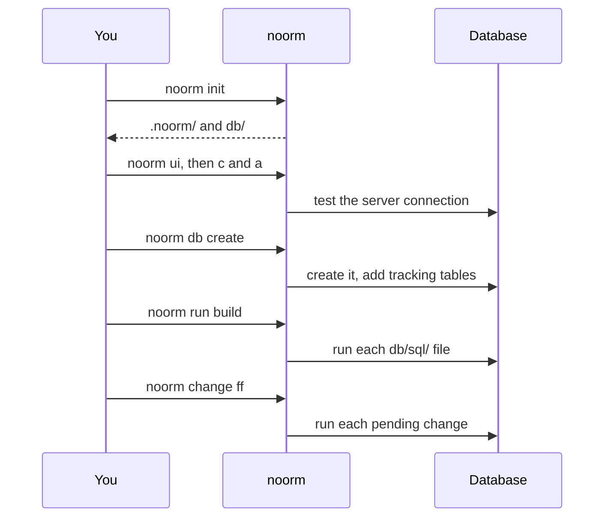

# First build


Create a project, connect it to a PostgreSQL server, and build a schema from SQL files.

```sql
-- db/sql/01_tables/02_sales_order.sql
CREATE TABLE sales_order (
    party_id   integer     NOT NULL,
    order_no   integer     NOT NULL,
    placed_at  timestamptz NOT NULL DEFAULT now(),
    CONSTRAINT sales_order_pk
        PRIMARY KEY (party_id, order_no),
    CONSTRAINT sales_order_isplacedby_party
        FOREIGN KEY (party_id) REFERENCES party (party_id)
);
```

```bash
noorm run build
```

```
• log  Build completed  status=success filesRun=2 filesSkipped=0 filesFailed=0 durationMs=31.208
```

Real runs prefix each line with a timestamp.


## What do the commands touch?


In this walkthrough, only three commands change the database: `db create`, `run build`, and `change ff`.




## Create the project


```bash
mkdir noorm-tutorial
cd noorm-tutorial
noorm init
```

`noorm init` asks for a display name and email unless `~/.noorm/` already holds an identity. It creates:

```
noorm-tutorial/
├── .gitignore         # gets a .noorm/state/ line
├── .noorm/
│   ├── .gitignore
│   ├── settings.yml   # commit this
│   └── state/
│       └── state.enc  # your configs and secrets, encrypted
└── db/
    ├── sql/
    ├── changes/
    ├── AGENTS.md
    └── CLAUDE.md
```

`db/AGENTS.md` sends AI agents to the `/noorm` skill, and `db/CLAUDE.md` imports it. [What lives where](/getting-started/concepts#what-lives-where) covers the rest.


## Add a config


A config is a saved connection. Creating one is interactive:

```bash
noorm ui
```

Press `c`, then `a`. Enter name `dev`, type PostgreSQL, host `localhost`, port `5432`, database `noorm_dev`, and your server's username and password. Leave User Role at `admin`, Agent Role at `viewer`, and Test Database unchecked.

The form tests the server connection before it saves, and the first config you save becomes the active one. Quit with `ctrl + c`.


## Create the database


```bash
noorm db create
```

```
Database "noorm_dev" created and initialized.
```

It also adds noorm's tracking tables.


## Build the schema


```bash
mkdir db/sql/01_tables
```

Save the `sales_order` file from the top of this page in that folder, and add the table it points at:

```sql
-- db/sql/01_tables/01_party.sql
CREATE TABLE party (
    party_id  integer GENERATED ALWAYS AS IDENTITY,
    name      text    NOT NULL,
    CONSTRAINT party_pk PRIMARY KEY (party_id)
);
```

Then run `noorm run build`. It prints the block at the top of this page: two files run in path order, so `party` exists before the foreign key needs it.


## Catch an existing database up


Treat `dev` as a database you cannot rebuild. Declare a new table in `db/sql/`, then add a change so `dev` gets it too.

```sql
-- db/sql/01_tables/03_invoice.sql
CREATE TABLE invoice (
    party_id    integer     NOT NULL,
    invoice_no  integer     NOT NULL,
    issued_at   timestamptz NOT NULL DEFAULT now(),
    CONSTRAINT invoice_pk
        PRIMARY KEY (party_id, invoice_no),
    CONSTRAINT invoice_isowedby_party
        FOREIGN KEY (party_id) REFERENCES party (party_id)
);
```

```bash
noorm change add invoice-table
```

This scaffolds `db/changes/2026-10-21-invoice-table/` (your folder carries the day you run it) with comment-only stubs in `change/` and `revert/`. Replace both. The change carries its own guarded copy of the table:

```sql
-- db/changes/2026-10-21-invoice-table/change/001_invoice-table.sql
CREATE TABLE IF NOT EXISTS invoice (
    party_id    integer     NOT NULL,
    invoice_no  integer     NOT NULL,
    issued_at   timestamptz NOT NULL DEFAULT now(),
    CONSTRAINT invoice_pk
        PRIMARY KEY (party_id, invoice_no),
    CONSTRAINT invoice_isowedby_party
        FOREIGN KEY (party_id) REFERENCES party (party_id)
);
```

```sql
-- db/changes/2026-10-21-invoice-table/revert/001_invoice-table.sql
DROP TABLE IF EXISTS invoice;
```

```bash
noorm change ff
```

```
• log  Fast-forward success  executed=1 skipped=0 failed=0
• log    2026-10-21-invoice-table (success)
```

Adding a column works the same way: see [Add a column](/guide/changes/add-a-column).


## Build a second database


A fresh database takes the schema from `db/sql/`. The change exists for databases that predate the table. Point one command at another database name with `NOORM_CONNECTION_DATABASE`:

```bash
NOORM_CONNECTION_DATABASE=noorm_test noorm db create
NOORM_CONNECTION_DATABASE=noorm_test noorm run build
```

The build runs 3 files, `invoice` included. The variable overrides the stored database name for that command, and the `dev` config is unchanged.


## What bites


| Symptom | Cause | Fix |
|---|---|---|
| `noorm init` exits: requires an interactive terminal | `init` prompts, and a script has no terminal | Run `noorm identity init --name "Ada" --email ada@example.com` once, then `noorm init --yes` |
| `noorm config add` prints: Interactive only | The CLI cannot prompt for connection details | Use `noorm ui`, or `noorm config import <file.json>` in scripts |
| `"run:build" is not allowed on config "dev" (role: viewer)` | An AI agent is driving the CLI, so the config's agent role applies, and it defaults to `viewer` | Run the command in your own terminal, or raise Agent Role on the config |
| `change ff` on a freshly built database fails: relation "invoice" already exists | The change has no guard, and a built database has no change records, so `ff` runs every change | Guard it: `CREATE TABLE IF NOT EXISTS` |


## Next


- [Concepts](/getting-started/concepts): the two folders and the commands that apply them
- [Add a column](/guide/changes/add-a-column): one edit, both folders, with a backfill
- [Building your SDK](/getting-started/building-your-sdk): query the schema from TypeScript
- [Terminal UI](/tui): keys and screens
