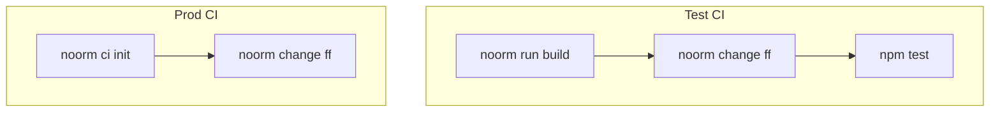
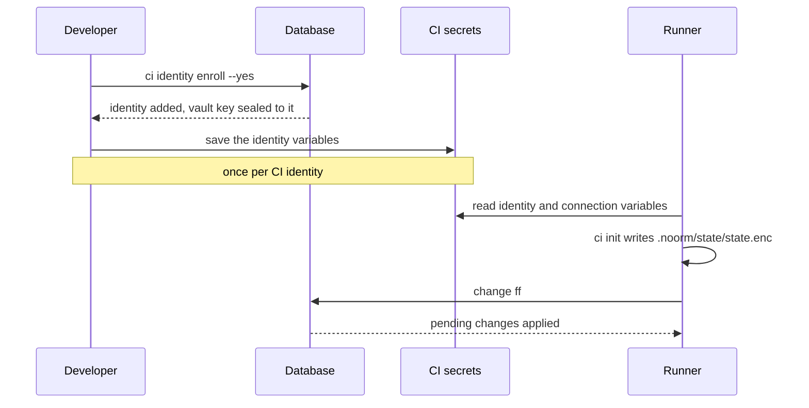

# CI/CD Automation


Run `noorm run build` and `noorm change ff` from a pipeline that has no saved state, no terminal, and no identity file.

```yaml
# .github/workflows/database.yml
name: Database CI

on:
    pull_request:

jobs:
    schema:
        runs-on: ubuntu-latest
        services:
            postgres:
                image: postgres:16
                env:
                    POSTGRES_PASSWORD: test
                    POSTGRES_DB: order_to_cash_ci
                ports:
                    - 5432:5432
                options: >-
                    --health-cmd pg_isready
                    --health-interval 5s
                    --health-retries 5
        env:
            NOORM_CONNECTION_DIALECT: postgres
            NOORM_CONNECTION_HOST: localhost
            NOORM_CONNECTION_DATABASE: order_to_cash_ci
            NOORM_CONNECTION_USER: postgres
            NOORM_CONNECTION_PASSWORD: test
        steps:
            - uses: actions/checkout@v4
            - uses: actions/setup-node@v4
              with:
                  node-version: '22'
            - run: npm install -g @noormdev/cli
            - run: noorm run build
            - run: noorm change ff
            - run: npm test
```

A database built from `db/sql/` has no change records, so `change ff` replays every change in `db/changes/`. A change that is not safe to run twice fails here instead of in production.

Tests that open the database through the SDK with `requireTest` need a stored test config. Add the `NOORM_IDENTITY_*` variables and run `noorm ci init --name test --test` before `npm test`, as [Building your SDK](/getting-started/building-your-sdk#where-does-the-connection-come-from) shows.


## Which shape does my pipeline need?


Test CI builds a throwaway database and replays every change. Prod CI applies only the pending changes to a shared database:



| | Test CI | Prod CI |
|---|---|---|
| Database | Created in the job | Shared, holds data |
| Identity | None, unless SDK tests need a stored test config | Enrolled once, read from `NOORM_IDENTITY_*` |
| Vault secrets | Unavailable | Decrypted when templates render |

If a change or template reads `$.secrets.KEY` and the key lives in the team vault, you need prod CI.


## How do I set up prod CI?


A developer with vault access enrolls the CI identity once. Every job then builds its own state from environment variables:



Enroll from a machine that has vault access on `prod`. The command prints `NOORM_IDENTITY_PRIVATE_KEY` once. Save it, with the name and email, in your CI secret store:

```bash
noorm ci identity enroll --config prod --name "GitHub CI" --email ci@example.com --yes
```

If the CI secret lives on a different machine than the vault access, mint the keypair there and enroll only the public half:

```bash
noorm ci identity new --name "GitHub CI" --email ci@example.com --json > ci-identity.json
noorm ci identity enroll --config prod --name "GitHub CI" --email ci@example.com \
    --public-key <publicKey from ci-identity.json> --yes
```

Each job runs `ci init`, then `change ff`:

```yaml
# .github/workflows/deploy-db.yml
name: Deploy database changes

on:
    push:
        branches: [main]

jobs:
    deploy:
        runs-on: ubuntu-latest
        env:
            NOORM_IDENTITY_PRIVATE_KEY: ${{ secrets.NOORM_CI_KEY }}
            NOORM_IDENTITY_NAME: GitHub CI
            NOORM_IDENTITY_EMAIL: ci@example.com
            NOORM_CONNECTION_DIALECT: postgres
            NOORM_CONNECTION_HOST: ${{ secrets.DB_HOST }}
            NOORM_CONNECTION_DATABASE: order_to_cash
            NOORM_CONNECTION_USER: ${{ secrets.DB_USER }}
            NOORM_CONNECTION_PASSWORD: ${{ secrets.DB_PASSWORD }}
            # the prod stage is protected, so change ff asks for confirmation
            NOORM_YES: "1"
        steps:
            - uses: actions/checkout@v4
            - uses: actions/setup-node@v4
              with:
                  node-version: '22'
            - run: npm install -g @noormdev/cli
            - run: noorm ci init --name prod
            - run: noorm change ff
```

GitLab CI takes the same variables under `variables:` and the same three commands. `NOORM_CI_CONFIG_NAME` renames the config when `--name` is absent (default `ci`). The connection variables are listed under [environment-only mode](/headless#environment-only-mode).


## How do I load secrets for one job?


`ci secrets` reads `KEY=value` lines from a dotenv file into the active config's secrets, in the runner's state file. They outrank a vault secret with the same key. Existing keys are skipped unless you pass `--overwrite`:

```bash
printf 'STRIPE_KEY=%s\n' "$STRIPE_KEY" > ci-secrets.env
noorm ci secrets --file ci-secrets.env
rm ci-secrets.env
```


## What bites


| Symptom | Cause | Fix |
|---|---|---|
| `ci init` exits 2: `Missing or invalid environment variables` | A secret is not passed to the step, or the key is not 96 hex characters | Map the secret into the step's `env`. Copy the full value `enroll` printed |
| `ci init` exits 1: `State already exists at … Use --force to overwrite.` | A cached or committed `.noorm/state/state.enc` is in the workspace | `ci init --force` backs it up first. At a terminal it also needs `--yes` |
| `ci identity enroll` exits 1: `About to grant irrevocable vault access` | `--yes` is missing, and sealing a vault key cannot be undone | Check the fingerprint it prints, then rerun with `--yes` |
| `change ff` exits 1: `requires confirmation` | A stage named like the config (`prod`) has `protected: true`, which caps `user` at `operator` | Set `NOORM_YES=1` on the deploy step |
| Tests fail: `Config "ci" does not have isTest: true` | `ci init` leaves `isTest` false, and an environment-only config has it false too | `ci init --test`. `ci identity new` mints a throwaway identity for it |
| `Secret "STRIPE_KEY" not found (searched: config-local, global-local, vault)` | A template reads a secret this job does not have | Use prod CI for vault secrets, or `ci secrets` for job-scoped ones |
| `ci secrets` exits 3 | Some keys were stored and some failed | Fix the errors it lists, then rerun. Stored keys are skipped |


## Next


- [Non-interactive operation](/guide/automation/non-interactive): what `--yes` answers and what still refuses
- [Deploying an application](/guide/deployment): schema once per release, the app on every replica
- [Vault](/guide/environments/vault): how team secrets are encrypted and shared
- [Exit codes](/headless#exit-codes): the 0, 1, 2, 3 contract every command shares
