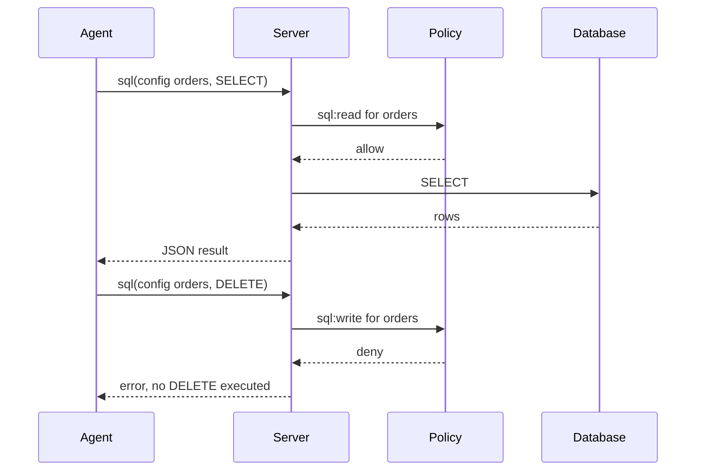
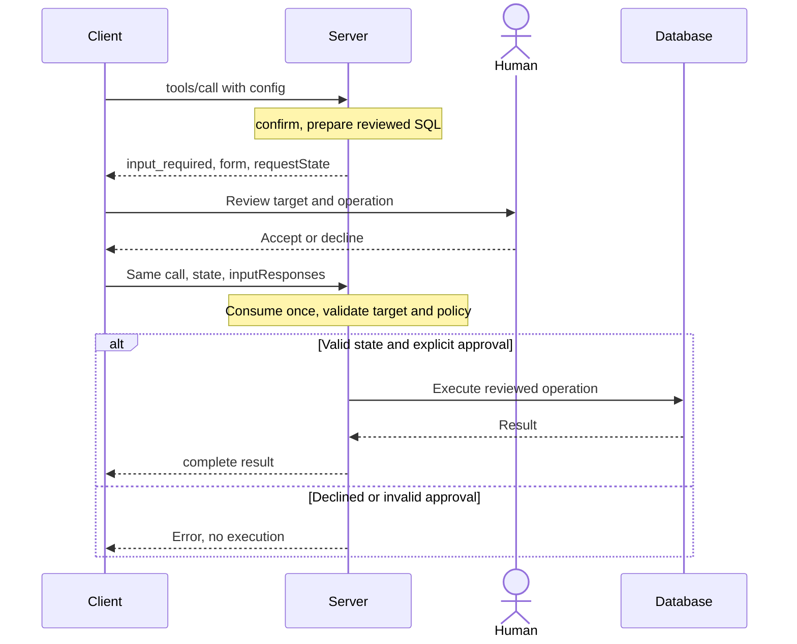

# MCP (AI Agent Integration)

Let an AI agent explore and query a database through noorm, limited to the effective `agent` role on each config.

```bash
noorm mcp init
```

This writes a Claude Code `.mcp.json` entry:

```json
{
    "mcpServers": {
        "noorm": {
            "command": "noorm",
            "args": ["mcp", "serve"]
        }
    }
}
```

`--agent cursor` writes `.cursor/mcp.json`. Existing files keep their other server entries. Pair it with the [agent skill](/getting-started/installation#install-the-agent-skill-optional): `npx skills add noormdev/noorm/skills`.

## How does a request reach the database?

Each SQL call names its target. For a viewer on `orders`, the server permits a read and rejects a write before sending it to the database.



## Protocol and request context

The stdio server speaks MCP **2026-07-28**. Clients must support that revision; legacy initialization-based clients are rejected. Discovery uses `server/discover`; each request carries its protocol version and client capabilities in `_meta`.

Discover the 11 tools with `tools/list`. Call each by its own name, with flat arguments. `list_configs` takes `{}`; every other tool requires `config`.

| Tool | Arguments besides `config` | Purpose |
|---|---|---|
| `list_configs` | none; no config | List visible configs and their dialects |
| `overview` | none | Summarize database objects |
| `list` | `category` | List objects in a category |
| `detail` | `category`, `name`, optional `schema` | Inspect one object |
| `sql` | `query` | Execute SQL, subject to its classified permission |
| `change_history` | optional `limit` | List applied changes |
| `change_run` | `name` | Apply a named change |
| `change_ff` | none | Apply pending changes in order |
| `change_revert` | `name` | Revert a named change |
| `run_build` | optional `force` | Run the configured build; `force` skips checksum checks |
| `run_file` | `path` | Execute a project-relative SQL file |

For example, a `tools/call` request's params can be:

```json
{
    "name": "sql",
    "arguments": {
        "config": "orders",
        "query": "SELECT id FROM sales_order LIMIT 10"
    }
}
```

Choose SQL syntax for the target dialect and inspect the schema before querying; the example assumes a dialect supporting `LIMIT` and the named table and column. Unknown tools and invalid arguments return JSON-RPC `-32602`; permission failures are tool results with `isError: true`.

**Migration:** Replace `run_noorm_cmd` calls with the command name as the tool name, move `payload` fields alongside `config`, and remove `command` and `payload`. Replace `noorm_help` with `tools/list` and its input schemas. Neither old tool is available.

There is no MCP `connect`, `disconnect`, or active-session `status` command. Each request resolves its named config and current project policy, then closes its database connection when the request finishes. Existing clients must stop sending session commands and supply `config` on each database operation.

## Prompt cookbooks

Use `prompts/list` to discover the following prompts and `prompts/get` to retrieve their user-role guidance. A user or application selects a prompt; it is not a tool for an agent to call. Retrieving one does not connect to or modify a database.

| Prompt | Arguments | Guidance |
|---|---|---|
| `noorm_getting_started` | optional `config` | Discover configs and select a target |
| `noorm_explore_database` | `config` | Explore objects and inspect details |
| `noorm_query_database` | `config`, optional `question` | Inspect schema and answer with dialect-aware SQL |
| `noorm_apply_change` | `config`, `change` | Review history and a named project change before applying it |
| `noorm_build_database` | `config` | Review project build inputs and run the build |
| `noorm_run_sql_file` | `config`, `path` | Review and run a project SQL file |
| `noorm_automation` | `task`, optional `config` | Write a headless script with explicit targets, JSON output, and failure handling |
| `noorm_ci` | `provider`, `target` (`test` or `deploy`), `config` | Set up disposable test CI or a shared-database deployment pipeline |

For example, `prompts/get` with `{"name":"noorm_query_database","arguments":{"config":"orders","question":"Which orders are recent?"}}` returns guidance to inspect the target and schema first. The client supplies the returned messages to the conversation. The agent then uses the actual tool results to choose a query; the prompt itself executes nothing.

For automation, pass the requested workflow as `task`, for example `{"name":"noorm_automation","arguments":{"task":"Apply pending changes from a deployment script","config":"orders"}}`. The cookbook covers headless commands, environment-only connections, exit codes, and the distinction between a script's confirmation flags and MCP human approval.

For CI, select the provider and pipeline shape: `{"name":"noorm_ci","arguments":{"provider":"GitHub Actions","target":"test","config":"ci"}}`. Test guidance builds a disposable database and runs changes and tests, including stored test config bootstrap when the SDK requires it. Deployment guidance uses an enrolled CI identity and applies pending changes without rebuilding an existing database. `config` names the stored config when bootstrapping with `ci init`; environment-only jobs do not pass a nonexistent saved config. See [CI/CD Automation](/guide/automation/ci) and [Non-interactive operation](/guide/automation/non-interactive) for the underlying commands.

## Permissions and human approval

The following table shows unmodified built-in roles. Project role overrides and custom roles can change these decisions.

| Commands | Permission | Viewer | Operator | Admin |
|---|---|---|---|---|
| `list_configs` | none | allow | allow | allow |
| `overview`, `list`, `detail`, `change_history` | `explore` | allow | allow | allow |
| Read-only SQL | `sql:read` | allow | allow | allow |
| DML, including `INSERT`, `UPDATE`, `DELETE` | `sql:write` | deny | allow | allow |
| DDL | `sql:ddl` | deny | deny | allow |
| `run_build`, `run_file`, `change_run`, `change_ff`, `change_revert` | corresponding `run:*` or `change:*` permission | deny | confirm | allow |

DML defaults are unchanged: operator and admin do not prompt. To let an operator request approval for DDL, override its permission in `.noorm/settings.yml`:

```yaml
access:
    roles:
        operator:
            permissions:
                sql:ddl: confirm
        metadata-reader:
            permissions:
                explore: allow
                sql:read: allow
```

Built-in overrides retain unspecified default permissions. Custom roles may `extends` another role's effective definition; without a base, unspecified permissions are denied. Assign names through each config's `access.user` and `access.agent`. See [Access roles](/guide/environments/configs#access-roles).

### Who approves a confirmed operation?

The client presents the operation to a human, then retries it with the response. Noorm validates the returned state and current policy before executing.



The client must advertise form elicitation support. Decline, cancel, missing support, modified state, changed target/arguments/policy, expiration, or replay prevents execution. Approvals expire after five minutes and do not survive a server restart. File, build, and change approval binds rendered SQL and the approved execution plan; known template secret values are redacted in the review text while the private snapshot retains the actual SQL.

MCP trusts the client to collect human consent; it cannot independently prove a human clicked approve. Role checks also do not replace database grants or protection of project files and credentials. Project template sidecars execute JavaScript and must be trusted.

An agent calling the **CLI** is still denied for every `confirm` permission, including with `--yes` or `NOORM_YES`. Human CLI/TUI confirmation remains available. `deny` never becomes executable through approval.

`access.agent: false` hides a config from discovery and direct requests. A config without an explicit access assignment defaults to `user: admin`, `agent: viewer`. Protected-stage ceilings cannot be relaxed by a role override.

## Exploration resources

Clients can browse resource listings and URI templates, then read database metadata as `application/json`:

```text
noorm://configs/{config}/overview
noorm://configs/{config}/objects/{category}
noorm://configs/{config}/objects/{category}/{name}
noorm://configs/{config}/objects/{category}/{name}?schema={schema}
```

Encode config, schema, and object names as URI components. Lists cover tables, views, procedures, functions, types, indexes, foreign keys, triggers, locks, and connections. Detail supports tables, views, procedures, functions, types, and triggers, subject to dialect support.

Every read enforces `explore`, including human elicitation when its effective decision is `confirm`. Resources reuse the same introspection operations as exploration tools; they do not execute caller-provided SQL or return table-row dumps. Results use private, immediately stale cache hints so clients do not reuse live schema/session metadata as a shared public result.

## Troubleshooting

| Symptom | Cause | Action |
|---|---|---|
| Unsupported protocol or rejected initialization | Client only speaks a legacy MCP revision | Upgrade the client to support `2026-07-28` |
| Explicit config required | Database request omitted its target | Add `config` to the tool arguments, or use a config-qualified resource URI |
| `sql:ddl` denied for operator | Built-in operator still denies DDL | Explicitly configure `sql:ddl: confirm` if appropriate |
| Missing required client capability | Client cannot collect form approval | Use a client with modern form elicitation support; noorm will not bypass confirmation |
| Approval no longer matches | It expired, was consumed, or its target/policy changed | Make a fresh request and review a new approval |
| Agent CLI denied even with `--yes` | CLI agents cannot fulfill human confirmation | Use MCP elicitation or have a human run the operation |

## Next

- [Access roles](/guide/environments/configs#access-roles)
- [MCP command flags](/headless#mcp)
