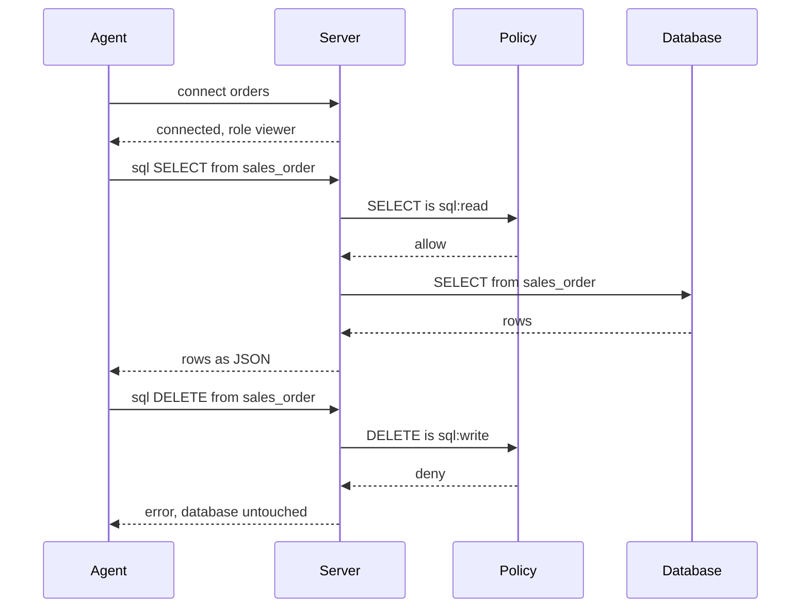

# MCP (AI Agent Integration)


Let an AI agent explore and query a database through noorm, limited to what the `agent` role on each config allows.

```bash
noorm mcp init
```

```
Created /home/dev/order-to-cash/.mcp.json
```

```json
// .mcp.json
{
    "mcpServers": {
        "noorm": {
            "command": "noorm",
            "args": [
                "mcp",
                "serve"
            ]
        }
    }
}
```

That is Claude Code's file. `--agent cursor` writes `.cursor/mcp.json`. Other MCP clients take the same entry by hand. An existing file keeps its other entries, and `init` prints `Extended`. Pair it with the [agent skill](/getting-started/installation#install-the-agent-skill-optional): `npx skills add noormdev/noorm/skills`.


## How does a request reach the database?


An agent holds `viewer` on a config named `orders`. Every command passes a policy check first:



The server offers two tools: `noorm_help` lists commands and their parameters, and `run_noorm_cmd` runs one as `{ command, config?, payload? }`.


## Which commands can the agent run?


Each command needs one permission, and the agent's role on the config decides if it has it:

| Commands | Permission | `viewer` | `operator` | `admin` |
|---|---|---|---|---|
| `list_configs`, `connect`, `disconnect`, `status` | none | yes | yes | yes |
| `overview`, `list`, `detail`, `change_history` | `explore` | yes | yes | yes |
| `sql` with `SELECT`, or `SHOW` and `DESCRIBE` on MySQL | `sql:read` | yes | yes | yes |
| `sql` with `INSERT`, `UPDATE`, `DELETE` | `sql:write` | no | yes | yes |
| `sql` with DDL | `sql:ddl` | no | no | yes |
| `run_build`, `run_file`, `change_run`, `change_ff`, `change_revert` | `run:*`, `change:*` | no | no | yes |

`sql` is classified by what the statement does, and `EXPLAIN` takes the class of the statement it wraps. A config with no `access` gives agents `viewer`.

`access.agent: false` hides a config: `list_configs` omits it, and `connect` fails with the error an unknown name produces, `Config "orders" not found`.

An agent that shells out to `noorm` after a refusal stays on the `agent` channel ([how the channel is chosen](/guide/environments/configs#which-channel-is-a-process-on)).


## What bites


| Symptom | Cause | Fix |
|---|---|---|
| `"sql:write" is not allowed on config "orders" (role: viewer).` | The default agent role is `viewer` | Raise `access.agent` for that config in the TUI |
| `"change:ff" on config "orders" requires confirmation from a human.` | A `confirm` cell is deny for agents, and `--yes` does not change that | Give a disposable database `agent: admin`, or run the command yourself |
| Agent still refused after you raised its role | A session keeps the config it loaded at `connect` | Have the agent call `connect` again, or restart the server |


## Next


- [Access roles](/guide/environments/configs#access-roles): the full role matrix
- [MCP commands](/headless#mcp): `mcp init` and `mcp serve` flags
