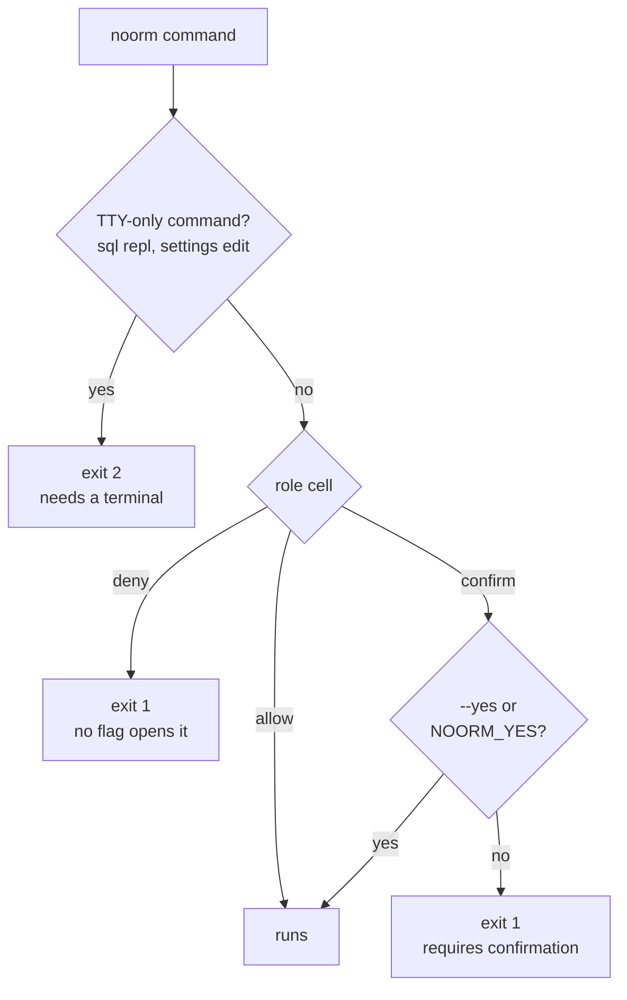

# Non-interactive operation


Run noorm in CI, a deploy script, or an agent subprocess, where nobody can press Enter.

```bash
# bootstrap.sh
set -euo pipefail

# identity init exits 1 when an identity exists, so guard it
[ -f ~/.noorm/identity.key ] || noorm identity init --name "$CI_USER" --email "$CI_EMAIL"
# init exits 1 when .noorm/ exists, which a CI checkout of a project has
[ -d .noorm ] || noorm init --yes
noorm run build    # connection comes from NOORM_CONNECTION_* variables
noorm change ff
```

This scaffolds a project if there is none, then builds it.


## What does `--yes` answer?


`--yes` (or `-y`) answers a confirmation for one command. `NOORM_YES` answers for every command: any non-empty value counts except `0` and `false`, in any letter case. The flag beats `NOORM_YES=0`.

A run with no terminal stops at the first gate it cannot answer. The role cells come from [Access roles](/guide/environments/configs#access-roles), and on the `agent` channel `confirm` is `deny`:




## Which prompts have a flag?


| Command | Without a terminal |
|---|---|
| `noorm init` | `--yes`, after `noorm identity init` has written `~/.noorm/identity.*` |
| `change run`, `revert`, `rm`, `edit`, `add` | Pass the name or description as the argument, or exit 1 |
| `db transfer` with a `.dtzx` file | `--passphrase`, or exit 2 |
| `sql repl` | `--yes` exits 2. Use `noorm sql query "SELECT 1"` or `--file query.sql` |
| `settings edit` | `--yes` exits 2. Edit `.noorm/settings.yml`, then `noorm settings build` |
| `settings secret` | `--yes` exits 2. Edit `secrets:`, and set values with `noorm secret set <key> --stdin` |


## What bites


| Symptom | Cause | Fix |
|---|---|---|
| `identity init --force` still exits 1 | Replacing needs the `--yes` flag. `NOORM_YES` does not count, because a new keypair orphans every `state.enc` | Pass `--yes` |
| `db reset` exits 1: `This is a destructive operation. Pass --yes to confirm.` | It needs `--yes` or `NOORM_YES` even for `admin` | Pass it |


## Next


- [CI/CD Automation](/guide/automation/ci): test CI and prod CI pipelines
- [Exit codes](/headless#exit-codes): the 0, 1, 2, 3 contract
