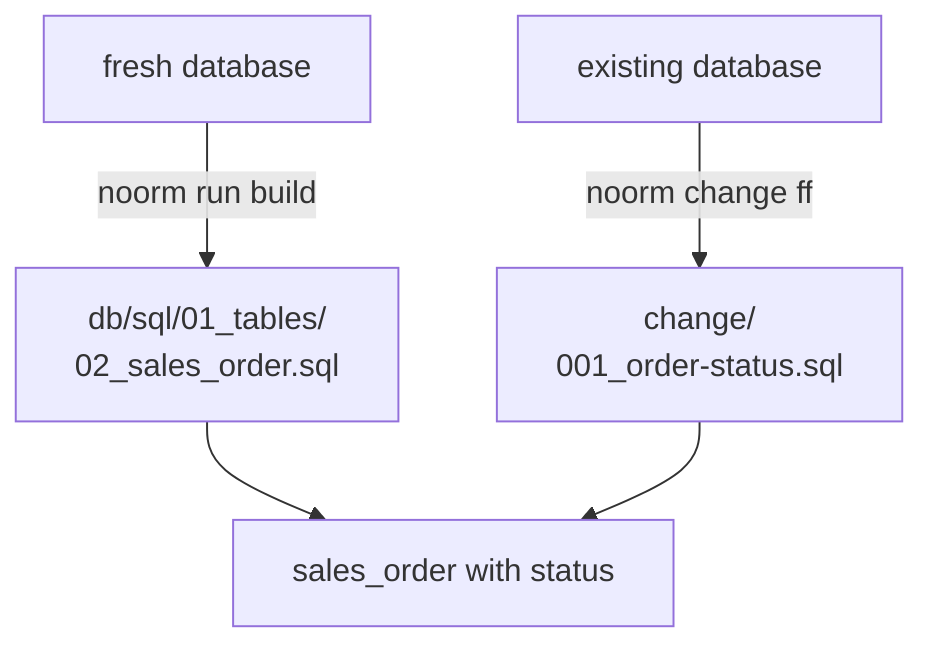

# Add a column to a live database

Declare the column in `db/sql/` so fresh databases get it. Add a change so databases that already exist catch up, backfill included.

The table's file holds the current state. The column is declared once, inline:

```sql
-- db/sql/01_tables/02_sales_order.sql
CREATE TABLE sales_order (
    party_id   integer     NOT NULL,
    order_no   integer     NOT NULL,
    placed_at  timestamptz NOT NULL DEFAULT now(),
    status     text        NOT NULL DEFAULT 'open', -- [!code ++]
    CONSTRAINT sales_order_pk
        PRIMARY KEY (party_id, order_no),
    CONSTRAINT sales_order_isplacedby_party
        FOREIGN KEY (party_id) REFERENCES party (party_id)
);
```

Scaffold the change, then fill in its two files:

```bash
noorm change add order-status
```

```sql
-- db/changes/2026-10-20-order-status/change/001_order-status.sql
ALTER TABLE sales_order ADD COLUMN IF NOT EXISTS status text;

-- Invoiced orders become 'invoiced', the rest 'open'. Paid orders are
-- marked by the payment change that follows this one.
UPDATE sales_order so
SET    status = CASE WHEN EXISTS (
           SELECT 1 FROM invoice_line il
           WHERE il.party_id = so.party_id AND il.order_no = so.order_no
       ) THEN 'invoiced' ELSE 'open' END
WHERE  status IS NULL;

ALTER TABLE sales_order
    ALTER COLUMN status SET DEFAULT 'open',
    ALTER COLUMN status SET NOT NULL;
```

```sql
-- db/changes/2026-10-20-order-status/revert/001_order-status.sql
ALTER TABLE sales_order DROP COLUMN IF EXISTS status;
```

Apply it to every database that predates the column:

```bash
noorm change ff
```

```
• log  Fast-forward success  executed=1 skipped=0 failed=0
• log    2026-10-20-order-status (success)
```


## How it works


Each database reaches the same table by one of two paths:



| File | Runs on | Says |
|---|---|---|
| `db/sql/01_tables/02_sales_order.sql` | fresh databases, through `run build` | what the table is now |
| `change/001_order-status.sql` | each database where the change is pending, through `change ff` | how to get there from the old table, backfill included |
| `revert/001_order-status.sql` | `change revert` | how to undo it |

`ALTER`, `UPDATE`, and `DROP` live only in `db/changes/`. The file in `db/sql/` never says how the table got to its current shape.

A database built from `db/sql/` has no record of any change, so its first `change ff` runs every change it finds, this one included. The `IF NOT EXISTS` and the `WHERE status IS NULL` make that second run a no-op.


## Options


| Flag | Effect |
|---|---|
| `--dry-run` | Render the change to `tmp/` without touching the database |
| `--json` | Print the result as JSON |
| `--config`, `-c` | Run against another config: `noorm change ff -c staging` |
| `--force`, `-f` | Skip the checksum check and run every file of each pending change |
| `NOORM_YES=1` | Allow operations that need confirmation, for scripts and CI |

Full entry: [`change ff`](/headless#change-ff).


## What bites


| Symptom | Cause | Fix |
|---|---|---|
| `change ff` fails on a freshly built database: column "status" already exists | The build created the column, and the change ran again because nothing recorded it | Write the change so a second run changes nothing: `IF NOT EXISTS`, and backfill only rows that still need it |
| `run build` on a fresh database fails: column "status" already exists | An `ALTER TABLE` landed in `db/sql/` | Declare the column inline in `CREATE TABLE`; the `ALTER` belongs in the change |
| `SET NOT NULL` fails: the column contains null values | The backfill missed rows | Backfill in the same change, before `SET NOT NULL` |
| `change ff` exits 1: requires confirmation | Your role on that config is `operator` | Set `NOORM_YES=1`, or confirm in `noorm ui` |


## Next


- [Forward and revert](/guide/changes/forward-revert): apply, revert, and the status of each change
- [Changes overview](/guide/changes/overview): folder anatomy and manifests
