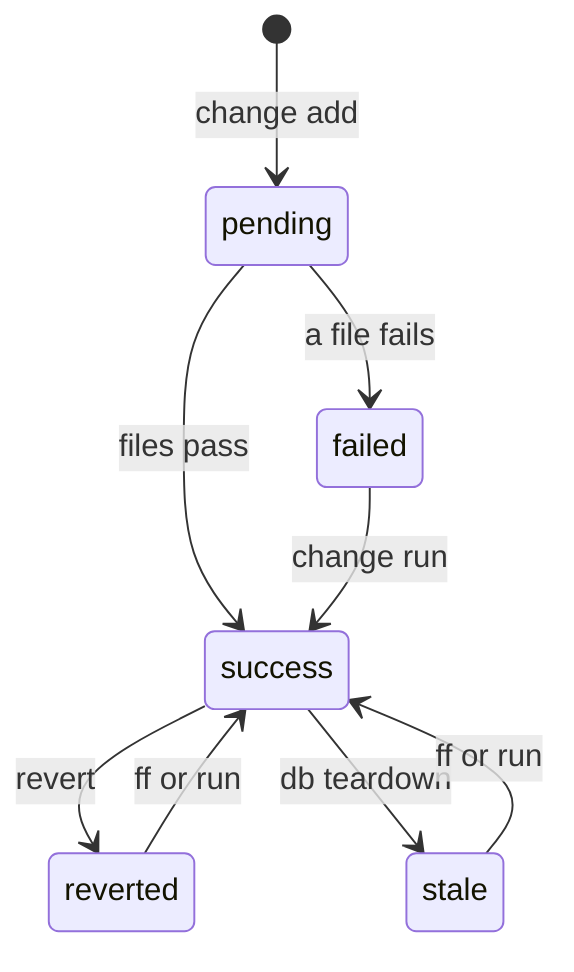
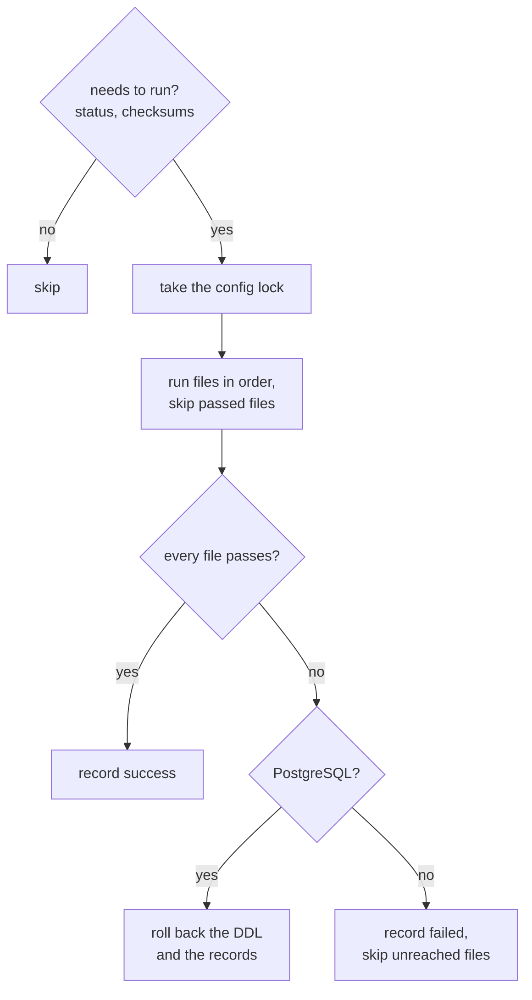

# Forward and revert


Apply outstanding changes in order, and roll one back when it goes wrong.

```bash
noorm change ff
```

```
• log  Fast-forward success  executed=2 skipped=0 failed=0
• log    2026-10-22-open-orders (success)
• log    2026-10-23-payment (success)
```

```bash
noorm change revert 2026-10-23-payment
```

```
• log  2026-10-23-payment reverted (success)
```

`ff` ran both outstanding changes, oldest first. `revert` ran the `revert/` files of `payment` and set it to `reverted`, so the next `ff` applies it again.


## Which statuses can a change have?


A change has five statuses, and `ff` and `next` pick up three of them.



| Status | Means | `ff` and `next` |
|---|---|---|
| `pending` | no record yet | run it |
| `success` | applied | skip it |
| `failed` | last run failed and was recorded | skip it |
| `reverted` | applied, then rolled back | run it |
| `stale` | `db teardown` dropped what it built | run it |

`revert` runs from `success` or `failed`, and `db teardown` turns both into `stale`. A revert from `reverted` or `stale` runs nothing and still reports success. A change with no record fails with `not applied`.


## How do I apply changes?


| Command | Applies | TUI |
|---|---|---|
| `noorm change ff` | every outstanding change, oldest first | `f` |
| `noorm change next [n]` | the next `n` outstanding changes, default 1 | `n` |
| `noorm change run <name>` | one named change, in or out of order | `r` |

`ff` and `next` stop at the first failing change. Exit `0` is success, `1` failed, `3` partial: some applied before one failed. [CI](/guide/automation/ci) runs these in a pipeline.


## What happens when a change runs?


A change takes the config lock, runs its files in order, and records the outcome. The first failing file stops it.



On PostgreSQL the whole change is one transaction, so a failure leaves no record and no applied file. MySQL, SQL Server, and SQLite have no wrapping transaction, so files that passed stay applied.


## How do I recover from a failed change?


Fix the file, then retry:

| | PostgreSQL | MySQL, SQL Server, SQLite |
|---|---|---|
| Status after a failure | none, so `pending` | `failed`, with the error |
| Retry with | `noorm change ff` | `noorm change run <name>` |

The retry skips files that already passed. If a half-applied run needs manual cleanup first, clean up, then add `--force` to run every file. [History](/guide/changes/history#which-file-broke-the-change) shows which file failed.


## What happens when a change folder cannot be read?


A manifest that names a file no longer in `db/sql/` makes its change unreadable. `ff` and `next` do not step over it:

| The unreadable change | `ff` and `next` |
|---|---|
| never ran, or is `reverted` or `stale` | fail at its position, so later changes do not run out of order. Exit `1`, or `3` when earlier changes applied |
| already applied | keep its status and add a `warnings` entry |

```
✗ log  Fast-forward partial  executed=1 skipped=1 failed=1
• log    2026-10-20-order-status (success)
✗ log    2026-10-22-open-orders (failed)
✗ log      error: Manifest '/home/dana/orders/db/changes/2026-10-22-open-orders/change/001_rebuild-views.txt' references missing file: 02_views/02_unpaid_invoices.sql
```

`skipped=1` is `2026-10-23-payment`, which never ran.


## How do I roll back?


| Command | Reverts | TUI |
|---|---|---|
| `noorm change revert <name>` | one change | `v` |
| `noorm change rewind <n>` | the last `n` applied changes, newest first | `w` |
| `noorm change rewind <name>` | that change and every change applied after it | `w` |

`revert` runs the `revert/` files in filename order, writes a history record with direction `revert`, then sets the original record to `reverted`. `rewind` considers only `success` changes and orders them by apply time, breaking same-second ties by history id.


## How do I preview a run?


`--dry-run` renders every file, templates and manifests included, to `tmp/` and runs nothing:

```bash
noorm change ff --dry-run
```

```
• log  Dry run: rendering changes to tmp/ (no DB writes)
• log  Fast-forward (dry-run) success  executed=2 skipped=0 failed=0 dryRun=true
• log    2026-10-22-open-orders (success, dry-run)
• log    2026-10-23-payment (success, dry-run)
```

A dry run takes no lock and writes no status or history. `ff`, `next`, and `rewind` still read the tracking tables to choose what to render. In the TUI, `Shift+D` toggles it.

::: warning Rendered secrets
Dry-run files hold every secret a template resolved, in plaintext. noorm writes them owner-only, and `noorm init` does not add `tmp/` to `.gitignore`.
:::


## What decides whether a change runs?


noorm compares checksums of every file in `change/`, plus every file a manifest lists.

| The change is | `ff` and `next` | `change run <name>` |
|---|---|---|
| new, `reverted`, or `stale` | runs | runs |
| `failed` | skips | runs the files that have not passed |
| `success`, files unchanged | skips | skips |
| `success`, a file edited | skips | runs the edited files |

`--force` (TUI: `Shift+F`) runs every file and ignores file history. On `revert` it skips the status check. [`change ff`](/headless#change-ff) lists the other flags.


## What bites


| Symptom | Cause | Fix |
|---|---|---|
| `ff` reports `executed=0` while a change shows `failed` | `ff` skips a recorded `failed` change | Fix the file, then `noorm change run <name>` |
| `ff` fails after `run build`: already exists | A build records no changes, and `db teardown` marks applied ones `stale`, so `ff` replays them over the built schema | Write each change to be safe to run twice ([Add a column](/guide/changes/add-a-column)) |
| `ff` warns `Changes directory not found` and runs nothing | `settings.yml` has no `paths`, which now resolves to `./db/changes` | Add `paths: { sql: ./sql, changes: ./changes }` |
| Exit `1`: `requires confirmation` or `(role: viewer)` | Your role on that config is `operator` or `viewer` | `NOORM_YES=1` for `operator`. `viewer` is denied: [Access roles](/headless#access-roles) |
| Exit `1`: `Lock for '<config>' held by ...` | Another operation holds the config lock | Wait, or check `noorm lock status` |


## Next


- [History](/guide/changes/history): what each run recorded
- [Changes](/guide/changes/overview): folder layout and manifests
- [Add a column](/guide/changes/add-a-column): a change with a backfill
- [Teardown](/guide/database/teardown): how teardown makes changes `stale`
