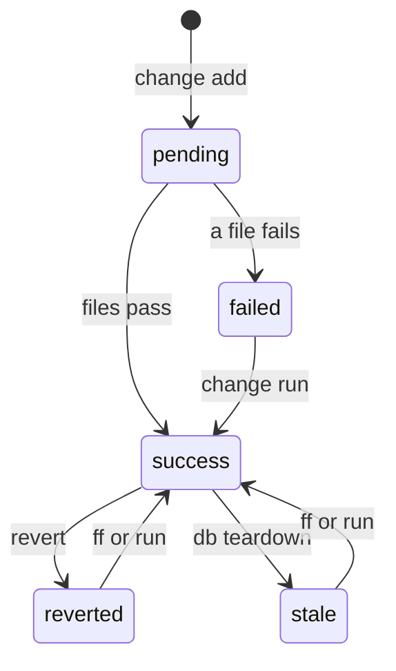
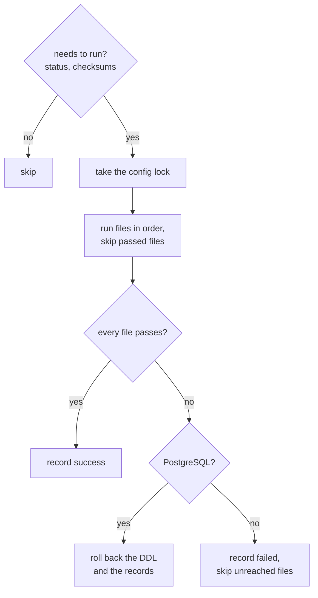

# Forward and revert


Apply outstanding changes in order, and roll one back when it goes wrong.

```bash
noorm change ff
```

```
• log  Fast-forward success  executed=2 skipped=0 failed=0
• log    2026-10-22-open-orders (success)
• log    2026-10-23-payment (success)
```

```bash
noorm change revert 2026-10-23-payment
```

```
• log  2026-10-23-payment reverted (success)
```

`ff` ran both outstanding changes, oldest first. `revert` ran the `revert/` files of `payment` and set it to `reverted`, so the next `ff` applies it again.


## Which statuses can a change have?


A change has five statuses, and `ff` and `next` pick up three of them.



| Status | Means | `ff` and `next` |
|---|---|---|
| `pending` | no record yet | run it |
| `success` | applied | skip it |
| `failed` | last run failed and was recorded | skip it |
| `reverted` | applied, then rolled back | run it |
| `stale` | `db teardown` dropped what it built | run it |

`revert` runs from `success` or `failed`, and `db teardown` turns both into `stale`. A revert from `reverted` or `stale` runs nothing and still reports success. A change with no record fails with `not applied`.


## How do I apply changes?


| Command | Applies | TUI |
|---|---|---|
| `noorm change ff` | every outstanding change, oldest first | `f` |
| `noorm change next [n]` | the next `n` outstanding changes, default 1 | `n` |
| `noorm change run <name>` | one named change, in or out of order | `r` |

`ff` and `next` stop at the first failing change. Exit `0` is success, `1` failed, `3` partial: some applied before one failed. [CI](/guide/automation/ci) runs these in a pipeline.


## What happens when a change runs?


A change takes the config lock, runs its files in order, and records the outcome. The first failing file stops it.



On PostgreSQL the whole change is one transaction, so a failure leaves no record and no applied file. MySQL, SQL Server, and SQLite have no wrapping transaction, so files that passed stay applied.


## How do I recover from a failed change?


Fix the file, then retry:

| | PostgreSQL | MySQL, SQL Server, SQLite |
|---|---|---|
| Status after a failure | none, so `pending` | `failed`, with the error |
| Retry with | `noorm change ff` | `noorm change run <name>` |

The retry skips files that already passed. If a half-applied run needs manual cleanup first, clean up, then add `--force` to run every file. [History](/guide/changes/history#which-file-broke-the-change) shows which file failed.


## What happens when a change folder cannot be read?


A manifest that names a missing file in `db/sql/` makes that direction of the change unreadable. During forward execution, `ff` checks the whole pending batch before running SQL.

| The unreadable forward change | `ff` | `next` |
|---|---|---|
| Never ran, or is `reverted` or `stale` | Blocks the batch before any pending SQL runs unless the operator retires the eligible changes | Stops at the unreadable change if it is in the batch |
| Already applied | Keeps its execution status and reports a warning | Keeps its execution status and reports a warning |


## How do I retire obsolete changes?

Retire a change only when every supported database has caught up and you no longer need to roll it back. If a database still needs the change, restore its missing files instead. SQL execution errors are not candidates for retirement.

Once no supported upgrade or rollback needs an old definition, remove it from `db/sql/` and remove its `build.exclude` entry. Retire the old changes that refer to it in the same project update. Check that no remaining forward or rollback manifest needs the file, then verify a clean build.

Open Fast-Forward in the TUI or run `noorm change ff` in a human terminal to review pending changes with missing forward files. Use Space to select the changes, press Enter, and confirm both conditions. To stop without recording retirement, cancel, select nothing, or decline confirmation.

NoORM writes the confirmed names to `.noorm/retired.yml` at the project root and checks the batch again. You can also edit the file directly:

```yaml
- 2026-10-22-open-orders
- 2026-10-23-payment
```

Use a YAML list of exact change names. No Git command is required to record retirement. Commit the file when you want other checkouts to use the same list. A missing file means no changes are retired; an invalid file blocks change operations.

NoORM skips retired changes even while their folders remain and keeps their database execution history. It cannot revert a retired change or rewind across one. Retirement does not delete any files or modify any database.

If a retired change has a recorded failure or an unfinished run on the target database, `ff` stops. Check the execution history and reconcile the database before proceeding. Retirement cannot undo SQL that already ran.
This guard applies to `ff`; use it to check the whole batch rather than running one change at a time with `next`.

CI, agent sessions, redirected input or output, `NOORM_YES`, `--json`, and `--dry-run` never prompt or write to `.noorm/retired.yml`. If a pending change remains unreadable, `ff` reports the failure before any pending SQL runs.


## How do I roll back?


| Command | Reverts | TUI |
|---|---|---|
| `noorm change revert <name>` | one change | `v` |
| `noorm change rewind <n>` | the last `n` applied changes, newest first | `w` |
| `noorm change rewind <name>` | that change and every change applied after it | `w` |

`revert` runs the `revert/` files in filename order, writes a history record with direction `revert`, then sets the original record to `reverted`. `rewind` considers only `success` changes and orders them by apply time, breaking same-second ties by history id.


## How do I preview a run?


`--dry-run` renders every file, templates and manifests included, to `tmp/` and runs nothing:

```bash
noorm change ff --dry-run
```

```
• log  Dry run: rendering changes to tmp/ (no DB writes)
• log  Fast-forward (dry-run) success  executed=2 skipped=0 failed=0 dryRun=true
• log    2026-10-22-open-orders (success, dry-run)
• log    2026-10-23-payment (success, dry-run)
```

A dry run takes no lock and writes no status or history. `ff`, `next`, and `rewind` still read the tracking tables to choose what to render. In the TUI, `Shift+D` toggles it.

::: warning Rendered secrets
Dry-run files hold every secret a template resolved, in plaintext. noorm writes them owner-only, and `noorm init` does not add `tmp/` to `.gitignore`.
:::


## What decides whether a change runs?


noorm compares checksums of every file in `change/`, plus every file a manifest lists.

| The change is | `ff` and `next` | `change run <name>` |
|---|---|---|
| new, `reverted`, or `stale` | runs | runs |
| `failed` | skips | runs the files that have not passed |
| `success`, files unchanged | skips | skips |
| `success`, a file edited | skips | runs the edited files |

`--force` (TUI: `Shift+F`) runs every file and ignores file history. On `revert` it skips the status check. [`change ff`](/headless#change-ff) lists the other flags.


## What bites


| Symptom | Cause | Fix |
|---|---|---|
| `ff` reports `executed=0` while a change shows `failed` | `ff` skips a recorded `failed` change | Fix the file, then `noorm change run <name>` |
| `ff` fails after `run build`: already exists | A build records no changes, and `db teardown` marks applied ones `stale`, so `ff` replays them over the built schema | Write each change to be safe to run twice ([Add a column](/guide/changes/add-a-column)) |
| `ff` warns `Changes directory not found` and runs nothing | `settings.yml` has no `paths`, which now resolves to `./db/changes` | Add `paths: { sql: ./sql, changes: ./changes }` |
| Exit `1`: `requires confirmation` or `(role: viewer)` | Your role on that config is `operator` or `viewer` | `NOORM_YES=1` for `operator`. `viewer` is denied: [Access roles](/headless#access-roles) |
| Exit `1`: `Lock for '<config>' held by ...` | Another operation holds the config lock | Wait, or check `noorm lock status` |


## Next


- [History](/guide/changes/history): what each run recorded
- [Changes](/guide/changes/overview): folder layout and manifests
- [Add a column](/guide/changes/add-a-column): a change with a backfill
- [Teardown](/guide/database/teardown): how teardown makes changes `stale`
