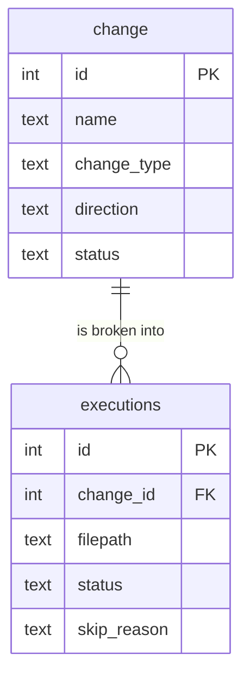

# Execution history


Find out who ran a change, when, and which file broke it.

```bash
noorm change history
```

```
Execution History: 4 records
  2026-10-20-order-status - success (10/21/2026, 1:40:29 AM)
  2026-10-21-invoice - failed (10/21/2026, 1:40:03 AM)
  2026-10-20-order-status - reverted (10/21/2026, 1:40:03 AM)
  2026-10-19-sales-order - success (10/21/2026, 1:40:03 AM)
```

Newest first, one line per operation. The first line is the revert of `2026-10-20-order-status`. The third is its original apply, now flagged `reverted`. The text omits direction, and `--json` carries it.


## What does noorm record?


Each operation is one `change` row, with one `executions` row per file that was not already applied:



Rows also carry who ran it (`Name <email>`), when, how long, a checksum, and the error text. MySQL and SQLite name the tables `__noorm_change__` and `__noorm_executions__`. [Execution](/guide/sql-files/execution#what-gets-tracked) lists every column.

| `change_type` | Written by | In `change history` |
|---|---|---|
| `change` | `change run`, `ff`, `next`, `revert`, `rewind` | yes |
| `build` | `run build` | no, TUI only |
| `run` | `run file`, `run dir`, `run files` | no, TUI only |

A build or run where every file is unchanged writes no operation.


## Which file broke the change?


```bash
noorm change history-detail 2026-10-24-order-line
```

```
• log  History for: 2026-10-24-order-line (1 operation(s))
• log  
  [15] change — failed at 10/21/2026, 1:46:16 AM by Dana Reyes <dana@example.com>
• log         duration: 27ms
• log         error: 002_order-line-index.sql: [Err 1] no such column: nope
• log      • 001_order-line.sql — success | 2ms
• log      • 002_order-line-index.sql — failed | 1ms | error: [Err 1] no such column: nope
• log      • 003_line-index.sql — skipped | skipped: 002_order-line-index.sql failed: [Err 1] no such column: nope
```

`[15]` is the operation id. The failing file carries the database's error, and every file after it is `skipped` with the failure as the reason. After you fix `002` and run `noorm change run 2026-10-24-order-line`, a second operation lists only `002` and `003`. File `001` already passed, so it leaves no row.

| File status | TUI | Meaning |
|---|---|---|
| `success` | `[OK]` | ran without error |
| `failed` | `[ERR]` | threw an error |
| `skipped` | `[-]` | an earlier file failed, so this one was never reached |

`--count` sets how many operations to show, default 10. How to retry is in [Forward and revert](/guide/changes/forward-revert#how-do-i-recover-from-a-failed-change).


## How do I read history in the TUI?


Press `g` from home, then `h`. [TUI](/tui#changes-list) shows the screens.

| Screen | Shows | Keys |
|---|---|---|
| History | the latest 200 operations of every type, with totals by type | `Enter` opens files, `e` shows the full error, `Esc` goes back |
| File executions | one operation's files, with path, checksum, and error or skip reason | `Enter` shows the full error, `Esc` goes back |

Rows carry `[OK]` for `success` and `[ERR]` for any other status, and a type tag: `[CHANGESET]`, `[BUILD]`, or `[RUN]`. Times show as `2 hours ago`.


## How do I script against history?


```bash
noorm change history --json --count 100
```

```json
{
    "success": true,
    "history": [
        {
            "id": 13,
            "name": "2026-10-23-payment",
            "direction": "change",
            "status": "success",
            "executedAt": "2026-10-21T05:41:50.000Z",
            "executedBy": "Dana Reyes <dana@example.com>",
            "durationMs": 19,
            "errorMessage": null,
            "checksum": "73fbc0894afc..."
        }
    ]
}
```

`--count` defaults to 20 here. `executedAt` is ISO UTC. The text form prints local time. `change history-detail <name> --json` returns each operation with its file records.


## What bites


| Symptom | Cause | Fix |
|---|---|---|
| A failed change leaves no history on PostgreSQL | One transaction rolls back the DDL and the history rows together | Read the error from the failing command ([Forward and revert](/guide/changes/forward-revert#what-happens-when-a-change-runs)) |
| An entry named `__reset__` | `db teardown` records itself, with the drop summary in `errorMessage` | None. It marks where changes went `stale` |
| `[ERR]` on a `reverted` or `stale` row in the TUI | `[OK]` means `success` only | Check `change history --json` or `change list` for the exact status |
| `change history-detail` prints nothing into a pipe | The text goes through the logger to stderr | Use `--json`, or redirect with `2>&1` |
| History from another environment is missing | Each config keeps its own history | Pass `-c <config>` |


## Next


- [Forward and revert](/guide/changes/forward-revert): apply, roll back, and recover
- [Changes](/guide/changes/overview): folder layout and manifests
- [Teardown](/guide/database/teardown): why changes go `stale`
- [`change history`](/headless#change-history): flags and JSON
