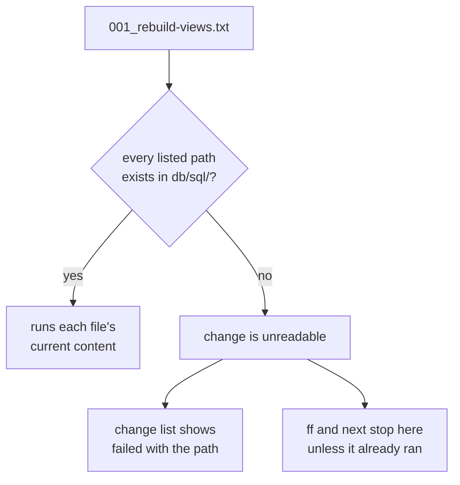

# Changes


A change takes a database that already exists to the schema in `db/sql/`. noorm runs each change once per database and records the result.

```bash
noorm change add order-status
```

```
Created: 2026-10-20-order-status
  /home/dana/orders/db/changes/2026-10-20-order-status
```

```
db/changes/2026-10-20-order-status/
├── change/
│   └── 001_order-status.sql
├── revert/
│   └── 001_order-status.sql
└── changelog.md
```

Each `.sql` file starts as one comment line. Replace it with SQL, as [Add a column](/guide/changes/add-a-column) does for this change. In the TUI, press `g` from home, then `a`.


## What is in a change folder?


| Path | Holds | Read by |
|---|---|---|
| `change/` | forward scripts | `change run`, `ff`, `next` |
| `revert/` | rollback scripts | `change revert`, `rewind` |
| `changelog.md` | why the change exists | people. noorm records only that it exists |

Files in `change/` and `revert/` run by extension:

| Extension | Runs |
|---|---|
| `.sql` | as written |
| `.sql.tmpl` | after Eta renders it ([Templates](/guide/sql-files/templates)) |
| `.txt` | a manifest: files from `db/sql/`, in place |

Other files are not run, though a template still reads the data files beside it. A folder with neither `change/` nor `revert/` is not a change, so shared fragments and archives can sit beside the real ones.


## How are changes and files ordered?


noorm sorts by name at both levels, so the name is the order.

| Level | Pattern | Example |
|---|---|---|
| Change folder | `YYYY-MM-DD-slug` | `2026-10-20-order-status` |
| File | `NNN_slug.ext` | `001_order-status.sql` |

- `change add` builds the folder name from today's date and a slug of your description.
- Pad file numbers to three digits. Names sort as text, so `10_` comes before `9_`.
- `revert/` runs in the same filename order as `change/`. Number its files in the order the undo has to happen.

`invoice_line` references `invoice`, so the revert drops the child first:

```
change/                       revert/
├── 001_invoice.sql           ├── 001_invoice-line.sql
└── 002_invoice-line.sql      └── 002_invoice.sql
```


## How does a change reuse a view or function from db/sql/?


A `.txt` manifest lists files in `db/sql/`. noorm runs them in place, so the view is defined once and the change never copies its SQL:

```
# db/changes/2026-10-22-open-orders/change/001_rebuild-views.txt
02_views/01_open_orders.sql
02_views/02_unpaid_invoices.sql
```

A manifest sorts among the other files of its folder. Use that to drop a dependent view, alter the table, then rebuild the view:

```
change/
├── 001_drop-unpaid-invoices.sql  -- DROP VIEW IF EXISTS unpaid_invoices;
├── 002_widen-amount.sql          -- ALTER TABLE invoice_line ALTER COLUMN amount TYPE numeric(14,2);
└── 003_rebuild-views.txt         02_views/02_unpaid_invoices.sql
```

| Rule | Detail |
|---|---|
| Paths | one per line, relative to `paths.sql`: `02_views/01_open_orders.sql`, not `db/sql/02_views/...` |
| Ignored lines | blank lines and lines starting with `#` |
| Order | lines run in file order. A path listed twice in one change runs once, at its first position |
| Content | the file as it is at run time, not as it was when you wrote the change |
| Revert | a manifest in `revert/` rebuilds the current definition. To restore an older one, write its `CREATE OR REPLACE` inline |

A manifest is resolved every time noorm reads the change, so one missing path makes the whole change unreadable:



[Forward and revert](/guide/changes/forward-revert#what-happens-when-a-change-folder-cannot-be-read) covers what `ff` does with it. An empty manifest, or one with only comments, is unreadable too.


## How do I see what is pending?


```bash
noorm change list
```

```
2026-10-19-sales-order (success)
2026-10-20-order-status (reverted)
2026-10-21-invoice (failed): 002_invoice-line.sql: [Err 1] near "(": syntax error
2026-10-23-payment (pending)
1 pending change(s)
```

Each line is `name (status)`. A change recorded in the database whose folder is gone shows `(status, orphaned)`. `--json` adds `appliedAt`, `appliedBy`, `revertedAt`, `errorMessage`, `isNew`, and `orphaned` to each entry. [Forward and revert](/guide/changes/forward-revert#which-statuses-can-a-change-have) defines the five statuses.


## What bites


| Symptom | Cause | Fix |
|---|---|---|
| `change run` fails: files are empty or contain only template placeholders | The scaffolded stub is a comment, and a change needs real SQL | Replace the comment with SQL |
| A folder in `db/changes/` never appears in `change list` | It has neither `change/` nor `revert/` | Add `change/` with at least one file |
| `change list` shows `failed` with `references missing file` | A manifest names a file that `db/sql/` no longer has. Deleting or renaming a `db/sql/` file breaks every unapplied change that lists it | Restore the file, or fix the manifest line |
| You edited an applied change and `change ff` does nothing | `ff` skips applied changes, so databases that ran it keep the old body | Add a new change. `change run <name>` re-executes the edit on the one database you point it at |
| `change ff` fails on a database built from `db/sql/` | A build records no changes, so `ff` replays all of them | Write each statement to be safe to run twice ([Add a column](/guide/changes/add-a-column)) |
| A manifest-listed table file fails on replay: already exists | A manifest runs the file's current content, and `CREATE TABLE` fails on an existing table | List only `CREATE OR REPLACE` objects: views, functions, procedures, triggers |
| `1 pending change(s)` is fewer than `ff` will run | The footer counts `pending` only. `ff` also runs `reverted` and `stale` | Read each status in the list |


## Next


- [Forward and revert](/guide/changes/forward-revert): apply and roll back
- [History](/guide/changes/history): what each run recorded
- [Add a column](/guide/changes/add-a-column): one edit, both folders
- [Templates](/guide/sql-files/templates): `.sql.tmpl` files in changes
