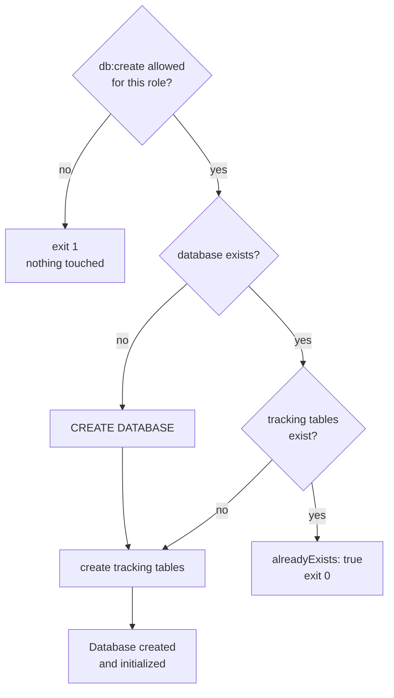

# Creating a database


Create the database a config points at, and set it up for noorm, before the first build.

`db create` takes no `--name`, `--dialect`, or `--host`. The config holds the connection, so write it first. This `dev-config.json` targets local PostgreSQL:

```json
{
    "name": "dev",
    "connection": {
        "dialect": "postgres",
        "host": "localhost",
        "database": "order_to_cash_dev",
        "user": "postgres",
        "password": "postgres"
    }
}
```

```bash
noorm config import dev-config.json
noorm db create -c dev
noorm config use dev
```

```
Imported config 'dev'.
Database "order_to_cash_dev" created and initialized.
Active config set to: dev
```

Run `noorm init` before these and `noorm run build` after. In the TUI, press `d` on Home, then `c`.


## What does it do?


`db create` checks the role first, then creates only what is missing:



`CREATE DATABASE` runs over a connection that does not need the target to exist:

| Dialect | Connects to |
|---|---|
| PostgreSQL | the `postgres` database |
| MSSQL | the `master` database |
| MySQL | no database selected |
| SQLite | nothing; it checks that the folder is writable |

The tracking tables are `version`, `change`, `executions`, `lock`, `identities`, and `vault`. PostgreSQL and MSSQL keep them in a `noorm` schema. MySQL and SQLite name them `__noorm_<table>__`.

`viewer` is refused, `operator` needs `--yes`, and `admin` runs. A new config gets `user: admin` and `agent: viewer`. [Configs](/guide/environments/configs#access-roles) has the full matrix.


## How do I bootstrap CI?


A CI checkout already has the committed `.noorm/`, so skip `init`. With no stored config, the `NOORM_CONNECTION_*` variables define the connection:

```bash
# ci/bootstrap.sh
set -euo pipefail

export NOORM_CONNECTION_DIALECT=postgres
export NOORM_CONNECTION_HOST=localhost
export NOORM_CONNECTION_DATABASE=order_to_cash_ci
export NOORM_CONNECTION_USER=ci
export NOORM_CONNECTION_PASSWORD="$DB_PASSWORD"

noorm db create
noorm run build
```

[CI](/guide/automation/ci) covers runners that need an identity or the vault.


## What bites


| Symptom | Cause | Fix |
|---|---|---|
| `db create --name foo` creates nothing named `foo` | Unknown flags are ignored, so it used the config's database | Set `connection.database` in the config |
| `"db:create" is not allowed on config "dev" (role: viewer).` | The role is `viewer`, or the process is on the `agent` channel, which defaults to `viewer` | Raise the role, or see [channels](/guide/environments/configs#which-channel-is-a-process-on) |
| `This is a destructive operation requiring confirmation (yes-dev). Pass --yes to confirm.` | The role is `operator` | Pass `--yes` or set `NOORM_YES=1` |
| `Failed to create database: permission denied to create database` | The login lacks server-level rights | Grant `CREATEDB` on PostgreSQL or `dbcreator` on SQL Server |
| `Cannot connect to server: …` | Wrong host, port, or credentials | Fix the JSON, then `config import --force --yes` |
| MySQL: `Cannot connect to server: Database 'order_to_cash_dev' does not exist on …` | MySQL has no system database for the existence check to fall back to | Create the empty database with another client, then run `db create` |


## Next


- [First build](/getting-started/first-build): build `db/sql/` into it
- [Configs](/guide/environments/configs): roles and channels
- [Non-interactive operation](/guide/automation/non-interactive): `--yes` per command
- [`db create` reference](/headless#db-create): flags and `--json` output
