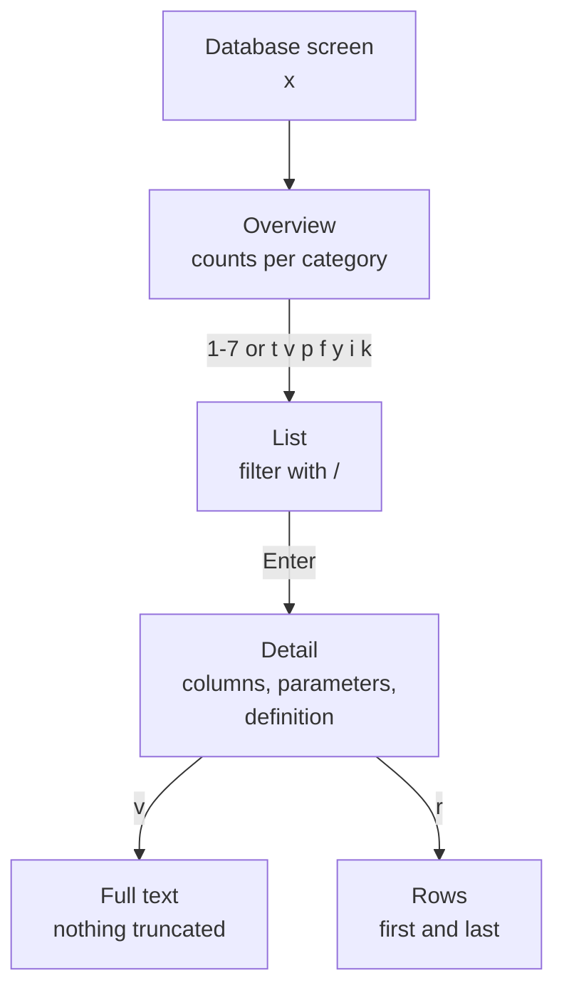

# Schema Explorer


Read your database's structure, from tables to triggers, without opening a second client.

Counts first, then one table:

```bash
noorm db explore
noorm db explore tables detail sales_order
```

```
Database Overview
  Tables:       11
  Views:        1
  Functions:    1
  Procedures:   0
  Types:        0
  Indexes:      14
  Foreign Keys: 12
  Triggers:     0
```

```
• log  Table: sales_order
• log    party_id: integer (not null) [PK]
• log    order_no: integer (not null) [PK]
• log    placed_at: timestamp with time zone (not null)
• log    status: text (not null)
```

The explorer is read-only and every role may use it. The TUI path is Home, `d` for Database, `x` for Explore.


## What can I look at?


| Category | List | One object | TUI keys | Empty on |
|---|---|---|---|---|
| Tables | `tables` | `tables detail <name>` | `1` `t` | |
| Views | `views` | `views <name>` | `2` `v` | |
| Procedures | `procedures` | `procedures <name>` | `3` `p` | SQLite |
| Functions | `functions` | `functions <name>` | `4` `f` | SQLite |
| Types | `types` | `types <name>` | `5` `y` | MySQL, SQLite |
| Indexes | `indexes` | | `6` `i` | |
| Foreign keys | `fks` | | `7` `k` | |
| Triggers | `triggers` | `triggers <name>` | | |

Every list and detail command takes `--schema <name>`. SQLite has no schemas and rejects the flag.

Types are enums, composites, and domains on PostgreSQL, and alias and table types on MSSQL. Triggers have no TUI screen. Locks and connections are runtime state, so they appear only as counters in the `--json` overview.


## How do I move around the TUI?


Indexes and foreign keys end at the list. The other categories continue to a detail screen:



| Screen | Keys |
|---|---|
| Overview | A category with a zero count is dimmed and cannot be opened. `Esc` goes back |
| List | `/` filters, `1`-`9` picks a row, `Enter` opens it. The filter text is kept until you leave the explorer |
| Detail | `↑` `↓` scroll, `Ctrl+U` `Ctrl+D` half a page, `PageUp` `PageDown` a page, `Home` `End` the ends |
| Rows | `Tab` switches between the first and last set, `Enter` opens a row, `/` filters, `s` sorts, `Esc` closes |

`r` works on tables only. It reads rows ordered by primary key: up to 10 from each end, fewer on a short terminal. A table with no primary key shows only its first rows, in storage order.


## How do I use it in scripts?


Add `--json`. Every payload carries a top-level `success`, and a list is always named, never a bare array:

```bash
noorm db explore tables detail sales_order --json
```

```json
{
    "success": true,
    "name": "sales_order",
    "schema": "public",
    "columns": [
        { "name": "party_id", "dataType": "integer", "isNullable": false, "isPrimaryKey": true, "ordinalPosition": 1 },
        { "name": "status", "dataType": "text", "isNullable": false, "defaultValue": "'open'::text", "isPrimaryKey": false, "ordinalPosition": 4 }
    ],
    "indexes": [
        { "name": "sales_order_pk", "columns": ["party_id", "order_no"], "isUnique": true, "isPrimary": true }
    ],
    "foreignKeys": [
        { "name": "sales_order_isplacedby_party", "columns": ["party_id"], "referencedTable": "party", "referencedColumns": ["party_id"], "onUpdate": "NO ACTION", "onDelete": "NO ACTION" }
    ],
    "rowCountEstimate": 3
}
```

This output is trimmed to two columns, and the repeated `schema` keys inside indexes and foreign keys are dropped. The list commands return `{ "tables": [...] }`, `{ "views": [...] }`, and so on, with `foreignKeys` for `fks`. The overview adds `locks` and `connections` to the eight counters. Full flags: [`db explore`](/headless#db-explore).


## What bites


| Symptom | Cause | Fix |
|---|---|---|
| `noorm db explore tables \| grep party` prints nothing | Listings and detail text are log lines on stderr. Only the overview text and `--json` use stdout | Use `--json` |
| `noorm db explore -c prod tables` explores the active config | A flag before the subcommand is read by `explore`, not by `tables` | `noorm db explore tables -c prod` |
| `View not found: detail` | Only `tables` has a `detail` subcommand | `noorm db explore views open_orders` |
| `SQLite has no schemas; drop the schema filter to explore this database` | `--schema` on SQLite | Drop the flag |
| noorm's tracking tables are missing from the lists | Explore hides the `noorm` schema on PostgreSQL and MSSQL, and `__noorm_*` tables on MySQL and SQLite | The TUI shows them when `logging.level` is `verbose` in `.noorm/settings.yml`. The CLI never does |
| A composite foreign key lists its columns several times, mispaired (PostgreSQL) | The query joins `key_column_usage` to `constraint_column_usage` on the constraint name alone | Read the key from its `CREATE TABLE` in `db/sql/` |


## Next


- [SQL terminal](/guide/database/terminal): query the data itself
- [Teardown](/guide/database/teardown): drop what you found
- [Configs](/guide/environments/configs): point the explorer at another database
- [`db explore` reference](/headless#db-explore): every subcommand and flag
