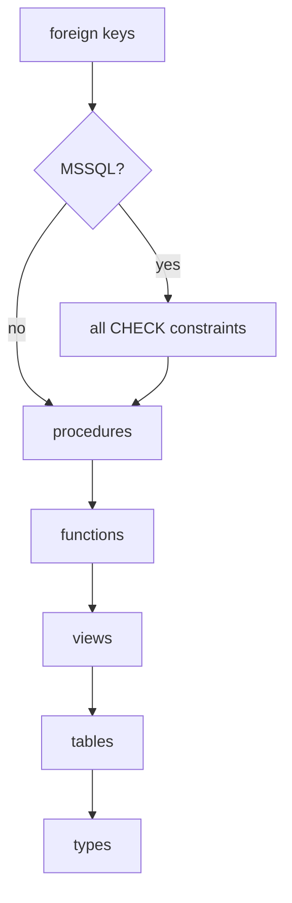

# Teardown


Reset a database to a known state: delete its rows, drop its objects, rebuild it from `db/sql/`, or drop the database.

Preview what a teardown would remove:

```bash
noorm db teardown --dry-run
```

```
• log  Would drop 5 objects
• log    Tables: 4
• log    Views: 1
• log    Functions: 0
• log    Types: 0
```

The counts come from a project with `party`, `product`, `sales_order`, `order_line`, and the view `open_orders`. Replace `--dry-run` with `--yes` to run it.


## Which command removes what?


| Command | Removes | Survives | `viewer` | `operator` | `admin` |
|---|---|---|---|---|---|
| `db truncate` | every row | tables, indexes, views, routines, types, noorm's tracking tables | deny | confirm | confirm |
| `db teardown` | foreign keys, procedures, functions, views, tables, types | noorm's tracking tables, `preserveTables`, `--preserve-schemas` | deny | deny | confirm |
| `db reset` | what teardown removes, then rebuilds from `db/sql/` | noorm's tracking tables | deny | confirm | allow |
| `db drop` | the database | nothing in it; the config stays | deny | deny | confirm |

`allow` runs. `confirm` needs `--yes` or `NOORM_YES=1`, and the TUI asks for the phrase `yes-<config>`. `deny` has no override. `db reset` asks for `--yes` even where its cell is `allow`.

On the `agent` channel every `confirm` is a `deny`. A stage with `protected: true` caps a config at `operator`, so teardown and drop are refused there. [Concepts](/getting-started/concepts#configs-stages-and-roles) defines the roles.

noorm's tracking tables live in the `noorm` schema on PostgreSQL and MSSQL, and as `__noorm_*__` tables on MySQL and SQLite.


## In what order does teardown drop things?


Procedures, functions, and views drop before tables, because a schema-bound object on MSSQL locks the table it references:



`--preserve-schemas a,b` leaves whole schemas alone. Teardown otherwise reaches every non-system schema, including ones noorm did not create.


## How do I keep tables through a wipe?


List them in settings. `postScript` is relative to the project root:

```yaml
# .noorm/settings.yml
teardown:
    preserveTables:
        - party_type
    postScript: scripts/post-teardown.sql
```

| Setting | `db truncate` | `db teardown` | `db reset` |
|---|---|---|---|
| `preserveTables` | kept | kept | ignored, because a surviving table would collide with the rebuild's `CREATE TABLE` |
| `postScript` | not run | runs after the drop | runs after the drop, before the rebuild |

`db truncate --preserve a,b` replaces the settings list for that run. `--only a,b` wipes those tables alone.


## How do I reset between tests?


Truncate between tests while the schema is stable:

```typescript
// tests/setup.ts
import { createContext } from '@noormdev/sdk'

const ctx = await createContext({ config: 'test', requireTest: true, yes: true })

await ctx.connect()

beforeEach(() => ctx.noorm.db.truncate())
```

`requireTest: true` throws `RequireTestError` unless the config has `isTest: true`. `yes: true` answers the confirmation the SDK cannot prompt for. When the schema changed, call `ctx.noorm.db.reset()`, which runs a teardown and a forced build. In CI:

```bash
noorm db reset --config test --yes
```


## How does each dialect empty a table?


| Dialect | Empties with | Disables foreign keys with | Restarts identity |
|---|---|---|---|
| PostgreSQL | `TRUNCATE ... CASCADE` | `session_replication_role` | yes |
| MySQL | `TRUNCATE` | `FOREIGN_KEY_CHECKS` | yes |
| MSSQL | `DELETE FROM` | `NOCHECK CONSTRAINT` per table | yes, reseed to 0 |
| SQLite | `DELETE FROM` | `PRAGMA foreign_keys` | no |

Foreign keys come back on even when the truncate fails partway. [Teardown internals](/dev/teardown#mssql-truncate-strategy) covers why MSSQL cannot use `TRUNCATE`.


## What bites


| Mistake or symptom | Cause | Fix |
|---|---|---|
| PostgreSQL truncate fails: `permission denied to set parameter "session_replication_role"` | Truncate turns off foreign-key triggers with `session_replication_role`, which only superusers, or roles granted `SET` on it, may change | Use a superuser for the test database, or on PostgreSQL 15+ run `GRANT SET ON PARAMETER session_replication_role TO <role>` |
| `"db:teardown" is not allowed on config "prod" (role: operator)` | The matrix denies `db:teardown` to `viewer` and `operator`. No flag overrides a denial | Give the config the `admin` role, or tear down another config |
| `requires confirmation` | The role's cell is `confirm` | Pass `--yes`, or set `NOORM_YES=1` |
| `requires confirmation from a human` | The `agent` channel never confirms | Run it as `user` |
| `db.truncate()` throws `ProtectedConfigError` on an `admin` config | `db:truncate` is `confirm` even for `admin`, and the SDK has no prompt | `createContext({ yes: true })` or `NOORM_YES=1` |
| `db teardown --dry-run` is refused on `operator` | A dry run skips the confirmation, not the role check | Look with `noorm db explore` |
| `Post-teardown script failed: Script failed: no such table` | The script runs after the tables drop. It splits on `;` and skips every statement that starts with `--`, comment line included | Put no comment above a statement, and do not insert into dropped tables |
| `postScript` seed rows are missing after `db reset`, which exits 0 | Reset runs the script before the rebuild recreates the tables | Seed from `db/sql/`, where the build inserts them |
| A preserved table is empty after `db truncate` on PostgreSQL | `TRUNCATE ... CASCADE` also empties every table that references a truncated one, and `--only` does the same | Preserve the tables it references too |
| `--preserve seeds` wipes a table listed in `preserveTables` | The flag replaces the settings list | Repeat every table in the flag |
| `change ff` re-runs every change after a teardown or reset | Teardown marks applied changes `stale`, and the rebuilt schema already holds their effect | Write changes that are safe to run twice: [Add a column](/guide/changes/add-a-column) |


## Next


- [Execution](/guide/sql-files/execution): rebuild the schema after a teardown
- [Forward and revert](/guide/changes/forward-revert): what `stale` changes do on the next `change ff`
- [Stages](/guide/environments/stages): cap a config's role with `protected: true`
- [CLI reference](/headless#db-truncate): every flag for `db truncate`, `db teardown`, `db reset`, and `db drop`
