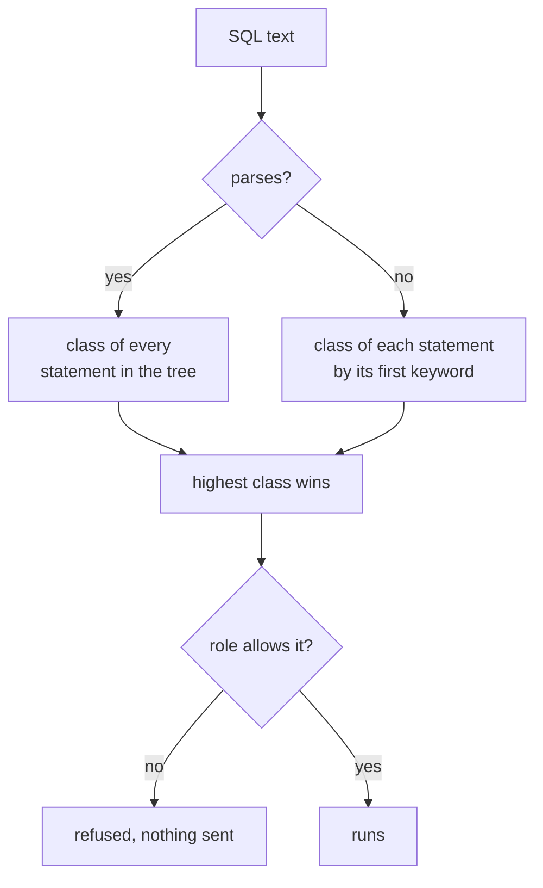

# SQL Terminal


Run SQL against a config's database from the shell or the TUI, with every statement checked against the config's role first.

```bash
noorm sql query "SELECT party_id, order_no, status FROM sales_order ORDER BY 1, 2"
```

```
Columns: party_id, order_no, status
{"party_id":1,"order_no":1,"status":"paid"}
{"party_id":2,"order_no":1,"status":"invoiced"}
{"party_id":2,"order_no":2,"status":"open"}
3 rows returned (2ms)
```

`Shift+Q` on any TUI screen opens the active config in an interactive terminal with a results grid and saved history. From a shell, run `noorm sql repl --config dev`, which needs a TTY and exits with a usage error under `--yes` or `NOORM_YES`. [`noorm sql`](/cli/sql) covers `query`, including `-f file.sql` and `--json`.


## What am I allowed to run?


The text is parsed and classified before anything reaches the database. The highest class wins:



| Class | Statements | `viewer` | `operator` | `admin` |
|---|---|---|---|---|
| `sql:read` | `SELECT`, `VALUES`, `TABLE`, an `EXPLAIN` of a read, `SHOW` and `DESCRIBE` on MySQL | yes | yes | yes |
| `sql:write` | `INSERT`, `UPDATE`, `DELETE`, `MERGE` | no | yes | yes |
| `sql:ddl` | everything else: `CREATE`, `ALTER`, `DROP`, `TRUNCATE`, `GRANT`, `SET`, `CALL`, `EXEC`, and input no keyword matches | no | no | yes |

`src/core/policy/classify.ts` decides these cases:

| Input (PostgreSQL) | Class | Why |
|---|---|---|
| `WITH gone AS (DELETE FROM order_line RETURNING *) SELECT * FROM gone` | `sql:write` | a `DELETE` inside the `WITH` |
| `EXPLAIN ANALYZE DELETE FROM order_line` | `sql:write` | `EXPLAIN` takes the class of what it runs |
| `SELECT * INTO order_copy FROM sales_order` | `sql:ddl` | it creates a table |
| `SELECT pg_terminate_backend(pid) FROM pg_stat_activity` | `sql:write` | a side-effecting builtin on the denylist |

The denylist names known-dangerous builtins, such as `nextval` and `pg_read_file`. It stops accidental writes on a `viewer` config and is not a sandbox.


## How do I work in the terminal?


| Where | Keys |
|---|---|
| Query input | `Enter` runs, `Shift+Enter` adds a line. `Shift+Tab` toggles edit mode (`[EDIT]>`), where `Enter` adds a line. `Tab` inserts four spaces. `↑` `↓` recall earlier queries and `h` opens history, both on an empty input |
| Results grid | `↑` `↓` move. `Enter` opens the row as YAML or JSON (`←` `→` change row, `f` switches format). `/` filters, `s` sorts, `c` clears both |
| Between them | A query that returns rows opens the grid. `Tab` or `Esc` returns to the query |
| Any time | `Esc` stops a running query or connect, otherwise clears the input, and on an empty input leaves |

A statement without rows shows `✓ 1 row(s) affected (5ms)` or `✓ Query executed (42ms)`. A failure shows `✗` and the server's message.


## How do I stop a query?


`Esc` returns the terminal to you. Whether the server stops working depends on the dialect:

| Dialect | On `Esc` |
|---|---|
| PostgreSQL | `pg_cancel_backend` on a second connection |
| MySQL | `KILL QUERY` on a second connection |
| SQL Server | nothing reaches the server |
| SQLite | nothing reaches the server |

The first two show `Cancelled. The server was asked to stop the query.` The last two show `Stopped waiting. The query may still be running on the server.` There the query may keep running and holding its locks, so kill it server-side if that matters.


## Where does history go?


Only the interactive terminal records history, one file set per config. `sql query` records nothing. A statement the role refused is recorded as a failure.

```bash
noorm sql history -n 2
```

```
SQL history for 'dev' (2 entries):

  ✓  Oct 21 at 01:42:51  5ms · 1 row(s)
     UPDATE sales_order SET status = 'paid' WHERE party_id = 2 AND order_no = 1

  ✗  Oct 21 at 01:42:51  2ms · relation "sale_order" does not exist
     SELECT * FROM sale_order
```

In the TUI, `h` opens the same list. `r` sends the selected query back to the input, `Enter` opens its stored rows or error, and `c` opens the clear menu. From a shell: `noorm sql clear --older-than 3 --yes`.

::: warning History is not encrypted
Query text sits in `.noorm/state/history/<config>.json` and returned rows sit gzipped in `.noorm/state/history/<config>/`. Both are owner-only (`0600`, in a `0700` directory), but anything a `SELECT` pulled from a credentials or PII table is readable by your user account. Clear the history after a sensitive query.
:::


## What bites


| Symptom | Cause | Fix |
|---|---|---|
| `"sql:write" is not allowed on config "ro" (role: viewer).` | The class needs a higher role than your channel has. In an agent session the channel is `agent`, which defaults to `viewer` | Raise the role, or see [channels](/guide/environments/configs#which-channel-is-a-process-on) |
| `SHOW search_path` (PostgreSQL) or `PRAGMA …` (SQLite) is refused below `admin` | Both parse as statements the classifier does not list as reads, so they count as `sql:ddl` | `SELECT current_setting('search_path')`, or `SELECT * FROM pragma_table_info('sales_order')` |
| `noorm sql -f reports/monthly.sql` prints `Unknown command` | The bare form needs the SQL as the first token after `sql` | `noorm sql query -f reports/monthly.sql` |
| `noorm sql history` is empty after you ran queries | They ran through `sql query` | Run them in the terminal |


## Next


- [Schema Explorer](/guide/database/explore): read the structure before you query it
- [Configs](/guide/environments/configs): roles and channels
- [`noorm sql`](/cli/sql): flags for `query`, `history`, and `clear`
- [Run files](/guide/sql-files/execution): run SQL files with change detection
