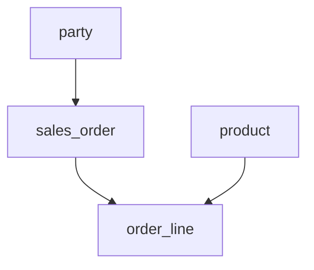
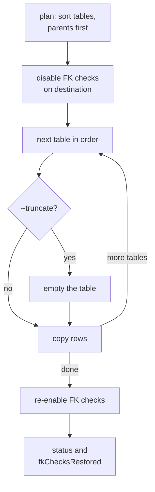

# Data Transfer


Copy rows from one database to another, parents before children, using two configs you already have.

Plan a copy of the order tables from `staging` to `qa`:

```bash
noorm db transfer -c staging --to qa \
    --tables party,product,sales_order,order_line \
    --dry-run
```

```
Dry run - transfer plan:
  Same server: no
  Tables: 4
  Estimated rows: 1250

  Transfer order:
    party - 120 rows
    product - 40 rows
    sales_order - 310 rows (after: party)
    order_line - 780 rows (after: sales_order, product)
```

Remove `--dry-run` to run it:

```
Transfer complete: success
  Total rows: 1250
  Tables: 4 success, 0 failed
  Duration: 0.84s
```


## In what order are tables copied?


noorm copies a table after every table it references. An arrow means "copied before":



Only foreign keys between the selected tables count, so a parent outside `--tables` must already exist in the destination. Tables with no key between them can appear in either order. On a foreign key cycle, noorm copies in alphabetical order and warns `Circular FK dependency detected`.


## What does a run do?


Foreign keys stay off at the destination until every table is copied:



A failed table does not stop the run. The rest still copy, and the status is `partial`, or `failed` if none succeeded. A failed table can keep rows it inserted before the error.


## What happens when a row already exists?


A row exists when its primary key is already in the destination:

| `--on-conflict` | Existing row |
|---|---|
| `fail` (default) | The table fails at its first conflict |
| `skip` | Left as is |
| `update` | Non-key columns take the source values |
| `replace` | MySQL deletes and reinserts it. MSSQL overwrites every column. PostgreSQL leaves it as is |

A cross-dialect transfer treats `update` and `replace` as `skip`.


## What do I need first?


| Needed | Detail |
|---|---|
| Destination tables | Present, with compatible columns. A missing one warns `Table "x" exists in source but not destination`, then fails |
| Saved configs | `--to` names the destination. The source is the active config, or `-c` |
| Destination role | `db:reset`: `viewer` denied, `operator` needs `--yes` or `NOORM_YES=1`, `admin` allowed. `--dry-run` needs `transfer:plan`, which `operator` has |
| Dialect | PostgreSQL, MySQL, or MSSQL, in any pairing. SQLite is refused |

noorm's own tracking tables never transfer. Two MySQL or two MSSQL configs on one host and port copy each table with one `INSERT ... SELECT`, but only with `--on-conflict fail`. Everything else, PostgreSQL included, copies in batches of `--batch-size` rows.


## How do I move tables through a file?


```bash
noorm db transfer -c staging --export ./backup/ --tables party,product
noorm db transfer -c qa --import ./backup/party.dt
```

| Extension | Content | Made by |
|---|---|---|
| `.dt` | line-delimited JSON5 | the default |
| `.dtz` | the same, gzipped | `--compress` |
| `.dtzx` | gzipped and AES-256-GCM encrypted | `--passphrase`, 12 characters or more |

One table writes to the path you give. Several write one file each into that directory. A path ending in `.dtzx` prompts for the passphrase on a terminal. The format is in [Data transfer internals](/dev/transfer#file-export-import).

Import takes one file per call and leaves foreign keys on, so import parents first.


## How do I script it?


| Exit | Meaning |
|---|---|
| `0` | Every table succeeded |
| `1` | No table succeeded, or the run failed before copying |
| `2` | A flag or config name was wrong. Nothing ran |
| `3` | Some tables succeeded and some failed: a mixed state |

With `--json`, read `fkChecksRestored`. `false` means the data moved but the destination still has foreign keys off, and `status` does not change.


## What bites


| Mistake or symptom | Cause | Fix |
|---|---|---|
| `noorm db transfer staging --to qa` copies from the active config | There is no positional source | `-c staging` |
| `Failed to disable FK checks` | The destination role cannot disable constraints. Nothing was copied | `--no-fk`, which relies on the parents-first order, or a more privileged role |
| Exit `3` | A table hit a conflict under `fail`, or had no destination | Read `tables[].error` in `--json`. For conflicts, rerun with `--on-conflict skip` |
| `--truncate` empties destination tables outside `--tables` (PostgreSQL) | `TRUNCATE ... CASCADE` also empties every table that references the truncated one | Put the child tables in `--tables` |
| `--import --dry-run` imports for real | `--dry-run` only plans database-to-database copies. `--export` ignores it too | Preview the schema in the TUI import wizard |


## Next


- [Teardown](/guide/database/teardown): empty or rebuild the destination first
- [Data transfer internals](/dev/transfer): planner, executors, file format
- [Execution](/guide/sql-files/execution): build the destination schema before copying
- [CLI reference](/headless#db-transfer): every `db transfer` flag
