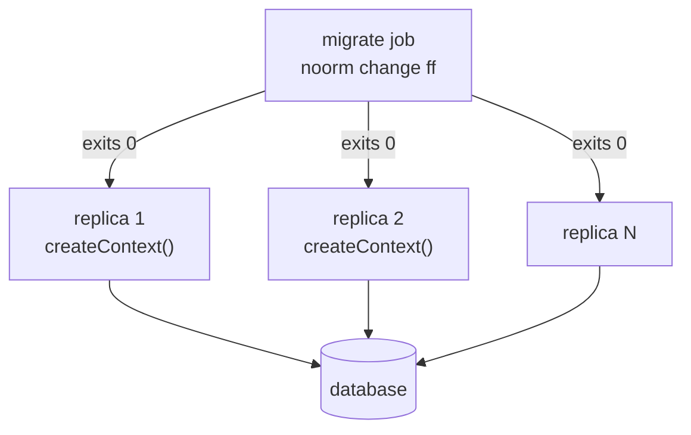

# Deploying an Application


Deliver the schema once per release, and give every application replica a connection and nothing else.

```typescript
// src/db.ts
import { createContext } from '@noormdev/sdk';
import type { DB } from './schema';

export const ctx = await createContext<DB>();

await ctx.connect();
```

```bash
# environment of each replica
NOORM_CONNECTION_DIALECT=postgres
NOORM_CONNECTION_HOST=db.internal
NOORM_CONNECTION_DATABASE=order_to_cash
NOORM_CONNECTION_USER=app
NOORM_CONNECTION_PASSWORD=$DB_PASSWORD
```

With no stored config, `createContext()` builds a config named `__env__` from these variables. The image needs no `.noorm/` directory, identity, or state file. Install the driver beside the SDK (`npm install @noormdev/sdk kysely pg`), because it is an optional peer dependency.

Unset variables take defaults: `_HOST` is `localhost`, `_PORT` follows the dialect (`5432`, `3306`, `1433`), and the pool runs from `_POOL_MIN=0` to `_POOL_MAX=10`.

For different connections in the same process, pass inline fields rather than mutating `process.env`, and give each context a `name` so its events and errors say which one they came from. Change history, run checksums and locks are stored under that name, so pick it once per database and keep it: a database reopened under another name reports its applied changes as pending. The [SDK connection reference](/reference/sdk#createcontext-options) covers unsaved connections, runtime callbacks, TLS identity, and pool controls.


## Why split schema delivery from the application?


A replica that changes the schema on boot races its siblings. Run the schema step once, and let replicas start after it:



The migrate step is a release step, an init container, or a Kubernetes `Job`. It connects as a deploy user through its own `NOORM_CONNECTION_*` variables, and only it needs `db/sql/` and `db/changes/`. An empty database starts with one `noorm run build`. Every later release runs `change ff` only. If your changes render vault secrets, it also needs an enrolled identity: [CI/CD Automation](/guide/automation/ci#how-do-i-set-up-prod-ci).


## Why one context per process?


`connect()` opens a pool of up to `NOORM_CONNECTION_POOL_MAX` connections, so a context per request opens a pool per request. Create one at startup, share it, and call `ctx.disconnect()` on `SIGTERM`.

Demand is replicas times pool max. Twenty replicas at the default ask for 200 backends, past PostgreSQL's default `max_connections` (typically 100). Lower the pool:

```bash
NOORM_CONNECTION_POOL_MAX=4    # 20 replicas x 4 = 80 backends
```


## How do I connect with a credential that rotates?


Pass `password` as a function. The pool calls it each time it opens a physical connection, so every new connection logs in with a current credential. This example signs an AWS RDS IAM auth token with `@aws-sdk/rds-signer`:

```typescript
// src/db.ts
import { readFileSync } from 'node:fs';
import { Signer } from '@aws-sdk/rds-signer';
import { createContext } from '@noormdev/sdk';
import type { DB } from './schema';

const host = 'orders.cluster-example.us-east-1.rds.amazonaws.com';
const port = 5432;
const user = 'app';

// The certificate bundle AWS publishes for RDS, at the path you downloaded it to.
const ca = readFileSync('/etc/ssl/rds/global-bundle.pem', 'utf8');

const signer = new Signer({ hostname: host, port, username: user, region: 'us-east-1' });

export const ctx = await createContext<DB>({
    config: false,
    name: 'orders',
    connection: {
        dialect: 'postgres',
        host,
        port,
        database: 'order_to_cash',
        user,
        ssl: { ca },
        password: () => signer.getAuthToken(),
        pool: { max: 4, maxLifetimeMs: 900_000 },
        keepAliveInitialDelayMs: 10_000,
    },
});

await ctx.connect();
```

| Setting | Why |
|---|---|
| `password: () => signer.getAuthToken()` | The database checks the token only at physical authentication. An open session keeps working after its token expires, and the next new connection signs a fresh one |
| `pool.maxLifetimeMs` | The pool replaces each connection after this long, so a connection opened before a failover is closed and reopened within that time |
| `keepAliveInitialDelayMs` | A failover can leave a socket half-open. The first TCP keepalive probe goes out after this many idle milliseconds, where the operating system default is about two hours |
| `ssl: { ca }` | TLS that verifies the server against the RDS certificate bundle, which AWS documents downloading for that purpose |
| `config: false` | The context ignores `NOORM_CONFIG` and any active stored config |

noorm does not include an IAM helper; the signer is your dependency, and any function that returns a string or a promise of one works. `Signer` reads AWS credentials from the default provider chain unless you pass `credentials`. IAM authentication needs TLS, and the example reads the certificate authority from a file whose path you supply.

`maxLifetimeMs` is a PostgreSQL pool option. MySQL and MSSQL take a different set: [Pool options](/reference/sdk#pool-options). A connection with a password function is not retried on a failed `connect()`, and an error the function throws reaches you unchanged: [Runtime credentials](/reference/sdk#runtime-credentials).

After `connect()` returns, a login the pool makes later can still fail, for example when the role loses its IAM permission. The query that needed the connection rejects, and `noormObserver` emits `connection:error` with `phase: 'login'`.


## How do I limit what the runtime can do?


Environment-only configs default to `user: admin`. The application only queries, so narrow it. Set both channels, because the access object needs both:

```bash
NOORM_ACCESS_USER=viewer
NOORM_ACCESS_AGENT=false
```

Kysely queries still work. The management surface refuses:

```
ProtectedConfigError: Cannot run.build on config "__env__": "run:build" is not allowed on config "__env__" (role: viewer).
```

This stops the SDK's own `ctx.noorm` operations, not hand-written SQL, so grant the runtime's database user only the privileges it needs. The migrate job needs its own environment without these variables. They apply only to an environment-only config: a stored config keeps its own access roles whatever the environment says. [Access roles](/guide/environments/configs#access-roles) lists what each role permits.


## What bites


| Symptom | Cause | Fix |
|---|---|---|
| `Private key required to decrypt state` at startup | A `.noorm/state/state.enc` is in the image | Keep `state.enc` out of the image |
| `Lock for 'prod' held by … since …, expires …` | Another `change ff` is running. The lock is per change and does not wait | Rerun after it finishes |
| Two deploys run `change ff` at once and neither fails | The lock holder is the identity's `name <email>`. A second job with the same name and email extends the lock | Serialize deploys in your CI, for example with a `concurrency` group |
| `Cannot apply the name "orders" to stored config "dev"` | `name` was passed while `NOORM_CONFIG` or the active config selected a stored config | Add `config: false` |
| `pool.idleTimeoutMs must be greater than zero on mysql` | MySQL and MSSQL pools cannot disable the idle timeout | Set a positive value or remove it |
| Two contexts for two databases both connect to the last one | Mutating `process.env` races concurrent context creation | Pass a separate inline `connection` to each `createContext()` instead |
| `noorm run build` in the deploy step errors or changes nothing | A changed `CREATE TABLE` file re-runs and cannot alter a table that holds data | Run `noorm change ff` only |


## Next


- [CI/CD Automation](/guide/automation/ci): pipelines, identity enrollment, vault secrets
- [SDK reference](/reference/sdk): the context API
