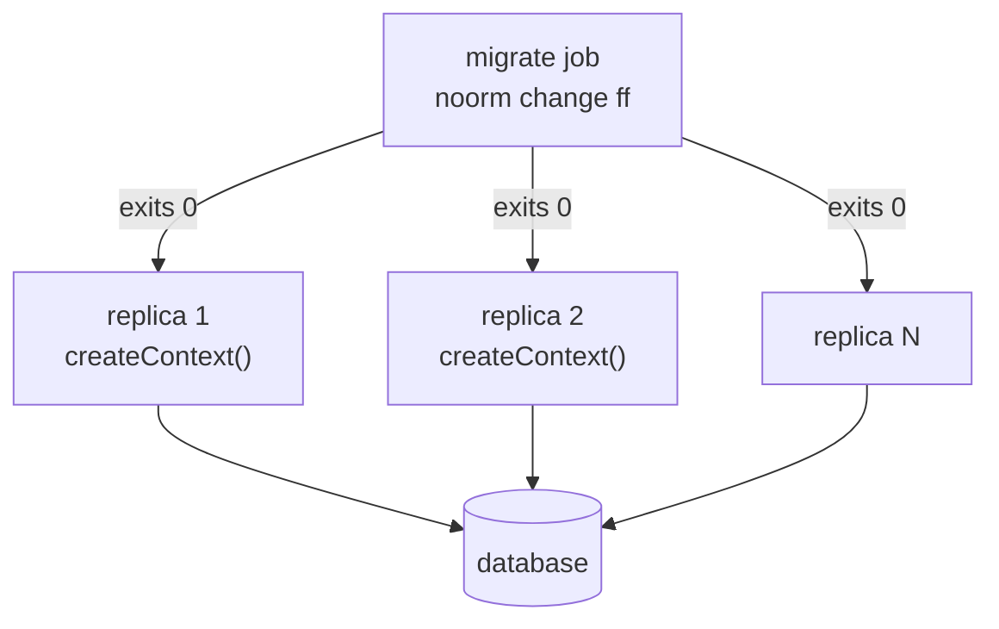

# Deploying an Application


Deliver the schema once per release, and give every application replica a connection and nothing else.

```typescript
// src/db.ts
import { createContext } from '@noormdev/sdk';
import type { DB } from './schema';

export const ctx = await createContext<DB>();

await ctx.connect();
```

```bash
# environment of each replica
NOORM_CONNECTION_DIALECT=postgres
NOORM_CONNECTION_HOST=db.internal
NOORM_CONNECTION_DATABASE=order_to_cash
NOORM_CONNECTION_USER=app
NOORM_CONNECTION_PASSWORD=$DB_PASSWORD
```

With no stored config, `createContext()` builds a config named `__env__` from these variables. The image needs no `.noorm/` directory, identity, or state file. Install the driver beside the SDK (`npm install @noormdev/sdk kysely pg`), because it is an optional peer dependency.

Unset variables take defaults: `_HOST` is `localhost`, `_PORT` follows the dialect (`5432`, `3306`, `1433`), and the pool runs from `_POOL_MIN=0` to `_POOL_MAX=10`.


## Why split schema delivery from the application?


A replica that changes the schema on boot races its siblings. Run the schema step once, and let replicas start after it:



The migrate step is a release step, an init container, or a Kubernetes `Job`. It connects as a deploy user through its own `NOORM_CONNECTION_*` variables, and only it needs `db/sql/` and `db/changes/`. An empty database starts with one `noorm run build`. Every later release runs `change ff` only. If your changes render vault secrets, it also needs an enrolled identity: [CI/CD Automation](/guide/automation/ci#how-do-i-set-up-prod-ci).


## Why one context per process?


`connect()` opens a pool of up to `NOORM_CONNECTION_POOL_MAX` connections, so a context per request opens a pool per request. Create one at startup, share it, and call `ctx.disconnect()` on `SIGTERM`.

Demand is replicas times pool max. Twenty replicas at the default ask for 200 backends, past PostgreSQL's default `max_connections` (typically 100). Lower the pool:

```bash
NOORM_CONNECTION_POOL_MAX=4    # 20 replicas x 4 = 80 backends
```


## How do I limit what the runtime can do?


Environment-only configs default to `user: admin`. The application only queries, so narrow it. Set both channels, because the access object needs both:

```bash
NOORM_ACCESS_USER=viewer
NOORM_ACCESS_AGENT=false
```

Kysely queries still work. The management surface refuses:

```
ProtectedConfigError: Cannot run.build on config "__env__": "run:build" is not allowed on config "__env__" (role: viewer).
```

This stops the SDK's own `ctx.noorm` operations, not hand-written SQL, so grant the runtime's database user only the privileges it needs. The migrate job needs its own environment without these variables. [Access roles](/guide/environments/configs#access-roles) lists what each role permits.


## What bites


| Symptom | Cause | Fix |
|---|---|---|
| `Private key required to decrypt state` at startup | A `.noorm/state/state.enc` is in the image | Keep `state.enc` out of the image |
| `Lock for 'prod' held by … since …, expires …` | Another `change ff` is running. The lock is per change and does not wait | Rerun after it finishes |
| Two deploys run `change ff` at once and neither fails | The lock holder is the identity's `name <email>`. A second job with the same name and email extends the lock | Serialize deploys in your CI, for example with a `concurrency` group |
| Two contexts for two databases both connect to the last one | `createContext()` reads `process.env` after awaiting state and settings, so concurrent calls see the last assignment | One process per database, or create each context in turn at startup |
| `noorm run build` in the deploy step errors or changes nothing | A changed `CREATE TABLE` file re-runs and cannot alter a table that holds data | Run `noorm change ff` only |


## Next


- [CI/CD Automation](/guide/automation/ci): pipelines, identity enrollment, vault secrets
- [SDK reference](/reference/sdk): the context API
