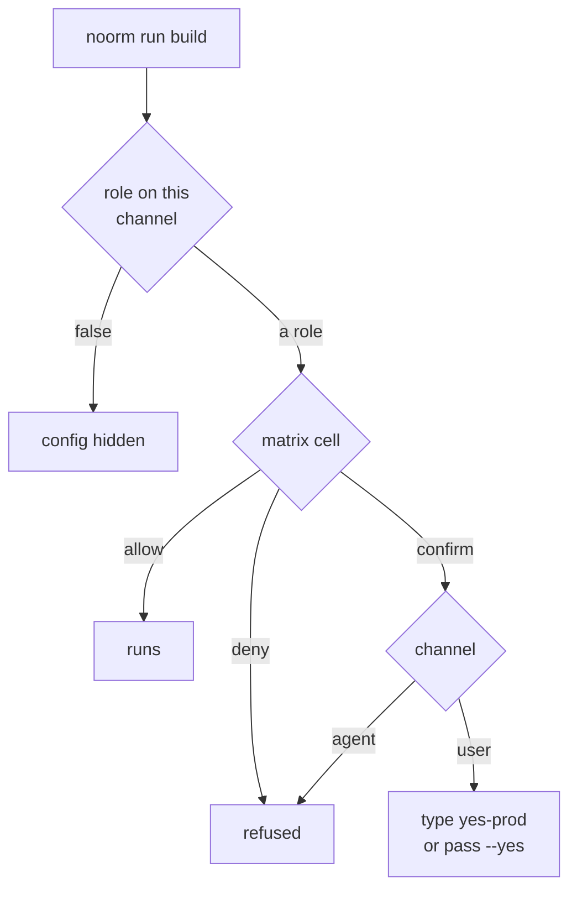
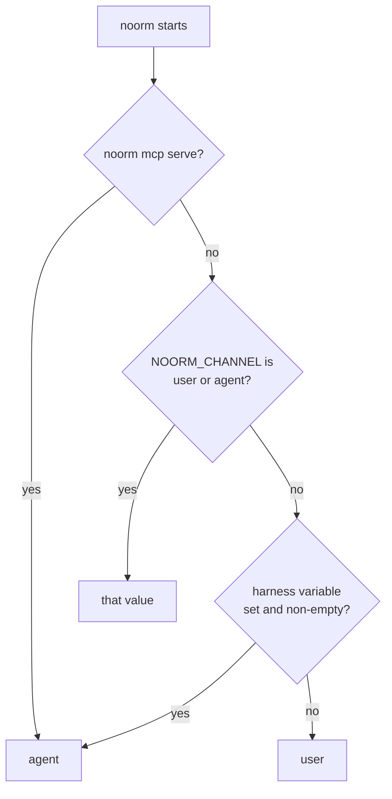

# Configs


Switch between your dev, staging, and prod databases, and decide what a person or an AI agent may do on each.

A config is a saved database connection. This project has three:

```bash
noorm config use staging
noorm config list
```

```
Active config set to: staging
Configurations:
  dev — postgres/order_to_cash_dev
  staging (active) — postgres/order_to_cash_staging
  prod — postgres/order_to_cash [user:operator agent:off]
```

The bracket tag marks a test config, or roles that differ from the default (`user:admin agent:viewer`). `agent:off` hides the config from AI agents.


## How do I create a config?


Use the TUI wizard: run `noorm ui`, press `c` for configs, then `a`. Before it saves, the wizard connects to the server's system database, so the target database does not have to exist yet. MySQL has no system database to fall back to, so on MySQL [create the database first](/guide/database/create#what-bites).

| Field | Notes |
|---|---|
| Config Name | Letters, numbers, hyphens, underscores. A name that matches a [stage](/guide/environments/stages) links the config to it |
| Database Type | `postgres`, `mysql`, `sqlite`, `mssql` |
| Host, Port | SQLite has no host. Port defaults to 5432, 3306, or 1433 |
| Database | Database name, or file path for SQLite |
| Username, Password | Stored encrypted in `.noorm/state/state.enc` |
| User Role, Agent Role | See [Access roles](#access-roles) |
| Test Database | Sets `isTest`, read by `rules` in `settings.yml` and the SDK's `requireTest` |

Schema and change folders are not config fields. `paths` in `.noorm/settings.yml` sets them.

`noorm config add` and `config edit` exit 1 and point you at the TUI. To create a config without it, write a JSON file and import it. This `staging.json` is hidden from agents:

```json
{
    "name": "staging",
    "access": { "user": "operator", "agent": false },
    "connection": {
        "dialect": "postgres",
        "host": "staging.db.internal",
        "database": "order_to_cash_staging",
        "user": "deploy"
    }
}
```

```bash
noorm config import ./staging.json
```

```
Imported config 'staging'.
```


## How do I switch configs?


Commands use the first of these that is set:

| Scope | How |
|---|---|
| One command | `noorm run build --config prod`, with the flag after the subcommand |
| One shell | `export NOORM_CONFIG=prod` |
| Every command | `noorm config use staging`, or highlight a config in the TUI and press Enter |


## How do I override a config in CI?


Environment variables override the stored config. [Stages](/guide/environments/stages#which-value-wins) shows the full order.

| Variable | Sets |
|---|---|
| `NOORM_CONNECTION_DIALECT`, `_HOST`, `_PORT`, `_DATABASE`, `_USER`, `_PASSWORD`, `_SSL` | `connection.*` on the config |
| `NOORM_PATHS_SQL`, `NOORM_PATHS_CHANGES` | `paths.sql`, `paths.changes`. Never written back to `settings.yml` |
| `NOORM_CONFIG` | Which stored config to use |
| `NOORM_YES` | Any value except empty, `0`, or `false` skips `confirm` prompts on the `user` channel |
| `NOORM_CHANNEL` | `user` or `agent`. See [Which channel is a process on?](#which-channel-is-a-process-on) |

When no config is selected by flag, `NOORM_CONFIG`, or `config use`, noorm builds one named `__env__` from the variables. It needs `NOORM_CONNECTION_DIALECT` and `NOORM_CONNECTION_DATABASE`:

```bash
export NOORM_CONNECTION_DIALECT=postgres
export NOORM_CONNECTION_HOST=db.ci.internal
export NOORM_CONNECTION_DATABASE=order_to_cash_ci
export NOORM_CONNECTION_PASSWORD="$DB_PASSWORD"

noorm run build
```

[CI/CD](/guide/automation/ci) covers the full pipeline.


## Access roles


Each config has two roles, one per channel. The `user` channel is you, in the CLI, TUI, or SDK. The `agent` channel is an AI agent, over MCP or the CLI. Change them in the TUI (config list, `e`).

| Role | Meaning |
|---|---|
| `viewer` | Reads only, no secrets. Default for `agent` |
| `operator` | Writes data. Builds, changes, and `db create` ask first |
| `admin` | Everything allowed, but irreversible operations still ask. Default for `user` |
| `false` | `agent` only. Hides the config: `config list` omits it and MCP answers as if it does not exist |

Every permission has one cell per role, fixed in `src/core/policy/matrix.ts`:

| Permission | viewer | operator | admin |
|---|---|---|---|
| `explore`, `sql:read` (`SELECT`, `EXPLAIN`) | allow | allow | allow |
| `sql:write` (`INSERT`, `UPDATE`, `DELETE`) | deny | allow | allow |
| `sql:ddl` (`CREATE`, `ALTER`, `DROP`) | deny | deny | allow |
| `run:build`, `run:file`, `run:dir`, `change:run`, `change:ff`, `change:revert`, `db:create`, `db:reset` | deny | confirm | allow |
| `db:truncate`, `change:rm`, `config:rm`, `config:write`, `vault:propagate`, `lock:force` | deny | confirm | confirm |
| `db:destroy` (`db drop`), `db:teardown` | deny | deny | confirm |
| `vault:read`, `secret:read`, `transfer:plan` | deny | allow | allow |
| `vault:write`, `secret:write` | deny | confirm | allow |
| `debug:read` | allow | allow | allow |
| `debug:write` | deny | deny | confirm |

A `confirm` cell never opens for an agent:



`--yes` and `NOORM_YES=1` satisfy a `confirm` cell. They never open a `deny` cell.


### Which channel is a process on?


A process takes the channel from its environment, not from which binary it called:



The harness variables are `CLAUDECODE`, `CLAUDE_CODE`, `CLAUDE_CODE_ENTRYPOINT`, `CODEX_SANDBOX`, `CURSOR_AGENT`, `GEMINI_CLI`, `AI_AGENT`, and `NOORM_AGENT`. `TERM_PROGRAM`, `CI`, and whether stdout is a terminal are ignored, because they describe the terminal, not the caller.

::: warning Roles prevent accidents
Roles stop a wrong-database teardown and an agent that shells out after an MCP refusal. They do not stop someone with the credentials, and an agent can set `NOORM_CHANNEL` too. Use database permissions for security.
:::


## How do I check a config?


```bash
noorm config validate prod
```

```
prod: VALID
  [+] Connection: Connection successful
  [+] Name: prod
  [+] Database: order_to_cash
  [+] Host: db.example.com
```

Exit 0 when valid, 1 when not. Every check runs, so one report lists all failures. In the TUI, highlight a config, press `+`, then `v`.


## How do I share a config with a teammate?


| | TUI export (`+`, then `x`) | `noorm config export` |
|---|---|---|
| File | `<name>.noorm.enc`, encrypted for one recipient | JSON to stdout, or `--output <file>` |
| Contents | The config and its local secrets, without `user` and `password` | The config, with `password` |
| Needs | The recipient's identity known locally | A role that can read secrets |
| Import | TUI: `+`, then `i` | `noorm config import <file>` |

`config export --output` writes the file with `0600` permissions. Treat it as a credential. Importing over an existing name needs `--force --yes`, because an overwrite rewrites the config's roles.


## What bites


| Symptom | Cause | Fix |
|---|---|---|
| `noorm -c prod run build` fails: `--cwd path is not a directory` | Before the subcommand, `-c` is `--cwd` | `noorm run build --config prod` |
| `"db:teardown" is not allowed on config "prod" (role: operator).` | The role's cell is `deny`, and no flag opens it | Change the role in the TUI, or use a config with `admin` |
| `"run:build" on config "prod" requires confirmation from a human.` | A `confirm` cell is `deny` on the `agent` channel | Run it in your own terminal, or with `NOORM_CHANNEL=user` when you script inside an agent session |
| An imported config is open to `admin` | The file has no `access`, so it gets `user: admin`, `agent: viewer` | Put `access` in the file |


## Next


- [Stages](/guide/environments/stages): defaults and required secrets shared by a team
- [Secrets](/guide/environments/secrets): keep sensitive values out of SQL
- [Headless reference](/headless): every `config` flag and exit code
- [MCP](/guide/automation/mcp): the agent side of access roles
