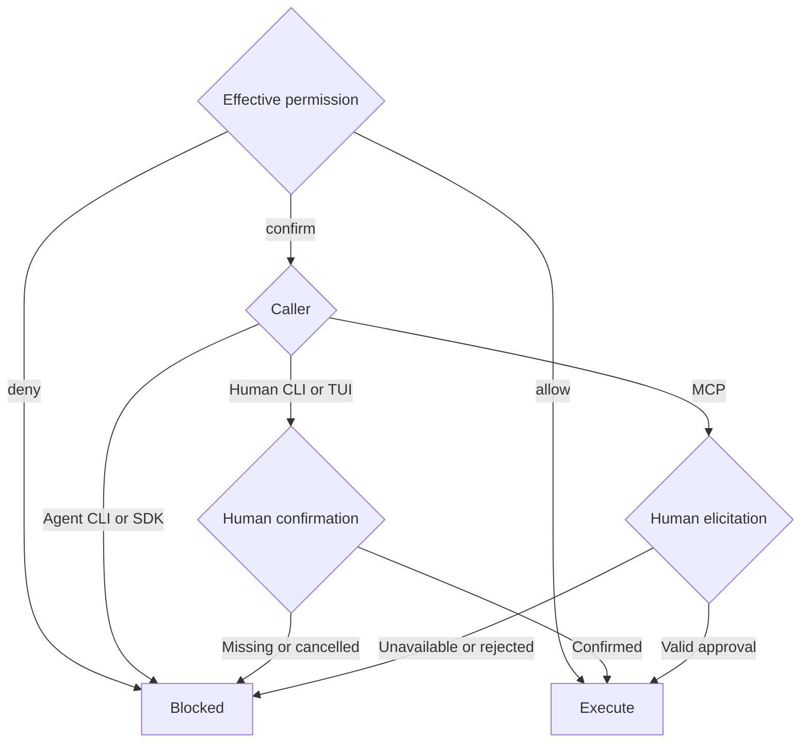
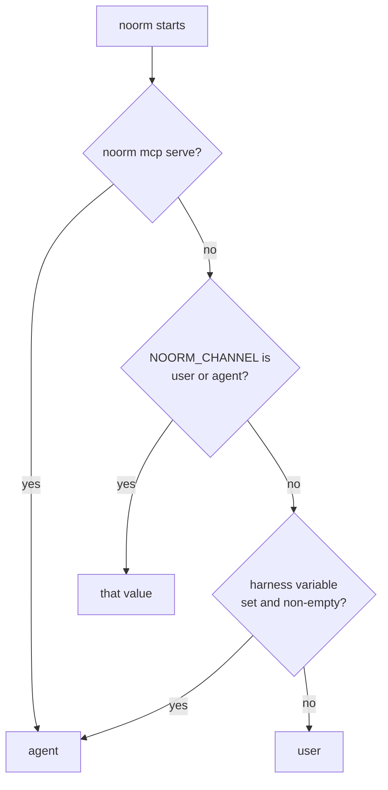

# Configs


Switch between your dev, staging, and prod databases, and decide what a person or an AI agent may do on each.

A config is a saved database connection. This project has three:

```bash
noorm config use staging
noorm config list
```

```
Active config set to: staging
Configurations:
  dev — postgres/order_to_cash_dev
  staging (active) — postgres/order_to_cash_staging
  prod — postgres/order_to_cash [user:operator agent:off]
```

The bracket tag marks a test config, or roles that differ from the default (`user:admin agent:viewer`). `agent:off` hides the config from AI agents.


## How do I create a config?


Use the TUI wizard: run `noorm ui`, press `c` for configs, then `a`. Before it saves, the wizard connects to the server's system database, so the target database does not have to exist yet. MySQL has no system database to fall back to, so on MySQL [create the database first](/guide/database/create#what-bites).

To save a config whose server is unreachable now, press `Ctrl+S` instead of submitting. It saves without testing the connection, and `noorm config validate <name>` tests it later. `Ctrl+S` works while the cursor moves between fields, not while a field is being edited.

A config is saved encrypted with your identity key. If you have no identity yet, the wizard shows identity setup first, filled in from `git config user.name` and `user.email`, then continues to the form.

| Field | Notes |
|---|---|
| Config Name | Letters, numbers, hyphens, underscores. A name that matches a [stage](/guide/environments/stages) links the config to it |
| Database Type | `postgres`, `mysql`, `sqlite`, `mssql` |
| Host, Port | SQLite has no host. Port defaults to 5432, 3306, or 1433 |
| Database | Database name, or file path for SQLite |
| Username, Password | Stored encrypted in `.noorm/state/state.enc` |
| User Role, Agent Role | See [Access roles](#access-roles) |
| Test Database | Sets `isTest`, read by `rules` in `settings.yml` and the SDK's `requireTest` |

Schema and change folders are not config fields. `paths` in `.noorm/settings.yml` sets them.

Create a config from an existing stage without connecting:

```bash
noorm config create --stage staging --name review --host db.example.com
noorm config validate review
```

`create` saves the stage's defaults with one-time connection overrides. To update an existing config from changed defaults, use `noorm config sync --stage staging --name review`; it previews changes and asks before saving. Neither command stores a stage link. The [CLI reference](/headless#config-create) lists flags, password rules, and overwrite authorization.

`noorm config add` and `config edit` exit 1 and point you at the TUI. For a complete config object, import JSON instead. This `staging.json` is hidden from agents:

```json
{
    "name": "staging",
    "access": { "user": "operator", "agent": false },
    "connection": {
        "dialect": "postgres",
        "host": "staging.db.internal",
        "database": "order_to_cash_staging",
        "user": "deploy"
    }
}
```

```bash
noorm config import ./staging.json
```

```
Imported config 'staging'.
```


## How do I switch configs?


Commands use the first of these that is set:

| Scope | How |
|---|---|
| One command | `noorm run build --config prod`, with the flag after the subcommand |
| One shell | `export NOORM_CONFIG=prod` |
| Every command | `noorm config use staging`, or highlight a config in the TUI and press Enter |


## How do I override a config in CI?


Environment variables override the stored config. [Stages](/guide/environments/stages#which-value-wins) shows the full order.

| Variable | Sets |
|---|---|
| `NOORM_CONNECTION_DIALECT`, `_HOST`, `_PORT`, `_DATABASE`, `_USER`, `_PASSWORD`, `_SSL` | `connection.*` on the config |
| `NOORM_PATHS_SQL`, `NOORM_PATHS_CHANGES` | `paths.sql`, `paths.changes`. Never written back to `settings.yml` |
| `NOORM_ACCESS_USER`, `NOORM_ACCESS_AGENT` | `access` on a config built from the environment. Ignored on a stored config, which keeps its own roles |
| `NOORM_CONFIG` | Which stored config to use |
| `NOORM_YES` | Any value except empty, `0`, or `false` skips `confirm` prompts on the `user` channel |
| `NOORM_CHANNEL` | `user` or `agent`. See [Which channel is a process on?](#which-channel-is-a-process-on) |

CamelCase fields keep their schema spelling within one segment:

```bash
export NOORM_CONNECTION_connectTimeoutMs=30000
export NOORM_CONNECTION_SSL_rejectUnauthorized=true
```

Underscores mean nesting, so splitting `connectTimeoutMs` into words addresses a different object. Use either scalar SSL or nested SSL settings, without mixing both forms. The [environment field reference](/dev/config#environment-variables) lists the supported schema paths and validation behavior. `config validate` tests the effective environment-overridden connection without saving overrides.

When no config is selected by flag, `NOORM_CONFIG`, or `config use`, noorm builds one named `__env__` from the variables. It needs `NOORM_CONNECTION_DIALECT` and `NOORM_CONNECTION_DATABASE`:

```bash
export NOORM_CONNECTION_DIALECT=postgres
export NOORM_CONNECTION_HOST=db.ci.internal
export NOORM_CONNECTION_DATABASE=order_to_cash_ci
export NOORM_CONNECTION_PASSWORD="$DB_PASSWORD"

noorm run build
```

[CI/CD](/guide/automation/ci) covers the full pipeline.


## Access roles


Each config has two roles, one per channel. The `user` channel is you, in the CLI, TUI, or SDK. The `agent` channel is an AI agent, over MCP or the CLI. Change them in the TUI (config list, `e`).

| Role | Meaning |
|---|---|
| `viewer` | Reads only, no secrets. Default for `agent` |
| `operator` | Writes data. Builds, changes, and `db create` ask first |
| `admin` | Everything allowed, but irreversible operations still ask. Default for `user` |
| `false` | `agent` only. Hides the config: `config list` omits it and MCP answers as if it does not exist. This is not a role |

The table shows the **built-in defaults**, defined in `src/core/policy/matrix.ts`. Project settings can override them:

| Permission | viewer | operator | admin |
|---|---|---|---|
| `explore`, `sql:read` (`SELECT`, `EXPLAIN`) | allow | allow | allow |
| `sql:write` (`INSERT`, `UPDATE`, `DELETE`) | deny | allow | allow |
| `sql:ddl` (`CREATE`, `ALTER`, `DROP`) | deny | deny | allow |
| `run:build`, `run:file`, `run:dir`, `pipeline:run`, `change:run`, `change:ff`, `change:revert`, `db:create`, `db:reset` | deny | confirm | allow |
| `db:truncate`, `change:rm`, `config:rm`, `config:write`, `vault:propagate`, `lock:force` | deny | confirm | confirm |
| `db:destroy` (`db drop`), `db:teardown` | deny | deny | confirm |
| `vault:read`, `secret:read`, `transfer:plan`, `lock:acquire` | deny | allow | allow |
| `vault:write`, `secret:write` | deny | confirm | allow |
| `debug:read` | allow | allow | allow |
| `debug:write` | deny | deny | confirm |

The read cells, `explore` and `sql:read`, apply to the `agent` channel only. The `user` channel always reads them as `allow`, so a `viewer` or a custom role with `explore: deny` still lets you browse and query your own database from the CLI, TUI, and SDK. The access-roles editor labels these cells as agent-channel cells. An agent without `explore` is also refused the table listing behind `db transfer --export` (when `--tables` is omitted).

Define project roles in `.noorm/settings.yml`:

```yaml
access:
    roles:
        operator:
            permissions:
                sql:write: confirm
        deployer:
            extends: operator
            permissions:
                run:build: allow
```

An override of a built-in role keeps its other default cells; built-ins cannot use `extends`. A custom role inherits its parent's effective project policy, including overrides; parents may themselves be custom roles. Without `extends`, unspecified permissions deny. Unknown permissions, values or parents and inheritance cycles are rejected. Select the role in the config's TUI access fields, or set its name in imported JSON. An unknown assigned role fails closed.

On a stage with `defaults.protected: true`, each effective permission is capped by the **original** operator matrix for users and viewer matrix for agents, regardless of overrides or inheritance. The stricter cell wins (`deny` < `confirm` < `allow`); role names do not change. `noorm config cp` and the TUI copy and rename screens refuse to move a config from a protected stage to an unprotected name, because the copy would drop the ceiling. See [Stages](/guide/environments/stages#what-does-protected-true-cap).

A config with `isTest: true` gives every role at least admin's cells on both channels, protected stage included: an agent can build, change and test its own test database. The database lifecycle cells read `allow`: `db create`, `db truncate`, `db teardown` and `db drop` no longer need `--yes`; `db reset` still does. Admin's other `confirm` cells (`config:write`, `config:rm`, `change:rm`, `vault:propagate`, `lock:force`, `debug:write`) still need a human. A role name that resolves to nothing still fails closed, `isTest` or not.

The same exemption covers a transfer destination and `dt.importFile`, since both write through `db:reset`. A transfer or vault destination counts as `isTest` when its stored config says so and it still points at that config's target; the SDK looks the destination up by name. A destination with no stored config keeps only an `isTest` already bound for the same target.

The flag counts only from a source the caller cannot overlay:

| Source | When `isTest` counts |
|---|---|
| Stored config | Its own `isTest` is `true` and env, flags, or an inline `connection` leave the target alone |
| Stage default that declares a database | The stage says `isTest: true` and the resolved target is the stage's |
| Env-only config (no stored config of that name) | `NOORM_isTest=true`, no stage sets `isTest: false`, no stage in play is protected, and env or flags supply the database (and the host, on server dialects) |
| SDK context with a `name` | The rules above, checked under both the `name` and the name it displaced (`NOORM_NAME`, `__inline__`, or `__env__`). A stored config under the displaced name must have `isTest: true` and the same target |

The target is dialect, host, database, and file; a port counts only when the source declares one, so an env port on a stage that declares none is not a retarget. Changing only the user or password keeps the flag. Anywhere else the env value is ignored: `NOORM_isTest=true noorm db drop --config prod` and `NOORM_NAME=prod NOORM_isTest=true` against a protected `prod` stage are still refused. An agent that sets `NOORM_isTest=true` on an env-only config whose target it supplies is the harness path, and it is allowed. An env-only config cannot take a stored config's name: `NOORM_NAME=prod` with a stored `prod` is refused, and `NOORM_CONFIG=prod` selects the stored config instead.

The TUI also stores `user: operator, agent: viewer` on a config it creates for a protected stage. The ceiling does not depend on that stored value; it is the starting point you can see and edit.

For `confirm`, a human on the user channel can confirm interactively or use `--yes` / `NOORM_YES=1`. Agent CLI calls always deny `confirm`, even with those flags. MCP can instead request a mediated human approval when the client supports it; rejection or unavailable approval denies the action. No confirmation opens a `deny` cell.

The effective permission decides whether confirmation is possible; the caller decides how it is collected.




### Which channel is a process on?


A process takes the channel from its environment, not from which binary it called:



The harness variables are `CLAUDECODE`, `CLAUDE_CODE`, `CLAUDE_CODE_ENTRYPOINT`, `CODEX_SANDBOX`, `CURSOR_AGENT`, `GEMINI_CLI`, `AI_AGENT`, and `NOORM_AGENT`. `TERM_PROGRAM`, `CI`, and whether stdout is a terminal are ignored, because they describe the terminal, not the caller.

::: warning Roles prevent accidents
Roles guard noorm operations against mistakes such as a wrong-database teardown. They are not a process sandbox: someone with the credentials can use another client, and an agent can set `NOORM_CHANNEL`. Use database permissions for security.
:::


## How do I check a config?


```bash
noorm config validate prod
```

```
prod: VALID
  [+] Connection: Connection successful
  [+] Name: prod
  [+] Database: order_to_cash
  [+] Host: db.example.com
```

Exit 0 when valid, 1 when not. Every check runs, so one report lists all failures. In the TUI, highlight a config, press `+`, then `v`.


## How do I share a config with a teammate?


| | TUI export (`+`, then `x`) | `noorm config export` |
|---|---|---|
| File | `<name>.noorm.enc`, encrypted for one recipient | JSON to stdout, or `--output <file>` |
| Contents | The config and its local secrets, without `user` and `password` | The config, with `password` |
| Needs | The recipient's identity known locally | A role that can read secrets |
| Import | TUI: `+`, then `i` | `noorm config import <file>` |

`config export --output` writes the file with `0600` permissions. Treat it as a credential. Creating a config through CLI import is user-channel only. Importing over an existing name needs `--force --yes` and the `config:write` permission, because an overwrite rewrites the config's roles.


## What bites


| Symptom | Cause | Fix |
|---|---|---|
| `noorm -c prod run build` fails: `--cwd path is not a directory` | Before the subcommand, `-c` is `--cwd` | `noorm run build --config prod` |
| `"db:teardown" is not allowed on config "prod" (role: operator).` | The role's cell is `deny`, and no flag opens it | Change the role in the TUI, or use a config with `admin` |
| `"run:build" on config "prod" requires confirmation from a human.` | An agent CLI call cannot satisfy a `confirm` cell | Run it in your own terminal, or use MCP with mediated human approval |
| An imported config is open to `admin` | The file has no `access`, so it gets `user: admin`, `agent: viewer` | Put `access` in the file |


## Next


- [Stages](/guide/environments/stages): defaults and required secrets shared by a team
- [Secrets](/guide/environments/secrets): keep sensitive values out of SQL
- [Headless reference](/headless): every `config` flag and exit code
- [MCP](/guide/automation/mcp): the agent side of access roles
