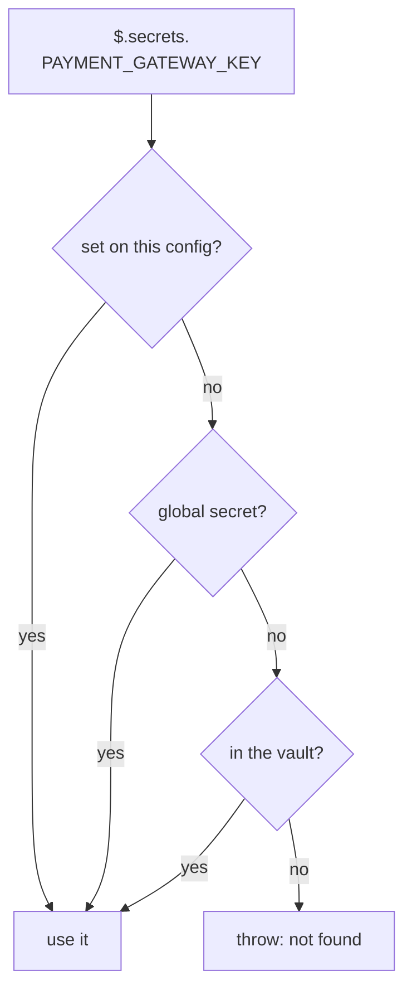

# Secrets


Keep API keys and other sensitive values out of committed SQL, and still use them when a template runs.

The template names the secret. The value never appears in the file:

```sql
-- db/sql/09_seeds/02_gateway.sql.tmpl
INSERT INTO app_setting (name, value)
VALUES ('payment_gateway_key', );
```

Set the value once per config. `--stdin` keeps it out of shell history and the process table:

```bash
printf %s "$KEY" | noorm secret set PAYMENT_GATEWAY_KEY --stdin --config prod
noorm secret list --config prod
```

```
Secret "PAYMENT_GATEWAY_KEY" set for config "prod".
Secrets for "prod" (1):
  PAYMENT_GATEWAY_KEY
```

Secrets are for values a template writes into your database. Database connection credentials belong to the [config](/guide/environments/configs).


## Which value does a template get?


The first tier that holds the key wins, so a local value overrides the team's:



| Tier | Stored in | Set with | Seen by |
|---|---|---|---|
| Config-local | `.noorm/state/state.enc`, per config | `noorm secret set`, or the TUI | You |
| Global-local | `state.enc`, all your configs | No CLI or TUI command writes one | You |
| Vault | The database, encrypted | `noorm vault set` | The team |

`$.secrets` merges all three tiers. `$.globalSecrets` holds only the global tier. A missing key throws `Secret "PAYMENT_GATEWAY_KEY" not found (searched: config-local, global-local, vault)` instead of rendering `undefined`.


## How do I set a secret?


| | CLI | TUI |
|---|---|---|
| Set | `noorm secret set <KEY> [value] [--stdin] [--config <name>]` | `noorm ui`, `c`, highlight a config, `k`, then `a` |
| List keys | `noorm secret list`, which never prints values | The same screen. Values show masked, with their first characters visible |
| Remove | `noorm secret rm <KEY> --yes` | The same screen, `d` |

Keys start with a letter and contain only letters, numbers, and underscores. The TUI masks `password` and `api_key` input and checks that a `connection_string` parses as a URI. A `viewer` role cannot read or write secrets, and an `operator` needs `--yes` to write one.

[Stages](/guide/environments/stages#how-do-i-require-a-secret) declares which secrets a config must have. The TUI lists those first, marked set or missing.

::: warning The rendered SQL holds the plain value
The database receives the secret as text, and so does anything that logs the rendered SQL. Render a secret only into the column that needs it.
:::


## What bites


| Symptom | Cause | Fix |
|---|---|---|
| `Secret "PAYMENT_GATEWAY_KEY" not found (searched: ...)` | No tier has the key. The vault tier is skipped without vault access | Set it locally, or ask a teammate to run `noorm vault propagate` |
| `Failed to set secret: Secret key "payment-gateway-key" is invalid` | A hyphen or leading digit in the key | Use `PAYMENT_GATEWAY_KEY` |
| A secret set locally is missing in CI | A CI runner has no `state.enc` | Put it in the [vault](/guide/environments/vault), or run `noorm ci secrets --file <env file>` after `noorm ci init` |
| `secret set` says it requires confirmation | The config's role for your channel is `operator` | Pass `--yes` |
| The TUI refuses to delete a secret | The stage requires it, and no vault copy exists | Remove the requirement from `settings.yml`. `noorm secret rm` does not check |
| A teammate's build fails where yours passes | Your local value hides a missing vault value | Run `noorm vault list`, then `noorm vault set` |
| Someone committed `state.enc` | It holds your credentials and secrets. `noorm init` ignores `.noorm/state/`, so the ignore line was removed or init never ran | Restore `.noorm/state/` in `.gitignore` and remove the file from the repo. Your identity key encrypts it, so another machine cannot read it |


## Next


- [Vault](/guide/environments/vault): share a secret with the team
- [Stages](/guide/environments/stages): require a secret per environment
- [Templates](/guide/sql-files/templates): the full `$` context
- [Headless reference](/headless): every `secret` and `vault` flag
