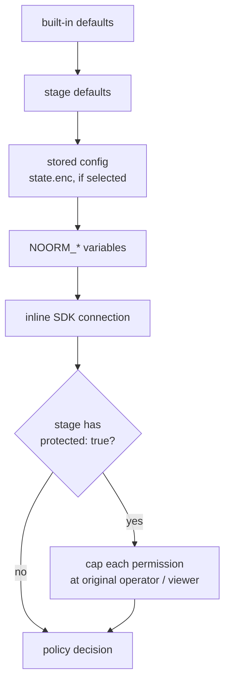

# Stages


Give every developer the same starting configs, the same access ceiling, and the same list of required secrets for dev, staging, and prod.

A stage is a template in `.noorm/settings.yml`. It is committed, so the team shares it:

```yaml
# .noorm/settings.yml
stages:
    dev:
        description: Local order-to-cash database
        defaults:
            dialect: postgres
            host: localhost
            port: 5432

    prod:
        description: Production
        locked: true
        defaults:
            dialect: postgres
            protected: true
        secrets:
            - key: PAYMENT_GATEWAY_KEY
              type: api_key
              description: Key the payment sync sends to the gateway
              required: true
```

A [config](/guide/environments/configs) uses the stage with its name. The stage is not stored on the config, so it cannot differ between developers. A config named `prod`:

- is created by the TUI from `defaults` if it does not exist yet
- cannot be deleted, because the stage is `locked`
- has each permission capped by the original `operator` matrix for you and `viewer` matrix for agents, because the stage is `protected`
- shows `PAYMENT_GATEWAY_KEY` as missing in the TUI until someone sets it

From the SDK, `createContext({ stage: 'prod' })` picks a stage for a config with another name.


## Where do `defaults` apply?


When `noorm ui` opens, it creates a config for each stage that sets `defaults.dialect` and has no config of its name yet, provided this machine has an identity. `host` falls back to `localhost`, and `database` to the stage name. A protected stage caps effective permission cells against the original operator matrix for users and viewer matrix for agents. TUI seeding preserves a stage's configured password; keep credentials out of committed settings.

At connect time, stage defaults are also a layer beneath stored values. Editing a default fills fields absent from a stored config, but does not replace stored fields. An SDK context can select that layer with `stage`, including in inline or [environment-only mode](/headless#environment-only-mode). The stage's `isTest` applies unless a higher-priority value overrides it.

The CLI, the SDK and the TUI all apply that layer:

| Surface | Layers above the stage defaults |
|---|---|
| CLI, SDK | Stored config, then `NOORM_*` variables, then flags or the inline SDK connection |
| TUI | Stored config only. No config variable (`NOORM_CONNECTION_*`, `NOORM_ACCESS_*`) and no flag is applied to a config |

Settings variables still apply in the TUI: `NOORM_STAGES_<stage>_DEFAULTS_*` changes the stage defaults the TUI merges, as `NOORM_PATHS_*` changes its paths.

In the TUI a stage `isTest: true` reaches build `rules`, but it never grants the [test-database permission exemption](/guide/environments/configs#access-roles). Only `isTest: true` on the stored config does. The TUI stores no stage value on a save: the edit form shows a stage's `ssl` as the state in effect and leaves the stored config without it.

To replace stored fields with current defaults, run `noorm config sync --stage staging --name review`. For unattended creation, use `noorm config create --stage staging --name review` or `--all`. These aliases require an unprotected stage: create and sync reject a different config name for a protected stage because a stored config does not retain a stage association. Use the stage name for protected stages. The [CLI reference](/headless#config-create) owns their password, preview, and overwrite rules.


## Which value wins?


Each source overrides the one above it; policy checks then apply the protected-stage ceiling:



The TUI skips the `NOORM_*` config layer and the inline layer: its config is the stored config over the stage defaults. A `NOORM_STAGES_<stage>_DEFAULTS_*` variable still changes those stage defaults.


## What can a stage set?


| Key | Effect |
|---|---|
| `description` | Shown in the TUI |
| `locked: true` | Configs on this stage cannot be deleted |
| `defaults` | Flat connection fields (`dialect`, `host`, `port`, `database`, `user`, `password`, `ssl`) plus `type`, `isTest`, and `access`. `protected: true` caps effective permission cells. [`ssl`](#can-a-stage-set-ssl) is a boolean or an object of file paths |
| `secrets` | Secrets this stage requires |


### Can a stage set ssl?


Yes, as `true`, `false`, or an object of `caFile`, `certFile`, `keyFile` and `rejectUnauthorized`. A stage never holds inline `ca`, `cert` or `key`: the PEM text would sit in `settings.yml`, which is committed, so settings validation refuses it and names the file form to use.

```yaml
stages:
    prod:
        defaults:
            dialect: postgres
            ssl:
                caFile: ./certs/corp-ca.pem
```

A relative path resolves from each machine's project root, so the file must exist at that path wherever a config on this stage connects. `tlsServerName` is not a stage default.

A stage `ssl` sits under the stored config, and `config sync` applies it over the stored one, so a stage `ssl: false` turns SSL off in the synced config. At resolution the stored config is the higher layer: a stored `false` turns SSL off, and a stored `true` keeps the stage's `caFile`.

`rejectUnauthorized` is never inherited. A stage `rejectUnauthorized: false` applies only to a config that has no `ssl` of its own, and a stored `ssl: true` or `{ caFile }` still validates the certificate. [Combining layers](/dev/config#combining-layers) has the rules.


### What does `protected: true` cap?


The cap applies to each effective permission at policy-check time, without changing the assigned role name. It uses the original built-in `operator` matrix for users and `viewer` matrix for agents, not their project overrides. For each cell, the stricter result wins: `deny` is stricter than `confirm`, which is stricter than `allow`. Custom roles and built-in overrides cannot relax this ceiling; stricter project policy remains in effect. The one exception is a config with `isTest: true`: every role reads at least admin's cells past the ceiling, and the lifecycle cells read `allow` ([access roles](/guide/environments/configs#access-roles)). `agent: false` still hides the config.

For example, even if a project grants an agent `run:build: allow`, a protected stage caps it at the original viewer cell, `deny`. A user's `run:build: allow` is capped at the original operator cell, `confirm`.

The ceiling applies when any of three sources marks the stage protected: the stage settings resolved for the config, the config's own name, or an explicit `stage` option. An option can add the ceiling and never remove it. Copying or renaming a config from a protected stage to a name that is not protected is refused, so a copy cannot shed the ceiling.


## How do I require a secret?


List it under a stage, or at the root of `settings.yml` to require it on every stage. A stage entry replaces a root entry with the same key.

| Field | Meaning |
|---|---|
| `key` | The name templates read: `$.secrets.PAYMENT_GATEWAY_KEY` |
| `type` | `string` is plain text. `password` and `api_key` are masked. `connection_string` is plain text and must parse as a URI |
| `description` | Hint shown in the value prompt |
| `required` | Defaults to `true` |

A required secret does not block a command by itself. The TUI lists it as missing, and the first template that reads it fails:

```
Secret "PAYMENT_GATEWAY_KEY" not found (searched: config-local, global-local, vault)
```

For an optional secret, probe first with ``. The `in` check does not throw. [Secrets](/guide/environments/secrets) covers where values come from.


## What bites


| Symptom | Cause | Fix |
|---|---|---|
| Editing a stage's `host` or `port` does not replace the config's value | Stored fields override the stage layer | Preview `noorm config sync --stage staging --name review`, or use a runtime environment override |
| A config connects from the TUI with TLS, a user, a password or a port it does not store | The stage's `defaults` fill every field the stored config lacks, in the TUI as in the CLI and SDK | Set the field on the config. A stored value wins over the stage, and a stored `ssl: false` turns the stage's `ssl` off. The config list shows `[tls]` for the state in effect |
| No config appears for a stage | The stage sets no `defaults.dialect`, or this machine had no identity when `noorm ui` opened | Add `dialect` under `defaults`, or set up an identity, then reopen `noorm ui` |
| A database password is in git history | `defaults.password` sits in the committed `settings.yml` | Leave `password` out of `defaults`. Set it on each config in `noorm ui` |
| `Config "prod" is linked to locked stage "prod" and cannot be deleted` | The stage has `locked: true` | Remove `locked` from the stage in `settings.yml` |
| A permissive role is denied or requires confirmation | The stage is `protected` and caps each permission | Inspect the original operator/user and viewer/agent cells; use an unprotected stage only when appropriate |


## Next


- [Configs](/guide/environments/configs): roles, channels, and the permission matrix
- [Secrets](/guide/environments/secrets): set values and resolve them in templates
- [Organization](/guide/sql-files/organization): build folders and rules in `settings.yml`
