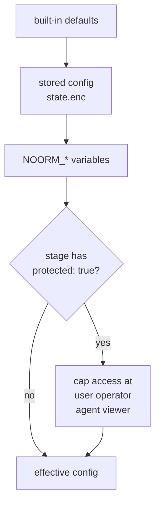

# Stages


Give every developer the same starting configs, the same access ceiling, and the same list of required secrets for dev, staging, and prod.

A stage is a template in `.noorm/settings.yml`. It is committed, so the team shares it:

```yaml
# .noorm/settings.yml
stages:
    dev:
        description: Local order-to-cash database
        defaults:
            dialect: postgres
            host: localhost
            port: 5432

    prod:
        description: Production
        locked: true
        defaults:
            dialect: postgres
            protected: true
        secrets:
            - key: PAYMENT_GATEWAY_KEY
              type: api_key
              description: Key the payment sync sends to the gateway
              required: true
```

A [config](/guide/environments/configs) uses the stage with its name. The stage is not stored on the config, so it cannot differ between developers. A config named `prod`:

- is created by the TUI from `defaults` if it does not exist yet
- cannot be deleted, because the stage is `locked`
- resolves to at most `operator` for you and `viewer` for agents, because the stage is `protected`
- shows `PAYMENT_GATEWAY_KEY` as missing in the TUI until someone sets it

From the SDK, `createContext({ stage: 'prod' })` picks a stage for a config with another name.


## Where do `defaults` apply?


`defaults` is a template for the first config, not a layer under every config. When `noorm ui` opens, it creates a config for each stage that sets `defaults.dialect` and has no config of its name yet, provided this machine has an identity. `host` falls back to `localhost`, `database` to the stage name, and a `protected` stage starts the config at `operator` for you and `viewer` for agents.

From then on, the stored config holds the values. Editing `defaults` later does not change it. A stage selected for an [environment-only](/headless#environment-only-mode) run also passes its `isTest`.


## Which value wins?


Each source overrides the one above it, then a protected stage caps `access`:




## What can a stage set?


| Key | Effect |
|---|---|
| `description` | Shown in the TUI |
| `locked: true` | Configs on this stage cannot be deleted |
| `defaults` | `dialect`, `host`, `port`, `database`, `user`, `password`, `ssl`, `isTest`: the template the TUI creates the config from. `protected: true` also caps access on every resolve, below |
| `secrets` | Secrets this stage requires |


### What does `protected: true` cap?


It lowers each channel to the ceiling and leaves stricter values alone. The cap applies on every resolve, so editing stored state does not raise it.

| Config sets | Resolves to |
|---|---|
| `user: admin` | `operator` |
| `user: viewer` | `viewer` |
| `agent: admin` or `agent: operator` | `viewer` |
| `agent: false` | `false` (hidden) |


## How do I require a secret?


List it under a stage, or at the root of `settings.yml` to require it on every stage. A stage entry replaces a root entry with the same key.

| Field | Meaning |
|---|---|
| `key` | The name templates read: `$.secrets.PAYMENT_GATEWAY_KEY` |
| `type` | `string` is plain text. `password` and `api_key` are masked. `connection_string` is plain text and must parse as a URI |
| `description` | Hint shown in the value prompt |
| `required` | Defaults to `true` |

A required secret does not block a command by itself. The TUI lists it as missing, and the first template that reads it fails:

```
Secret "PAYMENT_GATEWAY_KEY" not found (searched: config-local, global-local, vault)
```

For an optional secret, probe first with ``. The `in` check does not throw. [Secrets](/guide/environments/secrets) covers where values come from.


## What bites


| Symptom | Cause | Fix |
|---|---|---|
| Editing a stage's `host` or `port` does not change the config | `defaults` only seeds a config the TUI creates; the stored config wins after that | Edit the config, or set a `NOORM_CONNECTION_*` variable |
| No config appears for a stage | The stage sets no `defaults.dialect`, or this machine had no identity when `noorm ui` opened | Add `dialect` under `defaults`, or set up an identity, then reopen `noorm ui` |
| A database password is in git history | `defaults.password` sits in the committed `settings.yml` | Leave `password` out of `defaults`. Set it on each config in `noorm ui` |
| `Config "prod" is linked to locked stage "prod" and cannot be deleted` | The stage has `locked: true` | Remove `locked` from the stage in `settings.yml` |
| A config set to `admin` behaves as `operator` | The stage is `protected` | Intended. Put the config on an unprotected stage |


## Next


- [Configs](/guide/environments/configs): roles, channels, and the permission matrix
- [Secrets](/guide/environments/secrets): set values and resolve them in templates
- [Organization](/guide/sql-files/organization): build folders and rules in `settings.yml`
