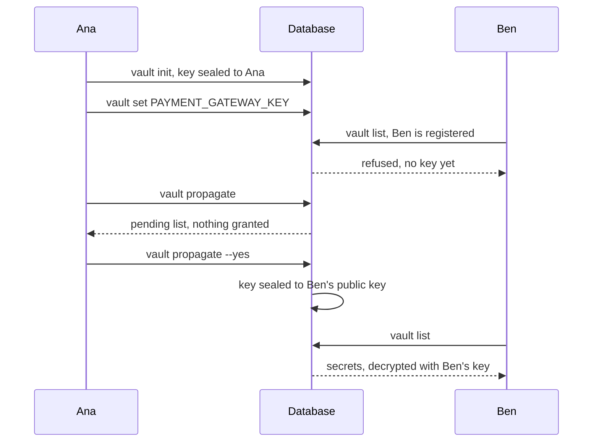

# Vault


Share a secret with your whole team without chat messages or committed files.

The first developer creates the vault and stores a secret in it:

```bash
noorm vault init
printf %s "$KEY" | noorm vault set PAYMENT_GATEWAY_KEY --stdin
noorm vault list
```

```
Vault initialized successfully
Vault secret "PAYMENT_GATEWAY_KEY" set successfully
Vault secrets (1):
  PAYMENT_GATEWAY_KEY (set by ana@example.com)
```

The vault lives in the config's own database, one per config. Templates read it as the last tier of [`$.secrets`](/guide/environments/secrets#which-value-does-a-template-get), so a local value overrides it for one developer.


## How does a teammate get access?


A new teammate is registered but holds no key. Someone with access grants it:



Ben needs an identity first: `noorm identity init`. Without `--yes`, `propagate` lists who is waiting and grants nothing. With it:

```bash
noorm vault propagate --yes
```

```
Granted vault access to 1 identities
  Ben Ortiz <ben@example.com>  4a5c14af...
```

In the TUI, `v` from home opens the vault. The header counts waiting teammates, `p` grants after listing them, and `a` adds a secret.


## Which commands manage the vault?


| Command | Effect |
|---|---|
| `noorm vault init` | Create the vault key and seal it to you. Safe to repeat |
| `noorm vault set <KEY> [value] [--stdin]` | Add or replace a secret |
| `noorm vault list` | Keys and who set them, never values |
| `noorm vault rm <KEY> --yes` | Delete a secret. The TUI cannot |
| `noorm vault propagate [--to <hash,...>] --yes` | Grant the key to waiting teammates |
| `noorm vault cp <KEY> <source> <destination>` | Copy one secret between configs |

Each takes `--json`, and every command but `cp` takes `--config`. Keys follow the [secret key rule](/guide/environments/secrets#how-do-i-set-a-secret).


## How is it encrypted?


| What | Encrypted with | Stored in |
|---|---|---|
| Each secret | One 256-bit vault key, AES-256-GCM, random IV | `noorm.vault`, column `encrypted_value` |
| The vault key, once per teammate | That teammate's public key: ephemeral X25519, HKDF-SHA256, AES-256-GCM | `noorm.identities`, column `encrypted_vault_key` |

A null `encrypted_vault_key` marks a teammate as waiting. Those are the PostgreSQL and SQL Server names. MySQL and SQLite use `__noorm_vault__` and `__noorm_identities__`. Someone with only the database sees ciphertext. Reading a secret takes the database and a granted teammate's private key.


## How do I copy a secret to another config?


```bash
noorm vault cp PAYMENT_GATEWAY_KEY staging prod --dry-run
```

```
Would copy 1 secrets: PAYMENT_GATEWAY_KEY
```

A dry run checks vault access on both configs, that the key exists, and collisions, then writes nothing. A real copy initializes the destination vault if it has none. An existing key is skipped unless you pass `--force`.


## How does a CI runner get access?


A developer with access runs `noorm ci identity enroll --config prod --name "GitHub CI" --email ci@example.com --yes` once. It registers the runner's identity and seals the key to it. [CI/CD](/guide/automation/ci) covers the runner side.


## What bites


| Symptom | Cause | Fix |
|---|---|---|
| `No vault access. Wait for a team member to propagate access.` | Your identity holds no sealed key yet | Ask a teammate to run `noorm vault propagate --yes` |
| `vault rm` exits 1: cannot be undone | The vault keeps no history, so it needs `--yes` | Check the key, then pass `--yes` |
| A `vault set` or `vault init` asks for confirmation | Your role on the config is `operator` | Pass `--yes` |
| A former teammate who still reaches the database can read the vault | A grant cannot be revoked, and no command rotates the vault key | Change the secret at its source, then `vault set` the new value |
| Everyone with access reads every secret | The vault has one key for all of it | Keep per-person values in local secrets |


## Next


- [Secrets](/guide/environments/secrets): resolution order and local overrides
- [Configs](/guide/environments/configs): the `vault:*` permissions per role
- [Identity](/cli/identity): create the keypair a teammate is registered with
- [CI/CD](/guide/automation/ci): enroll a runner and load job secrets
