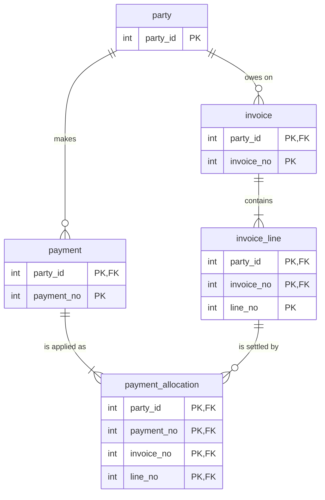
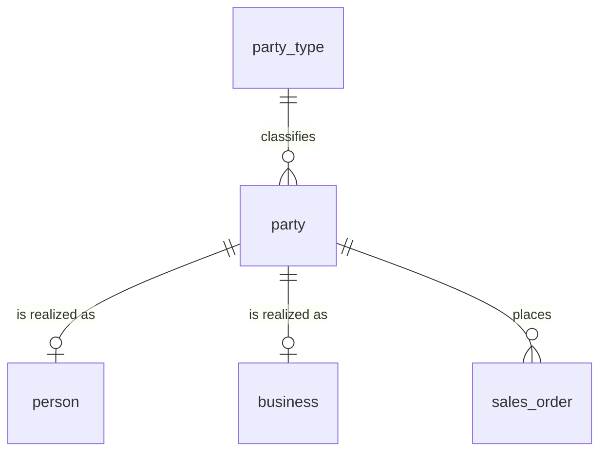

# The case for proper relational design


A child table that inherits its parent's key lets the database refuse rows that break a business rule. A surrogate ID on every table leaves that refusal to application code. noorm runs the SQL you write, so which one you get is your decision.

`party_id` enters at `party` and reaches `payment_allocation` down two branches, so the table stores it once and both parents must agree on it:




## What does an inherited key enforce?


`payment_allocation` has two parents, `payment` and `invoice_line`. Both keys start with `party_id`, so the table holds it once and both foreign keys read it:

```sql
CREATE TABLE payment_allocation (
    party_id    integer       NOT NULL,
    payment_no  integer       NOT NULL,
    invoice_no  integer       NOT NULL,
    line_no     integer       NOT NULL,
    amount      numeric(12,2) NOT NULL,
    CONSTRAINT payment_allocation_pk
        PRIMARY KEY (party_id, payment_no, invoice_no, line_no),
    CONSTRAINT payment_allocation_isdrawnfrom_payment
        FOREIGN KEY (party_id, payment_no)
        REFERENCES payment (party_id, payment_no),
    CONSTRAINT payment_allocation_settles_invoice_line
        FOREIGN KEY (party_id, invoice_no, line_no)
        REFERENCES invoice_line (party_id, invoice_no, line_no)
);
```

Payment 1 belongs to party 1. Invoice 1, line 1 belongs to party 2. Settling one with the other needs a row whose `party_id` is both:

```sql
INSERT INTO payment_allocation (party_id, payment_no, invoice_no, line_no, amount)
VALUES (1, 1, 1, 1, 49.00);
```

```
ERROR:  insert or update on table "payment_allocation" violates foreign key constraint "payment_allocation_settles_invoice_line"
DETAIL:  Key (party_id, invoice_no, line_no)=(1, 1, 1) is not present in table "invoice_line".
```

Two foreign keys enforce the rule. No trigger, no application check. The same shape puts `party_id` on every row below `party`, so finding who owes on an invoice line is a column read.

A surrogate ID on every table gives the rule no place to live:

```sql
CREATE TABLE payment_allocation (
    payment_allocation_id integer       GENERATED ALWAYS AS IDENTITY PRIMARY KEY,
    payment_id            integer       NOT NULL REFERENCES payment (payment_id),
    invoice_line_id       integer       NOT NULL REFERENCES invoice_line (invoice_line_id),
    amount                numeric(12,2) NOT NULL
);
```

Each foreign key checks that its row exists. Nothing relates the payment's party to the invoice line's party, so the database accepts any pair. Every write that must not cross parties is guarded in code you have to remember to write, and finding the party takes a join.


## Why is there a party table instead of a customer type and ID?


An order is placed by a person or a business. A common shape for one-of-several parents is a type column and an ID column:

```sql
CREATE TABLE sales_order (
    sales_order_id integer GENERATED ALWAYS AS IDENTITY PRIMARY KEY,
    customer_type  text    NOT NULL, -- 'PERSON' or 'BUSINESS'
    customer_id    integer NOT NULL  -- no foreign key is possible
);
```

A foreign key has one target table, and `customer_id` has two. Point it at a deleted person, or at a business ID while `customer_type` says `PERSON`, and nothing objects.

A basetype gives the order one target. `party` holds the identity every customer shares, and `person` and `business` hold what is specific to each. A subtype's key is its basetype's key:



```sql
CREATE TABLE party_type (
    code        text NOT NULL,
    description text NOT NULL,
    CONSTRAINT party_type_pk PRIMARY KEY (code)
);

CREATE TABLE party (
    party_id   integer GENERATED ALWAYS AS IDENTITY,
    party_type text    NOT NULL,
    name       text    NOT NULL,
    CONSTRAINT party_pk PRIMARY KEY (party_id),
    CONSTRAINT party_isclassifiedby_party_type
        FOREIGN KEY (party_type) REFERENCES party_type (code)
);

CREATE TABLE person (
    party_id    integer NOT NULL,
    given_name  text    NOT NULL,
    family_name text    NOT NULL,
    CONSTRAINT person_pk PRIMARY KEY (party_id),
    CONSTRAINT person_isa_party
        FOREIGN KEY (party_id) REFERENCES party (party_id)
);
```

`business` has the same shape. The kinds of party are rows in `party_type`, so admitting a new kind is an `INSERT`, where a `CHECK` list would be a constraint rewrite. `sales_order.party_id` is now a real foreign key:

```sql
INSERT INTO sales_order (party_id, order_no) VALUES (999, 1);
```

```
ERROR:  insert or update on table "sales_order" violates foreign key constraint "sales_order_isplacedby_party"
DETAIL:  Key (party_id)=(999) is not present in table "party".
```

One rule stays open: nothing in these keys stops a party from having both a `person` row and a `business` row. The model marks the cluster exclusive, and enforcing that takes one more constraint.

[ignatius](/modeling/) draws the cluster from the same key shape: a diamond joins the basetype to its members, and an X marks it exclusive.

<ModelViewer class="tall" model="order-to-cash" hash="view=graph" :tabs="false" label="order-to-cash graph" title="Order-to-cash model graph rendered by ignatius" />


## What does a type-and-ID column cost on reads?


The measurement used a separate social-graph schema, built both ways: comments and tags in shared tables keyed by a type column and an ID column, against per-parent tables such as `post_comments` and `comment_tags`. PostgreSQL 17, 1,000,000 posts and 5,000,000 comments, both designs indexed equivalently, best of three runs.

| Query | Design | Time | Pages read |
|---|---|---|---|
| Comments per group (one join) | Type and ID | 149.9 ms | 7,852 |
| Comments per group (one join) | Subtype tables | 134.6 ms | 5,022 |
| Comments on a group's posts, plus their tags (two joins) | Type and ID | 638.2 ms | 47,765 |
| Comments on a group's posts, plus their tags (two joins) | Subtype tables | 452.7 ms | 4,638 |

At one join the times are 15 ms apart. The second join took the type-and-ID query from 7,852 to 47,765 pages read and left the subtype query flat.

The likely reason is that each type-and-ID join re-derives the row kind at read time, by sifting a large shared table for the right type. A subtype table holds only the right rows, because the write path sorted them once. A third join would pay the sift again. That is inference from where the work happens, and no third join was measured.

The subtype design used more disk, 803 MB against 638 MB, because it has more tables and indexes and stores inherited keys more than once. The two-join gap is 1.4x in wall-clock time because the data mostly fits in cache.


## What happens on delete?


Delete an invoice line that an allocation settles:

```sql
DELETE FROM invoice_line WHERE party_id = 2 AND invoice_no = 1 AND line_no = 1;
```

```
ERROR:  update or delete on table "invoice_line" violates foreign key constraint "payment_allocation_settles_invoice_line" on table "payment_allocation"
DETAIL:  Key (party_id, invoice_no, line_no)=(2, 1, 1) is still referenced from table "payment_allocation".
```

A type-and-ID pair cannot carry a foreign key, so the equivalent delete succeeds and the child row points at nothing. Totals built from it are wrong and nothing reports it. Finding such orphans takes an anti-join per pair, 154 ms across the five million comments above, and it reports damage already done.


## Next


- [From model to SQL](/modeling/model-to-sql): how each entity file becomes a `CREATE TABLE`
- [Entities and key inheritance](/modeling/entities): the entity format and subtype clusters
- [Concepts](/getting-started/concepts): how `db/sql/` and `db/changes/` divide the work
