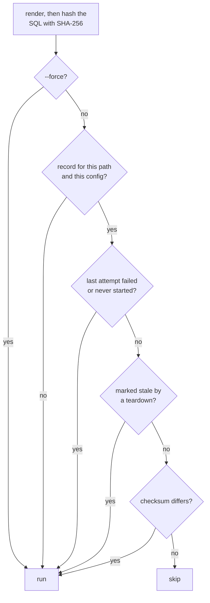

# Execution


Run your SQL files against a database and re-run only the ones whose SQL changed.

```bash
noorm run build
```

```
• log  Build completed  status=success filesRun=5 filesSkipped=0 filesFailed=0 durationMs=53.388000000000034
```

Run it again and every file is skipped:

```bash
noorm run build
```

```
• log  /srv/shop/db/sql/01_tables/01_party.sql (skipped: unchanged)
• log  /srv/shop/db/sql/01_tables/02_sales_order.sql (skipped: unchanged)
• log  /srv/shop/db/sql/01_tables/03_product.sql (skipped: unchanged)
• log  /srv/shop/db/sql/02_views/01_open_orders.sql (skipped: unchanged)
• log  /srv/shop/db/sql/09_seeds/01_products.sql.tmpl (skipped: unchanged)
• log  Build completed  status=success filesRun=0 filesSkipped=5 filesFailed=0 durationMs=8.991874999999993
```

Each line also starts with a `[YY-MM-DD HH:mm:ss]` timestamp, left out here.


## Which command runs what?


| Command | Runs | Applies `build.include`, `build.exclude`, rules |
|---|---|---|
| `noorm run build` | every file under `paths.sql` | yes |
| `noorm run file <path>` | one file | no |
| `noorm run dir <path>` | every file under a directory | no |
| `noorm run exec <dir-or-glob>` | a directory, or the files a glob matches | no |
| `noorm run files --paths a.sql,b.sql` | the listed files, in the order listed | no |
| `noorm run preview <file>` | nothing: prints a template's rendered SQL | n/a |
| `noorm run inspect <file>` | nothing: lists what a template can read from `$` | n/a |

Directories and globs run in path order, the order [Organization](/guide/sql-files/organization) describes. The five commands that run SQL take these flags:

| Flag | Effect |
|---|---|
| `--force`, `-f` | Run every file without the checksum test |
| `--dry-run` | Render to `tmp/`. Run nothing and record nothing |
| `--config`, `-c` | Use a config other than the active one |
| `--json` | Print the result as JSON on stdout |

`preview` and `inspect` take `--config` and `--json` only. Exit codes and JSON shapes are in [`noorm run`](/cli/run).


## How does noorm decide to skip a file?


A file skips only when its newest record succeeded on the same SQL. Everything else runs:



The hash covers the SQL the database would receive. For a `.sql.tmpl` that is the rendered output, so a changed data file, config, or secret re-runs the template while its own bytes stay the same.

One lookup decides the whole batch before anything runs. A skipped file leaves no row, and a batch where every file skips creates no operation record. Records are per config and per file path, whichever command wrote them, so `run file` after `run build` skips an unchanged file.


## What does --dry-run do?


It renders every file, templates included, and writes the result under `tmp/`, mirroring the source path and dropping `.tmpl`. Nothing runs and nothing is recorded. The skip test does not apply, so unchanged files render too:

```bash
noorm run build --dry-run
```

```
• log  /srv/shop/db/sql/09_seeds/01_products.sql.tmpl (success, dry-run) -> /srv/shop/tmp/db/sql/09_seeds/01_products.sql
• log  Build (dry-run) completed  status=success filesRun=5 filesSkipped=0 filesFailed=0 durationMs=11.70675 dryRun=true
```

::: warning Dry-run files hold your secrets
Rendering resolves every secret a template reads and writes it to `tmp/` in plain text. The files are owner-only (`0600`, in `0700` directories), but `noorm init` does not add `tmp/` to `.gitignore`. Add it, and delete the output when you finish.
:::

## What gets tracked


Each batch that runs writes to two tables in your database. PostgreSQL and SQL Server keep them in a `noorm` schema, as `noorm.change` and `noorm.executions`. MySQL and SQLite name them `__noorm_change__` and `__noorm_executions__`.

| Table | Columns |
|---|---|
| change (one row per batch) | `id`, `name`, `change_type`, `direction`, `checksum`, `executed_at`, `executed_by`, `config_name`, `cli_version`, `status`, `error_message`, `duration_ms` |
| executions (one row per file) | `id`, `change_id`, `filepath`, `file_type`, `checksum`, `cli_version`, `status`, `error_message`, `skip_reason`, `duration_ms` |

`change_type` is `build`, `run`, or `change`. `filepath` is relative to the project root. Before the first file runs, every file in the run set gets a `pending` row, so an interrupted build still shows what it intended. The next build treats a `pending` row as never started.


## What happens when a file fails?


The batch stops at the first failure. Files after it are not attempted:

| File | Recorded as | Next build |
|---|---|---|
| ran before the failure | `success` | skipped |
| the one that failed | `failed` | runs |
| after the failure | `skipped`, with `Skipped: failure in <file>` | runs |

The command exits `3` when some files ran and `1` when none did.


## How do I watch a slow file?


A file still running after 10 seconds logs `Still running <file> (Ns)` every 10 seconds. The entry carries the progress the database reports (an index build's phase and block count) and any session the file waits on for a lock, which tells a slow file from a stuck one. To cancel a run, use the TUI: [Long-Running Files](/tui#long-running-files).


## Multiple statements per file


| Dialect | A file with several statements |
|---|---|
| PostgreSQL | Runs as one call, in one implicit transaction |
| SQL Server | Splits on a line that holds only `GO`, then runs each batch in order |
| SQLite | Splits on statement boundaries. Semicolons inside strings, quoted identifiers, comments, and trigger bodies do not count |
| MySQL | The driver rejects it. Use one statement per file |

SQL Server needs `GO` because `CREATE VIEW`, `CREATE PROCEDURE`, `CREATE FUNCTION`, `CREATE TRIGGER`, and `CREATE TYPE` must each be alone in their batch:

```sql
-- db/sql/02_views/02_order_views.sql
CREATE OR ALTER VIEW open_orders AS
SELECT party_id, order_no FROM sales_order WHERE status = 'open';
GO

CREATE OR ALTER VIEW invoiced_orders AS
SELECT party_id, order_no FROM sales_order WHERE status = 'invoiced';
GO
```

When a batch fails, the error starts with `[batch 2 of 2]`. SQLite errors start with `[statement N of M]`. Files in `db/changes/` split the same way. Splitter rules are in the [runner internals](/dev/runner#mssql-batch-handling).


## What bites


| Mistake or symptom | Cause | Fix |
|---|---|---|
| A build skips files after you dropped tables by hand | The records still say `success` and the checksums match | `noorm run build --force`. To empty a database, use `noorm db teardown`, which marks the records stale |
| `run build` fails with `already exists`, and the error ends with `1 prior successful execution` | A `CREATE TABLE` file changed, so it ran again against a table that exists | `run build` is for new databases. Bring an existing one up to date with `noorm change ff` |
| A template runs on every build | Its SQL changes on every render: `$.now()`, `$.uuid()` | Use a fixed value |
| The first build on a second config runs every file | Records are per config name | None needed. The config has not run them yet |
| Progress reports show only elapsed time, or describe another session | `connection.pool.max: 1` leaves no second connection. A transaction-mode pooler (PgBouncer, RDS Proxy, Supabase port 6543) can route the report to another session | Raise the pool max, and connect to the database directly for builds you want to watch |
| A line that is only `GO` inside a string or block comment splits the file | The splitter reads lines, not SQL | Keep `GO` out of strings and `/* */` comments |


## Next


- [Organization](/guide/sql-files/organization): folder layout and which files take part
- [Templates](/guide/sql-files/templates): generate SQL from data files
- [Forward and revert](/guide/changes/forward-revert): bring existing databases up to date
- [`noorm run`](/cli/run): exit codes and JSON output
