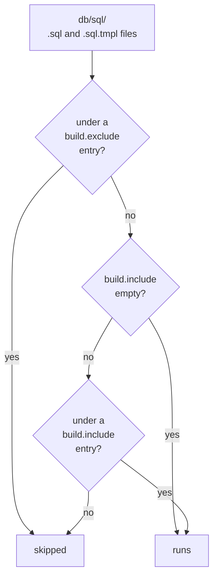

# Organizing SQL Files


Name your folders and files so the order they sort in is the order they run in.

`noorm run build` finds every `.sql` and `.sql.tmpl` file under `paths.sql` (`./db/sql` after `noorm init`), sorts the paths as text, and runs them in that order. Every other file is ignored.

```
db/sql/
├── 01_tables/
│   ├── 01_party.sql            # runs 1st
│   ├── 02_sales_order.sql      # 2nd
│   ├── 03_product.sql          # 3rd
│   ├── 04_order_line.sql       # 4th
│   └── 05_app_setting.sql      # 5th
├── 02_views/
│   └── 01_open_orders.sql      # 6th
├── 03_functions/
│   └── 01_place_order.sql      # 7th
├── 09_seeds/
│   ├── products.yml            # data file, never runs
│   ├── 01_products.sql.tmpl    # 8th
│   └── 02_gateway.sql.tmpl     # 9th
└── archive/                    # excluded in settings, never runs
```

`09_seeds` leaves `04` to `08` free for groups you add later, such as procedures and triggers.


## How are files ordered?


noorm compares whole paths as text, one character at a time. The folder comes first in the path, so a folder prefix orders the folders and a file prefix orders the files inside one.

| Names, in the order you want | Run order | Why |
|---|---|---|
| `tables/`, `views/`, `functions/` | `functions/`, `tables/`, `views/` | `f` sorts before `t` before `v` |
| `2_party.sql`, `10_order.sql` | `10_order.sql`, `2_party.sql` | `1` sorts before `2` as text |
| `accounts.sql`, `Users.sql` | `Users.sql`, `accounts.sql` | every capital letter sorts before every lowercase one |

Pad the prefixes in a folder to one width: `01_` through `99_`, or `001_` past that. Name each file for the object it creates.


## Which files take part in a build?


A file runs unless an exclude entry covers it, or an include list exists and does not cover it:



An entry is a folder or one file, relative to `paths.sql`. Both keys filter and neither reorders. `exclude` wins over `include`.

```yaml
# .noorm/settings.yml
build:
    exclude:
        - archive
```


## Can a config change which files run?


A rule adds include or exclude entries when the active config matches. Rules run in order, every key in `match` must hold, and a later rule overrides an earlier one for the same entry.

Suppose test configs have no `PAYMENT_GATEWAY_KEY`. A template that reads a missing secret throws, so this rule keeps the gateway seed out of test builds:

```yaml
# .noorm/settings.yml
rules:
    - description: Test configs have no gateway key
      match:
          isTest: true
      exclude:
          - 09_seeds/02_gateway.sql.tmpl
```

| `match` key | Holds when |
|---|---|
| `name` | the config's name equals the value |
| `isTest` | the config's `isTest` flag equals the value |
| `type` | the config's type is `local` or `remote` |
| `protected` | `true` when the config's `user` role is below `admin` |

Matching rules are merged into `build.include` and `build.exclude` before the build filters its files. `noorm run build --dry-run --config test` lists the files that config would run, and writes them rendered to `tmp/`.


## Can I group by domain instead of type?


Yes. Number the domain folders by dependency (`01_parties/`, `02_sales/`, `03_billing/`), and number `01_tables/` and `02_views/` inside each one. A view in `01_parties` runs before any `02_sales` table exists, so objects that reach across domains are easier to order by type.


## What bites


| Mistake or symptom | Cause | Fix |
|---|---|---|
| The build reports `success` with `filesRun=0`, or a file you excluded ran | An entry matched nothing. `sql/01_tables`, `./01_tables`, and `01_tables/` all match nothing, because entries start inside `paths.sql` | Write `01_tables`. The build warns `Ignored 1 build.include entry that matched no files` and still exits `0`, so read the warnings in CI |
| A test build runs the seeds but creates no tables | A matching rule's `include` joins an empty `build.include`, so the list is no longer empty and only the rule's folders run | List every folder in `build.include`, and use rule `exclude` for the conditional part |
| `run dir` runs a file that `build.exclude` lists | Only `run build` applies include, exclude, and rules | Name the files you want, or use `run build` |


## Next


- [Execution](/guide/sql-files/execution): what a build skips, runs, and records
- [Templates](/guide/sql-files/templates): generate seeds from data files
- [Concepts](/getting-started/concepts): how `db/sql/` and `db/changes/` fit together
- [Settings reference](/dev/settings): every key in `settings.yml`
