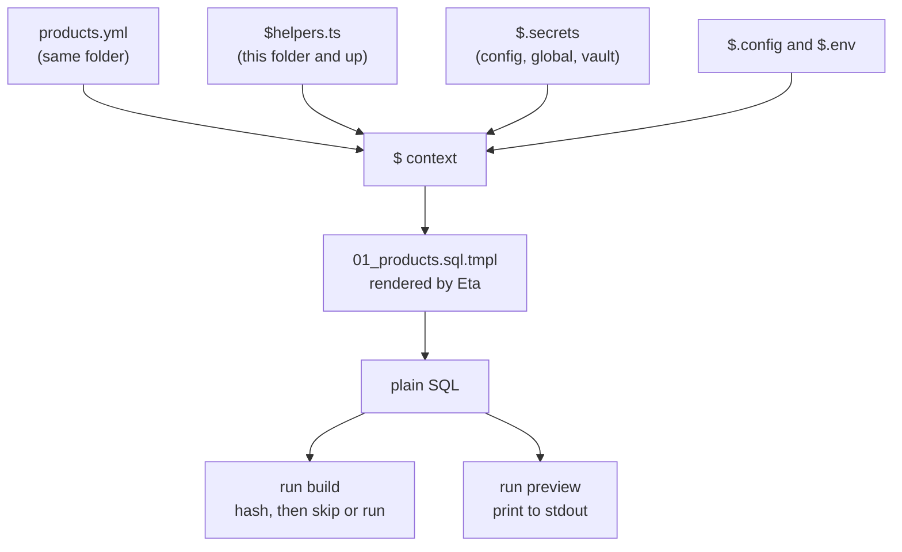

# SQL Templates


Generate repeated SQL from data files, config, and secrets instead of writing every statement by hand.

A data file sits beside the template, and its name becomes a variable:

```yaml
# db/sql/09_seeds/products.yml
- { sku: HW-DONGLE, name: USB security key, list_price: 49.00 }
- { sku: SW-SEAT,   name: "Desktop seat, yearly", list_price: 89.00 }
```

```sql
-- db/sql/09_seeds/01_products.sql.tmpl
-- 
INSERT INTO product (sku, name, list_price)
VALUES (, , );
-- 
```

```bash
noorm run preview db/sql/09_seeds/01_products.sql.tmpl
```

```
INSERT INTO product (sku, name, list_price)
VALUES ('HW-DONGLE', 'USB security key', 49);
INSERT INTO product (sku, name, list_price)
VALUES ('SW-SEAT', 'Desktop seat, yearly', 89);
```

Four inputs meet in one `$` object. The rendered SQL is what `run build` hashes and runs, and what `run preview` prints:




## What does the syntax look like?


Templates use [Eta](https://eta.js.org/) with delimiters that do not collide with SQL. Output is never HTML-escaped.

| Syntax | Does | Example |
|---|---|---|
| `` | runs JavaScript | `` |
| `` | writes a value into the SQL | `` |
| `-- ` | a tag alone on a line, behind a SQL comment | `-- ` |
| `$` | the context object | `$.products` |

noorm removes the `-- ` and the line break from a line that holds only `-- ` and a tag, before Eta runs. The directive prints nothing, and the file stays valid SQL for your editor and linter. The result loses its leading and trailing blank lines.


## What can a template read?


| Name | Holds |
|---|---|
| `$.<file>` | each data file in the template's folder, under its camelCased name |
| `$.<export>` | each export of the `$helpers` files from the template's folder up |
| `$.config` | the active config: `name`, `type`, `isTest`, `connection`, `access` |
| `$.secrets` | this config's secrets, merged with global and vault ones. A missing key throws |
| `$.globalSecrets` | global secrets only. A missing key reads as `undefined` |
| `$.env` | `process.env` |
| `$.quote`, `$.escape`, `$.json`, `$.uuid`, `$.now`, `$.include` | the built-ins |

When names collide, the last wins: helpers, data files, then `$.config`, `$.secrets`, `$.globalSecrets`, `$.env`, and the built-ins. A data file named `config.*` is the exception: it replaces `$.config`.


## Where does data come from?


noorm loads the data files in the template's own folder. It skips subfolders, dotfiles, `.sql` files, `$helpers` files, and other `.tmpl` files. `seed_data.yml` becomes `$.seedData`, and `my-config.json` becomes `$.myConfig`.

| Extension | `$.<file>` holds |
|---|---|
| `.json`, `.json5` | the parsed value. JSON5 allows comments and trailing commas |
| `.yaml`, `.yml` | the parsed value |
| `.csv` | an array of row objects keyed by the header row. Every value is a string |
| `.dt`, `.dtz` | an array of row objects from a [data transfer](/guide/database/transfer) export. `.dtzx` is not supported |
| `.js`, `.mjs`, `.ts` | the module's default export, or its exports |

A `.js`, `.mjs`, or `.ts` file runs code, so noorm loads it only when the template names its key, as `$.buildRows` or `$['buildRows']`.


## How do helpers work?


A `$helpers.ts`, `$helpers.js`, or `$helpers.mjs` file exports functions and values for every template in its folder and below. The nearest file wins a name:

```
db/sql/
├── $helpers.ts                  # price() for every template
└── 09_seeds/
    ├── $helpers.ts              # its own price() wins here
    ├── products.yml
    └── 01_products.sql.tmpl     # sees both files
```

```ts
// db/sql/$helpers.ts
export function price(amount: number): string {

    return amount.toFixed(2);
}
```

`` now writes `49.00`. The search for helper files stops at the project root, not at `paths.sql`.

`noorm run inspect` lists what a template can read, without rendering it:

```bash
noorm run inspect db/sql/09_seeds/01_products.sql.tmpl
```

```
Template: db/sql/09_seeds/01_products.sql.tmpl
Config:   dev

Data Files:
  $.products  Array [2]

Helpers ($helpers):
  $.price  Function

Built-ins: include, escape, quote, json, now, uuid
Secrets: 1 resolved, 0 global
```


## What do the built-ins do?


| Call | Returns |
|---|---|
| `$.quote(v)` | `v` as a SQL string literal: single quotes around it, quotes inside doubled. `null` gives `NULL`, `undefined` throws, and a number is quoted too (`'49'`) |
| `$.escape(s)` | `s` with single quotes doubled, and no surrounding quotes |
| `$.json(v)` | `JSON.stringify(v)` |
| `$.uuid()` | a UUID v4 |
| `$.now()` | the current time as an ISO 8601 string |
| `await $.include(path)` | the file at `path`, relative to the template. A `.sql` file is inserted as is. A `.sql.tmpl` file is rendered with the same context first. The path cannot leave the project root |


## How do secrets and config reach a template?


Read them off `$`. This template writes a secret and picks a URL by config name:

```sql
-- db/sql/09_seeds/02_gateway.sql.tmpl
INSERT INTO app_setting (name, value) VALUES
    ('payment_gateway_key', ),
    ('payment_gateway_url', );
```

On a config named `dev` with the secret set, `run preview` prints:

```
INSERT INTO app_setting (name, value) VALUES
    ('payment_gateway_key', 'gw_live_123'),
    ('payment_gateway_url', 'https://sandbox.gateway.example');
```

[Secrets](/guide/environments/secrets#which-value-does-a-template-get) explains which of the three tiers supplies `$.secrets.PAYMENT_GATEWAY_KEY`. `$.config.isTest` and `$.config.connection.database` are the other keys templates branch on.


## How do I check what a template renders?


`noorm run preview <file>` prints the rendered SQL to stdout, so `> rendered.sql` works. `--json` returns `{ filepath, sql, durationMs }`. Both `preview` and `inspect` take `--config` and `--json`, and a `viewer` role cannot use either.

A change folder renders `.sql.tmpl` files the same way. [Changes](/guide/changes/overview) covers where they go.

::: warning Helpers and scripts run as you
A `$helpers` file runs whenever a template at or below its folder renders, and a referenced `.js` or `.ts` data file runs too. Both execute in the noorm process with your environment, including during `preview`. Read them before you run a template from a branch you did not write.
:::


## What bites


| Mistake or symptom | Cause | Fix |
|---|---|---|
| `49.00` renders as `49` | YAML and JSON parse it as the number 49 | Quote it in the data file (`"49.00"`), or format it in a helper such as `$.price()` |
| `Secret "PAYMENT_GATEWAY_KEY" not found (searched: config-local, global-local, vault)` | No tier holds the key. `$.secrets.KEY ?? fallback` cannot catch it, because the read throws first | Set the secret, or test first: `'PAYMENT_GATEWAY_KEY' in $.secrets ? $.quote($.secrets.PAYMENT_GATEWAY_KEY) : 'NULL'` |
| `sqlQuote() received undefined` | A field the row lacks, a typo, or an unset `$.globalSecrets` key | Fix the name. Pass `null` when you mean SQL `NULL` |
| `$.config.name` is undefined, or holds a file's fields | A `config.yml` beside the template replaced `$.config` | Rename the data file |
| `[object Promise]` in the SQL | `$.include()` is async | Write `` |
| A string with `'` breaks the statement | The value went in with `` alone, which writes raw text | Wrap every string from a data file in `$.quote()` |
| One of two data files is ignored | `user_roles.json`, `user-roles.yaml`, and `user.roles.csv` all become `$.userRoles`, and the last one loaded wins | Give each file a distinct base name |
| A `.ts` data file never loads, even in `preview` | The template does not name its key | Write `$.key` in the template |
| A `$helpers.ts` fails to load on Node | Node older than 22.13 cannot strip TypeScript types | Use `$helpers.js`. `run inspect` lists the failure under `Helper Errors:` |


## Next


- [Secrets](/guide/environments/secrets): set the values a template reads
- [Organization](/guide/sql-files/organization): where templates sit in the build order
- [Execution](/guide/sql-files/execution): how a rendered template is hashed and skipped
- [Data transfer](/guide/database/transfer): export `.dt` files to use as seed data
