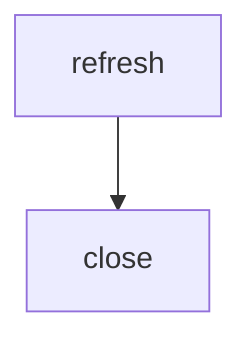

# SQL pipelines

A SQL pipeline runs a named operational workflow against one configured database. Use one for business operations such as closing a reporting period, where SQL steps have explicit dependencies and transaction boundaries. Each invocation runs the declarations fresh and records its own history.

For example, create `db/pipelines/close-period/pipeline.yml`:

```yaml
description: Close a reporting period
transaction: step
concurrency: 4
singleRun: true
inputs:
  period:
    type: string
    description: Reporting period
    required: true
  dryAccounting:
    type: boolean
    description: Mark the close as a test
    default: false
  batchSize:
    type: integer
    description: Maximum batch size
    default: 0
  region:
    type: string
    description: Region to close
    choices: [north, south]
steps:
  - id: refresh
    sql: refresh.sql.tmpl
    needs: []
  - id: close
    sql: close.sql.tmpl
    needs: [refresh]
```

Create the referenced SQL files in the same folder. For a database with an existing `period_close` table, `close.sql.tmpl` could contain:

```sql
-- 
INSERT INTO period_close (period, region)
VALUES (, );
-- 
INSERT INTO period_close (period)
VALUES ();
-- 
```

`refresh.sql.tmpl` can contain the SQL needed to prepare that table's data. Run the workflow and inspect its history:

```bash
noorm pipeline run close-period --period 2026-10 --dry-accounting=false --batch-size 0
noorm pipeline history close-period --limit 20
```

To operate the same definitions interactively, run `noorm ui` and press `p` on Home. [Pipelines in the terminal](/guide/pipeline-terminal) covers native review, explicit input presence, confirmation, results, and history lookup.


## Definitions and dependencies

Place each definition at `paths.pipelines/<slug>/pipeline.yml`. The default path is `./db/pipelines`, relative to the project root. Slugs are single safe path segments, independent of CLI command names; `history`, `show`, and `run` are valid names. Step paths are relative to the pipeline folder, must remain inside it, and end in `.sql` or `.sql.tmpl`.

Step IDs are nonempty and unique by exact spelling within a pipeline: `refresh`, `Refresh`, and `"refresh "` are distinct, and Unicode is preserved. Quote YAML labels when whitespace matters, and refer to dependencies with the same exact spelling. IDs are limited to 255 UTF-16 code units; declared relative SQL paths are nonempty and limited to 500 UTF-16 code units. These portable bounds are checked before execution.

Labels and paths must be well-formed Unicode without U+0000, which PostgreSQL text cannot store. Whitespace-only IDs are rejected; significant leading or trailing whitespace is retained.

The `needs` declarations let `close` start only after `refresh` succeeds:



When no step has `needs`, declarations run serially in file order. If any step has `needs`, every step must declare it; use `needs: []` for roots. Dependencies must exist and cannot form a cycle. Eligible steps are selected in declaration order. Numeric step IDs in history identify declarations, not execution order. Multiple declarations may reference the same file; each executes independently on every invocation. Checksums record provenance and do not skip work.

## Inputs and templates

Input names use lower camel case and become kebab-case CLI flags. Types are `string`, `number`, `integer`, `boolean`, `object`, and `array`. Each declaration requires a description; `required`, `default`, and scalar `choices` are optional. Values must match the declared type. Objects and arrays contain JSON values, without nested schemas. Optional missing values stay absent; check membership before reading them, as in the example. `false`, `0`, and an empty string are supplied values.

CLI `--input` accepts a JSON object. Generated flags override its properties, and defaults fill remaining gaps. SDK input is already typed and the SDK never prompts. The CLI prompts for missing required values only on eligible interactive terminals. See the [CLI reference](/cli/pipeline) for flags and prompt restrictions.

Every step and included template receives the same reserved `$.input`, even if an adjacent data file or helper has that name. Eta uses `` for JavaScript and `` for output. Use `$.quote($.input.period)` for a dialect-aware SQL literal; interpolation is not parameter binding. `$.escape` is not available in pipelines and throws in every render, because no escaping inside an author-written quote is correct under every MySQL session mode. Write `$.quote(value)` where the SQL needs a literal, with no quotes of your own around it. See [SQL templates](/guide/sql-files/templates#how-does-quoting-differ-in-pipelines) for what each dialect emits. Adjacent CSV, JSON, and YAML data files and `$.include` remain available as described in [SQL templates](/guide/sql-files/templates). There is no automatic database import. All steps render once before workflow SQL starts, so a template cannot read the effects of an earlier step.

## Transactions and execution

| `transaction` | Boundary | Failure behavior |
|---|---|---|
| `pipeline` | One pinned transaction for the workflow | A confirmed rollback rolls back earlier successful steps. Execution is serial. |
| `step` (default) | One transaction per step | Confirmed earlier commits survive a later failure. |
| `none` | No added workflow transaction | A failing step can have effects whose outcome is unknown. |

The manifest concurrency defaults to 4. Graphs in `step` or `none` mode use at most the smaller of that value and the configured pool maximum (10 when unset). Linear workflows, `pipeline` transactions, and SQLite execute at concurrency 1. On failure or interruption, noorm stops scheduling new steps and waits for in-flight work; an abort does not promise server-side cancellation. Managed modes reject recognizable transaction controls before any step runs, and MySQL also rejects statements that would break the managed boundary. A PostgreSQL `BEGIN ATOMIC` function body is rejected too, since its `END` cannot be told from a transaction end. Arbitrary SQL syntax errors can still fail during execution.

The preflight is a best-effort scan, so noorm also checks at runtime. After each step it verifies that the managed transaction is still the one it opened. A step that commits or rolls back that transaction, through SQL the scan missed, fails with `TRANSACTION_ESCAPED` and an `unknown` transaction outcome. If noorm cannot verify ownership after a step or during cleanup, it reports `OWNERSHIP_UNVERIFIED` and keeps the outcome `unknown`. See [pipeline recovery](./pipeline-recovery.md#errors-that-leave-an-unknown-outcome).

The ownership check needs `pg_current_xact_id()` on PostgreSQL 13 or later and `CURRENT_TRANSACTION_ID()` on SQL Server 2016 or later. MySQL and SQLite use savepoints. Below those versions the marker query fails when the transaction opens, so the run fails with phase `execute` before any workflow SQL.

With `none`, recognized explicit transaction or autocommit controls are allowed, but noorm cannot certify their commits from successful SQL execution alone. Affected steps and the run may have an unknown transaction outcome even when execution succeeds; earlier independent autocommits remain recorded. Linear steps share a session, whereas graph steps cannot rely on one. An open author transaction is not committed by noorm and may be rolled back during session cleanup. Controls hidden in routines or dynamic SQL are outside the bounded recognition and remain the author's responsibility.

Workflow SQL uses an invocation-owned pool, separate from the caller's admission and history pool. Noorm closes that pool after in-flight work settles. File-backed SQLite uses an owned handle; SQLite `:memory:` uses the existing pinned handle. If noorm cannot establish that the in-memory handle is safe after a cleanup failure, it closes the database and disconnects the SDK context. An ordinary confirmed rollback does not do that.

## History, safety, and recovery

Each admitted run has independent pipeline history and declaration-ordered step records. It does not write generic change or execution history. Noorm stores checksums rather than raw input or rendered SQL. History can lag while workflow activity is still settling. Execution status and transaction outcome are separate: a successful step can later be rolled back, and a lost commit or rollback acknowledgement can leave an unknown outcome. Results retain the primary error and secondary cleanup errors.

`singleRun` defaults to `false`. When enabled, a run claims a guard for its config and slug. A concurrent protected invocation reports busy without creating history. There is no TTL, automatic steal, or force-unlock API. When activity cannot be proven settled, the guard remains held. An administrator must follow [pipeline recovery](./pipeline-recovery.md) before clearing an abandoned guard.

Run and dry run both enforce `run:dir` policy. Dry run validates and renders the workflow without admission, history, or workflow SQL, but trusted template helpers can have side effects. Pipelines do not provide a scheduler service, retries, automatic resume, domain idempotency, query rowsets, or new MCP commands. The native terminal screens operate file-owned definitions; they do not edit YAML or graphs or stream step progress. Design business SQL for repeated invocation.

## SDK

A connected context exposes the same workflow and config-scoped history:

```typescript
const result = await ctx.noorm.pipelines.run('close-period', {
    input: { period: '2026-10', dryAccounting: false, batchSize: 0 },
})
const runs = await ctx.noorm.pipelines.history('close-period', { limit: 20 })
const detail = result.runId === null ? null : await ctx.noorm.pipelines.getRun(result.runId)
```

History defaults to 20 and accepts integer limits from 1 to 100. Run IDs must be positive safe integers; a run belonging to another config returns `null`. See the [SDK reference](/reference/sdk#ctx-noorm-pipelines) for results and errors.
