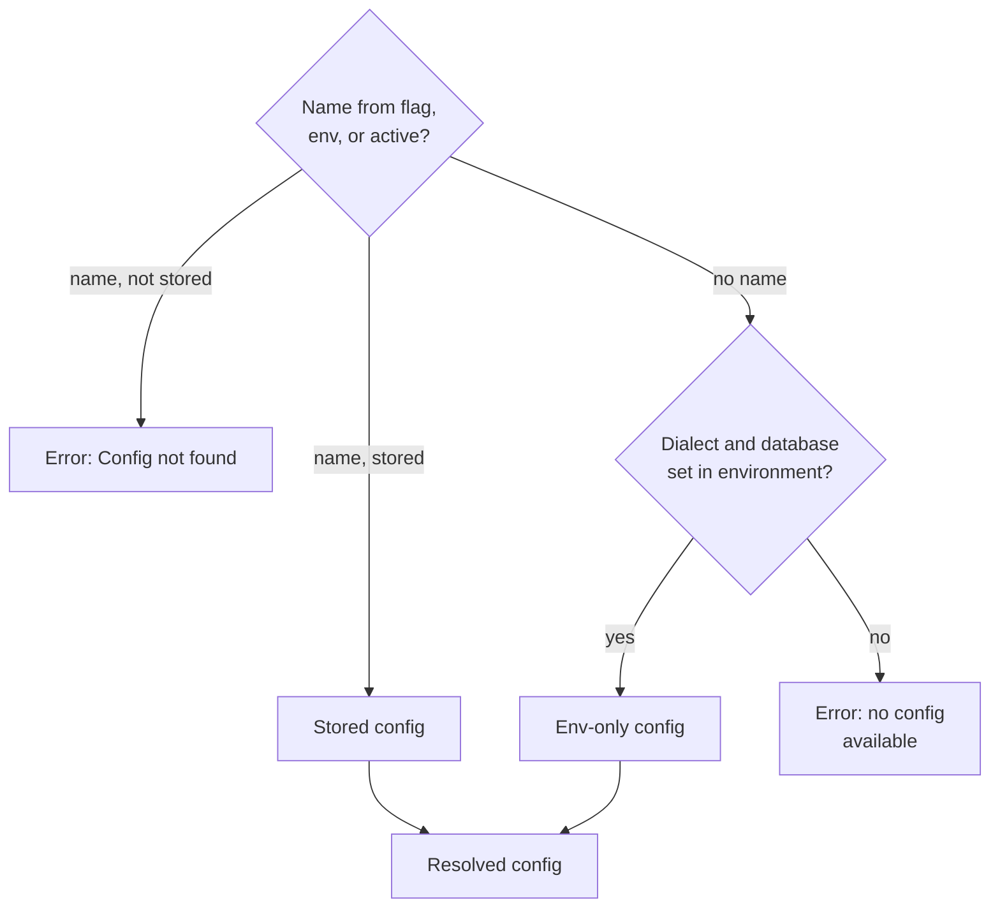
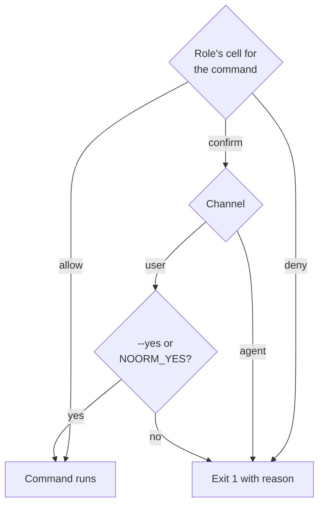
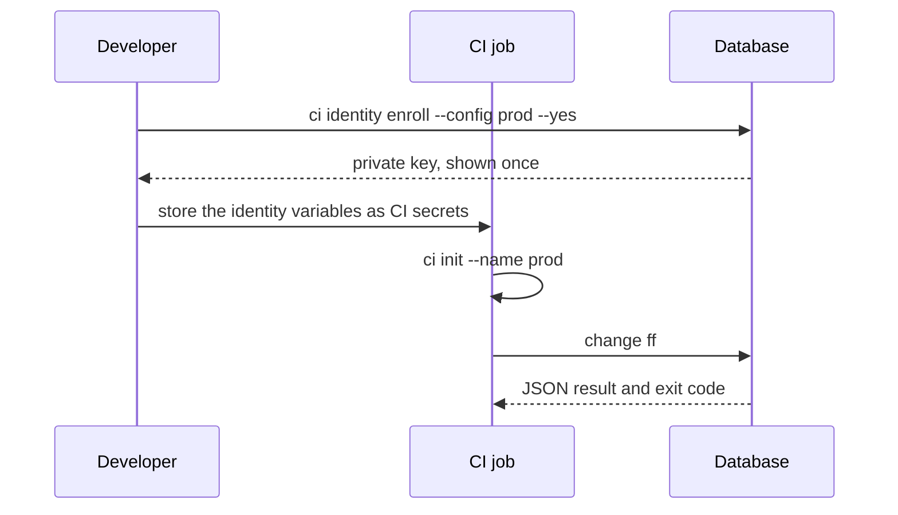

# CLI Reference


Run noorm from a script or CI job, read one JSON result, and branch on the exit code.

With one pending change, `change ff` writes a single JSON document to stdout and its log to stderr. The exit code matches `success`:

```bash
noorm change ff --json > ff.json 2> ff.log; echo "exit $?"
jq -c '{success, status, executed, failed}' ff.json
```

```text
exit 0
{"success":true,"status":"success","executed":1,"failed":0}
```

`ui` and `sql repl` open the TUI, and `settings edit` and `settings secret` need a terminal. `init` needs a terminal or `--yes`. Every other command runs headless.


## How a command runs


### Where do flags go?


Only `-c`/`--cwd` is read before the subcommand. Every other flag goes after it.

| Position | Flags | Effect |
|---|---|---|
| Before the subcommand | `-c <path>`, `--cwd <path>`, `--cwd=<path>` | Run in `<path>` instead of walking up to the nearest `.noorm/`. A path that is not a directory exits 2 |
| Anywhere | `--help`, `-h` | Print help |
| As the only argument | `--version`, `-v` | Print the version |
| After the subcommand | all other flags | Per-command flags |

Any other flag before the subcommand exits 2 and names where to move it.

```bash
noorm -c packages/db run build     # --cwd: build inside packages/db
noorm run build -c staging         # --config: build against the staging config
```

These flags recur across commands. Each command section lists the ones it accepts:

| Flag | Alias | Effect |
|---|---|---|
| `--config <name>` | `-c` | Use this stored config instead of the active one |
| `--json` | | Print one JSON document on stdout |
| `--dry-run` | | Preview without writing. `run` and `change` commands render to `tmp/` |
| `--force` | `-f` | `run` and `change`: skip the checksum check. `init`, `ci init`, `settings init`, `config import`, `vault cp`, `identity init`: overwrite what exists |
| `--yes` | `-y` | Confirm a command the config's role marks `confirm`. `NOORM_YES` does the same |

Run `noorm <command> --help` for a command's flags and an EXAMPLES block. Shell completion is [`complete`](#complete).


### Which database does a command use?


A command resolves one config by name, or builds one from the environment when no name resolves:



The resolved config merges three layers, and a later layer wins. Then a `settings.yml` stage named like the config, if it has `protected: true`, caps the config's access:

1. Built-in defaults
2. The stored config
3. `NOORM_*` environment variables

A `NOORM_CONNECTION_HOST` therefore overrides the host of a stored config. CLI flags select the config but never change its connection fields.


### Environment-only mode


Set `NOORM_CONNECTION_DIALECT` and `NOORM_CONNECTION_DATABASE` and skip stored configs. The config is named `__env__`. Host defaults to `localhost`.

```bash
export NOORM_CONNECTION_DIALECT=postgres
export NOORM_CONNECTION_HOST=db.example.com
export NOORM_CONNECTION_DATABASE=app
export NOORM_CONNECTION_USER=deploy
export NOORM_CONNECTION_PASSWORD=$DB_PASSWORD
noorm run build
```

Env-only mode applies only when no name resolves. A runner with an active stored config, such as one set up by `ci init`, uses that config and layers the variables over it. A clean checkout has no `state.enc`, so env-only mode needs no identity.


### What does a command print?


| Stream | Carries |
|---|---|
| stdout | The result: summary text, or with `--json` exactly one JSON document |
| stderr | Progress lines, warnings, log events (JSON lines under `--json`), and error diagnostics |
| exit code | The outcome. See [Exit codes](#exit-codes) |

Every `--json` payload is an object with a boolean `success`. Three rules hold for all commands:

1. `jq -e '.success'` works on the `--json` output of every command except `dev test-helpers`, which prints a text report first.
2. `success` is `true` if and only if the exit code is `0`. A partial result is `success: false` with `"status": "partial"` and exit `3`.
3. A failed payload carries `error` as a message string, never a stack trace.

```json
{"success":false,"error":"Template not found: db/sql/nope.sql.tmpl"}
```

A command with nothing to report still writes a result: `change list` on a project with no changes prints `No changes found.`, or `{"success":true,"changes":[],"pending":0}` under `--json`. Lists sit under a named key (`changes`, `tables`, `configs`), never at the top level.


## Exit codes


Defined in `src/cli/_exit.ts`. The split between `1` and `3` matters most in a pipeline.

| Code | Name | Meaning | Remedy |
|---|---|---|---|
| `0` | success | Everything asked for happened | Continue |
| `1` | failure | The operation ran and no unit of work succeeded, or it failed before starting: connection error, policy denial, missing `--yes`, unreadable state | Read `error` or stderr, fix the cause, retry |
| `2` | usage | A usage error the command checks for itself: an invalid flag value, a named target that does not exist (directory, glob, config, change, secret or vault key), a TTY-only command run without a terminal, or `lock force` with nothing to release. Nothing was attempted. A missing required flag (reported by the argument parser), `run file` on a missing file, and `secret set` on a missing config exit `1` | Fix the invocation. Retrying unchanged fails the same way |
| `3` | partial | Some units succeeded and some failed. The target is in a mixed state | Do not retry blindly. Inspect first with `change list`, `change history-detail`, or `vault list`, then repair or revert |

Commands that can exit `3`:

- `run build`, `run dir`, `run exec`, `run files`
- `change ff`, `change next`, `change rewind`
- `db transfer` (database to database), `ci secrets`, `vault propagate`
- `dev test-helpers`, `dev test-workers`

Policy denials exit `1`. They have no dedicated code.


## Environment variables


Names after the `NOORM_` prefix nest on underscores: `NOORM_CONNECTION_HOST` sets `connection.host`. Numeric values become numbers, `true` and `false` become booleans, and values whose name contains `password` stay strings. Other unreserved `NOORM_*` names overlay the matching key in `settings.yml`.

| Variable | Effect |
|---|---|
| `NOORM_CONNECTION_DIALECT` | `postgres`, `mysql`, `sqlite`, or `mssql`. With `NOORM_CONNECTION_DATABASE`, the minimum for env-only mode |
| `NOORM_CONNECTION_DATABASE` | Database name |
| `NOORM_CONNECTION_HOST`, `_PORT`, `_USER`, `_PASSWORD`, `_FILENAME` | Server, credentials, and the SQLite file |
| `NOORM_CONFIG` | Stored config to use. `--config` wins |
| `NOORM_YES` | Any value except empty, `0`, or `false` (case-insensitive). Confirms every `confirm` cell on the `user` channel, like `--yes`. `identity init --force` and `sql clear` read only the literal flag |
| `NOORM_CHANNEL` | `user` or `agent`. Forces the access channel. Other values are ignored |
| `NOORM_IDENTITY_PRIVATE_KEY` | X25519 private key, hex PKCS8 DER, 96 characters |
| `NOORM_IDENTITY_NAME`, `NOORM_IDENTITY_EMAIL` | Display name and email. All three `NOORM_IDENTITY_*` variables must be valid or the CLI ignores them |
| `NOORM_IDENTITY` | Audit identity as `Name <email>`. Used for change and build records when no `NOORM_IDENTITY_*` set is present and the config has no `identity` override. Falls back to the git user, then the system user |
| `NOORM_CI_CONFIG_NAME` | Default config name for `ci init`. `--name` wins, then `ci` |
| `NOORM_PATHS_SQL`, `NOORM_PATHS_CHANGES` | Override `paths.sql` and `paths.changes`. Defaults are `./db/sql` and `./db/changes` |
| `NOORM_INSECURE` | Same as `noorm update --insecure` |
| `NOORM_DEBUG` | Truthy enables event tracing and connection debug output |
| `NOORM_DEV` | `true` raises the default log level from `info` to `verbose` |
| `NOORM_AGENT` | Marks the session as an agent. See [Which channel am I on?](#which-channel-am-i-on) |
| `NOORM_HEADLESS`, `NOORM_LOGGER_DEBUG`, `NOORM_JSON` | Reserved. Excluded from config nesting. The logger reads the first two. Use `--json` for JSON output |


## Access roles


Each config carries `access: { user, agent }`. The `user` role governs a human at the CLI, TUI, or SDK. The `agent` role governs an AI agent over MCP or the CLI. Roles are `viewer`, `operator`, and `admin`, and `agent` can also be `false`, which hides the config from agents. A config with no explicit access gets `{ user: admin, agent: viewer }`. A legacy `protected: true` maps to `{ user: operator, agent: viewer }`, and a stage with `protected: true` caps its configs at that pair.


### Which channel am I on?


noorm resolves the channel from who is driving, not from which binary ran:

1. `NOORM_CHANNEL`, when set to exactly `user` or `agent`.
2. A non-empty harness marker variable: `CLAUDECODE`, `CLAUDE_CODE`, `CLAUDE_CODE_ENTRYPOINT` (Claude Code), `CODEX_SANDBOX` (OpenAI Codex), `CURSOR_AGENT` (Cursor), `GEMINI_CLI` (Gemini CLI), `AI_AGENT` or `NOORM_AGENT` (any other agent). The channel is `agent`.
3. Otherwise `user`.

`noorm mcp serve` is always `agent`. `noorm info` reports the detected harness and the marker variables that triggered it, which is the first place to look when a denial has no visible cause.


### What happens when a command is gated?


Each command maps to a permission. The config's role for the channel picks a cell: `allow`, `deny`, or `confirm`.



On the `agent` channel a `confirm` cell is a deny, so `--yes` never unlocks it. There is no `--force` override for a denied cell: `--force` only skips checksums. The TUI asks you to type `yes-<config-name>` for the same cells.

| Permission | Commands | viewer | operator | admin |
|---|---|---|---|---|
| `explore`, `sql:read` | `db explore`, `sql query` with `SELECT`, or `SHOW` and `DESCRIBE` on MySQL | allow | allow | allow |
| `sql:write` | `sql query` with `INSERT`, `UPDATE`, `DELETE`, `MERGE` | deny | allow | allow |
| `sql:ddl` | `sql query` with any other statement | deny | deny | allow |
| `change:run`, `change:revert` | `change run`, `ff`, `next`, `revert`, `rewind` | deny | confirm | allow |
| `run:build`, `run:file`, `run:dir` | `run build`, `file`, `dir`, `exec`, `files`, and `inspect`, `preview` against a resolved config | deny | confirm | allow |
| `db:create`, `db:reset` | `db create`, `db reset`, `db transfer --to`, `db transfer --import` | deny | confirm | allow |
| `db:truncate` | `db truncate` | deny | confirm | confirm |
| `db:teardown` | `db teardown` | deny | deny | confirm |
| `db:destroy` | `db drop` | deny | deny | confirm |
| `change:rm` | `change rm` | deny | confirm | confirm |
| `config:rm`, `config:write` | `config rm`, `config import --force` | deny | confirm | confirm |
| `vault:read`, `secret:read` | `vault list`, `secret list`, `config export` | deny | allow | allow |
| `vault:write`, `secret:write` | `vault init`, `set`, `rm`, `cp`, and `secret set`, `rm` | deny | confirm | allow |
| `vault:propagate` | `vault propagate`, `ci identity enroll` | deny | confirm | confirm |
| `transfer:plan` | `db transfer --to --dry-run` | deny | allow | allow |
| `lock:force` | `lock force` | deny | confirm | confirm |

Commands not listed have no role gate.

`sql query` classifies the statement, not a flag. Multiple statements take the highest class (`read` < `write` < `ddl`), `EXPLAIN` takes the class of what it wraps, and anything unparseable or unrecognized is `ddl`.

Roles catch mistakes such as a teardown against the wrong database. They do not stop someone who holds the credentials and connects with another client.


## Commands


These commands never connect to a database:

- `identity`, `settings`, `secret`, `version`, `mcp init`
- `ci init`, `ci secrets`, `ci identity new`
- `change add`, `change edit`, `change rm`
- `sql history`, `sql clear`
- `config`, except `use` and `validate`

`run inspect` and `run preview` try one short connection to read vault secrets.


### Project


#### `init`


Create `.noorm/`, `settings.yml`, an encrypted `state.enc`, and a `# noorm` block in `.gitignore`. On the default layout, also create `db/sql/`, `db/changes/`, `db/AGENTS.md`, and `db/CLAUDE.md`. Create an identity first when none exists.

```
noorm init [--force] [--yes] [--here]
```

| Flag | Effect |
|---|---|
| `--force`, `-f` | Reinitialize a directory that already has `.noorm/`. Without it, exit 1. Existing `paths` in `settings.yml` are kept, so a project on `./sql` and `./changes` gets no `db/` folder. Existing `db/AGENTS.md` and `db/CLAUDE.md` are not overwritten |
| `--yes`, `-y` | Skip prompts. Needs an identity at `~/.noorm/identity.{key,pub,json}`, else exit 2 |
| `--here` | Initialize in the directory you launched from, ignoring a parent `.noorm/` |

```bash
noorm identity init --name "CI Bot" --email ci@example.com
noorm init --yes
```

Without a terminal and without `--yes` or `NOORM_YES`, `init` exits 2. Ephemeral runners use [`ci init`](#ci-init) instead. See [`noorm init`](/cli/init).


#### `ui`


Open the TUI at the home screen. Takes no flags.

```bash
noorm ui
```


### Config


Local state in `.noorm/state/state.enc`. `config use` also registers your identity in that config's database when it can connect.


#### `config list`


List stored configs.

```bash
noorm config list --json
```

JSON: `configs[]` with `name`, `type`, `isTest`, `access`, `isActive`, `dialect`, `database`. Configs whose `access.agent` is `false` are omitted on the `agent` channel.


#### `config use <name>`


Set the active config. An unknown name exits 2. JSON: `activeConfig`.

```bash
noorm config use staging
```


#### `config add`


Wizard only. Exits 1 with a pointer to `noorm ui` and `config import`.


#### `config edit [name]`


Wizard only. Exits 1 with a pointer to `noorm ui` and `config import <file> --force --yes`.


#### `config rm <name>`


Delete a stored config.

```bash
noorm config rm staging --yes
```

| Condition | Result |
|---|---|
| No `--yes` and no `NOORM_YES` | Exit 1. There is no confirmation prompt |
| Unknown name | Exit 2 |
| Config linked to a locked stage | Exit 1 until the stage is unlocked |
| Role denies `config:rm` | Exit 1 |

JSON: `name`, `deleted`.


#### `config cp <src> <dest>`


Copy a config under a new name. Unknown `<src>` exits 2. An existing `<dest>` exits 1, and there is no `--force`. JSON: `src`, `dest`.

```bash
noorm config cp dev staging
```


#### `config export <name>`


Write a config as JSON, password included.

```bash
noorm config export dev > dev.json
noorm config export dev --output ./dev.json
```

| Flag | Effect |
|---|---|
| `--output`, `-o` | Write to a file with mode `0600` instead of stdout |

Plain output is the bare config object that `config import` reads, so redirecting round-trips. `--json` wraps it as `{success, name, config}`, which `config import` does not accept. Gated by `secret:read`.


#### `config import <path>`


Create a config from JSON. Unreadable or invalid JSON, or a missing `name` or `connection`, exits 2.

```bash
noorm config import ./staging.json
noorm config import ./staging.json --force --yes
```

| Flag | Effect |
|---|---|
| `--force`, `-f` | Overwrite an existing config of the same name. Without it, exit 1 |
| `--yes`, `-y` | Confirm the overwrite. An overwrite rewrites `access`, so it is a `config:write` confirm cell |

JSON: `name`, `overwritten`.


#### `config validate <name>`


Test that a config connects.

```bash
noorm config validate prod --json
```

Exit 0 when valid, 1 when a check fails, 2 for an unknown name. JSON: `config`, `valid`, `checks[]` with `label`, `status`, `detail`.


### Identity


Your keypair lives at `~/.noorm/identity.{key,pub,json}`. It signs change history, owns locks, and encrypts state and the vault.


#### `identity init`


Create an X25519 keypair.

```bash
noorm identity init --name "Ana Ruiz" --email ana@example.com
```

| Flag | Effect |
|---|---|
| `--name` | Display name. Required |
| `--email` | Email address. Required |
| `--force` | Replace an existing identity. Needs `--yes` |
| `--yes`, `-y` | Confirm the replacement. Only the literal flag counts, so an ambient `NOORM_YES` does not |

An existing identity without `--force` exits 1. JSON: `name`, `email`, `fingerprint`, `publicKey`, and on replacement `backedUpTo` and `warning`.

::: danger
Replacing an identity re-keys state encryption. Every `state.enc` on the machine becomes unreadable: configs, secrets, and database passwords. Nothing re-encrypts them under the new key. The old keypair is backed up first, and restoring `identity.key` from `backedUpTo` is the only way back.
:::


#### `identity edit`


Change the display name or email. At least one is required, else exit 2. No identity exits 2.

```bash
noorm identity edit --email ana@newjob.com
```

The fingerprint derives from name and email, so editing changes it. Vault access was granted to the old fingerprint, and a teammate with access must run `vault propagate` again. JSON: `name`, `email`, `fingerprint`, `publicKey`, `previousFingerprint`, `fingerprintChanged`.


#### `identity export`


Print your public key and fingerprint for a teammate.

```bash
noorm identity export --json
```

No identity exits 2. JSON: `name`, `email`, `fingerprint`, `publicKey`.


#### `identity list`


List users discovered from database syncs.

```bash
noorm identity list --json
```

JSON: `users[]` with `name`, `email`, `identityHash`, `machine`, `source`, `lastSeen`.


### Settings


Project settings in `.noorm/settings.yml`.


#### `settings init`


Write `settings.yml` with defaults. An existing file exits 1 unless you pass `--force`. JSON: `path`.

```bash
noorm settings init --force
```

`--force` keeps the `paths` already in the file.


#### `settings build`


Reload and re-save `settings.yml` to apply missing defaults and normalize formatting. JSON: `path`.

```bash
noorm settings build
```


#### `settings edit`


Interactive editor for paths, build, strict, logging, stages, rules, and teardown. Exits 2 with a pointer to editing the file directly when you pass `--yes` or `NOORM_YES`, or when stdin is not a terminal. Run `noorm settings build` to validate a hand edit. See [`settings edit`](/cli/settings-edit).


#### `settings secret`


Interactive editor for the secret requirements each stage declares, not their values. Exits 2 under `--yes` or without a terminal. Edit the `secrets:` section of `settings.yml` directly and set values with `secret set`. See [`settings secret`](/cli/settings-secret).


### Secrets


Config-scoped secrets, encrypted in your `state.enc` and never shared. A template reads `$.secrets.KEY` from the first match of: this config's secret, a global secret, then the [vault](/guide/environments/vault).

All three take `--config` and `--json`, and `set` and `rm` take `--yes`. With no `--config`, they use the active config. An unknown config exits 1.


#### `secret list`


List key names, never values. JSON: `configName`, `keys`.

```bash
noorm secret list --config prod
```


#### `secret set <key> [value]`


Set a secret. `--stdin` reads the value from stdin so it stays out of the process table, shell history, and `set -x` traces. Pass the value or `--stdin`, not both.

```bash
printf %s "$KEY" | noorm secret set PAYMENT_GATEWAY_KEY --stdin
```

An `operator` role needs `--yes`. JSON: `configName`, `key`.


#### `secret rm <key>`


Delete a secret. `--yes` or `NOORM_YES` is required. An unknown key exits 2. JSON: `configName`, `key`.

```bash
noorm secret rm OLD_KEY --yes --config prod
```


### CI provisioning


A CI runner starts with no `.noorm/` and no identity on disk. `ci` bridges that. The full pipelines are in [CI/CD automation](/guide/automation/ci).


#### `ci init`


Build `state.enc` from `NOORM_IDENTITY_*` and `NOORM_CONNECTION_*`, create a `remote` config with default access, and make it active.

```
noorm ci init [--name <name>] [--force] [--test] [--yes] [--json]
```

| Flag | Effect |
|---|---|
| `--name` | Config name. Defaults to `$NOORM_CI_CONFIG_NAME`, then `ci` |
| `--force`, `-f` | Replace an existing `state.enc`. The old one is copied to `state.enc.bak-<timestamp>` first |
| `--test` | Mark the config `isTest: true`, which satisfies the SDK's `requireTest` guard |
| `--yes`, `-y` | Needed with `--force` on a terminal. Without a terminal, `--force` alone is enough |

```bash
noorm ci init --name prod
```

| Condition | Result |
|---|---|
| Missing or invalid `NOORM_IDENTITY_*`, missing dialect or database | Exit 2 |
| `state.enc` exists without `--force` | Exit 1 |

JSON: `identity` (`name`, `email`, `publicKey`, `identityHash`, `source`), `config` (`name`, `dialect`, `database`, `isTest`), `stateFile`, and `backedUpTo` after a replacement.


#### `ci secrets`


Load a dotenv file into the config's secrets. Run it after `ci init`.

```bash
noorm ci secrets --file ./ci-secrets.env --overwrite
```

| Flag | Effect |
|---|---|
| `--file` | Dotenv file. Required |
| `--config` | Target config. Defaults to the active one |
| `--overwrite` | Replace keys that exist. Without it, existing keys are skipped |

The file takes `KEY=value` lines. Blank lines and `#` lines are ignored, the line splits on the first `=`, one matched pair of quotes is stripped, and keys match `[A-Za-z_][A-Za-z0-9_]*`.

| Exit | Meaning |
|---|---|
| `0` | Every key loaded or skipped |
| `1` | State unreadable, or every write failed |
| `2` | No active config, unknown config, or an unreadable or malformed file |
| `3` | Some keys set, some failed |

JSON: `config`, `set`, `skipped`, `errors`, and the first five `errorDetails`.


#### `ci identity new`


Generate a CI keypair locally. No database contact and nothing written to disk.

```bash
noorm ci identity new --name "CI Bot" --email ci@example.com
```

`--name` and `--email` are required. The private key prints once. JSON: `name`, `email`, `publicKey`, `identityHash`, `privateKey`, `envBlock`.


#### `ci identity enroll`


Register a CI identity in a config's database and grant it vault access. A developer with vault access runs it once per config.

```bash
noorm ci identity enroll --config prod --name "CI Bot" --email ci@example.com --yes
```

| Flag | Effect |
|---|---|
| `--config`, `-c` | Target config. Required |
| `--name`, `--email` | Identity to enroll. Required |
| `--public-key` | Hex X25519 public key from `ci identity new`, 88 characters. Without it, enroll mints a keypair and prints the private key once |
| `--yes`, `-y` | Needed to grant access, which cannot be undone. Skipped when the identity already holds access |

Re-running is safe for the same key. An identity already registered under the same hash with a different public key is refused. JSON: `name`, `email`, `publicKey`, `identityHash`, `enrolledIn`, `alreadyEnrolled`, and `privateKey` and `envBlock` when it minted the keypair.


### Schema runs


Executes SQL files against the database. A file whose checksum is unchanged is skipped unless `--force`. Every `run` command accepts `--config` and `--json`, and all but `inspect` and `preview` accept `--force` and `--dry-run`. `--dry-run` renders to `tmp/` and writes nothing to the database.


#### `run build`


Execute every SQL file under `paths.sql`, filtered by `build.include` and `build.exclude`.

```
noorm run build [--config <name>] [--dry-run] [--force] [--json]
```

```bash
noorm run build --dry-run
```

| Exit | Meaning |
|---|---|
| `0` | Every file ran or was skipped as unchanged |
| `1` | No file succeeded |
| `3` | Some files ran, some failed |

JSON: `status`, `files[]` (`filepath`, `checksum`, `status`, `durationMs`, `outputPath` on a dry run), `filesRun`, `filesSkipped`, `filesFailed`, `durationMs`, `unmatchedInclude`, `unmatchedExclude`. An include or exclude entry that matches nothing warns and does not fail. Entries are relative to `paths.sql`, so write `01_tables`, not `db/sql/01_tables`.


#### `run file <path>`


Execute one `.sql` or `.sql.tmpl` file. JSON is the file result: `filepath`, `status`, `checksum`, `durationMs`.

```bash
noorm run file db/sql/01_tables/02_sales_order.sql
```


#### `run dir <path>`


Execute every SQL file in a directory in path order.

```bash
noorm run dir db/sql/01_tables/
```

A missing directory, or one with no SQL files, exits 2. A directory with nothing in it is a mistyped path, not a successful no-op.


#### `run exec <path>`


Execute the files a glob or directory matches. A glob keeps only `.sql` and `.sql.tmpl` files, sorted. No matches exits 2.

```bash
noorm run exec "db/sql/**/*.sql" --dry-run
```


#### `run files --paths <path,...>`


Execute specific files in the order given. An empty list exits 1.

```bash
noorm run files --paths db/sql/01_tables/01_party.sql,db/sql/01_tables/02_sales_order.sql
```


#### `run inspect <path>`


Show what a `.sql.tmpl` file can see, without running it: data files, helpers, built-ins, config keys, and secret counts.

```bash
noorm run inspect db/sql/09_seeds/01_products.sql.tmpl --json
```

JSON: `filepath`, `context` (`dataFiles`, `helpers`, `helperErrors`, `builtins`, `configKeys`, `secretCount`, `globalSecretCount`). A missing template exits 2. Building the context executes the template's helper scripts, so a resolved config must allow `run:file`.


#### `run preview <path>`


Render a `.sql.tmpl` file and print the SQL without running it. It tries a short, no-retry connection to read vault secrets. When the database is unreachable it renders with local secrets only and says so: stderr in text mode, `vaultProbeFailed` and `notice` in JSON.

```bash
noorm run preview db/sql/09_seeds/01_products.sql.tmpl > rendered.sql
```

Text mode writes only the SQL to stdout, so redirecting works. JSON: `filepath`, `sql`, `durationMs`. A missing template exits 2. A render error exits 1. The output contains resolved secrets in plaintext, so it needs `run:file` like `inspect`.


### Changes


Bare `noorm change` prints help and does not connect. Every `change` command that connects accepts `--config` and `--json`.

When you omit the name on a terminal, these commands open a picker. Without a terminal they exit 1 and ask for the name.

| Command | Picker lists |
|---|---|
| `change run` | pending, reverted, and stale changes, and never-run changes that cannot be parsed. Not orphaned ones |
| `change revert`, `change rewind` | applied changes |
| `change edit`, `change rm` | every directory under `paths.changes` |
| `change history-detail` | every change with an execution record |
| `change add` | prompts for a description |


#### `change list`


List every known change and its status: `pending`, `success`, `failed`, `reverted`, or `stale`, plus `orphaned` when the folder is gone.

```bash
noorm change list --json
```

JSON: `changes[]` and `pending`. An unreadable change that never ran shows as `failed`, with the parse message after it in text and in `errorMessage` under `--json`.


#### `change ff`


Apply every pending change in order.

```
noorm change ff [--config <name>] [--dry-run] [--force] [--json]
```

| Flag | Type | Effect |
|---|---|---|
| `--config`, `-c` | string | Config to run against. Defaults to the active config |
| `--dry-run` | boolean | Render the changes to `tmp/` without writing to the database |
| `--force`, `-f` | boolean | Skip the checksum check and run every file of each pending change |
| `--json` | boolean | Print the result as JSON |

```bash
noorm change ff
noorm change ff -c staging --json
noorm change ff --dry-run
```

| Exit code | Meaning |
|---|---|
| `0` | Every pending change applied, or none were pending |
| `1` | A change failed, or the command could not run |
| `3` | Partial: some changes applied before one failed |

JSON fields:

| Field | Meaning |
|---|---|
| `success`, `status` | `status` is `success`, `partial`, or `failed` |
| `executed`, `skipped`, `failed` | Change counts |
| `durationMs` | Total time |
| `changes[]` | Per change: `name`, `direction`, `status`, `files[]`, `durationMs`, `error` |
| `warnings[]` | Non-fatal problems, such as a missing `db/changes/` directory |
| `error` | Why the batch failed before any change ran |
| `dryRun` | `true` under `--dry-run` |

A missing `db/changes/` directory is a warning, not a failure. A change folder that cannot be parsed, for example a `.txt` manifest naming a file no longer in `db/sql/`, is handled by its status:

| The unreadable change | `ff` and `next` |
|---|---|
| Never ran, `reverted`, or `stale` | Fails at that change's position, so later changes do not run out of order. The result is `failed` (exit `1`), or `partial` (exit `3`) when earlier changes applied, and `error` carries the parse message |
| Applied | Keeps its status and adds a message to `warnings` |

A folder with neither `change/` nor `revert/` is not a change and is ignored. On a database built from `db/sql/`, the first `ff` runs every change, so write changes that are safe to run twice. See [Add a column](/guide/changes/add-a-column).


#### `change next`


Apply the next pending change, or the next `n` with a positional count.

```bash
noorm change next 3 --dry-run
```

Accepts `--config`, `--force`, `--dry-run`, and `--json`. A count that is not a positive integer exits 1. Failed and unreadable changes behave as in `ff`. JSON matches `ff`.


#### `change run [name]`


Apply one change by name. Without a name on a terminal, pick from the list.

```bash
noorm change run 2026-10-20-order-status --json
```

Accepts `--config`, `--force`, `--dry-run`, and `--json`. A change whose folder cannot be parsed reports the parse error instead of "Change not found". JSON: `name`, `direction`, `status`, `files[]` (`filepath`, `checksum`, `status`, `durationMs`), `durationMs`. `direction` is `change` or `revert`.


#### `change revert [name]`


Run one applied change's `revert/` scripts.

```bash
noorm change revert 2026-10-20-order-status
```

Accepts `--config`, `--force`, `--dry-run`, and `--json`.


#### `change rewind [name]`


Revert the named change and every change applied after it, newest first. A bare integer reverts the last `n` instead.

```bash
noorm change rewind 2026-10-20-order-status
noorm change rewind 3
```

Accepts `--config`, `--force`, `--dry-run`, and `--json`. A name that matches no applied change fails with `error` set.


#### `change add [description]`


Scaffold `<paths.changes>/<YYYY-MM-DD>-<slug>/` with `change/` and `revert/`, each holding `001_<slug>.sql`, plus `changelog.md`. No database connection.

```bash
noorm change add order-status --json
```

JSON: `name`, `path`. The stub files hold one comment each, so running the change before you edit them fails with "Files are empty or contain only template placeholders". An existing folder of the same name fails.


#### `change edit [name]`


Open a change folder in `$EDITOR`, then `$VISUAL`, then `code`. The command exits with the editor's exit code. An unknown change exits 2. Takes no flags besides the name.

```bash
EDITOR=vim noorm change edit 2026-10-20-order-status
```


#### `change rm [name]`


Delete a change folder from disk. The database is untouched. The role gate applies when a config resolves, and `--yes` or `NOORM_YES` confirms. With no config at all, confirmation is required. An unknown change exits 2.

```bash
noorm change rm 2026-10-20-order-status --yes
```

JSON: `name`, `deleted`.


#### `change history`


Show execution records.

```bash
noorm change history --count 50 --json
```

| Flag | Effect |
|---|---|
| `--count` | Last N records. Default 20 |

JSON: `history[]` with `id`, `name`, `direction`, `status`, `executedAt`, `executedBy`, `durationMs`, `errorMessage`, `checksum`.


#### `change history-detail [name]`


Show per-file results for each operation on one change.

```bash
noorm change history-detail 2026-10-20-order-status --count 5
```

| Flag | Effect |
|---|---|
| `--count` | Last N operations. Default 10 |

JSON: `name` and `operations[]`, each with the history `record` and its `files[]`.


### Database


#### `db create`


Create the database if it does not exist and bootstrap noorm's tracking tables. It connects to the dialect's system database to issue the statement. An existing, initialized database reports `alreadyExists` and exits 0.

```bash
noorm db create --config dev --yes
```

Accepts `--config`, `--yes`, and `--json`. The role gate runs before any probe, so a denied role never gets a SQLite file created as a side effect. JSON: `config`, `database`, `created`, `trackingInitialized`.


#### `db drop`


Drop the whole database.

```bash
noorm db drop --config dev --yes
```

Accepts `--config`, `--yes`, and `--json`. When `NOORM_CONNECTION_*` points the config at another database than the one it stores, stderr warns before the drop, and JSON adds `targetOverridden` and `storedDatabase`. JSON: `config`, `database`, `dropped`.


#### `db reset`


Tear down every user object, then build from `db/sql/`. `--yes` or `NOORM_YES` is required up front, else exit 1.

```bash
noorm db reset --config dev --yes
```

Accepts `--config`, `--yes`, and `--json`. JSON: `reset`.


#### `db explore`


Overview counts, with a subcommand per object type.

```bash
noorm db explore
noorm db explore tables detail sales_order
noorm db explore fks --schema public
```

| Subcommand | Lists | JSON key |
|---|---|---|
| `tables` | tables. `tables detail <name>` describes one | `tables` |
| `views [name]` | views, or one view | `views` |
| `procedures [name]` | stored procedures, or one | `procedures` |
| `functions [name]` | functions, or one | `functions` |
| `types [name]` | custom types, or one | `types` |
| `indexes` | indexes | `indexes` |
| `fks` | foreign keys | `foreignKeys` |
| `triggers [name]` | triggers, or one | `triggers` |

Every subcommand accepts `--config` and `--json`, plus `--schema <name>` to restrict the listing or name the schema of the object you describe. A name that matches nothing exits 2. The overview JSON has `tables`, `views`, `procedures`, `functions`, `types`, `indexes`, `foreignKeys`, `triggers`, `locks`, and `connections`. `locks` and `connections` are runtime state, so only `--json` shows them.


#### `db truncate`


Delete all rows from application tables. Schema and noorm tracking tables stay.

```bash
noorm db truncate --preserve party_type,product --yes
```

| Flag | Effect |
|---|---|
| `--preserve` | Comma-separated tables to leave untouched |
| `--only` | Comma-separated tables to truncate, and no others |
| `--dry-run` | List the statements without running them |
| `--yes`, `-y` | Confirm |

Also accepts `--config` and `--json`. JSON: `truncated`, `preserved`, `count`, and under `--dry-run` `dryRun` and `statements`.


#### `db teardown`


Drop all database objects.

```bash
noorm db teardown --preserve-schemas app_private --yes
```

| Flag | Effect |
|---|---|
| `--preserve-schemas` | Comma-separated schemas to leave untouched. Teardown otherwise reaches every non-system schema |
| `--dry-run` | Report what would drop |
| `--yes`, `-y` | Confirm |

Also accepts `--config` and `--json`. JSON: `dropped` (`tables`, `views`, `functions`, `types`), `count`, `postScriptResult`, `dryRun`. A post-teardown script that fails exits 1 even though the objects are gone, so a half-finished teardown does not report success.


#### `db transfer`


Move data between configs, or to and from `.dt` files. Exactly one of `--to`, `--export`, and `--import`; none or several exit 2.

```bash
noorm db transfer --to backup --tables party,sales_order --on-conflict update
noorm db transfer --export ./backup/ --compress
noorm db transfer --import ./backup/party.dtz --on-conflict skip
```

| Flag | Applies to | Effect |
|---|---|---|
| `--to <config>` | database to database | Destination config. Unknown config exits 2 |
| `--export <path>` | export | A file for one table, or a directory for several |
| `--import <path>` | import | A `.dt`, `.dtz`, or `.dtzx` file |
| `--compress` | export | Write `.dtz`. Any other mode exits 2 |
| `--passphrase <text>` | export, import | Encrypt to `.dtzx`, or decrypt one. Export needs at least 12 characters. Omit it on a terminal for a masked prompt. In a non-interactive session or under `--json`, omitting it exits 2 |
| `--tables <a,b>` | database to database, export | Comma-separated tables. Default all |
| `--on-conflict <s>` | database to database, import | `fail`, `skip`, `update`, or `replace`. Default `fail` |
| `--batch-size <n>` | all | Rows per batch. Default 1000 |
| `--truncate` | database to database, import | Truncate destination tables first |
| `--no-fk` | database to database | Leave foreign key checks enforced. By default they are disabled during the transfer |
| `--no-identity` | database to database | Let the destination assign identity values. By default they are preserved |
| `--dry-run` | database to database | Print the plan and exit 0 |

`--config` selects the source, and `--json` is accepted. The export extension follows `--passphrase` (`.dtzx`), then `--compress` (`.dtz`), then `.dt`.

| Mode | Exit | JSON |
|---|---|---|
| Database to database | 0 success, 1 failed, 3 partial | `status`, `tables[]`, `totalRows`, `durationMs`, `fkChecksRestored` |
| `--dry-run` | 0 | `sameServer`, `tableCount`, `estimatedRows`, `tables[]`, `warnings[]` |
| Export | 0, or 1 on error | `mode: "export"`, `tables[]`, `totalRows`, `totalBytes`, and `filepath` or `directory` |
| Import | 0, or 1 on error | `mode: "import"`, `filepath`, `rowsImported`, `rowsSkipped` |

When foreign key checks are not restored on the destination, stderr warns and `fkChecksRestored` is `false`.


### Locks


Tool-level mutual exclusion between noorm runs against one config. `change run`, `ff`, `next`, `revert`, and `rewind` take and release their own lock around each change.


#### `lock status`


Show whether the config is locked, and by whom.

```bash
noorm lock status --json
```

JSON: `isLocked` and `lock` (`lockedBy`, `lockedAt`, `expiresAt`), or `lock: null`.


#### `lock acquire`


Take the config's lock so other noorm runs against it fail until you release it or it expires.

```bash
noorm lock acquire --timeout 600000 --reason "nightly migration"
```

| Flag | Effect |
|---|---|
| `--timeout` | Milliseconds before the lock expires. Default 300000. A non-positive or non-numeric value exits 2 |
| `--reason` | Text shown to anyone this lock blocks |

Another holder fails the command with exit 1. The same identity extends its own lock. JSON: `acquired`, `lockedBy`, `expiresAt`, `reason`.


#### `lock release`


Release your own lock. A lock held by someone else, or no lock, exits 1. JSON: `released`.

```bash
noorm lock release
```


#### `lock force`


Release any holder's lock. Needs `--yes` or `NOORM_YES`.

```bash
noorm lock force --yes
```

Exit 0 when a lock was broken and 2 when there was none, so a script can tell an eviction from a no-op. JSON: `success` (whether a lock was broken), `released`, `holder`, `forced`. Breaking a lock can corrupt data if the holder is still running.


### Vault


Team-shared secrets, encrypted in the config's own database. Vault commands load your identity first and exit 1 when it is missing. See [Vault](/guide/environments/vault).

All but `cp` accept `--config`, `--json`, and `--yes`.


#### `vault init`


Create the vault and seal its key to your identity.

```bash
noorm vault init
```

```text
Vault initialized successfully
```

An initialized vault you can read reports success. One you cannot read exits 1 and asks for a `propagate`. An `operator` role needs `--yes`.


#### `vault set <key> [value]`


Create or update a secret. `--stdin` reads the value from stdin. Pass the value or `--stdin`, not both.

```bash
printf %s "$KEY" | noorm vault set PAYMENT_GATEWAY_KEY --stdin
```

An `operator` role needs `--yes`. Without vault access, exit 1. JSON: `key`, `action`.


#### `vault list`


List keys, who set them, and when. Never values.

```bash
noorm vault list --json
```

JSON: `secrets[]` (`key`, `setBy`, `updatedAt`) and `status` (`usersWithAccess`, `usersWithoutAccess`).


#### `vault rm <key>`


Delete a secret. `--yes` or `NOORM_YES` is required, because the vault keeps no history and this destroys the team's only copy. A key that was never in the vault exits 2.

```bash
noorm vault rm OLD_API_KEY --yes
```

JSON: `key`, `deleted`.


#### `vault cp <key> <source> <destination>`


Copy one secret from one config's vault to another's. All three arguments are positional.

```bash
noorm vault cp PAYMENT_GATEWAY_KEY staging production --dry-run
```

| Flag | Effect |
|---|---|
| `--force`, `-f` | Overwrite the key if the destination has it. Without it, the key is skipped |
| `--dry-run` | Run the same checks, write nothing |

Unknown source or destination exits 2. `--config` is accepted and ignored. JSON: `dryRun`, `copied`, `skipped`, `errors`.


#### `vault propagate`


Grant vault access to identities waiting for it. A grant cannot be revoked, so a bare `propagate` only lists who is waiting and exits 1.

```bash
noorm vault propagate                      # list who is waiting
noorm vault propagate --to 4a5c14af… --yes # grant one identity
noorm vault propagate --yes                # grant everyone waiting
```

| Flag | Effect |
|---|---|
| `--to` | Comma-separated identity hashes. Default: everyone waiting. A hash that is not waiting fails |
| `--yes`, `-y` | Perform the grant |

JSON: `granted`, `propagatedTo[]` (hashes), `alreadyHadAccess`, `failed[]`, `pending[]` (`identityHash`, `name`, `email`). A grant that lands for some identities and fails for others exits 3.


### SQL


#### `sql query [sql]`


Run one statement. The statement can be positional or read from a file.

```bash
noorm sql query "SELECT party_id, name FROM party ORDER BY party_id"
```

```text
Columns: party_id, name
{"party_id":1,"name":"Meridian Analytics"}
{"party_id":2,"name":"Ada Lovelace"}
2 rows returned (3ms)
```

| Flag | Effect |
|---|---|
| `--file`, `-f` | Read the SQL from a file. It replaces a positional statement |
| `--config`, `-c` | Config to run against |
| `--json` | Print the result as JSON |

No statement, or an unreadable file, exits 2. A failed statement exits 1. A write prints `Rows affected: n` in place of the row count. JSON: `columns`, `rows`, `durationMs`. `rowsAffected` replaces the rows for a write and is absent on a `SELECT`. The role gate classifies the statement.

`noorm sql "SELECT 1"` works because the entry point rewrites it to `sql query` when the first non-flag token starts with a SQL verb, such as `SELECT`, `INSERT`, `WITH`, `CREATE`, or `DROP`. `noorm sql -f q.sql` and `noorm sql -c prod "SELECT 1"` print help, because a flag's value sits in that position. Spell out `query` there. See [`noorm sql`](/cli/sql).

`sql query` records no history, so a build agent never persists query text or rows.


#### `sql repl`


Open the TUI at the SQL Terminal. Exits 2 under `--yes` or `NOORM_YES`, or without a terminal. `--config` makes that config the active one before it starts.

```bash
noorm sql repl --config dev
```

See [`sql repl`](/cli/sql-repl).


#### `sql history`


Show history recorded by the interactive terminal for one config.

```bash
noorm sql history -n 20 --json
```

| Flag | Effect |
|---|---|
| `--limit`, `-n` | Maximum entries. Default 50. A non-positive value exits 2 |
| `--config`, `-c` | Config whose history to read. Defaults to `NOORM_CONFIG`, then the active config. None resolved exits 2 |

JSON: `configName` and `entries[]` (`id`, `query`, `executedAt`, `durationMs`, `success`, `errorMessage`, `rowCount`).


#### `sql clear`


Delete recorded history and its result files.

```bash
noorm sql clear --older-than 3 --yes
```

| Flag | Effect |
|---|---|
| `--older-than` | Only entries older than N months. Must be a positive integer, else exit 2 |
| `--yes`, `-y` | Confirm. Without it, and without `--json`, the command reports what it would clear and exits 0 |

`NOORM_YES` does not count here. JSON: `configName`, `entriesRemoved`, `filesRemoved`.


### MCP


Expose noorm to AI coding agents over the Model Context Protocol. See [MCP](/guide/automation/mcp).


#### `mcp init`


Write or extend the agent's MCP config with a `noorm` server entry that runs `noorm mcp serve`. Other entries stay.

```bash
noorm mcp init --agent cursor
```

| Flag | Effect |
|---|---|
| `--agent` | `claude` (default) writes `.mcp.json`. `cursor` writes `.cursor/mcp.json`. Other values write `.mcp.json` |

JSON: `path`, `created`, `extended`.


#### `mcp serve`


Start the MCP server on stdio. It stays alive while stdin is open. Always on the `agent` channel.

```bash
noorm mcp serve
```


### Diagnostics and updates


#### `info`


Report versions, the active config and its connection, your identity, the detected agent harness, and object counts.

```bash
noorm info --json
```

`--config` is accepted and ignored: `info` always reports the active config. An unreachable database still exits 0, with `connection: null` and `connection_error` set. JSON: `cli_version`, `schema_version`, `state_version`, `settings_version`, `installed_at`, `upgraded_at`, `active_config`, `config_count`, `connection`, `identity`, `agent` (`id`, `name`, `markers`), `objects`.


#### `version`


Report the CLI version, Node, platform, identity files, and project detection. No database connection. Exits 0.

```bash
noorm version --json
```

JSON: `version`, `node`, `platform`, `arch`, `identity`, `project`.


#### `update`


Check for a newer release and replace the running binary.

```bash
noorm update
```

| Flag | Effect |
|---|---|
| `--insecure` | Downgrade an unreachable `checksums.txt` from a failure to a warning. A confirmed checksum mismatch always fails. `NOORM_INSECURE` does the same |
| `--json` | Print only the JSON document |

On a terminal, status lines rewrite in place and the download ends on `Downloaded X MB (100%)`. Piped output prints one line per step. A failed check or install exits 1. JSON: `currentVersion`, `latestVersion`, `updateAvailable`, `installed`, and `error` on failure.

After a successful update, `update` offers the agent skill through the first installer on `PATH`:

| Found | Command |
|---|---|
| `npx` | `npx skills add noormdev/noorm/skills` |
| `gh`, no `npx` | `gh skill install noormdev/noorm skills/noorm`, which needs GitHub CLI 2.90 or newer |
| Neither | Nothing runs. Both commands print, with where to get Node.js and the GitHub CLI |

On a terminal it asks first and runs the command on yes. Piped output prints the command without asking, and `--json` skips the offer. A failed install prints both commands. A declined or failed skill install does not change the exit code.


#### `complete`


Print a shell completion script. Takes `zsh`, `bash`, `fish`, `powershell`, or `fig`.

```bash
source <(noorm complete zsh)
```

`fig` prints a JSON spec. A bare `noorm complete` is the runtime hook the scripts call, and it exits 1 without `--`.


#### `dev test-helpers <template>` and `dev test-workers`


Diagnostics for `$helpers` resolution and worker threads in a compiled binary.

```bash
noorm dev test-helpers db/sql/09_seeds/01_products.sql.tmpl
noorm dev test-workers --json
```

Both accept `--json`. Exit 0 when everything passes, 3 when some pass and some fail, 1 when none pass. `test-helpers` prints its text report to stdout even under `--json`, so its output is not a single JSON document.


## How do I script a pipeline?


A developer enrolls the CI identity once. Every job then builds its own state from environment variables:



The same job as a script. `|| true` covers the lock `change ff` already released:

```bash
#!/bin/bash
set -e

export NOORM_IDENTITY_PRIVATE_KEY=$NOORM_CI_KEY
export NOORM_IDENTITY_NAME="CI Bot"
export NOORM_IDENTITY_EMAIL="ci@example.com"
export NOORM_CONNECTION_DIALECT=postgres
export NOORM_CONNECTION_HOST=$DB_HOST
export NOORM_CONNECTION_DATABASE=$DB_NAME
export NOORM_CONNECTION_USER=$DB_USER
export NOORM_CONNECTION_PASSWORD=$DB_PASSWORD

noorm ci init --name prod
noorm lock acquire --reason "deploy $GITHUB_SHA"
trap 'noorm lock release || true' EXIT
noorm change ff --json
```

GitHub Actions and GitLab versions are in [CI/CD automation](/guide/automation/ci). Snippets for reading results:

```bash
# Apply only when something is pending
[ "$(noorm change list --json | jq '.pending')" -gt 0 ] && noorm change ff

# One failure check for every command
noorm run build --json | jq -e '.success' > /dev/null || echo "build did not succeed"

# Grant vault access to anyone waiting
[ "$(noorm vault list --json | jq '.status.usersWithoutAccess')" -gt 0 ] && noorm vault propagate --yes

# Render a template and pipe the SQL onward
noorm run preview db/sql/hotfix.sql.tmpl | psql -h localhost -d app
```


## What bites


| Mistake or symptom | Cause | Fix |
|---|---|---|
| `noorm -c prod run build` fails: `--cwd path is not a directory` | Before the subcommand, `-c` is `--cwd` | `noorm run build -c prod` |
| `Unrecognized flag '--json' before the subcommand`, exit 2 | Only `-c`/`--cwd` is read before the subcommand | Move the flag after the subcommand |
| A script tests `[ $? -eq 2 ]` for "partially applied" | Before noorm 1.0.0, `2` meant partial and total failure alike. Partial is `3` now | Test `-eq 3`. `if ! noorm ...` is unaffected |
| `jq '.[]'` on `change list` or `db explore tables` fails | Lists sit under a named key since 1.0.0 | `jq '.changes[]'`, `jq '.tables[]'` |
| `noorm init` exits 2 in CI | No terminal, and `--yes` needs an existing identity | `noorm identity init --name ... --email ...`, then `noorm init --yes`, or use `ci init` |
| A `confirm` command fails under Claude Code, Codex, Cursor, or Gemini CLI even with `--yes` | The `agent` channel turns every `confirm` cell into a deny | Raise the config's `agent` role where the command is allowed, or run as a human with `NOORM_CHANNEL=user`. `noorm info` shows the detected harness |
| `noorm sql -c prod "SELECT 1"` prints help | The bare form rewrites only when the first non-flag token is SQL | `noorm sql query -c prod "SELECT 1"` |
| `config add` or `config edit` exits 1 | Both are wizard-only | `noorm ui`, or `config import <file>` with `--force --yes` |
| `noorm lock release` exits 1 after `change ff` | Each change takes and releases its own lock, so the lock from `lock acquire` is gone after the first change | `noorm lock release \|\| true` |
| The SDK's `requireTest` guard rejects the config `ci init` made | `ci init` sets `isTest: true` only with `--test` | Pass `--test` for a throwaway database, not for production |
| `tmp/` holds secrets after `run build --dry-run` | Rendered files contain resolved secrets in plaintext, owner-only, and `tmp/` is not gitignored | Delete `tmp/`, or add it to `.gitignore` |
| `change ff` fails on a freshly built database: object already exists | `run build` leaves no change records, so the first `ff` runs every change | Write changes that are safe to run twice |
| `dev test-helpers --json` does not parse | It prints a text report before the document | Use `run inspect --json` for helper data |


## Next


- [Non-interactive operation](/guide/automation/non-interactive): `--yes`, `NOORM_YES`, and which commands need a terminal
- [CI/CD automation](/guide/automation/ci): pipelines for GitHub Actions and GitLab
- [CLI flag conventions](/cli/flags): why `-c` means two things
- [Stages](/guide/environments/stages): defaults and `protected` caps for configs
- [MCP](/guide/automation/mcp): the same commands for AI agents
