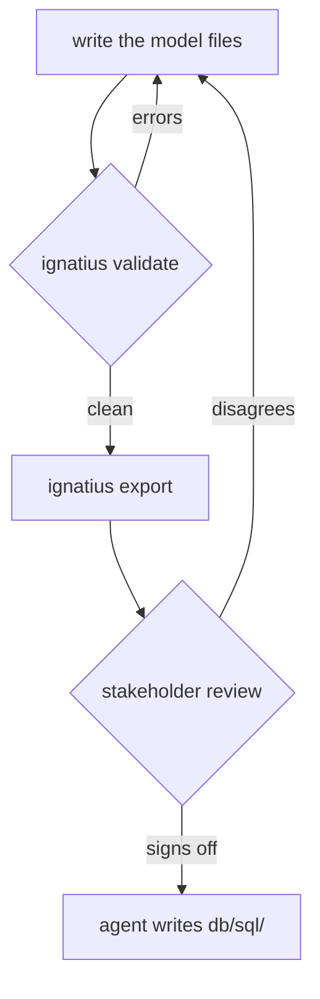

# Modeling best practices


A model earns its keep when someone who does not write SQL can read it, disagree with it, and be right.

The model is agreed before any SQL exists, so a wrong entity boundary costs a conversation instead of a migration.




## What belongs in the model?


- **Decisions, not storage.** Types are logical. Whether `text` becomes `varchar(255)`, which index it gets, and how it partitions belong in the SQL ([From model to SQL](/modeling/model-to-sql)).
- **The reason, in the body.** Frontmatter is the structure. The body is the argument a stakeholder reviews. The `party` body says every table in sales and billing inherits `party_id`, which is what stops one customer's payment from settling another customer's invoice. A schema dump cannot give you that sentence.
- **Two or three example rows per entity.** Validation catches a broken reference, not a wrong rule. A row that reads wrong when you read it back exposes the rule.
- **Stores that are not tables.** Caches, log files, queues, exported spreadsheets, and signed forms hold data nobody versioned. Give each a `stores/<name>.md` that says what is written to it, who reads it, and how long it is kept.


## How do I choose keys and name relationships?


- Describe `pk`, `columns`, and `on`. Leave `classification`, `identifying`, and cardinality out: ignatius derives them ([What gets derived](/modeling/entities#what-gets-derived)).
- Choose inherited or surrogate keys on purpose. Inherited keys stop a child attaching to the wrong parent and put the owning party on every row. Surrogate keys suit lookup tables and roots such as `party`. Record the reason in the entity body.
- When a team disagrees, serve the three variants of one model in the ignatius repository (`key-inherited`, `orm-hybrid`, `orm-pure` under `models/`). Only the keys differ.
- Name each relationship with a business act: `is placed by`, not `belongs to` ([What goes in a predicate?](/modeling/entities#what-goes-in-a-predicate)).


## How do I write flows?


- **Processes are verbs.** `Place-Order`, `Issue-Invoice`, and `Collect-Payment` read as work. `Payment-Handler` names a component, which belongs in an architecture diagram.
- **Flow data lists fields.** Write "transaction reference, status, raw response", not "log data". A reviewer can only catch a missing field that was named.
- **Decompose only where the detail changes a decision.** A sub-diagram must balance with its parent, and `flow.unbalanced_decomposition` checks it at every level. Two levels that stay balanced beat four that drift.


## Review before you build


```bash
ignatius validate model
ignatius export model -o model.html
```

`validate` exits `1` on errors and `0` otherwise, so warnings alone do not fail it. Read them anyway: `entity.unknown_group` is a group file you never wrote, `cluster.no_discriminator` is an exclusive cluster that cannot tell its members apart, and `flow.unknown_attribute` is a flow promising a column the entity lacks.

`export` writes one HTML file holding the graph, the dictionary, and the flows. It works offline, so attach it to the ticket or mail it. Set `branding` in `ignatius.yml` first, because the default logo, title, and copyright are the tool's own ([Branding your model](/modeling/branding)). Then give the agreed model to your agent as the specification for the SQL.

When an agent edits the model, review the edit as a diff. Record the baseline before it starts:

```bash
ignatius approve model
```

```
Approved 0 change(s), cleared 0 note(s).
```

Then open `ignatius serve model`. It marks every added, changed, and removed entity, column, relationship, and flow node since the last approval, and lists each beside the change note that explains it. Run `approve` again to accept the edit. The [modeling skill](/modeling/modeling-skill) writes the note.

Commit the model folder in the repository whose schema it describes. The `.gitignore` ignatius writes keeps `.ignatius/` out. A schema change and its model change land in one reviewable commit, and CI can run `validate` next to your other checks.


## Where can I see a finished model?


```bash
git clone https://github.com/noormdev/ignatius.git
ignatius serve ignatius/models/llm-memory-db-mssql -o
```

It validates clean and mixes keys on purpose: `Agent` and `Artifact` are surrogate roots, while `Milestone`, `Task`, and `Task_Artifact` inherit `milestone_id` and `task_no` down the chain.


## What bites


| Mistake or symptom | Cause | Fix |
|---|---|---|
| Review comments argue about `varchar` lengths | physical types sit in the model | keep types logical and decide them in the SQL |
| Warnings pile up unread | `validate` exits `0` on warnings | read each one, because each names a real gap |
| The export carries the tool's logo and title | `branding` is unset | set it before the file leaves your team |
| A reviewer cannot tell what crosses an arrow | `data:` on a non-table flow says "log data" | list the fields |


## Next


- [Entities and key inheritance](/modeling/entities)
- [Data flows](/modeling/data-flows)
- [The modeling skill](/modeling/modeling-skill)
- [Branding your model](/modeling/branding)
