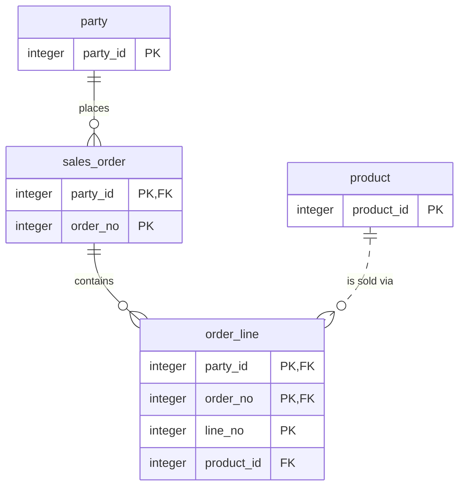
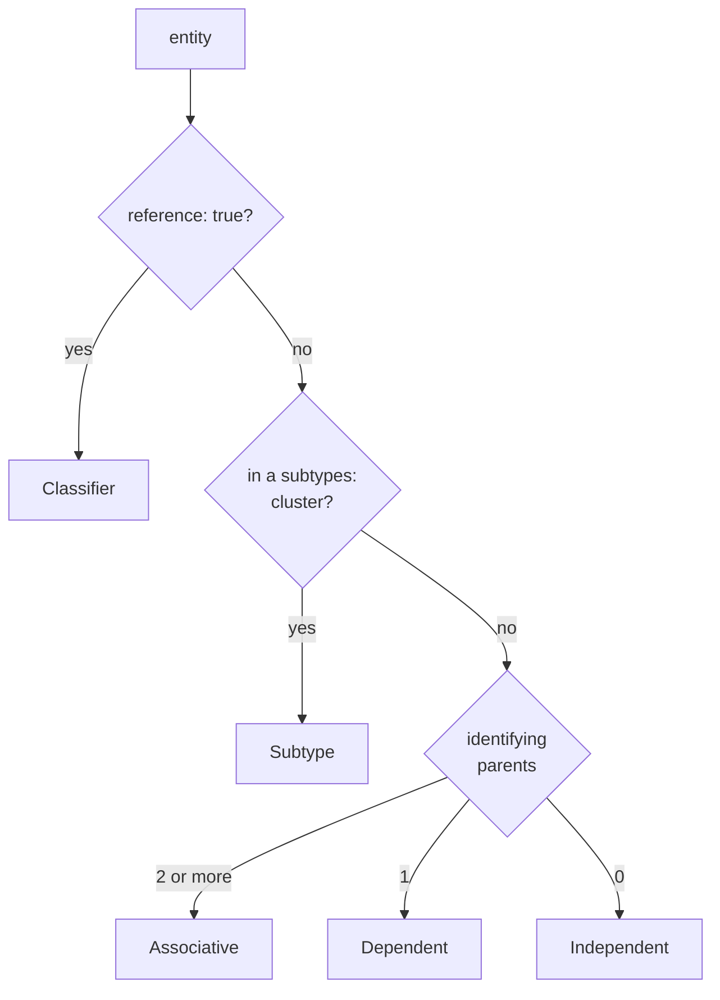

# Entities and key inheritance


An entity file describes one table: its key, its columns, and the parents it points at. ignatius derives the rest of the diagram from the keys.

A child's key contains its parent's key. That is the IDEF1X premise ignatius implements, and it is why every `order_line` names its party without a join.

Each child carries its parents' key columns inside its own key.




## The folder format


A folder with an `ignatius.yml` is a model. Entities go under `data/`. The subfolder is for your own organization, because an entity's group comes from its `group:` field.

```
model/
├── ignatius.yml
├── data/
│   ├── parties/        party.md, person.md, business.md, party_type.md
│   ├── sales/          sales_order.md, order_line.md, product.md
│   └── billing/        invoice.md, invoice_line.md, payment.md, ...
├── groups/             one file per group
├── externals/          Customer.md
├── stores/             gateway-log.md
├── clusters/           optional: named sets of stores for flows
└── flows/
    └── order-to-cash/  Place-Order.md, Issue-Invoice.md, ...
```

`ignatius.yml` can be one line, `name: Order to cash`. `theme` and `branding` change how the model looks: see [Branding your model](/modeling/branding). `ignatius serve` and `ignatius approve` also write `.ignatius/`, the local change-review state, and a `.gitignore` entry that keeps it out of version control.

A group file in `groups/` holds a `label` and a `color`. It tints the entities that name it and does not affect layout.


## What does an entity file contain?


Frontmatter carries the structure. The body says why the entity exists. The viewer builds the attribute table from the frontmatter, so do not write one.

<div class="nh-file">
<div class="nh-panel-head"><span>model/data/sales/order_line.md (excerpt)</span><span>you write this</span></div>

```markdown
---
entity: order_line
group: sales
pk:
  - party_id
  - order_no
  - line_no
columns:
  party_id:
    type: integer
  order_no:
    type: integer
  line_no:
    type: integer
  product_id:
    type: integer
examples:
  - party_id: 2
    order_no: 1
    line_no: 1
    product_id: 10
relationships:
  - target: sales_order
    on:
      party_id: party_id
      order_no: order_no
    predicate: { fwd: contains, rev: is part of }
  - target: product
    on:
      product_id: product_id
    predicate: { fwd: is sold via, rev: sells }
---

# order_line

One product on a [[sales_order]]. The key carries the whole lineage, so the owning party is on every row without a join.
```

</div>

Only `entity` is required. A missing `pk` or `columns` raises a warning. The other fields:

| Field | Meaning |
|---|---|
| `group` | A file name in `groups/` |
| `columns` | Each takes a `type`, plus optional `nullable` (default `false`), `default`, `desc` |
| `ak` | Alternate keys: a `rule` naming the business rule, and its `columns` |
| `relationships` | The parents: `target`, `on: { child_column: parent_column }`, `predicate` |
| `subtypes` | A subtype cluster, declared on the basetype |
| `reference: true` | Marks a lookup table |
| `examples` | Sample rows keyed by column name |

`type` is logical: `text`, `integer`, `decimal`, `boolean`, `date`, `datetime`, `binary`, or `json` for a document with an open-ended shape. The SQL picks the physical type ([From model to SQL](/modeling/model-to-sql)).

Write two or three realistic `examples` per entity. A row that looks wrong when you read it back means the rule is wrong, and no validation rule catches that.

In a body, `[[party]]` links to that entity and `[[party|the buyer]]` changes the label.


## What goes in a predicate?


The business verb for the relationship. It is the one part of an edge ignatius cannot derive.

Write both readings. `fwd` reads parent to child and `rev` reads child to parent. Neither is derived from the other, because the inverse of "is realized as" is "is a". A plain string sets both to the same phrase.

`belongs to`, `has many`, and `has one` restate the foreign key, the cardinality marker, and the key shape. Read the verb aloud in both directions. If someone who runs the business would not say it, the predicate or the relationship is wrong.

| Relationship | Parent reads | Child reads |
|---|---|---|
| `sales_order → party` | party places sales_order | sales_order is placed by party |
| `invoice → party` | party owes on invoice | invoice is owed by party |

The graph labels each edge with `fwd`. Hover an entity and its edges read outward from it, so edges where it is the child show `rev`. In the SQL, the reverse predicate names the foreign key: `sales_order_isplacedby_party`.


## What gets derived


A changed key changes the diagram on the next reload. An edge is identifying when every foreign-key column is part of the child's primary key.

Classification takes the first rule that matches, top to bottom.



| Entity | Primary key | Derived | Why |
|---|---|---|---|
| `party_type` | `code` | Classifier | `reference: true` |
| `party` | `party_id` | Independent | its only parent, `party_type`, is outside the key |
| `person` | `party_id` | Subtype | listed in the `subtypes:` of `party` |
| `order_line` | `party_id`, `order_no`, `line_no` | Dependent | `sales_order` is in the key, `product` is not |
| `payment_allocation` | `party_id`, `payment_no`, `invoice_no`, `line_no` | Associative | `payment` and `invoice_line` are both in the key |

The dialog for `order_line` shows the result: the DEPENDENT badge and the PK, FK marks on `party_id` and `order_no`, none of which the file declares.

<ModelViewer class="tall" model="order-to-cash" hash="view=graph&amp;entity=order_line" :tabs="false" label="order_line in the model" title="Order-to-cash model with order_line selected" />

Cardinality comes from the same keys:

| Edge | Parent : child | Example |
|---|---|---|
| identifying, FK is part of the child key | 1 : many | `sales_order → party` |
| identifying, FK is the whole child key | 1 : 1 | none in this model |
| identifying, child is a subtype | 1 : 0..1 | `person → party` |
| not identifying | 1 : many | `order_line → product` |

On a not-identifying edge, a nullable FK makes the parent side optional (`0..1`), and an `ak` on the FK columns makes the child side `1`.


## How do subtypes work?


The basetype lists its members and the column that tells them apart:

```yaml
# model/data/parties/party.md (excerpt)
subtypes:
  - exclusive: true
    desc: Every party is exactly one of person or business
    members:
      person:
        party_type: party_type.code.PERSON
      business:
        party_type: party_type.code.BUSINESS
```

Each member is also its own entity file, keyed by the basetype's key, with a relationship back to it. An exclusive cluster draws an X in the diamond and needs the mapping form above. An inclusive cluster (`exclusive: false`) leaves the diamond empty and lists members by name, because several can coexist for one row.


## The two key conventions


| Convention | Primary key | Foreign key |
|---|---|---|
| `key-inherited` | the parent's key columns plus a local discriminator | inside the child's key |
| `orm-oriented` | a single surrogate `id` | a plain column outside the key |

A model can mix them per entity. `party` is the root of the order-to-cash model, nothing above it supplies a key, and a surrogate is right there. Record the reason in the entity body. The [modeling skill](/modeling/modeling-skill) detects the prevailing convention from existing entities.

Key inheritance pays off in the graph. Hold Shift and hover `party`: dotted lines reach `order_line`, `invoice_line`, and `payment_allocation`, which are not direct neighbors but carry `party_id` inside their keys. On a schema where every table has its own `id`, there is nothing to show.

The ignatius repository ships one data model three ways under `models/`: `key-inherited`, `orm-hybrid`, and `orm-pure`. Only the keys differ.


## What bites


| Mistake or symptom | Cause | Fix |
|---|---|---|
| `classification: Dependent` or `identifying: true` does nothing | ignatius reads only `reference: true`, and no finding reports the rest | delete the line and change the key shape |
| `cluster.no_discriminator` warning | an exclusive cluster lists `members` as plain names | use the mapping form: `person: { party_type: party_type.code.PERSON }` |
| `[[Party]]` renders as muted text, `body.unknown_link` | link targets match the entity id exactly, and the id is `party` | write `[[party]]` |
| `entity.example_unknown_column` never shows in `validate` | the rule is live-only, reported by `ignatius serve` | check the rows in the viewer |
| An entity file named `index.md` fails with `config.index_file_entity` | `index.md` is the reserved router name | rename the file |


## Next


- [Data flows](/modeling/data-flows): the processes, externals, and stores that use these entities
- [From model to SQL](/modeling/model-to-sql): how each field becomes DDL
- [The case for proper relational design](/guide/relational-design): the argument for inherited keys in the database
- The [`idef1x` skill](https://www.skills.sh/damusix/skills/idef1x) coaches an agent through the methodology, separately from ignatius
- The [folder format reference](https://github.com/noormdev/ignatius/blob/main/docs/guides/folder-format.md) lists every rule
