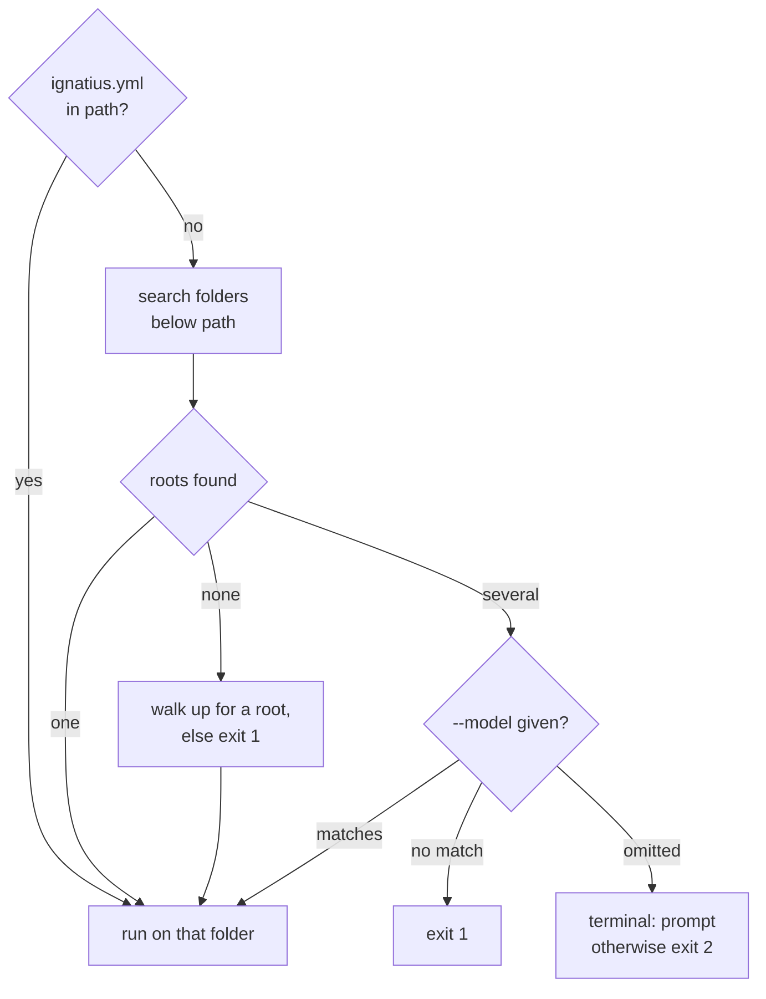

# ignatius commands

Install the ignatius binary, then serve, check, or export a model from the command line.

```bash
curl -fsSL https://noorm.dev/ignatius.sh | sh
ignatius serve path/to/model -o
```

```
ignatius serving at http://localhost:3000
```

The browser opens on the diagram. Save a `.md`, `.yaml`, or `.yml` file in the model folder and the open tab redraws. Windows, a pinned version, and building from source are on [Download](/download).


## What does each command do?


| Command | Flags | Effect |
|---|---|---|
| `ignatius serve [path]` | `-p`, `--port <n>` (3000); `--model <key>`; `-o`, `--open` | Serves the model with live reload. `server` is an alias |
| `ignatius validate [path]` | `--model <key>`; `--index` | Prints findings to stderr and a summary to stdout. Writes nothing |
| `ignatius export [path]` | `-o`, `--out <file>` (required); `--theme <mode>` (`dark`); `--model <key>` | Writes the Graph, Dictionary, and Flows views as one offline HTML file. `--theme` takes `light` or `dark` |
| `ignatius index [path]` | `--model <key>`; `--agents` | Writes a router file (`index_file:` in `ignatius.yml`, default `index.md`) into every organizing folder. `--agents` adds `AGENTS.md` and `SKILL.md`, plus `CLAUDE.md` when the harness resolves to Claude |
| `ignatius approve [path]` | `--model <key>` | Accepts the current files as the change-review baseline and deletes the notes in `.ignatius/changes/` |
| `ignatius version` | none | Prints the version. `ignatius --version` prints the same |
| `ignatius update` | `--check`; `-y`, `--yes` | Replaces the running binary with the latest release |

`serve` marks what changed since the last `approve`; see [Change review](https://github.com/noormdev/ignatius/blob/main/docs/guides/change-review.md). Press `?` in the app for the keys that work in the current view, or read the [keyboard shortcuts](https://github.com/noormdev/ignatius/blob/main/docs/guides/commands.md#keyboard-shortcuts).


## How does a command find the model?


Every model command takes an optional `path`. A model root is a folder with an `ignatius.yml`:



The search skips `node_modules`, `.git`, `dist`, `tmp`, `trash`, `.worktrees`, `.claude`, and any folder starting with `_`. The `--model` key is the root's path relative to the search path, such as `sales`.


## What do the exit codes mean?


| Code | When |
|---|---|
| `0` | No errors. Warnings alone do not fail `validate`, `export`, or `index` |
| `1` | An error finding, no model found, `--model` matches nothing, or `export` without `-o` |
| `2` | Several models, no `--model`, and no terminal to prompt in |
| `130` | You cancelled a prompt |

An error finding is an omitted edge, an unknown target, or an unparseable file. It prints as `<severity>  <rule>  <location>  <message>`:

```bash
ignatius validate model
```

```
error  edge.unknown_target  sales_order→partyy  Edge target "partyy" not present in model.
✗ /home/you/shop/model: 1 error(s), 0 warning(s) across 11 entities.
```

A clean run prints `✓ <path>: valid — 11 entities, no findings.` The [rule catalog](https://github.com/noormdev/ignatius/blob/main/docs/guides/validation.md) lists every rule.


## How does serve pick a port?


When 3000 is taken, a terminal asks which port to use, with the next free one as the default. A pipe or CI counts up until a bind succeeds and prints `Port 3000 is in use — trying 3001.` to stderr. `-o` opens the port it settled on.


## How do I stay current?


| Situation | `ignatius update` does |
|---|---|
| Already latest | Prints `ignatius 0.23.0 is up to date.` |
| Newer release | Prints `A new version is available: 0.23.0 → <latest>`. With `--check`, or with no terminal and no `--yes`, it stops there. In a terminal it asks `Update to <latest> now?`, downloads, checks the checksum, and swaps the binary |
| Windows | Prints the release URL. A running `.exe` cannot replace itself |
| Binary in a folder you cannot write | Exits `1` with `cannot write to …`. Run `sudo ignatius update --yes` |


## What bites


| Symptom | Cause | Fix |
|---|---|---|
| `-o <output.html> is required` | `export` has no default output | `ignatius export model -o model.html` |
| CI exits `2`: `multiple models found: a, b` | Two roots under the path and no terminal to choose in | Add `--model a` |
| `dict was removed`, or `graph`, `flow` | Those subcommands no longer exist | `ignatius export -o model.html` |
| `export` exits `1` and the HTML file exists | `export` writes the file, then fails on error findings | Fix the findings before you share the file |
| `validate` passes with a stale router | Plain `validate` never hashes routers | `validate --index`, then `ignatius index` |
| `update` ran with no checksum check | A mismatch aborts, but an unreachable `checksums.txt` skips the check | Rerun `ignatius update` once the release page is reachable |


## Next


- [Download](/download): Windows, a pinned version, and the agent skill
- [Entities and key inheritance](/modeling/entities): the folder format a model root holds
- [The modeling skill](/modeling/modeling-skill): author a model from Claude Code
- [Branding your model](/modeling/branding): put your name on the export
