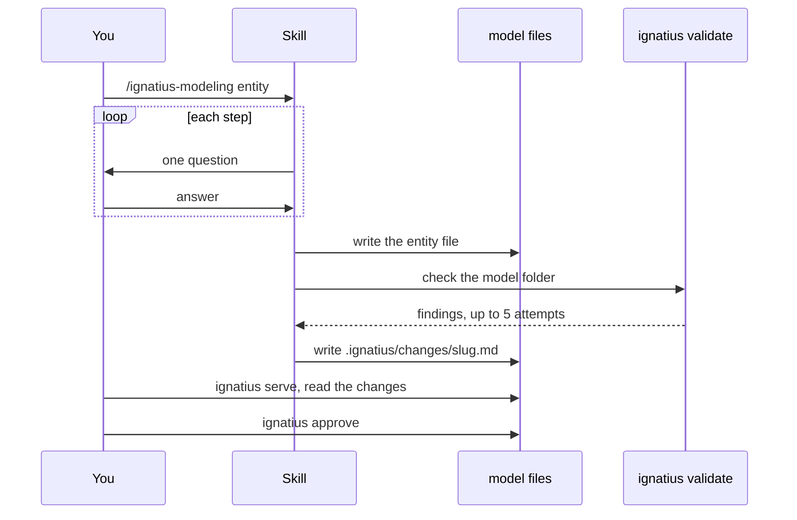

# The modeling skill

`/ignatius-modeling` is a Claude Code skill that writes ignatius entity and flow files by asking you one question at a time.

One session asks, writes, validates, and then waits for you to approve:



The skill needs Claude Code and the `ignatius` binary on your `$PATH` ([Download](/download)). Install the skill into the current project, or add `-g` for every project:

```bash
npx skills add https://github.com/noormdev/ignatius --skill ignatius-modeling
```


## Which mode do I run?


| Invocation | Use it to |
|---|---|
| `/ignatius-modeling entity` | Add one entity |
| `/ignatius-modeling model` | Bootstrap `ignatius.yml`, group files, and folders |
| `/ignatius-modeling flow` | Author a [data flow diagram](/modeling/data-flows) when you can already name your processes |
| `/ignatius-modeling discover` | Work out entities and flows from how the business runs. With a real database, schema dump, codebase, or API, it reads that instead of interviewing you |
| `/ignatius-modeling` | Asks which mode |

Every entity gets example rows and every process gets input and output examples, because concrete rows expose wrong rules that pass every structural check. The skill picks `key-inherited` or `orm-oriented` for each new entity from the keys you already have; see [the two key conventions](/modeling/entities). To point `discover` at a live database, see [Reverse-engineering](/modeling/reverse-engineering).


## What does validation catch?


After each write the skill runs `ignatius validate <model-root>`, reports each finding with a fix hint, and asks whether to revise. It stops after five attempts.

| Check | Done by |
|---|---|
| Unknown targets, dangling foreign-key columns, missing discriminators, unknown columns in flow contracts, unbalanced decompositions | `ignatius validate` |
| Example rows with a key that is not a column | Only `ignatius serve` shows it. `validate` never prints that rule, so the skill reads the rows back |
| Each predicate reads as a true sentence both ways, and the body states the purpose and rules | The skill's self-check, then you |


## How do I review what it changed?


Every session that changes model files ends with one change note, `.ignatius/changes/<slug>.md`. It names the entities, columns, diagrams, and nodes the session touched and says why. `ignatius serve` shows the edit as highlights beside the note. `ignatius approve` accepts it.

Before its first write, the skill checks for a baseline so that the edit shows as a change:

| `.ignatius/baseline.json` | `.ignatius/changes/` | The skill |
|---|---|---|
| valid | any | edits as usual |
| missing or invalid | empty | runs `ignatius approve`, then edits |
| missing or invalid | holds notes | stops and asks you to approve the notes or restore the baseline |

The skill never runs `approve` after editing. Accepting the edit is your step. The `model` mode writes no note, and a model it creates gets a `.gitignore` containing `.ignatius/`. The note format is in [Change review](https://github.com/noormdev/ignatius/blob/main/docs/guides/change-review.md).


## What bites


| Symptom | Cause | Fix |
|---|---|---|
| The skill stops before its first write | `.ignatius/changes/` holds notes and there is no baseline | Read the notes, run `ignatius approve`, then continue |
| A change shows as `unexplained` | The note does not name that entity, column, diagram, or node | Add the name to the note |
| A note shows `named but unchanged` | The note names an entity, column, diagram, or node that did not change | Remove the name, or make the change |
| A note you wanted is gone | `ignatius approve` deletes every note | Copy anything worth keeping into the entity or flow body first |


## Next


- [Entities and key inheritance](/modeling/entities): the format the skill writes
- [Data flows](/modeling/data-flows): the diagram format
- [From model to SQL](/modeling/model-to-sql): hand the validated model to an agent that writes the DDL
- [Best practices](/modeling/best-practices): review what the skill produces
