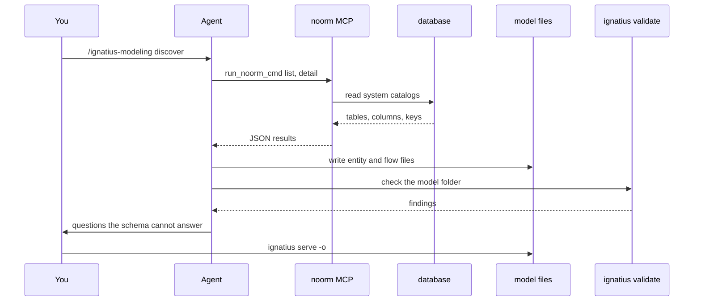

# Reverse-engineering an existing database

Extract an ignatius model from a database you already run, with an agent that reads the schema through noorm's MCP server.

The agent reads the database through noorm, writes the model files, and checks them. You review the result:



`noorm mcp init` runs once per project. The slash command runs in the agent:

```bash
noorm mcp init
```

```
/ignatius-modeling discover
```


## What do I set up first?


1. A model root: any folder with an `ignatius.yml`. `/ignatius-modeling model` scaffolds one. `mkdir -p models/legacy && echo "name: Legacy Schema" > models/legacy/ignatius.yml` is the minimum. Keep it in the repository whose schema it describes.
2. The agent's MCP config. `noorm mcp init` writes `.mcp.json` for Claude Code, and `noorm mcp init --agent cursor` writes `.cursor/mcp.json`. The agent gets two tools, `noorm_help` and `run_noorm_cmd`.
3. A noorm config for the database you mean. The agent connects to the active config unless it names another. A model of staging is not a model of production.
4. The skill and the binary, both on [Download](/download).


## How do I keep the agent read-only?


A config that never declared `access` gives agents `viewer`: schema exploration and read-only SQL. That is all this job needs, so this step is usually a check. Confirm it in `noorm ui` under Config, then Edit.

The role covers MCP and an agent that shells out to `noorm`. See [MCP](/guide/automation/mcp) for the full role table.

::: warning Roles prevent accidents, not attacks
An agent that shells out can set `NOORM_CHANNEL=user`. Reverse-engineering also feeds the agent table comments, column descriptions, and procedure bodies that you may not have written. Connect noorm with a database user that holds only `SELECT` and catalog permissions, so the role is the second line of defense.
:::


## What does the database user need?


A permissions gap does not raise an error. The catalogs return fewer rows, so the model looks finished and misses tables. [PostgreSQL](https://www.postgresql.org/docs/current/infoschema-tables.html), [MySQL](https://dev.mysql.com/doc/refman/8.0/en/information-schema-introduction.html), and [SQL Server](https://learn.microsoft.com/en-us/sql/relational-databases/security/metadata-visibility-configuration) each show only objects the user owns or holds a privilege on.

| Dialect | noorm reads | Grant |
|---|---|---|
| PostgreSQL | `information_schema`, `pg_catalog` | `GRANT USAGE ON SCHEMA public TO modeler;` and `GRANT SELECT ON ALL TABLES IN SCHEMA public TO modeler;` |
| MySQL | `information_schema` | `GRANT SELECT ON mydb.* TO 'modeler'@'%';` |
| SQL Server | `sys` catalog views | `GRANT VIEW DEFINITION TO modeler;` |
| SQLite | `sqlite_master`, `PRAGMA` | none, file access |

Before the agent writes anything, have it run `overview`, which returns a count for each object type. Compare the table count with what you know is there.


## What does the agent extract?


Foreign keys give the agent entities and relationships. Only code gives it processes, so offer the repository too.

| In the database or code | In the model |
|---|---|
| Table | Entity, named exactly as the table. `sales_orders` stays `sales_orders` |
| Column | Attribute, nullability kept. A `NOT NULL` foreign key is a mandatory parent |
| Primary key | `key-inherited` when it contains a foreign key, `orm-oriented` for a lone surrogate `id` |
| Foreign key | Relationship. Whether it is identifying comes from where the key sits |
| Table whose whole primary key is its parent's | Subtype member |
| `SELECT` in a handler or procedure | Input flow with that column list |
| `INSERT` in a handler or procedure | Output flow with those columns |
| A few real rows per table | `examples:`, with PII and secrets masked |

The skill records anti-patterns instead of fixing them. A junk-drawer table or a surrogate key where the real identity is composite is captured as it is, then raised with you as a question.


## How far does extraction get?


IDEF1X names the approach bottom-up and sorts its results into levels:

| Level | You get | Worth |
|---|---|---|
| 1 | Current-system documentation | Shows what **is** |
| 2 | Application-level logical model | The requirements the system satisfies today, right or wrong |
| 3 | Business-level model | A basis for future design. Needs the business in the room |

We read a schema as enough for level 1 and part of level 2. Level 3 lives with the people who run the business. A model of what you have is not a model of what you want. The [`idef1x` skill](https://www.skills.sh/damusix/skills/idef1x) carries the method.


## How do I review the result?


```bash
ignatius validate models/legacy
ignatius serve models/legacy -o
```

`validate` exits `1` on errors and `0` otherwise, so it also gates a pull request. A clean run means the model is consistent. Two failures pass it: a table the agent could not see, and a purpose the agent had to guess. An entity body that restates its columns is the second one.

The skill ends the session with a change note. `serve` shows the edit beside it, and `ignatius approve` accepts it; see [the modeling skill](/modeling/modeling-skill). Walk the people who run the business through the served model.


## What bites


| Symptom | Cause | Fix |
|---|---|---|
| The model is clean and tables are missing | The database user cannot see them | Grant catalog access, then compare `overview` counts |
| The agent cannot find your config | `access.agent` is `false`, which hides the config from agents | Set `agent` to `viewer` |
| Links and `db:` tokens break | An entity id no longer matches its table name | Restore the source name. Raise a rename as a question |
| Real customer values in a committed file | `examples:` come from live rows | Mask them before you commit |
| An entity body restates its columns | The schema cannot say what the entity is for | Write the purpose yourself |


## Next


- [The modeling skill](/modeling/modeling-skill): the modes and the change-review loop
- [Entities and key inheritance](/modeling/entities): the files the agent writes
- [Data flows](/modeling/data-flows): processes, externals, and stores
- [MCP](/guide/automation/mcp): the server and its access roles
