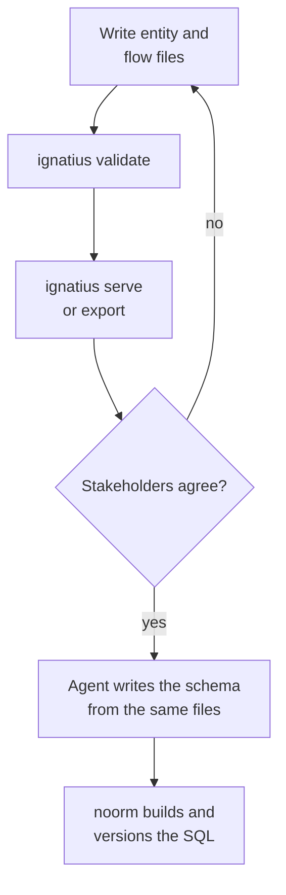

# Why ignatius

Most schemas get designed while they are being built, so the shape of the whole lives in migration history and in the head of whoever wrote it. [ignatius](https://github.com/noormdev/ignatius) moves that design earlier. You describe entities, keys, and relationships in markdown, and it renders a diagram people can argue about before anyone writes SQL. It never connects to a database and never generates DDL.

<!-- Wrapped in a div because `video` is not a CommonMark block-level tag:
     left bare, markdown-it splits the multi-line element across paragraphs and
     Vue's SFC parser then rejects the orphaned closing tag. -->

<video src="/video/ignatius.mp4" poster="/video/ignatius-poster.jpg" width="1316" height="858" controls muted playsinline preload="none"></video>

Above: a model of an LLM memory database in all three views.

## What does it produce?

One folder of markdown drives three views of the same model.

| View | Notation | Answers | Shows |
|---|---|---|---|
| Data Graph | IDEF1X | What is the data, and how is it identified? | Entities in crow's-foot notation, identifying relationships, compound keys that carry their lineage, subtype clusters |
| Data Dictionary | none | What is each thing for? | Every entity, process, external, and store on one searchable page |
| Data Flows | SSADM data flow diagrams | Who touches the data, and where does it live? | Processes, external actors, and stores, where a store is any place data rests: a table, a cache, a log file, a queue, a paper form |

See [Entities and key inheritance](/modeling/entities) and [Data flows](/modeling/data-flows).

You write keys and relationships as text, and ignatius derives cardinality, entity classification, and subtype clusters from the key shape. Change a foreign key and the notation updates on the next reload. The model diffs and reviews like code.

A table list says what exists. The graph also shows how entities connect, where identity comes from, and which clusters share a basetype. Each entity carries prose on why it exists, plus example rows, and a sample row that violates a constraint you believed in exposes a modeling error no structural check will catch.

## Why model before building?

The industry mostly skips modeling and goes straight to building. In my experience, modeling first solves about 80% of the problems up front and gives months of valid programming work before anyone opens an editor.

The other 20% is real: once you start building, you do find problems in the model. What matters is when. While nothing is committed to the system, changing the model costs an edit to a text file. Once it is code, it does not.

Review sits between writing the model and writing the schema, so a disagreement about the data surfaces while it is cheap:

## Who reads the model?

| Reader | Gets | How |
|---|---|---|
| Stakeholder | A diagram to explore, a dictionary to search, and prose on business meaning | `ignatius export` writes one self-contained HTML file that opens from `file://` with nothing installed |
| Coding agent | Plain markdown with YAML frontmatter to read and write | The [`ignatius-modeling` skill](/modeling/modeling-skill) authors entity and flow files through guided Q&A and checks each with `ignatius validate` |

## Why is it a separate tool from noorm?

noorm already explores schemas and runs SQL, so it is fair to ask why modeling is not a `noorm model` subcommand. Three reasons:

- **It never touches a database.** ignatius carries no database driver and emits no DDL. It is useful before the database exists, when a tool that needs a connection has nothing to offer.
- **It does not need noorm.** Nothing in the format is specific to noorm: markdown in, IDEF1X and SSADM diagrams out, no dialect anywhere. A team on any other migration tool gets the same thing.
- **The audiences differ.** `ignatius export` produces a file for the person approving a design. That reader has no reason to install a schema manager.

## Where does the name come from?

ignatius is named for Derek Ignatius Asirvadem, who mentored me for a couple of years and introduced me to IDEF1X. NIST published IDEF1X as FIPS 184 in 1993, and it became part of ISO/IEC/IEEE 31320-2 in 2012. Studying it and then practising it convinced me there is no higher standard for modeling data. The [landing page](/modeling/) traces its lineage back to Codd in 1970.

Before ignatius I drew models in OmniGraffle, on Derek's recommendation. My own obsession with perfect lines and names turned drawing into the bottleneck, and a picture cannot tell an LLM how two entities relate. So the model moved into markdown, where the layout is generated and an agent can read and write the source.

None of these tools would exist without his guidance. ignatius is a tribute to him.

## Next

- [ignatius commands](/modeling/installation): install, serve, validate, export
- [Entities and key inheritance](/modeling/entities)
- [Data flows](/modeling/data-flows)
- [Reverse-engineering](/modeling/reverse-engineering): extract a model from a database you already run
- [Best practices](/modeling/best-practices)
