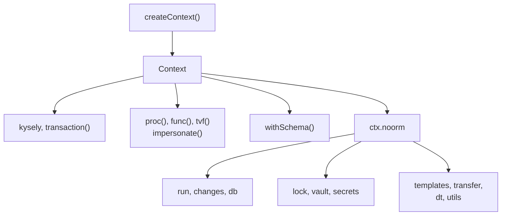
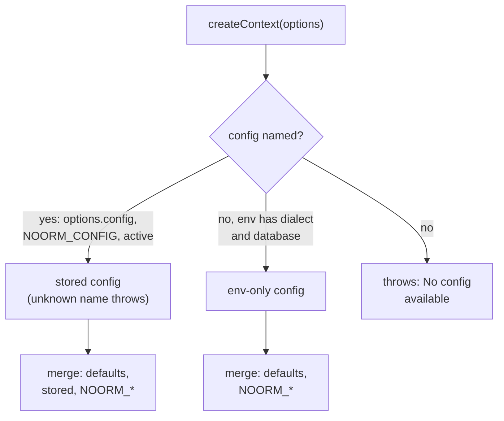
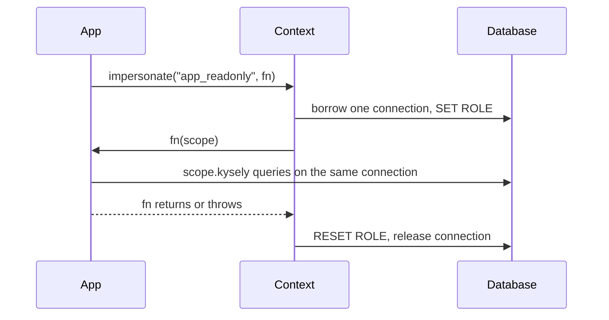
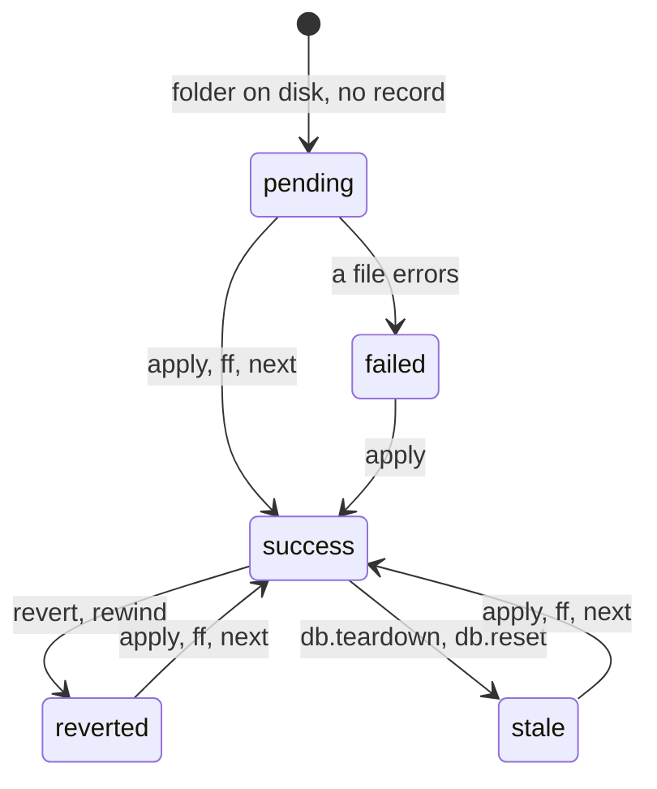

# SDK reference


Query a noorm-managed database from TypeScript, and run builds, changes, locks, and the vault from the same context.

```bash
npm install @noormdev/sdk kysely pg
```

`kysely` and your dialect's driver are peer dependencies: `pg` for postgres, `mysql2` for mysql, `tedious` and `tarn` for mssql, `better-sqlite3` for sqlite. Node 22.13 or newer.

```typescript
// scripts/open-orders.ts
import { createContext } from '@noormdev/sdk';

interface OrderToCash {
    sales_order: {
        party_id: number;
        order_no: number;
        placed_at: Date;
        status: string;
    };
}

const ctx = await createContext<OrderToCash>({ config: 'dev' });
await ctx.connect();

const applied = await ctx.noorm.changes.ff();

const open = await ctx.kysely
    .selectFrom('sales_order')
    .select(['party_id', 'order_no'])
    .where('status', '=', 'open')
    .execute();

console.log(`${applied.executed} changes applied, ${open.length} open orders`);

await ctx.disconnect();
```

`createContext` resolves a config and returns an unconnected `Context`. `connect()` opens the pool. `changes.ff()` applies every pending change and returns a `BatchChangeResult`. `ctx.kysely` is a Kysely instance typed by your schema interface. `disconnect()` closes the pool.


## How is a context laid out?


Everything on `ctx` runs SQL. Everything noorm itself does hangs off `ctx.noorm`:



A context is either connected or not. `connect()` moves it to connected, `disconnect()` moves it back, and both are no-ops when already there. Calls that need the pool throw `NotConnectedError` otherwise:

| Area | Needs `connect()` | Works without it |
|---|---|---|
| `ctx` | `kysely`, `transaction`, `proc`, `func`, `tvf`, `impersonate` | `dialect`, `connected`, `withSchema`, `noorm` |
| `run` | `preview`, `file`, `files`, `dir`, `build` | `discover` |
| `changes` | `apply`, `revert`, `ff`, `next`, `rewind`, `status`, `pending`, `history`, `historyForChange`, `getFileHistory` | `create`, `addFile`, `removeFile`, `renameFile`, `reorderFiles`, `delete`, `discover`, `parse`, `validate` |
| `db`, `lock`, `dt` | every method | none |
| `vault` | every method except `copy` | `copy` |
| `transfer` | none | `to` and `plan` open their own connections to both configs |
| `secrets`, `utils` | none | every method |
| `templates` | none | `render`; the vault tier of `$.secrets` resolves only when connected |

Failures arrive as thrown errors, as fields on a result, or as returned data. [Error handling](#error-handling) lists which call does which. [Access policy](#access-policy) explains why a call can throw `ProtectedConfigError` before it touches the database.


## createContext(options)


```typescript
createContext<DB = unknown, Procs = object, Funcs = object, Tvfs = object>(
    options?: CreateContextOptions,
): Promise<Context<DB, Procs, Funcs, Tvfs>>
```

`DB` types `ctx.kysely`. `Procs`, `Funcs`, and `Tvfs` type `proc()`, `func()`, and `tvf()`; see [Stored procedures, functions and TVFs](#stored-procedures-functions-and-tvfs).

| Option | Type | Default | Effect |
|---|---|---|---|
| `config` | `string` | `NOORM_CONFIG`, then the active config, then env-only mode | Stored config to use |
| `projectRoot` | `string` | `process.cwd()` | Directory that holds `.noorm/` and the paths in `settings.yml` |
| `requireTest` | `boolean` | `false` | Throws `RequireTestError` unless the resolved config has `isTest: true` |
| `channel` | `'user' \| 'agent'` | `'user'` | Which half of the config's `access` applies; see [Access policy](#access-policy) |
| `stage` | `string` | the stage named like the config | Stage whose `protected: true` caps the config's access. An env-only config also takes the stage's `isTest` |
| `yes` | `boolean` | `false` | Pre-confirms `confirm` cells on the `user` channel. Ignored on `agent` |

The context is not connected when it returns. The config name comes first, then the config is merged from built-in defaults, the stored config, and `NOORM_*` variables:



The later layer wins. Env-only mode names the config `__env__`, which shows up in error messages and event payloads. It reads no stored config, so it needs no `.noorm/` directory: a missing `state.enc` resolves to empty state. [Deploying an application](/guide/deployment) covers that setup.

| Variable | Effect |
|---|---|
| `NOORM_CONFIG` | Config name when `options.config` is unset |
| `NOORM_CONNECTION_DIALECT` | `postgres`, `mysql`, `sqlite`, or `mssql`. Any other value throws |
| `NOORM_CONNECTION_DATABASE` | With the dialect, switches on env-only mode |
| `NOORM_CONNECTION_HOST`, `_PORT`, `_USER`, `_PASSWORD`, `_SSL`, `_POOL_MIN`, `_POOL_MAX` | Override the matching `connection` field of the resolved config |
| `NOORM_PATHS_SQL`, `NOORM_PATHS_CHANGES` | Override `paths.sql` and `paths.changes` from `settings.yml` |
| `NOORM_IDENTITY_PRIVATE_KEY`, `_NAME`, `_EMAIL` | CI identity. All three are required, otherwise they are ignored. They let the context decrypt state and vault keys with no key file on disk |
| `NOORM_YES` | Any value except empty, `0`, or `false` confirms `confirm` cells on the `user` channel, like `yes: true` |

An env-only config takes the default access, `{ user: 'admin', agent: 'viewer' }`.

| Throws | When |
|---|---|
| `Config "<name>" not found` | The name matches no stored config |
| `No config available...` | No name, and the env lacks a dialect or database |
| `RequireTestError` | `requireTest: true` on a config without `isTest: true` |
| `Private key required to decrypt state` | A `state.enc` exists and no identity key or `NOORM_IDENTITY_*` is available |


## Context members


| Member | Returns | Notes |
|---|---|---|
| `kysely` | `Kysely<DB>` | Standard Kysely. Re-derived on every access, so a reconnect never leaves a stale schema wrap. Not gated by access policy |
| `dialect` | `Dialect` | `postgres`, `mysql`, `sqlite`, or `mssql` |
| `connected` | `boolean` | `true` between `connect()` and `disconnect()` |
| `noorm` | `NoormOps` | Created on first access, one per context |
| `connect(retryOptions?)` | `Promise<void>` | See [Lifecycle](#lifecycle) |
| `disconnect()` | `Promise<void>` | See [Lifecycle](#lifecycle) |
| `transaction(fn)` | `Promise<T>` | See [Transactions](#transactions) |
| `proc(name, params?)` | `Promise<T[]>` | See [proc](#proc-name-params) |
| `func(name, params?, column)` | `Promise<T>` | See [func](#func-name-params-column) |
| `tvf(name, params?)` | `Promise<T[]>` | See [tvf](#tvf-name-params) |
| `impersonate(username, fn?)` | `Promise<T>` or `Promise<ImpersonatedScope>` | See [Impersonation](#impersonation) |
| `withSchema(name)` | `Context` | See [Schema scoping](#schema-scoping) |

`ctx.noorm` also exposes three read-only properties:

| Property | Type | Holds |
|---|---|---|
| `config` | `Config` | The resolved config |
| `settings` | `Settings` | Project settings: paths, build rules, stages, teardown |
| `identity` | `Identity` | The audit identity recorded on every change and lock |


### Lifecycle


```typescript
await ctx.connect();

// Fail fast on an unreachable database.
await ctx.connect({ retries: 1, delay: 0 });
```

`connect(retryOptions?)` takes `ConnectionRetryOptions` (not exported; declare it inline):

| Field | Default | Meaning |
|---|---|---|
| `retries` | `3` | Attempts before giving up |
| `delay` | `1000` | Milliseconds before the first retry |
| `backoff` | `2` | Multiplier applied to the delay on each retry |

Only transient failures retry: messages containing `econnrefused`, `etimedout`, `too many connections`, or `connection reset`. Authentication, password, login, access-denied, missing-database, and missing-driver errors fail on the first attempt. After the last attempt, `connect()` throws the server's own error.

`disconnect()` releases any impersonation scope you never reverted, destroys the pool, and clears the connection. Calling it while disconnected is a no-op. A disconnected context can `connect()` again.


### Transactions


`transaction(fn)` hands `fn` a Kysely `Transaction<DB>` with `proc`, `func`, and `tvf` attached, and resolves with its return value. A throw inside `fn` rolls back, so do not swallow errors in the callback.

```typescript
const cancelled = await ctx.transaction(async (trx) => {
    const open = await trx
        .selectFrom('sales_order')
        .select('order_no')
        .where('party_id', '=', 2)
        .where('status', '=', 'open')
        .execute();

    await trx
        .updateTable('sales_order')
        .set({ status: 'cancelled' })
        .where('party_id', '=', 2)
        .where('status', '=', 'open')
        .execute();

    return open.length;
});
```

Routine calls run on the transaction's connection, so they see transaction-scoped settings and roll back with the rest of `fn`.

```typescript
import { sql } from 'kysely';

const open = await ctx.transaction(async (trx) => {
    await sql`SET LOCAL statement_timeout = '8s'`.execute(trx);

    return trx.tvf('party_open_orders', { party_id: 2 });
});
// SELECT * FROM "party_open_orders"("party_id" => $1), cancelled if it runs past 8 seconds
```

| Rule | Behavior |
|---|---|
| Handle type | `TransactionScope` is `Transaction<DB> & RoutineCalls<Procs, Funcs, Tvfs>`. A callback annotated `(trx: Transaction<DB>) => …` still compiles |
| `SET LOCAL` | Postgres syntax. It lasts until the transaction ends |
| Routine names | Qualified with the context's schema, as on `ctx` |
| `trx.proc` on postgres | Looks the name up in `pg_catalog.pg_proc` first: a procedure runs `CALL`, anything else runs `SELECT * FROM name(...)`. No `CALL` is attempted against a name with no visible procedure, so calling a function does not abort the transaction. A name that is both a procedure and a function runs `CALL`, which fails with 42809 and aborts the transaction when it resolves to the function: arguments that match a function overload, or a function earlier on `search_path` than the procedure. `trx.tvf` reaches the function in every case |
| Derived handles | `trx.withSchema(...)`, `trx.withPlugin(...)`, and other Kysely instances derived from `trx` carry no `proc`, `func`, or `tvf` |


### Impersonation


`impersonate(username, fn?)` runs queries as another database principal. It borrows one connection from the pool, switches identity on it, and returns a scope whose `kysely`, `proc`, `func`, `tvf`, and `transaction` use that connection.

| Dialect | Switch | Revert |
|---|---|---|
| `mssql` | `EXECUTE AS USER = '<username>'` | `REVERT` |
| `postgres` | `SET ROLE '<username>'` | `RESET ROLE` |
| `mysql`, `sqlite` | throws `ImpersonationError` | |

A username may contain letters, digits, `_`, `@`, `.`, `-`, and `\`. Anything else throws `ImpersonationError`.

The two modes differ in who ends the borrow:



```typescript
import { type ImpersonatedScope } from '@noormdev/sdk';

// Callback mode: reverts on the way out, including when fn throws.
const rows = await ctx.impersonate('app_readonly', (scope) =>
    scope.kysely.selectFrom('sales_order').selectAll().execute(),
);

// Explicit mode: you own the lifecycle.
const scope: ImpersonatedScope<OrderToCash> = await ctx.impersonate('app_readonly');
const orders = await scope.kysely.selectFrom('sales_order').selectAll().execute();
await scope.revert();
```

| Behavior | Detail |
|---|---|
| Scope members | `kysely`, `proc`, `func`, `tvf`, `transaction`, `revert`. No `noorm` and no lifecycle methods; management operations stay on `ctx.noorm`, running as the context's own principal |
| Explicit mode holds a pooled connection | Until `revert()` or `ctx.disconnect()`. `disconnect()` releases an unreverted scope without running the revert SQL, because it destroys the pool |
| `revert()` | Idempotent after it succeeds. After a failure the scope stays revertible, so a retry re-runs the revert |


### Schema scoping


`withSchema<SDB, SProcs, SFuncs, STvfs>(name)` returns a `Context` scoped to one schema. It wraps Kysely's own `withSchema`; it is not a new connection.

```typescript
const billing = ctx.withSchema<BillingDB, BillingProcs>('billing');

await billing.kysely.selectFrom('invoice').selectAll().execute();
// select * from "billing"."invoice", typed against BillingDB

await billing.proc('post_invoices', { party_id: 2 });
// CALL "billing"."post_invoices"("party_id" => $1)

await billing.proc('sales.close_order', [2, 1]);
// CALL "sales"."close_order"($1, $2), a name with a dot is used as given

await ctx.kysely.selectFrom('sales_order').selectAll().execute();
// the parent is untouched, no prefix
```

`BillingDB` and `BillingProcs` are interfaces you declare, like `OrderToCash` in the first example. The routine generics default to the parent's.

| Rule | Behavior |
|---|---|
| Lifecycle | The derived context shares the parent's connection, pool, and held-connection set. `connect()` and `disconnect()` on either act on both |
| Name check | `name` must match letters, digits, `_`, and `-`. Anything else, including `.`, throws `Invalid schema name` immediately, before any connection is touched |
| Replace, not stack | `ctx.withSchema('a').withSchema('b')` resolves against `b` only |
| Routine names | `proc`, `func`, and `tvf` prefix a name that has no `.` with the schema. A name with a `.` passes through |
| `transaction` | Inherits the schema |
| `impersonate` | `scope.kysely` and the Kysely builder on `scope.transaction` stay schema-qualified. Routine methods inside a scope (`scope.proc`/`func`/`tvf` and the same methods on the `scope.transaction` handle) call the builders with the name as given, so qualify routine names yourself |
| Raw `` sql`...` `` | Not rewritten. Unqualified identifiers resolve against the connection's default schema, so qualify them by hand |
| `ctx.noorm` | Not affected. Pass `schema` to `db.describe*` explicitly |

There is no schema field on the config, and no per-dialect gating. The qualifier means whatever Kysely's `withSchema` means for the active dialect: a schema on postgres and mssql, a database on mysql, an attached database name on sqlite.


## Stored procedures, functions and TVFs


`proc()`, `func()`, and `tvf()` call routines by name, with the SQL built for the active dialect and every value bound as a parameter. They are not gated by access policy. Declare each routine your database defines as an `[Args, Return]` tuple and pass the maps as generics:

```typescript
// src/db.ts
import { createContext, type TvpValue } from '@noormdev/sdk';

interface NewLine { product_id: number; qty: number }

interface Procs {
    place_order: [{ party_id: number; lines: TvpValue<NewLine> }, { order_no: number }];
    set_order_status: [{ party_id: number; order_no: number; status?: string }, void];
    close_order: [[number, number], void];
    archive_closed_orders: void;
}

interface Funcs {
    party_balance: [{ party_id: number }, { balance: number }];
    line_total: [[number, number], { total: number }];
    schema_version: [void, { v: string }];
}

interface Tvfs {
    party_open_orders: [{ party_id: number }, { order_no: number; status: string }];
}

export const ctx = await createContext<OrderToCash, Procs, Funcs, Tvfs>({ config: 'dev' });
```

The routine names above are examples. A tuple's first element types the arguments, and the second types the rows returned:

| Entry | Arguments | Return |
|---|---|---|
| `[{ k: T }, R]` | object, named parameters | `R` |
| `[[A, B], R]` | array, positional parameters | `R` |
| `[Args, void]` | as above | `void` |
| `[void, R]` | none | `R` |
| `void` | none | `unknown` |

A routine map you do not provide leaves the matching method uncallable at the type level. Each method takes a second generic to override the inferred return type, such as `ctx.proc<'set_order_status', MyRow>(...)`. Names are quoted per dialect (`"name"`, `[name]`, `` `name` ``), and a schema-qualified name splits on its first `.` and quotes each half. In the tables below, placeholders are written `$1`; the driver supplies its own markers.


### proc(name, params?)


Calls a stored procedure and returns its result-set rows as `Promise<T[]>`.

| Dialect | Named | Positional | No params |
|---|---|---|---|
| mssql | `EXEC name @k = $1` | `EXEC name $1` | `EXEC name` |
| postgres | `CALL name(k => $1)` | `CALL name($1)` | `CALL name()` |
| mysql | `CALL name($1)`, values in key order | `CALL name($1)` | `CALL name()` |
| sqlite | throws | throws | throws |

```typescript
await ctx.proc('set_order_status', { party_id: 2, order_no: 1, status: 'paid' });
await ctx.proc('close_order', [2, 1]);
await ctx.proc('archive_closed_orders');
```

On postgres, `proc()` retries as `SELECT * FROM name(...)` when `CALL` fails with SQLSTATE `42809` or `42883`. One method therefore reaches both `CREATE PROCEDURE` and `CREATE FUNCTION` objects. Inside a transaction a failed `CALL` would abort it, so `trx.proc` decides up front instead; see [Transactions](#transactions).


### Parameter handling and NULL semantics


Every key present in a params object is sent. The SDK never drops a key, and a value of `undefined` or `null` is bound as SQL `NULL` (`sql.ts` builds one `@key = <value>` per `Object.entries` pair, and Kysely's mssql driver binds both as NVarChar `NULL`).

MSSQL applies a parameter's `DEFAULT` only when the parameter is omitted from the call. `status: undefined` against `@status text = 'open'` sends `@status = NULL`, overwrites the default, and fails a `NOT NULL` column.

| Zod schema | A missing key parses to | The SDK sends |
|---|---|---|
| `z.string()` | rejects before the call | nothing |
| `z.string().nullable()` | `null` when the value is `null` | `@key = NULL` |
| `z.string().optional()` | `undefined` | `@key = NULL`, the key is still present |
| `z.string().default('open')` | `'open'` | `@key = 'open'` |

`.optional()` reads like "leave the parameter alone" and means "send NULL". Two patterns keep the SQL default working:

```typescript
// Pattern A: put the default in the schema.
const StatusChange = z.object({
    party_id: z.number(),
    order_no: z.number(),
    status: z.string().default('open'),
});

// Pattern B: leave the key out when the value is absent.
const params: Record<string, unknown> = { party_id: 2, order_no: 1 };
if (status !== undefined) {
    params.status = status;
}
await ctx.proc('set_order_status', params);
```

For a column that stores `NULL`, `{ note: undefined }` and `{ note: null }` are the same call. Use `undefined` for "the input did not carry this field" and `null` for "clear it".


### func(name, params?, column)


Calls a database function and returns the first row, `{ [column]: value }`, or `null` when there is none. The last argument is the result column alias.

| Dialect | Named | Positional | No params |
|---|---|---|---|
| mssql | `DECLARE @__result sql_variant; EXEC @__result = name @k = $1; SELECT @__result AS col` | `SELECT name($1) AS col` | `SELECT name() AS col` |
| postgres | `SELECT name(k => $1) AS col` | `SELECT name($1) AS col` | `SELECT name() AS col` |
| mysql | throws | `SELECT name($1) AS col` | `SELECT name() AS col` |
| sqlite | throws | throws | throws |

T-SQL has no named arguments in `SELECT`, which is why mssql uses `EXEC @var = name`. mysql throws `MySQL does not support named parameters in function calls. Use positional parameters (array) instead.` rather than reorder an object into positional form.

```typescript
const { balance } = await ctx.func('party_balance', { party_id: 2 }, 'balance');
const { total } = await ctx.func('line_total', [3, 49], 'total');
const { v } = await ctx.func('schema_version', 'v');
```


### tvf(name, params?)


Calls a table-valued function and returns its rows as `Promise<T[]>`. mssql and postgres only; mysql and sqlite throw.

| Dialect | Named | Positional | No params |
|---|---|---|---|
| mssql | `SELECT * FROM name($1)`, values in key order | `SELECT * FROM name($1)` | `SELECT * FROM name()` |
| postgres | `SELECT * FROM name(k => $1)` | `SELECT * FROM name($1)` | `SELECT * FROM name()` |

A T-SQL `FROM` clause takes positional arguments only. On mssql, declare the parameters as an array when order matters, because an object is flattened in key order.

```typescript
const open = await ctx.tvf('party_open_orders', { party_id: 2 });
```


### Table-valued parameters


`tvp(typeName, rows)` passes an array of rows to an mssql routine as a table-valued parameter. Other dialects throw `Table-valued parameters (TVP) are only supported on MSSQL.` Kysely's driver cannot bind a TVP, so the SDK emits a batch that declares a table variable of your table type, inserts the rows into it, and passes the variable. Every value stays a bound parameter.

```typescript
import { tvp } from '@noormdev/sdk';

const lines: NewLine[] = [
    { product_id: 10, qty: 1 },
    { product_id: 11, qty: 2 },
];

const [{ order_no }] = await ctx.proc('place_order', {
    party_id: 2,
    lines: tvp('order_line_input', lines),
});
```

`TvpValue<T>` keeps the row type through the signature, so the compiler checks the columns. A TVP works in `proc()`, `func()`, `tvf()`, and in `scope.proc()` and its siblings:

| Method | Statement shape |
|---|---|
| `proc` | `DECLARE @__tvp_<key> <type>; INSERT INTO @__tvp_<key> ([col], ...) VALUES (...), (...); EXEC [name] @k = $1, @<key> = @__tvp_<key>` |
| `func` | the same preamble, then `DECLARE @__result sql_variant; EXEC @__result = [name] ...; SELECT @__result AS [col]` |
| `tvf` | the same preamble, then `SELECT * FROM [name]($1, @__tvp_<key>)` |

With positional parameters the variable is `@__tvp_<index>`.

| Rule | Behavior |
|---|---|
| Type name | A schema-qualified name works: `tvp('dbo.order_line_input', rows)`. An empty name throws `TVP type name is required.` |
| Row keys | Every row must have the first row's keys, or `tvp()` throws `TVP row <i> has mismatched keys...`. Columns come from the first row's keys |
| Empty TVP | `tvp('order_line_input', [])` declares the variable and inserts nothing |
| Several TVPs | Allowed in one call |
| Parameter limit | mssql allows 2,100 bound parameters per batch. The SDK counts `rows x columns` per TVP plus scalar parameters, and throws `TVP parameter count (n) exceeds MSSQL limit of 2100...` before sending. Split the rows and call again |


## Access policy


Each config grants a role to two channels: `access: { user, agent }`, with roles `viewer`, `operator`, and `admin`, or `agent: false` to hide the config from agents entirely. The default is `{ user: 'admin', agent: 'viewer' }`. A stage with `protected: true` caps its configs at `operator` for the user and `viewer` for agents. [Access roles](/guide/environments/configs#access-roles) covers setting them.

`createContext({ channel })` picks which half applies. Each permission resolves to `allow`, `deny`, or `confirm`, and the SDK has no prompt to answer a `confirm`:

| Matrix cell | `user` channel | `agent` channel |
|---|---|---|
| `allow` | runs | runs |
| `deny` | throws | throws |
| `confirm` | throws unless `yes: true` or `NOORM_YES` is set | throws, and `yes` is never read |

A gated method checks before it does any work and throws `ProtectedConfigError` (`configName`, `operation`). Raw `ctx.kysely` queries, `proc`, `func`, `tvf`, `impersonate`, and `transaction` are not gated. These are the permissions that SDK methods check; the Gate column of each namespace table names the one each method uses:

| Permission | `viewer` | `operator` | `admin` |
|---|---|---|---|
| `run:build`, `run:file`, `run:dir` | deny | confirm | allow |
| `change:run`, `change:ff`, `change:revert` | deny | confirm | allow |
| `change:rm` | deny | confirm | confirm |
| `db:reset` | deny | confirm | allow |
| `db:truncate` | deny | confirm | confirm |
| `db:teardown` | deny | deny | confirm |
| `lock:force` | deny | confirm | confirm |
| `secret:read` | deny | allow | allow |
| `secret:write` | deny | confirm | allow |
| `vault:read` | deny | allow | allow |
| `vault:write` | deny | confirm | allow |
| `vault:propagate` | deny | confirm | confirm |
| `transfer:plan` | deny | allow | allow |

Three exceptions to the plain rule:

- `db.truncate` and `db.teardown` with `dryRun: true` check for denial but skip confirmation, so a role that may run the operation can always look first. A role that may not run it cannot preview it either.
- Denials raised below the SDK seam throw a plain `Error` with the same message, not `ProtectedConfigError`. That covers `run.preview`, `transfer.plan`, and `vault.copy`. Match on the message there.
- `transfer.to` and `transfer.plan` check the destination config, not the source, because the destination is the write target. `vault.copy` checks `vault:read` on the source and `vault:write` on the destination.


## ctx.noorm namespaces


| Namespace | Does |
|---|---|
| [`run`](#ctx-noorm-run) | Executes and previews SQL files, and builds the schema |
| [`changes`](#ctx-noorm-changes) | Scaffolds, applies, reverts, and reports changes |
| [`db`](#ctx-noorm-db) | Explores the schema, truncates, tears down, and resets |
| [`lock`](#ctx-noorm-lock) | Holds the per-config lock that serializes schema operations |
| [`secrets`](#ctx-noorm-secrets) | Reads and writes config-scoped secrets in local encrypted state |
| [`vault`](#ctx-noorm-vault) | Reads and writes team secrets stored in the database |
| [`templates`](#ctx-noorm-templates) | Renders a `.sql.tmpl` file without executing it |
| [`transfer`](#ctx-noorm-transfer) | Copies data between two configs |
| [`dt`](#ctx-noorm-dt) | Exports and imports `.dt` data files |
| [`utils`](#ctx-noorm-utils) | Checksums a file and probes a connection |


### ctx.noorm.run


Relative paths resolve against `projectRoot`.

| Method | Returns | Gate | Notes |
|---|---|---|---|
| `discover(dirpath?)` | `Promise<string[]>` | none | Absolute, sorted paths of `.sql` and `.sql.tmpl` files. Defaults to `settings.paths.sql`. Throws `Failed to read directory` for a missing one |
| `preview(filepaths, output?)` | `Promise<FileResult[]>` | `run:file`, deny only | Renders without executing. SQL lands in `renderedSql`. A file that fails to load or render returns `status: 'failed'` with `error`. `output` writes the combined text to a file; a write failure emits an `error` event |
| `file(filepath, options?)` | `Promise<FileResult>` | `run:file` | Skips an unchanged file with `skipReason: 'unchanged'` |
| `files(filepaths, options?)` | `Promise<BatchResult>` | `run:dir` | Runs in the order given |
| `dir(dirpath, options?)` | `Promise<BatchResult>` | `run:dir` | Runs every SQL file under the directory, sorted by path. A missing directory returns `status: 'failed'` with `error` |
| `build(options?)` | `Promise<BatchResult>` | `run:build` | Runs the schema directory. Applies `settings.build.include`, `build.exclude`, and `settings.rules` |

`preview` resolves every secret into the returned text, so treat its output as plaintext secrets.

```typescript
const result = await ctx.noorm.run.build({ force: true });

if (result.status !== 'success') {
    for (const file of result.files.filter((f) => f.status === 'failed')) {
        console.error(`${file.filepath}: ${file.error}`);
    }
    process.exit(1);
}

await ctx.noorm.run.dir('db/sql/09_seeds');
```

| Option | Type | Default | Applies to | Effect |
|---|---|---|---|---|
| `force` | `boolean` | `false` | all | Re-run files even when unchanged |
| `dryRun` | `boolean` | `false` | all | Render to disk, execute nothing |
| `abortOnError` | `boolean` | `true` | `RunOptions` | Stop at the first failure |
| `concurrency` | `number` | `1` | `RunOptions` | Files in parallel. `1` keeps DDL sequential |
| `preview` | `boolean` | `false` | `RunOptions` | Render without executing or writing history |
| `output` | `string \| null` | `null` | `RunOptions` | File that receives preview output |

`build()` takes `BuildOptions` (`force`, `dryRun`). The other run methods take `RunOptions` (all six).


#### Run result shape


`FileResult` is what `run.file` returns and what each entry of `BatchResult.files` holds:

| Field | Type | Set when |
|---|---|---|
| `filepath` | `string` | always |
| `checksum` | `string` | always; empty when the file could not be read |
| `status` | `'success' \| 'failed' \| 'skipped'` | always |
| `error` | `string` | `status` is `'failed'` |
| `skipReason` | `'unchanged' \| 'already-run'` | `status` is `'skipped'` |
| `durationMs` | `number` | executed and failed files |
| `renderedSql` | `string` | preview mode |
| `outputPath` | `string` | a dry run that wrote rendered SQL to disk |

`BatchResult`:

| Field | Type | Meaning |
|---|---|---|
| `status` | `'success' \| 'failed' \| 'partial'` | Overall outcome |
| `files` | `FileResult[]` | One per file |
| `filesRun`, `filesSkipped`, `filesFailed` | `number` | Counts |
| `durationMs` | `number` | Total time |
| `changeId` | `number` | Tracking-table id, when recorded |
| `error` | `string` | The batch failed before any file ran |
| `unmatchedInclude` | `string[]` | `build()` only: `include` entries that matched no file |
| `unmatchedExclude` | `string[]` | `build()` only: `exclude` entries that matched no file |

A build over zero files still succeeds, so `unmatchedInclude` is how a mistyped pattern shows up. A mistyped `exclude` fences off nothing and the held-back files run, so check `unmatchedExclude` too.


### ctx.noorm.changes


| Method | Returns | Gate | Notes |
|---|---|---|---|
| `create(options)` | `Promise<Change>` | none | Creates `<date>-<slug>/` with `change/`, `revert/`, `changelog.md`, and a `001_<slug>.sql` stub in each folder. Throws `Change already exists: <name>` |
| `addFile(change, folder, options)` | `Promise<Change>` | none | Adds the next numbered file to `'change'` or `'revert'` |
| `removeFile(change, folder, filename)` | `Promise<Change>` | none | |
| `renameFile(change, folder, oldFilename, newDescription)` | `Promise<Change>` | none | Keeps the numeric prefix |
| `reorderFiles(change, folder, newOrder)` | `Promise<Change>` | none | Renumbers by the order of filenames given |
| `delete(change)` | `Promise<void>` | `change:rm` | Removes the folder from disk |
| `discover()` | `Promise<Change[]>` | none | Every parseable change. Folders that fail to parse are dropped and reported as `error` events |
| `parse(name)` | `Promise<Change>` | none | Throws `ChangeNotFoundError`, `ChangeValidationError`, or `ManifestReferenceError` |
| `validate(change)` | `void` | none | Throws `ChangeValidationError` on duplicate filenames in a folder |
| `apply(name, options?)` | `Promise<ChangeResult>` | `change:run` | An applied, unchanged change returns `success` with no files |
| `revert(name, options?)` | `Promise<ChangeResult>` | `change:revert` | Throws `ChangeNotAppliedError` for a never-applied change |
| `ff(options?)` | `Promise<BatchChangeResult>` | `change:ff` | Applies every pending change in name order |
| `next(count = 1, options?)` | `Promise<BatchChangeResult>` | `change:run` | Applies the next `count` pending changes |
| `rewind(target, options?)` | `Promise<BatchChangeResult>` | `change:revert` | Reverts newest first. `target` is a change name (reverts it and everything after) or a number of changes |
| `status()` | `Promise<ChangeListItem[]>` | none | Every change, merged from disk and database, sorted by name |
| `pending()` | `Promise<ChangeListItem[]>` | none | The items a forward run would pick up |
| `history(limit?)` | `Promise<ChangeHistoryRecord[]>` | none | Execution records |
| `historyForChange(name, limit?)` | `Promise<ChangeHistoryRecord[]>` | none | One change's records, newest first |
| `getFileHistory(operationId)` | `Promise<FileHistoryRecord[]>` | none | Per-file records behind one history `id` |

`apply` and `revert` take the config's lock for the length of each change, with reason `Change: <name>` or `Revert: <name>`. A lock held by another identity throws `LockAcquireError`, and an empty change throws `ChangeValidationError`, out of `ff`, `next`, and `rewind` as well. Per-file failures come back on the result as `status: 'failed'` or `'partial'`.

```typescript
const change = await ctx.noorm.changes.create({ description: 'order-status' });
// db/changes/2026-10-20-order-status/{change,revert}/001_order-status.sql

await ctx.noorm.changes.addFile(change, 'change', {
    name: 'rebuild-views',
    type: 'txt',
    paths: ['02_views/01_open_orders.sql'],
});

const dry = await ctx.noorm.changes.ff({ dryRun: true });
const result = await ctx.noorm.changes.ff();

if (result.status !== 'success') {
    console.error(result.error ?? result.changes.filter((c) => c.status === 'failed'));
}
```

A `txt` file is a manifest: one path per line, relative to `paths.sql`, that runs those `db/sql/` files in place. [Forward and revert](/guide/changes/forward-revert) covers when to use one.

| Option | Type | Default | Applies to | Effect |
|---|---|---|---|---|
| `force` | `boolean` | `false` | all | Skip the already-applied check |
| `dryRun` | `boolean` | `false` | all | Render to `tmp/`, leave the tracking tables untouched |
| `preview` | `boolean` | `false` | all | Emit rendered SQL without writing |
| `output` | `string \| null` | `null` | all | File that receives preview output |
| `abortOnError` | `boolean` | `true` | `ff`, `next`, `rewind` | Stop at the first failure |

`ChangeOptions` holds the first four. `BatchChangeOptions` adds `abortOnError` and is not exported. `AddFileOptions` is `{ name: string; type: 'sql' \| 'txt'; paths?: string[]; content?: string }`; `CreateChangeOptions` is `{ description: string; date?: Date }`.

A change moves between five statuses. `pending()` returns `pending`, `reverted`, and `stale`, plus a folder that never ran and fails to parse:



On PostgreSQL a failed change rolls back its history rows, so it keeps its previous status. On mysql, mssql, and sqlite the failure is recorded as `failed`.

An unparseable folder, such as a manifest that names a `db/sql/` file that no longer exists, comes back from `status()` and `pending()` as `status: 'failed'` and `isNew: true`, with `errorMessage` holding the parse error. `ff` and `next` fail at that change when they would run it, instead of skipping it. If the change already ran, it keeps its status and the batch adds a warning. A folder with neither `change/` nor `revert/` is not a change and is ignored.

`ChangeListItem`:

| Field | Type | Meaning |
|---|---|---|
| `name` | `string` | Folder name |
| `path`, `date`, `description` | `string`, `Date \| null`, `string` | From disk. Absent when `orphaned` |
| `changeFiles`, `revertFiles`, `hasChangelog` | `ChangeFile[]`, `ChangeFile[]`, `boolean` | From disk. Absent when `orphaned` or unparseable |
| `status` | `'pending' \| 'success' \| 'failed' \| 'reverted' \| 'stale'` | Latest recorded status |
| `appliedAt`, `appliedBy`, `revertedAt` | `Date \| null`, `string \| null`, `Date \| null` | From the tracking tables |
| `errorMessage` | `string \| null` | Failure message or parse error |
| `appliedHistoryId` | `number \| null` | History id behind `appliedAt`; the true apply order |
| `isNew` | `boolean` | On disk with no record |
| `orphaned` | `boolean` | Recorded in the database, folder gone |

`ChangeResult`: `name`, `direction` (`'change' \| 'revert'`), `status`, `files` (each with `filepath`, `checksum`, `status`, `skipReason?`, `durationMs?`, `error?`, `renderedSql?`), `durationMs`, `error?`, `operationId?`.

`BatchChangeResult`: `status` (`'success' \| 'failed' \| 'partial'`), `changes` (`ChangeResult[]`), `executed`, `skipped`, `failed`, `durationMs`, `error?`, `warnings?`. `error` is set when the batch failed before any change could report, such as a `rewind` name that matches no applied change. `warnings` carries a missing changes directory and applied changes whose files can no longer be read.

`ChangeHistoryRecord`: `id`, `name`, `direction`, `status`, `executedAt`, `executedBy`, `durationMs`, `errorMessage`, `checksum`. `FileHistoryRecord`: `id`, `changeId`, `filepath`, `fileType`, `checksum`, `status`, `skipReason`, `errorMessage`, `durationMs`; the type is not exported.


### ctx.noorm.db


Every `db` method needs a connection. The explore methods are not gated.

| Method | Returns |
|---|---|
| `overview()` | `ExploreOverview`: counts for `tables`, `views`, `procedures`, `functions`, `types`, `indexes`, `foreignKeys`, `triggers`, `locks`, `connections` |
| `listTables()` | `TableSummary[]`: `name`, `schema?`, `columnCount`, `rowCountEstimate?` |
| `describeTable(name, schema?)` | `TableDetail \| null`: `columns`, `indexes`, `foreignKeys`, and the summary fields |
| `listViews()` / `describeView(name, schema?)` | `ViewSummary[]` / `ViewDetail \| null` |
| `listProcedures()` / `describeProcedure(name, schema?)` | `ProcedureSummary[]` / `ProcedureDetail \| null` |
| `listFunctions()` / `describeFunction(name, schema?)` | `FunctionSummary[]` / `FunctionDetail \| null` |
| `listTypes()` / `describeType(name, schema?)` | `TypeSummary[]` / `TypeDetail \| null` |
| `listIndexes()` | `IndexSummary[]` |
| `listForeignKeys()` | `ForeignKeySummary[]` |
| `previewTeardown()` | `TeardownPreview`: `toDrop`, `toPreserve`, `statements` |

Each `describe*` returns `null` when the object does not exist. `ColumnDetail` carries `name`, `dataType`, `isNullable`, `defaultValue?`, `isPrimaryKey`, `ordinalPosition`.

```typescript
const detail = await ctx.noorm.db.describeTable('order_line');

for (const col of detail?.columns ?? []) {
    console.log(`${col.name}: ${col.dataType}`);
}
```

The destructive methods:

| Method | Returns | Gate | What it does |
|---|---|---|---|
| `truncate(options?)` | `Promise<TruncateResult>` | `db:truncate` | Wipes data, keeps the schema. Disables foreign keys, deletes or truncates each target, re-enables them |
| `teardown(options?)` | `Promise<TeardownResult>` | `db:teardown` | Drops every object except noorm's own tables (change tracking, locks, vault, identities), and marks applied changes `stale` |
| `reset()` | `Promise<void>` | `db:reset` | Teardown, then `run.build({ force: true })`, which also passes the `run:build` gate |

```typescript
await ctx.noorm.db.truncate({ preserve: ['party_type', 'product'] });
await ctx.noorm.db.truncate({ only: ['order_line', 'sales_order'] });

const plan = await ctx.noorm.db.teardown({ dryRun: true });
await ctx.noorm.db.teardown({ preserveSchemas: ['app_private'] });
```

`TruncateOptions`:

| Option | Type | Default | Effect |
|---|---|---|---|
| `preserve` | `string[]` | `settings.teardown.preserveTables` | Tables to leave alone |
| `only` | `string[]` | all | Truncate only these. The inverse of `preserve` |
| `restartIdentity` | `boolean` | `true` | Restart identity and auto-increment sequences |
| `dryRun` | `boolean` | `false` | Return the SQL in `statements`, execute nothing |
| `policy` | `DbPolicyContext` | none | Internal gate context; the SDK already gates, so leave it unset |

`TeardownOptions` is not exported. From the SDK, two fields take effect and the rest come from settings or are dropped:

| Field | From the SDK |
|---|---|
| `dryRun` | read from your options |
| `preserveSchemas` | read from your options. Leaves whole schemas alone, which `preserveTables` cannot express: excluding `app_private.secrets` by name would also spare `public.secrets` |
| `preserveTables`, `postScript` | filled from `settings.teardown`; a value you pass is ignored |
| `configName`, `executedBy` | set by the SDK, so teardown marks applied changes `stale` and records a reset |
| `keepViews`, `keepFunctions`, `keepProcedures`, `keepTypes`, `policy` | ignored |

`reset()` takes no options and ignores `settings.teardown.preserveTables`: it rebuilds from `db/sql/`, so a surviving table would collide with its `CREATE TABLE`.

`TruncateResult`: `truncated`, `preserved`, `statements`, `durationMs`. `TeardownResult`: `dropped` (`tables`, `views`, `functions`, `procedures`, `types`, `foreignKeys`), `preserved`, `statements`, `durationMs`, and when they apply `postScriptResult`, `staleCount`, `resetRecordId`. `TeardownPreview.toDrop` groups names by the same six kinds; there is no flat list.

Drop order is foreign keys, procedures, functions, views, tables, then types, and mssql truncate disables constraints one table at a time. [Teardown internals](/dev/teardown#drop-order) gives the reasons, and [the mssql strategy](/dev/teardown#mssql-truncate-strategy) covers truncate.


### ctx.noorm.lock


One lock row per config serializes schema operations across every noorm user of that database. A lock expires on its own.

| Method | Returns | Gate | Notes |
|---|---|---|---|
| `acquire(options?)` | `Promise<Lock>` | none | The same identity can acquire again and extends the lock. Another holder throws `LockAcquireError` unless `wait` is set |
| `release()` | `Promise<void>` | none | Throws when no lock exists or another identity holds it |
| `status()` | `Promise<LockStatus>` | none | `{ isLocked, lock }`. Clears an expired lock first |
| `withLock(fn, options?)` | `Promise<T>` | none | Acquires, runs `fn`, releases in a `finally`. A failed release emits an `error` event instead of throwing |
| `forceRelease()` | `Promise<ForceReleaseResult>` | `lock:force` | Deletes the lock whoever holds it. `{ released, holder }`; `holder` is `null` when nothing was held |

`ForceReleaseResult` is not exported. The result object is always truthy, so branch on `released`.

```typescript
await ctx.noorm.lock.withLock(
    () => ctx.noorm.run.dir('db/sql/09_seeds'),
    { timeout: 120_000, wait: true, reason: 'seed products' },
);

const { released, holder } = await ctx.noorm.lock.forceRelease();
```

| `LockOptions` | Type | Default | Meaning |
|---|---|---|---|
| `timeout` | `number` | `300000` | Milliseconds until the lock expires |
| `wait` | `boolean` | `false` | Poll until the lock is free |
| `waitTimeout` | `number` | `30000` | Most milliseconds to wait. Used only with `wait` |
| `pollInterval` | `number` | `1000` | Milliseconds between polls. Used only with `wait` |
| `reason` | `string` | none | Shown to whoever the lock blocks |
| `dialect` | `Dialect` | the config's | Set by the SDK; a value you pass is replaced |

`Lock` is `{ lockedBy, lockedAt, expiresAt, reason? }`. `release()` throws `LockNotFoundError` or `LockOwnershipError`, neither exported; match on `err.name`.


### ctx.noorm.secrets


Config-scoped secrets live in local encrypted state, not the database. No connection is needed. Global secrets are not reachable here.

| Method | Returns | Gate | Notes |
|---|---|---|---|
| `get(key)` | `string \| undefined` | `secret:read` | Synchronous. `undefined`, not `null`, for an unset key |
| `list()` | `string[]` | `secret:read` | Synchronous. Key names only; values are never returned |
| `set(key, value)` | `Promise<void>` | `secret:write` | |
| `delete(key)` | `Promise<void>` | `secret:write` | |

```typescript
await ctx.noorm.secrets.set('PAYMENT_GATEWAY_KEY', process.env.GATEWAY_KEY!);
const key = ctx.noorm.secrets.get('PAYMENT_GATEWAY_KEY');
```


### ctx.noorm.vault


The vault holds team secrets in the database, encrypted with identity keypairs. `init`, `status`, `set`, `get`, `getAll`, `propagate`, and `copy` need a cryptographic identity at `~/.noorm/identity.json` or in `NOORM_IDENTITY_*`. `privateKey` is the identity's private key as hex, the same value as `NOORM_IDENTITY_PRIVATE_KEY`.

| Method | Returns | Gate | Notes |
|---|---|---|---|
| `init()` | `Promise<Buffer \| null>` | `vault:write` | The vault key on first init, `null` when already initialized. Safe to call at startup |
| `status()` | `Promise<VaultStatus>` | none | `isInitialized`, `hasAccess`, `secretCount`, `usersWithAccess`, `usersWithoutAccess` |
| `set(key, value, privateKey)` | `Promise<void>` | `vault:write` | Throws `VaultAccessError` when the key yields no vault key. The two causes, never propagated and wrong key, are indistinguishable by design |
| `get(key, privateKey)` | `Promise<string \| null>` | `vault:read` | `null` when absent or without access |
| `getAll(privateKey)` | `Promise<Record<string, VaultSecret>>` | `vault:read` | `{}` without access |
| `list()` | `Promise<string[]>` | `vault:read` | Key names; no private key needed |
| `exists(key)` | `Promise<boolean>` | `vault:read` | Does not decrypt |
| `delete(key)` | `Promise<boolean>` | `vault:write` | |
| `propagate(privateKey)` | `Promise<VaultPropagationResult>` | `vault:propagate` | Grants the vault key to identities without it. Run it after adding a teammate |
| `copy(destConfig, keys, privateKey, options?)` | `Promise<VaultCopyResult>` | `vault:read` source, `vault:write` destination | `keys` is a list or `'all'`. Initializes the destination vault when needed |

`vault:initialized` fires on first init only. Neither read throws on missing access: `get` returns `null` and `getAll` returns `{}`.

```typescript
const privateKey = process.env.NOORM_IDENTITY_PRIVATE_KEY!;

await ctx.noorm.vault.init();
await ctx.noorm.vault.set('PAYMENT_GATEWAY_KEY', 'sk-live-...', privateKey);

const grant = await ctx.noorm.vault.propagate(privateKey);
if (grant.failed.length > 0) {
    throw new Error(`Vault access not granted to ${grant.failed.map((f) => f.email).join(', ')}`);
}

await ctx.noorm.vault.copy(stagingConfig, ['PAYMENT_GATEWAY_KEY'], privateKey, { dryRun: true });
```

| Result | Fields |
|---|---|
| `VaultSecret` | `key`, `value`, `setBy`, `createdAt`, `updatedAt` |
| `VaultPropagationResult` | `propagatedTo` (identity hashes), `alreadyHadAccess` (count), `failed` (`identityHash`, `email`, `error`) |
| `VaultCopyResult` | `copied`, `skipped` (exists and not forced), `errors` (`{ key, error }`); all key lists, not counts |

`VaultCopyOptions` is `{ force?: boolean; dryRun?: boolean; channel?: Channel }`. `force` overwrites existing destination secrets. `dryRun` runs the full preflight and reports what would happen without writing. The SDK sets `channel` from the context.


### ctx.noorm.templates


`render(filepath)` renders a `.sql.tmpl` file and returns it without executing. No connection is needed, but the vault tier of `$.secrets` resolves only when the context is connected.

| Method | Returns | Gate |
|---|---|---|
| `render(filepath)` | `Promise<TemplateResult>` | `run:file`, deny only, throws `ProtectedConfigError` |

```typescript
const { sql, isTemplate, durationMs } = await ctx.noorm.templates.render(
    'db/sql/09_seeds/01_products.sql.tmpl',
);
```

`TemplateResult` is `{ sql: string; isTemplate: boolean; durationMs?: number }`. A plain `.sql` file comes back unchanged with `isTemplate: false`. Rendering resolves every secret tier into `sql` and runs the template's helpers, so the output is plaintext secrets.


### ctx.noorm.transfer


Both methods take the destination `Config` and open their own connections, so neither context needs `connect()`. Source and destination must be postgres, mysql, or mssql; sqlite throws.

| Method | Returns | Gate | Notes |
|---|---|---|---|
| `to(destConfig, options?)` | `Promise<TransferResult>` | `db:reset` on the destination | Throws on failure. A dry run is gated the same way |
| `plan(destConfig, options?)` | `Promise<TransferPlan>` | `transfer:plan` on the destination | Table order, row estimates, warnings. Throws on failure |

```typescript
const staging = await createContext({ config: 'staging' });
const qa = await createContext({ config: 'qa' });

const result = await staging.noorm.transfer.to(qa.noorm.config, {
    tables: ['party', 'product', 'sales_order', 'order_line'],
    onConflict: 'skip',
});

if (!result.fkChecksRestored) {
    console.error('Foreign key checks are still off on qa');
}
```

| `TransferOptions` | Type | Default | Effect |
|---|---|---|---|
| `tables` | `string[]` | all user tables | Tables to copy |
| `onConflict` | `'fail' \| 'skip' \| 'update' \| 'replace'` | `'fail'` | Primary key conflict strategy |
| `batchSize` | `number` | `1000` | Rows per batch for cross-server transfers |
| `disableForeignKeys` | `boolean` | `true` | Disable FK checks during the copy |
| `preserveIdentity` | `boolean` | `true` | Keep identity and auto-increment values |
| `truncateFirst` | `boolean` | `false` | Truncate destination tables first |
| `dryRun` | `boolean` | `false` | Validate only |
| `exportPath` | `string` | none | Write a `.dt` file instead of inserting |
| `passphrase` | `string` | none | Encrypts a `.dtzx` export |
| `channel` | `Channel` | the context's | Set by the SDK |

`TransferResult`: `status` (`'success' \| 'partial' \| 'failed'`), `tables` (`table`, `status`, `rowsTransferred`, `rowsSkipped`, `durationMs`, `error?`), `totalRows`, `durationMs`, `fkChecksRestored`. Check `fkChecksRestored`: `status` does not change when re-enabling foreign keys fails, so it is the only signal that referential integrity may still be off.

`TransferPlan`: `tables` in dependency order (`name`, `schema?`, `rowCount`, `hasIdentity`, `identityColumn?`, `primaryKey`, `columns`, `dependsOn`, `columnTypes?`), `sameServer`, `estimatedRows`, `warnings`, `crossDialect`, `sourceDialect`, `destinationDialect`.


### ctx.noorm.dt


A `.dt` file holds one table in noorm's portable format. The extension picks the form: `.dt` plain, `.dtz` compressed, `.dtzx` encrypted with a passphrase.

| Method | Returns | Gate |
|---|---|---|
| `exportTable(tableName, filepath, options?)` | `Promise<{ rowsWritten, bytesWritten }>` | none |
| `importFile(filepath, options?)` | `Promise<{ rowsImported, rowsSkipped }>` | `db:reset` |

Both throw on failure.

```typescript
await ctx.noorm.dt.exportTable('product', './exports/product.dtz');
await ctx.noorm.dt.exportTable('product', './exports/product.dtzx', { passphrase });
await ctx.noorm.dt.importFile('./exports/product.dtz', { onConflict: 'skip' });
```

| Option | Applies to | Type | Default | Effect |
|---|---|---|---|---|
| `passphrase` | both | `string` | none | `.dtzx` encryption or decryption |
| `batchSize` | both | `number` | `1000` | Rows per batch |
| `schema` | export | `string` | none | Schema or namespace, such as `public` |
| `onConflict` | import | `ConflictStrategy` | `'fail'` | Primary key conflict strategy |
| `truncate` | import | `boolean` | `false` | Truncate the target table first |


### ctx.noorm.utils


| Method | Returns | Notes |
|---|---|---|
| `checksum(filepath)` | `Promise<string>` | SHA-256 of the file. Works offline |
| `testConnection()` | `Promise<{ ok: boolean; error?: string }>` | Probes the config without connecting the context. Reports failure as data, not an exception |

```typescript
const probe = await ctx.noorm.utils.testConnection();
if (!probe.ok) console.error(probe.error);
```


## Events


Core operations emit events on `noormObserver`, an `ObserverEngine<NoormEvents>`. It is one process-global bus, not one per context, so a process that creates several contexts sees all of their events on the same stream.

```typescript
import { noormObserver } from '@noormdev/sdk';

const stop = noormObserver.on('file:after', (event) => {
    console.log(`${event.filepath}: ${event.status} in ${event.durationMs}ms`);
});

noormObserver.on(/^change:/, ({ event, data }) => console.log(event, data));

stop();
```

`on` returns a function that removes the listener, and a regular expression subscribes to every matching event. Start the process with `NOORM_DEBUG=1` to log each event name to stderr.

Context-scoped events carry `configName`, so filter on it when you run more than one context. Several do not, so check the payload type first:

| Family | Events | `configName` |
|---|---|---|
| File | `file:before`, `file:after`, `file:skip`, `file:progress`, `file:dry-run` | `file:before` only |
| Build and run | `build:start`, `build:complete`, `run:file`, `run:dir`, `run:files` | `run:*` only |
| Change | `change:created`, `change:start`, `change:file`, `change:complete`, `change:skip` | no |
| Lock | `lock:acquiring`, `lock:acquired`, `lock:released`, `lock:blocked`, `lock:expired` | yes |
| Connection | `connection:open`, `connection:close`, `connection:error` | yes |
| Secret | `secret:set`, `secret:deleted` | yes |
| Teardown | `teardown:start`, `teardown:progress`, `teardown:error`, `teardown:complete` | no |
| Template | `template:render`, `template:load`, `template:helpers` | no |
| Vault | `vault:initialized`, `vault:secret:created`, `vault:secret:updated`, `vault:secret:deleted`, `vault:propagated`, `vault:copy:starting`, `vault:copy:completed` | no |
| Transfer | `transfer:planning`, `transfer:plan:ready`, `transfer:starting`, `transfer:table:before`, `transfer:table:progress`, `transfer:table:after`, `transfer:complete`, `db:dual:connecting`, `db:dual:connected`, `db:dual:disconnecting`, `db:dual:disconnected`, `db:dual:cleanup-warning` | no |
| DT | `dt:export:start`, `dt:export:progress`, `dt:export:complete`, `dt:import:start`, `dt:import:schema`, `dt:import:progress`, `dt:import:complete`, `dt:stream:start`, `dt:stream:progress`, `dt:stream:complete`, `dt:validate:result`, `dt:modify:start`, `dt:modify:progress`, `dt:modify:complete`, and per-stage `dt:export:loaded`, `dt:export:processed`, `dt:export:saved`, `dt:import:loaded`, `dt:import:processed`, `dt:import:saved` | no |
| Errors | `error`: `{ source, error, context? }` | no |

`error` reports problems the SDK absorbs instead of throwing: an unparseable change folder during `discover()`, a failed lock release in `withLock`, an unwritable preview output path. `NoormEvents` also types families the CLI and TUI emit: `state`, `config`, `identity`, `app`, `router`, `version`, `logger`, `sql-terminal`, `settings`, `update`, and `init`. [Teardown events](/dev/teardown#observer-events) give the teardown payloads.


## Error handling


A call either returns its value or throws a named, `instanceof`-matchable error. There are no `[value, error]` tuples on this surface. Wrap a call in `attempt()` from `@logosdx/utils` only to translate, recover, or observe the error; otherwise let it propagate. These calls report differently:

| Call | Reports |
|---|---|
| `run.*`, `changes.ff`, `changes.next`, `changes.rewind` | Per-item failures on the result (`result.files[].error`, `result.error`). A call that returns is not proof of success, so check `status` |
| `utils.testConnection()` | `{ ok, error? }`, by design |
| `vault.get`, `vault.getAll`, `vault.init` | `null`, `{}`, and `null` for missing access or an existing vault |
| `transaction(fn)` | `fn` must throw to roll back |
| `ctx.kysely` queries | Whatever the driver throws |

```typescript
import { attempt } from '@logosdx/utils';
import { createContext, RequireTestError, ProtectedConfigError } from '@noormdev/sdk';

const [ctx, err] = await attempt(() => createContext({ config: 'prod', requireTest: true }));

if (err instanceof RequireTestError) {
    console.error(`${err.configName} is not a test database`);
}

const [, wipeErr] = await attempt(() => ctx!.noorm.db.truncate());

if (wipeErr instanceof ProtectedConfigError) {
    console.error(`Denied ${wipeErr.operation} on ${wipeErr.configName}`);
}
```

Every class below is exported from `@noormdev/sdk`:

| Error | Thrown when | Carries |
|---|---|---|
| `RequireTestError` | `requireTest: true` and the config lacks `isTest: true` | `configName` |
| `NotConnectedError` | A call that needs the pool ran before `connect()` or after `disconnect()` | |
| `ProtectedConfigError` | The access policy denied the call, or it needs a confirmation `yes` did not supply | `configName`, `operation` |
| `VaultAccessError` | `vault.set()` got a key that yields no vault key | `configName` |
| `ImpersonationError` | `impersonate()` on mysql or sqlite, or with an invalid username | |
| `LockAcquireError` | Another identity holds the lock | `configName`, `holder`, `heldSince`, `expiresAt`, `reason` |
| `LockExpiredError` | The lock expired during an operation | `configName`, `identity`, `expiredAt` |
| `ChangeValidationError` | `validate()` found duplicates, a change has no files, or its files are empty or only template placeholders | `changeName`, `issue` |
| `ChangeNotFoundError` | `parse`, `apply`, or `revert` named a change that is not on disk | `changeName` |
| `ChangeOrphanedError` | `apply` or `revert` named a change recorded in the database whose folder is gone | `changeName` |
| `ChangeNotAppliedError` | `revert` of a change that was never applied | `changeName` |
| `ChangeAlreadyAppliedError` | Exported; no SDK method throws it today | `changeName`, `appliedAt` |
| `ManifestReferenceError` | A `.txt` manifest names a file that is not under `paths.sql` | `manifestPath`, `missingPath` |


## Exported types and values


| Group | Names |
|---|---|
| Factory and classes | `createContext`, `Context`, `NoormOps`, `ChangesNamespace`, `RunNamespace`, `DbNamespace`, `LockNamespace`, `VaultNamespace`, `SecretsNamespace`, `TemplatesNamespace`, `TransferNamespace`, `DtNamespace`, `UtilsNamespace` |
| Core types | `CreateContextOptions`, `Config`, `Settings`, `Identity`, `Dialect`, `Channel`, `ConfigAccess`, `Role` |
| Run | `RunOptions`, `BuildOptions`, `FileResult`, `BatchResult` |
| Changes | `Change`, `ChangeFile`, `ChangeFileType`, `CreateChangeOptions`, `AddFileOptions`, `ChangeOptions`, `ChangeResult`, `BatchChangeResult`, `ChangeListItem`, `ChangeHistoryRecord` |
| Explore | `ExploreOverview`, `TableSummary`, `TableDetail`, `ViewSummary`, `ViewDetail`, `ProcedureSummary`, `ProcedureDetail`, `FunctionSummary`, `FunctionDetail`, `TypeSummary`, `TypeDetail`, `IndexSummary`, `ForeignKeySummary`, `ColumnDetail`, `ParameterDetail` |
| Database operations | `TruncateOptions`, `TruncateResult`, `TeardownResult`, `TeardownPreview` |
| Locks | `Lock`, `LockStatus`, `LockOptions` |
| Templates | `TemplateResult` |
| Vault | `VaultSecret`, `VaultStatus`, `VaultCopyOptions`, `VaultCopyResult`, `VaultPropagationResult` |
| Transfer and DT | `TransferOptions`, `TransferPlan`, `TransferTablePlan`, `TransferResult`, `TransferTableResult`, `ConflictStrategy`, `ExportOptions`, `ImportOptions` |
| Routines | `tvp`, `TvpValue`, `ImpersonatedScope`, `RoutineCalls`, `TransactionScope`, `ExtractArgs`, `ExtractReturn` |
| Events | `noormObserver`, `NoormEvents`, `NoormEventNames` |
| Errors | `RequireTestError`, `ProtectedConfigError`, `NotConnectedError`, `VaultAccessError`, `ImpersonationError`, `LockAcquireError`, `LockExpiredError`, `ChangeValidationError`, `ChangeNotFoundError`, `ChangeAlreadyAppliedError`, `ChangeNotAppliedError`, `ChangeOrphanedError`, `ManifestReferenceError` |

Five shapes that public signatures name are not exported: `BatchChangeOptions` (`changes.ff`, `next`, `rewind`), `FileHistoryRecord` (`changes.getFileHistory`), `TeardownOptions` (`db.teardown`), `ForceReleaseResult` (`lock.forceRelease`), and `ConnectionRetryOptions` (`connect`). Declare them inline, or derive them with `Parameters<>` and `Awaited<ReturnType<>>`.


## What bites


| Symptom | Cause | Fix |
|---|---|---|
| `ProtectedConfigError: requires confirmation` on `db.truncate()` against your own dev config | The default `admin` role still confirms `db:truncate`, `db:teardown`, `change:rm`, `vault:propagate`, and `lock:force`, and the SDK cannot prompt | Create the context with `yes: true`, or set `NOORM_YES=1`. On the `agent` channel nothing unblocks it |
| `NotConnectedError` | A query, `db`, `lock`, `vault`, or `dt` call ran before `connect()` | Call `await ctx.connect()` first; see the table in [How is a context laid out?](#how-is-a-context-laid-out) |
| `ff()` returned and nothing applied | A failed change comes back as `status: 'failed'`, and a missing changes directory is only a warning | Check `result.status`, `result.error`, and `result.warnings` |
| `ChangeValidationError: Files are empty or contain only template placeholders` | `changes.create` scaffolds stubs and `apply` refuses them | Write the SQL into the `change/` file first |
| `build()` succeeds and ran nothing | A mistyped `build.include` matched no file | Read `result.unmatchedInclude` and `result.unmatchedExclude` |
| `pending()` shows an item with `status: 'failed'` and `isNew: true` | The folder cannot be parsed, such as a manifest naming a deleted `db/sql/` file | Read `errorMessage`. `discover()` omits the same folder |
| `{ note: undefined }` overwrote a procedure's `DEFAULT` | `undefined` is sent as `NULL`, and mssql applies a default only to an omitted parameter | See [Parameter handling and NULL semantics](#parameter-handling-and-null-semantics) |
| `func()` throws on mysql | Named parameters are not supported in function calls | Pass an array |
| A connection stays out of the pool | An explicit `impersonate()` scope was never reverted | Call `scope.revert()`, or prefer callback mode. `disconnect()` also releases it |
| `withSchema` did not qualify a raw fragment | `` sql`...` `` bypasses the query-builder plugins | Qualify identifiers by hand inside raw SQL |
| One context's handler fires for another tenant's events | `noormObserver` is process-global | Filter on `event.configName`, where the payload has it |
| `Vault operations require a cryptographic identity` | No `~/.noorm/identity.json` and no `NOORM_IDENTITY_*` | Run `noorm identity init`, or set the three CI variables |
| `Private key required to decrypt state` in CI | A `state.enc` exists and no key is available | Set `NOORM_IDENTITY_PRIVATE_KEY`, `_NAME`, and `_EMAIL`, or use env-only mode |
| A viewer's context cannot read secrets or the vault | `secret:read` and `vault:read` are denied to `viewer` | Use a context on a role that holds them |


## Next


- [Building your SDK](/getting-started/building-your-sdk): wire a database package into an application
- [Deploying an application](/guide/deployment): env-only mode, one context per process
- [Access roles](/guide/environments/configs#access-roles): set `access` per config
- [Forward and revert](/guide/changes/forward-revert): what `ff`, `next`, and `rewind` do
- [Teardown internals](/dev/teardown): drop order and the mssql truncate strategy
